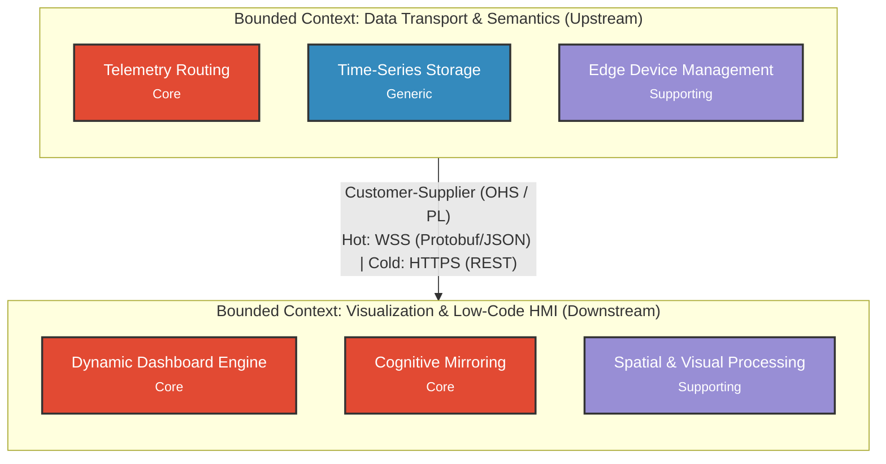

# The Meridian Grid (TMG)

The Meridian Grid is an open-architecture, decoupled Supervisory Control and Data Acquisition (SCADA) and Industrial Internet of Things (IIoT) telemetry platform. It transitions industrial operational technology (OT) from rigid, hierarchical point-to-point polling topologies toward an event-driven Unified Namespace (UNS) backed by modern web standards and reactive graphics runtimes.

---

## 1. System Scope & Engineering Objectives

Traditional SCADA deployments governed by the classical Purdue Model (ISA-95 Level 0–3) enforce point-to-point coupling between field Programmable Logic Controllers (PLCs) and monolithic desktop visualization runtimes. This introduces an $O(n^2)$ integration cost ("integration tax"), generates data silos, and strains plant-floor networks through continuous request-response polling.

The Meridian Grid addresses these structural limitations through:
- **Decoupled Edge Ingestion:** Translation of brownfield industrial protocols into event-driven, standardized industrial payloads at dedicated protocol-termination gateways.
- **Unified Namespace (UNS):** Establishment of an authoritative, event-driven Single Source of Truth (SSOT) structured under ISA-95 hierarchical topic paths (`Enterprise/Site/Area/Line/Cell`).
- **High-Performance Web HMI:** Browser-native operational supervision eliminating monolithic desktop runtime installations, utilizing dynamic vector/Canvas rendering engines governed by ISA-101 high-performance situational awareness standards.
- **Dual-Path Data Processing:** Bifurcated architecture routing live operational data through a low-latency Hot Path (event-driven telemetry streaming) while committing historical records to an append-only Cold Path (time-series relational persistence).

---

## 2. Normative Standards & Architectural Constraints

System design and implementation strictly adhere to the following industrial and software standards:

| Standard / Specification | Technical Role |
| :--- | :--- |
| **ISA-95 (IEC 62264)** | Physical and logical equipment hierarchy modeling and topic namespace taxonomy. |
| **Eclipse Sparkplug B v3.0** | Wire contracts, state management (`NBIRTH`, `NDEATH`, `DBIRTH`, `DDEATH`), and Google Protocol Buffers (Protobuf) serialization over MQTT. |
| **ANSI/ISA-101.01** | Human-Machine Interface visual ergonomics, display hierarchy, alarm management, and velocity-bounded rendering. |
| **ISA/IEC 62443** | Industrial automation cybersecurity, zones, conduits, and outbound-only reverse-access transport across the Industrial Demilitarized Zone (IDMZ). |
| **ISO/IEC 29110** | Software engineering lifecycle profile for Very Small Entities (VSEs), enforcing bidirectional traceability from requirements to test cases. |

---

## 3. Strategic Domain Architecture

The Meridian Grid is partitioned into two primary Bounded Contexts under Domain-Driven Design (DDD) principles:



### Core System Invariants
- **Data Ownership Preservation:** The unified exchange and presentation layers provide delivery and visualization services but never assume domain data ownership; emitting edge nodes remain the sole authoritative source of truth.
- **Client Fieldbus Isolation:** Browser clients are barred from directly addressing fieldbus registers; all telemetry access and command dispatch must traverse intermediate gateway boundaries to protect industrial controller integrity.
- **Cognitive Velocity Bounds:** Dynamic visual element presentation speeds are constrained to human ergonomic velocity thresholds to prevent operator cognitive fatigue, attentional saturation, and visual search errors under ISA-101.
- **Backpressure & Buffer Bounds:** Ingestion pipelines enforce strict queue caps and proactive client lifecycle handling to prevent host resource exhaustion and service disruption under slow-subscriber conditions.

> For formal mathematical definitions, empirical latency bounds, and literature citations, refer to the authoritative specification in [`docs/02-SI-Requirements/Domain-Context-Map.md`](docs/02-SI-Requirements/Domain-Context-Map.md).

---

## 4. Repository Structure

Artifacts are organized according to the ISO/IEC 29110 Basic Profile:

```text
.
|-- docs/
|   |-- 01-PM-Project-Management/     # Statements of work, Kanban logs, SLR search logs, governance protocols.
|   |-- 02-SI-Requirements/           # Ubiquitous language, Domain Context Map, audit records, vertical slices.
|   |-- 03-SI-Architecture/           # Architecture Decision Records (ADRs), Data Contracts, schemas.
|   |-- 04-SI-Construction/           # Environment setup, runtime configurations.
|   `-- 05-SI-Testing/                # Integration and end-to-end verification test cases.
|-- scripts/                          # Automated tooling for SLR enrichment, parsing, and frontmatter synchronization.
|-- src/                              # Application source code (TypeScript, React, Node.js).
`-- tests/                            # Automated test harnesses and verification suites.
```

---

## 5. Target Technology Stack (Subject to Phase 2 ADRs)

The following technologies represent the baseline architectural candidates for the platform. Final runtime dependencies, libraries, and database engines are subject to formal evaluation and commitment via Architecture Decision Records (ADRs) in `docs/03-SI-Architecture/ADRs/`.

- **Edge & Transport:** MQTT (v3.1.1 / v5.0), Eclipse Sparkplug B v3.0, Protocol Buffers (Google Protobuf).
- **Backend / Ingestion:** Node.js, TypeScript (Strict Mode, `noImplicitAny: true`), Express / Fastify, native WebSockets (`ws`).
- **Database / Storage:** PostgreSQL with TimescaleDB extension.
- **Frontend / HMI Runtime:** React, TypeScript, HTML5 Canvas API, SVG vector composition, Web Workers (`OffscreenCanvas`).
- **Automation & Tooling:** Python 3.11+ (Bibliographic extraction, data processing, and validation scripts only).

---

## 6. Project Lifecycle Status

- [x] **Phase 1: Problem Space & Domain Requirements (SI.2)**
  - Systematic Literature Reviews complete (`Q01`: Transport & Semantics, `Q02/Q03`: Visualization & HMI).
  - Ubiquitous Language baselined and grounded with zero hallucinations.
  - Strategic Domain Context Map specified.
- [ ] **Phase 2: Tactical Architecture & Contract Specification (SI.3)**
  - Formal Protobuf and JSON Schema Data Contracts.
  - Thin Vertical Slice definitions.
- [ ] **Phase 3: Incremental Construction & Verification (SI.4 - SI.5)**