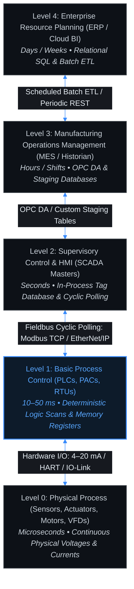

# Lesson 01: Traditional Automation Pyramid vs. Unified Namespace (UNS)

## 1. Physical Reality & Operational Foundations: The Classical Purdue Model (ISA-95 Level 0–4)

For over three decades, industrial manufacturing and process plants have been architected in accordance with the **[[../Glossary#Purdue Enterprise Reference Architecture (PERA / Purdue Model)|Purdue Enterprise Reference Architecture (PERA)]]**, originally formulated in the 1990s by Theodore Williams and later codified into international standards under **ANSI/ISA-95** (IEC 62264). This model conceptualizes the industrial enterprise as a rigid hierarchical pyramid structured into five distinct functional levels:

- **Level 0 (Physical Process):** The continuous physics of the plant. Comprises analog sensors (thermocouples, RTDs, 4–20 mA pressure transmitters), discrete actuators, solenoid valves, variable frequency drive (VFD) motors, and switchgear contacts operating on continuous physical timescales (microseconds).
- **Level 1 (Basic Control):** Dedicated real-time controllers executing [[../Glossary#Hard Real-Time vs. Soft Real-Time|deterministic cyclic logic loops]] (typically 10–50 ms [[../Glossary#PLC Hardware Scan Cycle|scan cycles]]). Comprises Programmable Logic Controllers (PLCs), Programmable Automation Controllers (PACs), Remote Terminal Units (RTUs), and safety instrumented systems (SIS).
- **Level 2 (Supervisory Control):** Operator interfaces and supervisory software monitoring and directing plant areas. Comprises Supervisory Control and Data Acquisition (SCADA) master stations, distributed control systems (DCS), and Human-Machine Interface (HMI) consoles operating on 1-second cyclic polling intervals.
- **Level 3 (Manufacturing Operations Management - MOM / MES):** Operations execution and site management. Encompasses Manufacturing Execution Systems (MES), batch execution systems, laboratory information management systems (LIMS), and site-wide process historians operating on shift, hourly, or daily batch horizons.
- **Level 4 (Enterprise Business Planning & Logistics):** High-level corporate resource planning and business logistics. Encompasses Enterprise Resource Planning (ERP), supply chain management (SCM), corporate data warehouses, and cloud business intelligence (BI) systems operating over days, weeks, and quarterly cycles.

### Industrial Field Hardware Reality

As illustrated in **Figure 01.1**, the operational interface between physical manufacturing equipment and modern industrial data architectures is embodied by physical controllers (Figure 01.1(a)) and dedicated edge communication hardware (Figure 01.1(b)):

<!-- PHOTO GUIDANCE: Field Equipment Search Suggestions
  Image 1 (Left): Level 1 Industrial PLC Rack Chassis
  - Target Path: ../photos/01-purdue-level1-plc-rack.png
  - Search Terms: "Rockwell ControlLogix 1756 rack chassis with Ethernet module", "Siemens S7-1500 PLC rack with digital and analog I/O modules", "Allen-Bradley ControlLogix 1756-L83E"
  - Key Visual Features: Industrial modular rack chassis with power supply, CPU controller module with LED run status lights, Ethernet communications card, and terminal wiring blocks.

  Image 2 (Right): Enterprise UNS Industrial Edge Appliance / Gateway
  - Target Path: ../photos/01-enterprise-uns-broker-appliance.png
  - Search Terms: "Advantech UNO DIN-rail industrial edge computer", "Moxa IIoT edge gateway DIN rail", "Siemens SIMATIC IPC227E DIN-rail gateway"
  - Key Visual Features: Rugged fanless aluminum DIN-rail chassis, dual Gigabit Ethernet ports, isolated serial RS-485 ports, 24V DC industrial power connector.
-->
![[01-purdue-level1-plc-rack.png]]
*(a) Level 1 Modular PLC Rack Chassis (ControlLogix / S7-1500)*

![[01-enterprise-uns-broker-appliance.png]]
*(b) Industrial DIN-Rail Edge Appliance for UNS Broker & Gateway*

*Figure 01.1: Physical Industrial Computing Hardware: (a) Level 1 Modular PLC Rack Chassis executing deterministic ladder logic scans; (b) Industrial DIN-Rail Edge Appliance hosting the Unified Namespace MQTT broker and protocol translation microservices.*

### The Classical Hierarchy & The Granularity Cliff

The PERA pyramid enforces strict, linear data paths where information must climb sequentially through every intervening operational tier. Each layer in the classical hierarchy acts as a specialized data filter, protocol translator, and security gatekeeper. While this isolation met the operational security needs of isolated 1990s factories, it creates a severe **Granularity Cliff**: microsecond physical events at Level 0 are downsampled to millisecond PLC registers, filtered into 1-second SCADA polls, aggregated into 15-minute MES production summaries, and eventually ingested as daily enterprise batch records in Level 4 ERP.

As diagrammed in **Figure 01.2**, this traditional pyramid architecture introduces structural data silos, severe polling latency, and high-maintenance protocol translations across every operational boundary:

![[01-purdue-hierarchy.svg]]

*Figure 01.2: ANSI/ISA-95 Traditional Automation Pyramid (Purdue Enterprise Reference Architecture) — Five Hierarchical Functional Tiers, Vertical Polling Conduits, Time Horizon Granularity Cliffs, and Systemic Protocol Bottlenecks.*

---

## 2. Mechanical Breakdown: Point-to-Point Coupling & The Quadratic Integration Tax

The defining structural characteristic of the traditional automation pyramid is **tight vertical coupling**: data cannot skip a layer. If a modern Level 4 enterprise cloud analytics engine requires real-time motor bearing vibration telemetry from a Level 0 sensor, the telemetry must be explicitly mapped through every layer:
1. **Sensor (L0)** transmits analog 4–20 mA current to an I/O card on the **PLC (L1)**.
2. The **PLC (L1)** scales the current into an engineering float and writes it to internal register `40001`.
3. The **SCADA Poller (L2)** polls register `40001` every 1,000 ms, maps it to tag `LINE1_MTR01_VIB`, and stores it in its proprietary local tag database (analyzed in [[02-Modbus-TCP-Mechanics|Lesson 02]]).
4. The **MES (L3)** queries the SCADA tag database across DCOM/OPC DA or an intermediate SQL staging table, mapping it to database column `EquipmentVibrationReading`.
5. The **Enterprise Cloud / ERP (L4)** runs a scheduled night-time ETL script that queries the MES database, transforms the record into JSON, and uploads it to a cloud data lake.

### Mathematical Derivation of the "Integration Tax"

When an enterprise introduces modern IIoT use cases (predictive maintenance AI, overall equipment effectiveness dashboards, energy management, vision quality inspection), every new consumer demands direct or indirect integration with underlying operational data sources.

In a point-to-point coupled architecture, connecting $N$ disparate systems (controllers, historians, SCADA packages, MES engines, ERP suites, third-party analytics) requires a number of dedicated communication bridges $C$ that scales **quadratically**:

$$C = \frac{N(N - 1)}{2} = \mathcal{O}(N^2)$$

For a mid-sized production plant with 25 disparate operational software systems and controller clusters:
$$C = \frac{25 \times (25 - 1)}{2} = \frac{25 \times 24}{2} = \mathbf{300\text{ custom protocol bridges}}$$

This combinatorial explosion is illustrated in **Figure 01.3**, contrasting the brittle mesh of 15 custom point-to-point bridges required for just 6 systems against the linear scalability of 6 standard broker connections in a Unified Namespace:

![[01-point-to-point-tax-vs-uns.svg]]

*Figure 01.3: The Integration Tax: (a) Quadratic integration complexity in traditional point-to-point architectures creating 15 fragile custom protocol bridges for 6 systems, versus (b) Linear O(N) scalability in an event-driven Unified Namespace with 6 standard broker adapters.*

### Concrete Systemic Failure Modes of the Pyramid

These structural constraints induce four systemic failure modes across traditional automation architectures:

First, schema drift causes cascade fragility throughout point-to-point networks. Because interfaces are tightly coupled to underlying schemas, if a control engineer reconfigures a PLC memory offset or alters a tag name, that modification triggers breaking changes across every upstream system—from SCADA and Historians to MES and ERP—that hardcoded the original memory mapping.

Second, cyclic polling induces latency accumulation and operational blindness. Because data propagation relies on a succession of independent polling loops, latency compounds at each tier:
$$T_{\text{total\_latency}} = T_{\text{scan}} + T_{\text{scada\_poll}} + T_{\text{mes\_poll}} + T_{\text{etl\_batch}}$$
Under this cascading delay, an alarm or thermal anomaly occurring on a motor bearing can take minutes or hours to reach operational supervisors and predictive maintenance engines.

Third, intermediate translation tiers strip critical context, producing an uncontextualized "tag soup". Raw field registers convey bare bytes without operational metadata. When passed upward through intermediate databases, engineering units, high/low alarm limits, calibration dates, asset serial numbers, and ISA-95 equipment hierarchy paths are lost.

Finally, vertical coupling introduces an unacceptable failure blast radius. When an intermediate tier (such as the primary SCADA server) experiences a hardware crash, network partition, or OS reboot, the entire vertical chain collapses, instantly blinding MES, ERP, and plant historians to all underlying field operations.

---

## 3. Paradigm Shift: The Unified Namespace (UNS) as an Event-Driven SSOT

The **[[../Glossary#Unified Namespace (UNS)|Unified Namespace (UNS)]]** completely collapses the vertical bottlenecks of the traditional automation pyramid into an event-driven, hub-and-spoke information architecture ([[Freitas_et_al_2025|Freitas et al., 2025]]; [[Senk_et_al_2026|Šenk et al., 2026]]).

> [!IMPORTANT]
> **Definition: What is a Unified Namespace?**
> A Unified Namespace is not a proprietary commercial software product. It is an **architectural pattern** that establishes a centralized, structured, and event-driven software abstraction layer. The UNS acts as the single authoritative **Single Source of Truth (SSOT)** for all operational technology (OT) telemetry, operational context, and business system state across the entire enterprise.

### Decoupling and Complexity Reduction to Linear $\mathcal{O}(N)$

In a Unified Namespace architecture, the fundamental communication pattern shifts from synchronous point-to-point request-response polling to an **asynchronous Publish/Subscribe (Pub/Sub)** model:
- **Producers (Publishers):** [[../Glossary#Edge-of-Network Node (EoN Node)|Edge-of-Network (EoN) gateways]], smart sensors, and controllers publish data state changes exclusively to the central message broker under a standardized topic hierarchy. Publishers have **zero knowledge** of what systems consume their data.
- **Consumers (Subscribers):** SCADA user interfaces, machine learning analytics engines, historians, and enterprise ERP applications subscribe to the specific topic namespaces they require. Consumers have **zero knowledge** of the physical hardware make or model that generated the data.

Because systems interact exclusively through the central namespace rather than directly with each other, the integration complexity drops from quadratic to strictly **linear**:

$$C = \mathcal{O}(N)$$

For the same facility with 25 software systems and controller clusters:
$$C = 25\text{ standard broker adapters}$$
Adopting a Unified Namespace eliminates **275 redundant, custom protocol bridges**, reducing initial engineering capital expenditure and ongoing maintenance overhead by over $90\%$.

### Report-by-Exception (RBE) vs. Cyclic Polling

Traditional SCADA and Purdue models operate on **cyclic polling**: a master queries every register on every slave at fixed intervals (e.g., every 500 ms), transmitting frames even if the physical measurement has not altered by a single microvolt.

In contrast, the Unified Namespace utilizes **[[../Glossary#Report-by-Exception (RBE)|Report-by-Exception (RBE)]]** protocol mechanics (standardized via MQTT and Sparkplug B):
- Field nodes transmit telemetry packets **strictly when a state transition occurs or when an analog value crosses a predefined deadband threshold** ($|\Delta V| \ge \epsilon$).
- If a machine is operating in a steady thermal state, zero telemetry frames traverse the network.
- As demonstrated by [[Senk_et_al_2026|Šenk et al. (2026)]], RBE reduces continuous network bandwidth consumption across industrial networks by **$80\%$ to $95\%$**, freeing communication conduits for high-fidelity event streams, burst analytics, and enterprise scale.

---

## 4. Architectural Implementation: Purdue Hierarchy vs. UNS Information Mesh

A frequent misconception in industrial systems engineering is that adopting a Unified Namespace requires abandoning the standard ISA-95 model. In reality, the UNS **decouples ISA-95 logical data modeling from physical Purdue network constraints** ([[Freitas_et_al_2025|Freitas et al., 2025]]).

### Mapping the ISA-95 Equipment Hierarchy to the Topic Namespace

The UNS retains the robust semantic taxonomy defined in **ANSI/ISA-95 Part 1 (Clause 5.3)**, but implements it directly as a unified MQTT topic hierarchy:

$$\text{Enterprise} \,/\, \text{Site} \,/\, \text{Area} \,/\, \text{Line} \,/\, \text{Cell} \,/\, \text{Device} \,/\, \text{Metric}$$

As depicted in the architectural diagram below, structuring telemetry within this equipment namespace allows producers to publish once while disparate subscribers independently consume metrics filtered to their exact operational scope:

```mermaid
%%{init: {
  'theme': 'base',
  'themeVariables': {
    'darkMode': true,
    'primaryColor': '#1E222B',
    'primaryTextColor': '#E6EDF3',
    'primaryBorderColor': '#388BFD',
    'lineColor': '#388BFD',
    'secondaryColor': '#16191F',
    'tertiaryColor': '#0D1117',
    'edgeLabelBackground': '#16191F'
  },
  'themeCSS': '.edgeLabel { color: #E6EDF3 !important; } .edgeLabel rect { fill: #16191F !important; } .label { color: #E6EDF3 !important; } .cluster-label span { color: #E6EDF3 !important; }'
}}%%
flowchart TD
    subgraph TopicTaxonomy ["ISA-95 Hierarchical MQTT Topic Namespace"]
        UNS["Enterprise / Houston / PlasticsArea / ExtrusionLine2 / Extruder01"]
    end

    subgraph Metrics ["Published Metrics & Contextual State (Payload)"]
        M1["BarrelTemperature: 215.4 °C"]
        M2["ScrewSpeedRPM: 1450.0 RPM"]
        M3["MotorCurrent: 42.8 A"]
        M4["RunState: RUNNING (1)"]
    end

    UNS --- M1
    UNS --- M2
    UNS --- M3
    UNS --- M4

    subgraph Subscribers ["Decoupled Enterprise Subscribers"]
        SCADA["Web SCADA HMI<br/><em>Sub: Enterprise/Houston/+/+/Extruder01/#</em>"]
        HIST["Time-Series Historian<br/><em>Sub: Enterprise/# (Auto-Ingest)</em>"]
        AI["Predictive Maintenance AI<br/><em>Sub: Enterprise/+/+/+/+/MotorCurrent</em>"]
        ERP["Cloud ERP / MES<br/><em>Sub: Enterprise/Houston/PlasticsArea/+/+/RunState</em>"]
    end

    UNS ==>|WSS :443| SCADA
    UNS ==>|MQTTS :8883| HIST
    UNS ==>|MQTTS :8883| AI
    UNS ==>|REST / Webhook| ERP

    classDef default fill:#161b22,stroke:#30363d,color:#e6edf3;
    classDef highlight fill:#0d1b2a,stroke:#388bfd,color:#58a6ff;
    classDef success fill:#162b1d,stroke:#2ea043,color:#3fb950;
    class UNS highlight;
    class SCADA,HIST,AI,ERP success;
```

When telemetry is published under this taxonomy (formalized under the ISA-95 equipment hierarchy in [[08-ISA-95-Object-Models-Taxonomy|Lesson 08]]), any authorized consumer across the enterprise can subscribe to the precise slice of data it requires using MQTT wildcards (`+` single-level, `#` multi-level; see [[03-MQTT-Protocol-Internals|Lesson 03]] and [[06-Sparkplug-B-Specification|Lesson 06]]):
- The **Plant Historian** subscribes to `Enterprise/#` to automatically ingest and store every plant metric without requiring manual tag configuration.
- The **Predictive Maintenance Engine** subscribes to `Enterprise/+/+/+/+/MotorCurrent` to monitor all motor loads across the entire facility simultaneously.
- The **Corporate ERP** subscribes to `Enterprise/+/+/+/+/RunState` to compute real-time Overall Equipment Effectiveness (OEE) across global sites.

### Brownfield Retrofit: The Edge-of-Network (EoN) Gateway Pattern

Modern industrial facilities cannot afford to rip out and replace billions of dollars of operational PLCs and DCS installations to deploy a UNS. Instead, brownfield integration is achieved using the **Edge-of-Network (EoN) Gateway** design pattern ([[Koprov_et_al_2022|Koprov et al., 2022]]; analyzed in depth in [[05-EoN-Nodes-Brownfield-Gateways|Lesson 05]]):

1. **Local Brownfield Polling:** An industrial DIN-rail edge computer (e.g., Moxa, Advantech, Siemens SIMATIC IPC) is deployed adjacent to the field controllers. It speaks legacy, unencrypted industrial protocols (Modbus RTU/TCP, Rockwell CIP, Siemens S7comm) locally over isolated, short-run fieldbuses or private OT subnets.
2. **Contextualization at the Edge:** The EoN Gateway maps raw memory bits and integer register addresses into rich ISA-95 hierarchical data objects, appending standardized engineering units, timestamp offsets, and quality codes.
3. **Outbound Publish-Only Telemetry:** The gateway establishes a secure outbound connection (MQTTS on Port 8883 or WSS on Port 443) through the plant firewall to the UNS broker. Crucially, the gateway opens **zero inbound listening ports** on the OT network, preserving complete physical perimeter isolation.

---

## 5. Comparative Evaluation: Purdue Monoliths vs. Enterprise Unified Namespace

| Architectural Dimension | Traditional Automation Pyramid (ISA-95 / PERA) | Enterprise Unified Namespace (UNS) |
| :--- | :--- | :--- |
| **Communication Topology** | Rigid vertical point-to-point hierarchy; linear request-response chains ($L0 \leftrightarrow L1 \leftrightarrow L2 \leftrightarrow L3 \leftrightarrow L4$) | Event-driven hub-and-spoke publish-subscribe information mesh centered on high-availability message brokers |
| **Data Propagation Model** | Synchronous cyclic polling; masters poll every slave at fixed intervals regardless of data state | Report-by-Exception (RBE); edge nodes transmit strictly upon value change or threshold deadband breach |
| **Data Contextualization** | "Tag Soup": flat register numbers (e.g., `40001`, `DB1.DBD4`) stripped of semantic metadata during transit | Self-describing semantic taxonomy (`Enterprise/Site/Area/Line/Cell/Metric`) with rich contextual metadata |
| **Integration Complexity** | Quadratic: $C = \frac{N(N-1)}{2} = \mathcal{O}(N^2)$ custom protocol bridges for $N$ systems | Linear: $C = \mathcal{O}(N)$ standard broker adapters for $N$ systems |
| **Failure Blast Radius** | High: Failure of an intermediate node (e.g., SCADA crash) blinds all higher-level systems (MES, ERP) | Low: Systems are fully decoupled; broker high availability (HA) clustering and edge store-and-forward prevent data loss |
| **Brownfield Retrofit Cost** | High: Demands re-engineering PLC logic routines, adding communication cards, and remapping SCADA tag tables | Low: Edge-of-Network (EoN) gateways poll existing PLCs locally without modifying running controller logic ([[Koprov_et_al_2022|Koprov et al., 2022]]) |
| **Latency Profile** | High & Cumulative: Seconds to hours as data traverses sequential polling and batch ETL queues | Ultra-Low & Real-Time: Millisecond-range end-to-end telemetry propagation directly from edge to subscribers |
| **Cybersecurity Surface** | False "Air-Gap" reliance; unsegmented direct IP routing across zones exposes field PLCs to lateral malware traversal | Zero-Trust architecture: Outbound-only TLS connections, mutual certificate authentication (mTLS), and IDMZ proxy isolation ([[Villamar_et_al_2025|Villamar et al., 2025]]) |

### Cybersecurity Governance: Purdue Air-Gap Myth vs. UNS Zero-Trust

Traditional Purdue architectures rely on the assumption of a physical "air-gap" or static firewall perimeters. In real-world industrial environments, this perimeter security model routinely fails: maintenance laptops, vendor VPNs, and infected USB thumb drives introduce lateral malware threats directly into Level 1/2 control networks. Once inside, flat industrial protocols (Modbus, EtherNet/IP) lack authentication, allowing attackers to compromise controllers without detection.

Modern Unified Namespace architectures enforce **Zero-Trust Cybersecurity** principles aligned with **IEC 62443-3-3** ([[Villamar_et_al_2025|Villamar et al., 2025]]; detailed in [[10-OT-Cybersecurity-IEC-62443|Lesson 10]]):
1. **Outbound-Only Firewall Rules:** Edge gateways in Level 1/2 initiate strictly outbound TLS connections (Port 8883) to the broker residing within the Industrial DMZ (IDMZ / Level 3.5). The OT firewall blocks 100% of inbound connection attempts.
2. **Mutual Cryptographic Authentication (mTLS):** Every edge node, SCADA client, and enterprise subscriber authenticates using unique X.509 cryptographic certificates and token-based access control lists (ACLs).
3. **Granular Topic Authorization:** Access control policies restrict field gateways to publishing only under their assigned ISA-95 topic subtree (e.g., `Enterprise/SiteA/Area1/#`), physically preventing a compromised edge device from forging commands or eavesdropping on adjacent production lines.

---

## 6. Active-Recall Assessments

> [!FAQ]- Why does the classical Purdue Model inevitably generate an O(N²) integration cost in modern IIoT environments, and what operational failure modes result from this coupling?
> The Purdue model relies on a strictly layered, point-to-point architecture where systems communicate through dedicated vertical request-response bridges. When an enterprise introduces $N$ disparate operational and business software systems that must share state, each pair of systems requires a dedicated protocol translation and communication bridge. The total required interfaces scale as $C = N(N-1)/2 = \mathcal{O}(N^2)$. For 25 systems, this requires 300 custom interfaces. This quadratic coupling results in severe schema drift (modifying a single PLC register offset breaks multiple upstream applications), excessive cyclic polling that saturates edge networks, and cascading blind spots if an intermediate node crashes.

> [!FAQ]- What is Report-by-Exception (RBE) data propagation, and how does it prevent industrial network saturation compared to cyclic polling?
> Under traditional cyclic polling, a supervisory master queries every slave register at fixed intervals (e.g., every 250–500 ms), transmitting frames across the physical wire regardless of whether the process variable has changed. Report-by-Exception (RBE), utilized in the Unified Namespace via MQTT and Sparkplug B, dictates that edge nodes publish telemetry frames *strictly when an analog value breaches a configured deadband threshold or when a discrete state changes* ([[Senk_et_al_2026|Šenk et al., 2026]]). When process conditions are quiescent, zero data packets traverse the network, reducing continuous bandwidth consumption by 80% to 95%.

> [!FAQ]- How does the Unified Namespace maintain the semantic value of the ANSI/ISA-95 model without inheriting its physical networking bottlenecks?
> The UNS decouples the *logical equipment hierarchy* of ISA-95 from the *physical networking constraints* of the Purdue Enterprise Reference Architecture ([[Freitas_et_al_2025|Freitas et al., 2025]]). The UNS retains the Part 1 Clause 5.3 equipment hierarchy (`Enterprise/Site/Area/Line/Cell`) directly as the semantic topic taxonomy within an enterprise message broker. This ensures that every published metric is accompanied by unambiguous operational context, while eliminating the physical requirement for data to traverse intermediate computational tiers (SCADA, MES) to reach enterprise consumers.

> [!FAQ]- How does the Edge-of-Network (EoN) Gateway pattern enable brownfield facility integration without modifying operational PLC logic routines?
> In brownfield facilities, rewriting validated PLC ladder logic routines or altering hardware configurations is cost-prohibitive and introduces operational risk. An Edge-of-Network (EoN) Gateway resolves this by deploying an industrial edge appliance locally on the plant floor ([[Koprov_et_al_2022|Koprov et al., 2022]]). The gateway connects locally to existing fieldbuses, polling legacy controllers via native protocols (Modbus, Profibus, EtherNet/IP) without altering existing logic. The gateway contextualizes raw register values into ISA-95 data objects at the edge and publishes them outbound to the UNS over secure MQTT/Sparkplug B connections, opening zero inbound network ports.

> [!FAQ]- Why is the traditional Purdue Model perimeter "air-gap" considered an architectural vulnerability, and how does a UNS enforce Zero-Trust security?
> The classical Purdue Model assumes that internal control networks are inherently safe behind perimeter boundary firewalls. In practice, lateral malware propagation through maintenance laptops, contractor USB drives, and dual-homed engineering workstations routinely bypasses firewalls; once inside, legacy industrial protocols offer zero authentication or encryption. The UNS architecture enforces Zero-Trust security aligned with IEC 62443: all field gateways initiate outbound-only TLS connections through the Industrial DMZ (IDMZ), zero inbound listening ports are opened on the OT subnet, and all communication is validated via mutual certificate authentication (mTLS) with granular topic-level access control lists ([[Villamar_et_al_2025|Villamar et al., 2025]]).
