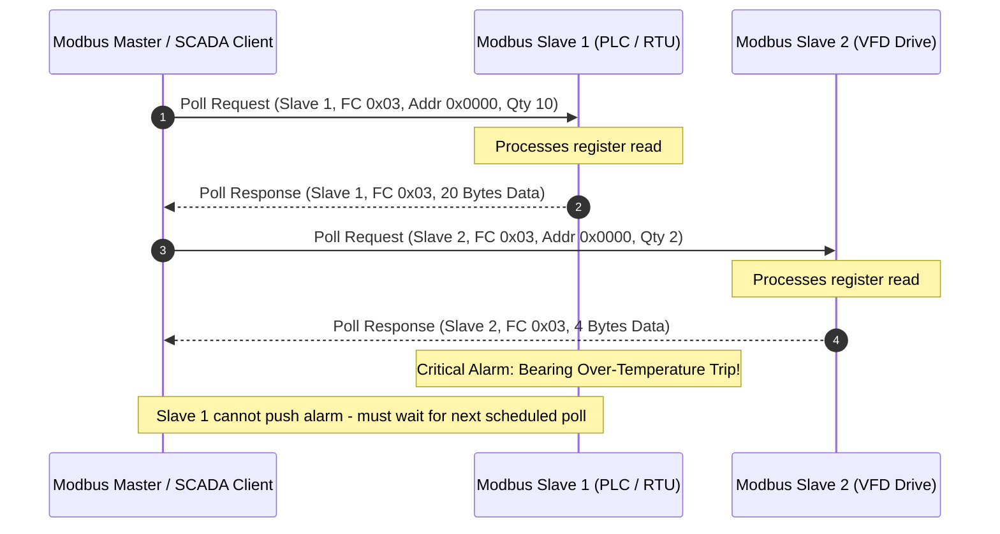
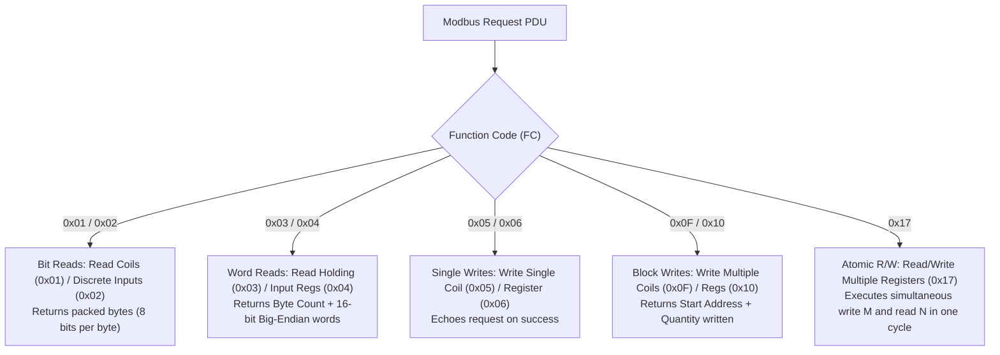
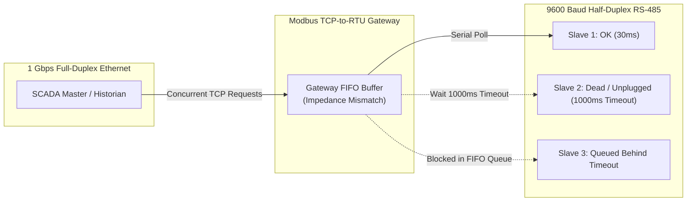
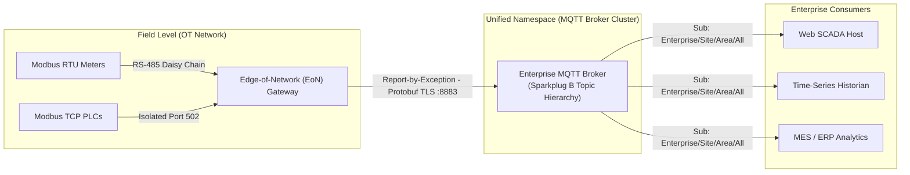

# Lesson 02: Modbus TCP Mechanics & Wire Protocol

## 1. Operational Reality: Field Bus Origins, RS-485 Physical Layer & Polling Latency

Originally developed in 1979 by Modicon (now Schneider Electric) for industrial Programmable Logic Controllers (PLCs), Modbus remains one of the most resilient and widely deployed communication protocols in industrial automation, SCADA systems, and critical infrastructure. Despite its ubiquity, Modbus reflects the architectural constraints of early microprocessors: synchronous, memory-constrained, and fundamentally half-duplex. This polling architecture represents the physical origin of the rigid point-to-point coupling and quadratic integration tax analyzed in [[01-Purdue-vs-UNS|Lesson 01 (Section 2)]].

### The Master/Slave (Client/Server) Polling Paradigm

Modbus operates on a strict, synchronous **Master/Slave** (in modern terminology, Client/Server) architecture:
- **One Master (Client):** Only the Master node can initiate transactions. It transmits request packets to specific slaves and waits synchronously for responses.
- **Multiple Slaves (Servers):** Slave devices cannot initiate communication spontaneously. A field slave can never alert the master of an alarm, an emergency stop, or a critical process trip on its own; it speaks only when explicitly addressed.
- **Polling Latency & The Silent Slave Dilemma:** Because field slaves cannot push updates, telemetry freshness is fundamentally bounded by the Master's polling cycle time $T_{\text{poll}}$:
  $$T_{\text{poll}} = \sum_{i=1}^{M} \left( T_{\text{tx}, i} + T_{\text{proc}, i} + T_{\text{rx}, i} + T_{\text{turnaround}} \right)$$
  Where $M$ is the number of connected slave devices, $T_{\text{tx}}$ is the request transmission time, $T_{\text{proc}}$ is the internal slave execution latency, $T_{\text{rx}}$ is the response transmission time, and $T_{\text{turnaround}}$ is the physical bus idle turnaround delay. If an emergency trip switch trips immediately after being polled, the SCADA supervisory system remains completely blind to the event until the Master traverses every intervening node and issues the next poll cycle.

The timing dynamics and silent slave vulnerability of this polling loop are illustrated in the sequence diagram below:



### Industrial Field Equipment Reality

In plant environments, Modbus communication bridges two eras of physical hardware, as shown in **Figure 02.1**: legacy RS-485 serial field instruments such as panel power meters (**Figure 02.1(a)**) and modern DIN-rail Industrial Ethernet gateways (**Figure 02.1(b)**) that convert TCP sockets to half-duplex serial drops.

<!-- PHOTO GUIDANCE: Field Equipment Search Suggestions
  Image 1 (Left): RS-485 Modbus RTU Digital Power Meter / Multi-Function Meter
  - Target Path: ../photos/02-modbus-rtu-power-meter.png
  - Search Terms: "Schneider Electric PowerLogic PM5000 rear terminals RS-485", "Schneider PM8000 power meter RS485 terminal block", "Accuenergy Acu-Rev 1310 DIN rail meter RS-485"
  - Key Visual Features: Rear view displaying 3-pin pluggable screw terminal block labeled '(+) / (-) / Shield' or 'A / B / COM', DIN-rail or panel mount casing.

  Image 2 (Right): Industrial Modbus TCP-to-RTU Gateway
  - Target Path: ../photos/02-modbus-tcp-gateway.png
  - Search Terms: "Moxa MGate MB3180 industrial gateway", "Moxa MB3280 2-port serial gateway", "Advantech ADAM-4572 Modbus gateway"
  - Key Visual Features: Rugged industrial metal DIN-rail chassis with RJ45 10/100M Ethernet port on top/bottom and DB9 / screw terminal RS-485 serial ports.
-->
![[02-modbus-rtu-power-meter.png]]
*(a) Modbus RTU Digital Power Meter with RS-485 Screw Terminals*

![[02-modbus-tcp-gateway.png]]
*(b) Industrial Modbus TCP-to-RTU DIN-Rail Gateway (Moxa MGate)*

*Figure 02.1: Industrial Field Hardware: (a) Panel-mounted Modbus RTU Digital Power Meter showing shielded RS-485 serial connections, and (b) Industrial Modbus TCP-to-RTU DIN-Rail Gateway bridging Ethernet networks to half-duplex serial drops.*

### Physical Layer Heritage: Serial RS-485 & Differential Signaling

Prior to Industrial Ethernet, Modbus ran over serial links, predominantly **TIA/EIA-485-A (RS-485)**:
- **Electrical Signaling:** RS-485 utilizes balanced differential signaling across two twisted copper conductors designated Line $A$ ($D+$ / Non-Inverting) and Line $B$ ($D-$ / Inverting). By measuring the differential voltage across the conductor pair rather than referencing a single wire to absolute ground, RS-485 achieves robust common-mode noise rejection across noisy industrial plants up to $1{,}200\text{ meters}$ ($4{,}000\text{ ft}$).
- **Common-Mode Noise Cancellation:** In heavy industrial environments, electromagnetic interference (EMI) from variable frequency drives (VFDs), large induction motors, and arc-welding rigs couples equally into both twisted conductors. Because the receiver amplifies strictly the difference between lines, identical noise voltages $V_{\text{noise}}$ cancel out:
  $$V_{\text{received}} = (V_A + V_{\text{noise}}) - (V_B + V_{\text{noise}}) = V_A - V_B$$
- **Voltage Thresholds:**
  - **Logic 1 (Mark / Idle / Off):** $V_A - V_B > +200\text{ mV}$ (Line $A$ is more positive than Line $B$).
  - **Logic 0 (Space / Active / On):** $V_A - V_B < -200\text{ mV}$ (Line $A$ is more negative than Line $B$).
  - **Common-Mode Range:** The EIA-485 standard mandates operation across an extended common-mode range of $-7\text{ V}$ to $+12\text{ V}$ to tolerate ground potential offsets between remote substations.
- **Half-Duplex Multi-Drop Bus Topology:** Up to 32 standard unit loads (UL) can share a single twisted pair without signal degradation. All devices must be wired in a strict **daisy-chain trunk-and-stub** topology. Star, ring, and tree topologies are strictly prohibited because unterminated stub branches create impedance discontinuities that generate severe signal reflections.
- **Characteristic Impedance & End-of-Line (EOL) Termination:** Industrial RS-485 twisted-pair cables exhibit a characteristic impedance of $Z_0 \approx 120\,\Omega$. When digital voltage transitions strike an open cable end, the energy reflects back along the line, corrupting bit waveforms. To absorb this wave energy, exactly two $120\,\Omega$ ($0.25\text{ W}$) termination resistors must be placed across conductors $A$ and $B$ at the extreme physical ends of the trunk cable ($R_T = Z_0$).
- **Single-Point Shield Grounding:** The cable shield drain wire must be bonded to Protective Earth (PE) at **one point only** (typically the Master PLC or control cabinet). Grounding the shield at both ends creates low-impedance ground loops driven by inter-building earth potential differentials $\Delta V_{\text{GND}}$, causing high circulating noise currents ($I_{\text{loop}} = \Delta V_{\text{GND}} / R_{\text{shield}}$) that induce noise into the data pair.

The complete electrical wiring configuration, terminating resistor placement, and ground loop prevention strategy are detailed in **Figure 02.2**:

![[02-rs485-wiring-topology.svg]]

*Figure 02.2: RS-485 2-Wire Multi-Drop Daisy-Chain Bus Topology: Proper trunk wiring, 120 Ω End-of-Line (EOL) termination resistors at physical extremities, and single-point shield earthing at the Master.*

### Timing & Silent Interval Delimitation ($t_{3.5}$ and $t_{1.5}$)

Modbus RTU encodes data in compact, raw binary bytes (1 start bit, 8 data bits, optional parity, 1 or 2 stop bits — totaling 11 bits per character frame). Because the RTU frame possesses no explicit start-of-frame or end-of-frame delimiter characters (such as ASCII `STX`/`ETX` or SLIP `0xC0`), receivers delimit frames using physical silence on the serial wire:
- **Frame Boundary Silent Interval ($t_{3.5}$):** A transmission frame must be preceded and followed by a silent interval of at least **$3.5$ character times**:
  $$t_{\text{char}} = \frac{11\text{ bits}}{\text{Baud Rate}}$$
  $$t_{3.5} = 3.5 \times t_{\text{char}} = 3.5 \times \frac{11}{\text{Baud Rate}}$$
  At $9600\text{ baud}$, $t_{\text{char}} \approx 1.146\text{ ms}$, yielding $t_{3.5} \approx 4.01\text{ ms}$. If a line goes silent for $\ge 3.5$ character times, the slave's UART considers the preceding message complete and resets its frame parser.
- **Inter-Character Timeout ($t_{1.5}$):** During frame transmission, individual characters must arrive contiguously. If a pause greater than **$1.5$ character times** occurs between bytes (approx $1.72\text{ ms}$ at $9600\text{ baud}$), the receiving device assumes the transmission is defective and discards the partial frame.
- **High-Speed Baud Rates:** For baud rates exceeding $19{,}200\text{ baud}$, the Modbus standard specifies fixed timeouts: $t_{1.5} = 750\,\mu\text{s}$ and $t_{3.5} = 1.750\text{ ms}$, due to microprocessor timer resolution limits.

### Industrial Cable Anatomy & Field Connector Interfaces

Reliable field bus communication requires engineered transmission line media rather than generic building wiring:

1. **Cable Construction (e.g., Belden 9841 / 3105A Standard):**
   - **Twisted Pair Conductors:** 24 AWG ($7 \times 32$) stranded tinned copper conductors twisted together. Twisting ensures external magnetic fields induce identical polarity noise into both wires, which the differential receiver subsequently subtracts.
   - **Ultra-Low Capacitance:** Conductor-to-conductor capacitance is engineered to $\approx 12.8\text{ pF/ft}$ ($42\text{ pF/m}$), preventing high-frequency edge rounding and signal dispersion over runs up to $1{,}200\text{ m}$.
   - **Dual-Layer Composite Shielding:** 100% Beldfoil® aluminum/polyester tape provides total electrostatic and radio frequency (RFI) shielding, while an outer 90% tinned copper braid provides high mechanical durability and low-frequency electromagnetic (EMI) shielding.
   - **Drain Wire:** A continuous 24 AWG stranded tinned copper drain wire maintains unbroken electrical contact with the aluminum foil along the entire cable run, simplifying earth termination.
2. **Common Field Connector Standards:**
   - **3-Pin Pluggable Screw Terminals (Phoenix Contact COMBICON 3.81/5.08 mm):** Found on $>90\%$ of industrial PLCs, digital power meters, and variable frequency drives. Stranded wires must be terminated with insulated bootlace ferrules; bare wire strands can splay and create intermittent line shorts.
   - **DB9 (D-Sub 9) Connectors:** Universal on Profibus DP and legacy European serial controllers. Pin 3 carries Line $B$ ($D+$), Pin 8 carries Line $A$ ($D-$), and Pin 5 provides Data Ground Reference (DGND). Industrial DB9 hoods incorporate internal slide switches to engage onboard $120\,\Omega$ termination resistors.
   - **M12 Circular Connectors (B-Coded IP67):** Deployed in washdown food/beverage plants, CNC machinery, and outdoor marine enclosures. The reverse mechanical keyway (B-coding) prevents accidental insertion into A-coded 24V DC sensor ports or D-coded Industrial Ethernet sockets.

These physical cable layers, shielding mechanics, and standard field connector pinouts are illustrated in **Figure 02.3**:

![[02-rs485-cable-connector-anatomy.svg]]

*Figure 02.3: RS-485 Physical Layer: Industrial Step-Stripped Shielded Twisted Pair Cable Anatomy (Belden 9841 Standard) and Common Field Connector Interfaces (Phoenix Pluggable, DB9 Profibus, and M12 B-Coded).*

---

## 2. Mechanical Anatomy: The Modbus Data Model, 4 Tables & PDU Addressing

The Modbus protocol decouples the physical communication link from its internal memory organization. All device telemetry and control points are organized into four distinct memory tables, categorized strictly by bit-width (single-bit boolean vs. 16-bit word) and access permissions (read-only vs. read/write):

| Table Name | Object Type | Access Type | Traditional Logical Address | Binary Wire Address Offset | Typical Industrial Use Case |
| :--- | :--- | :--- | :--- | :--- | :--- |
| **Discrete Inputs** | Single bit (0 or 1) | Read-Only | `10001` – `19999` (or `100001`+) | `0x0000` – `0xFFFF` | Optical proximity sensors, limit switches, breaker aux contacts |
| **Coils** | Single bit (0 or 1) | Read / Write | `00001` – `09999` (or `000001`+) | `0x0000` – `0xFFFF` | Solenoid valves, motor contactor coils, beacon lights |
| **Input Registers** | 16-bit word | Read-Only | `30001` – `39999` (or `300001`+) | `0x0000` – `0xFFFF` | Analog measurements: 4–20 mA ADC counts, thermocouple temperatures |
| **Holding Registers** | 16-bit word | Read / Write | `40001` – `49999` (or `400001`+) | `0x0000` – `0xFFFF` | PID setpoints, VFD frequency commands, tuning coefficients |

### The 0-Based Binary Addressing Trap & Modicon Notation

A perennial source of critical integration defects in industrial control systems is the confusion between the **Traditional Logical Address** documented in equipment user manuals and the **Binary Wire Address Offset** actually transmitted across the physical network.

1. **Traditional Logical Address (Modicon 5-Digit & 6-Digit Notation):**
   - **Leading Memory Prefix (`0`, `1`, `3`, `4`):** Established in 1979 by Modicon as human-readable shorthand to identify the target memory table:
     - `0xxxx` = Discrete Coils (read/write bits)
     - `1xxxx` = Discrete Inputs (read-only bits)
     - `3xxxx` = Input Registers (read-only 16-bit words)
     - `4xxxx` = Holding Registers (read/write 16-bit words)
   - **1-Based Indexing:** The remaining digits specify a 1-based index within that table. For example, `40001` represents the 1st holding register; `40020` represents the 20th.
   - **6-Digit Notation Extension:** As PLC memory expanded beyond 9,999 registers, vendors adopted 6-digit notation (`400001` through `465536`), where the leading `4` designates holding registers and the trailing five digits span the full 16-bit memory range ($1$ to $65{,}536$).
2. **Binary Wire Address Offset (0-Based PDU Field):**
   - **Prefix Stripping:** The leading table prefix (`0`, `1`, `3`, `4`) is **never transmitted on the physical wire**. Instead, the target table is implicitly selected by the **Function Code** in the PDU (e.g., Function Code `0x03` inherently routes to Holding Registers; Function Code `0x04` routes to Input Registers).
   - **0-Based Mathematical Offset:** Because the target table is determined by the Function Code, the address field in the PDU transmits a raw, 0-indexed unsigned 16-bit integer ranging from `0x0000` ($0$) to `0xFFFF` ($65{,}535$).
   - **Conversion Formula:**
     $$\text{Binary Wire Offset} = (\text{Logical Address} - \text{Table Base Offset}) - 1$$
     - Logical Holding Register `40001` $\longrightarrow (40001 - 40000) - 1 = \mathbf{0x0000}\text{ (Wire Offset 0)}$
     - Logical Holding Register `40010` $\longrightarrow (40010 - 40000) - 1 = \mathbf{0x0009}\text{ (Wire Offset 9)}$
     - Logical Input Register `30025` $\longrightarrow (30025 - 30000) - 1 = \mathbf{0x0018}\text{ (Wire Offset 24)}$
     - Logical Discrete Coil `00001` $\longrightarrow (00001 - 0) - 1 = \mathbf{0x0000}\text{ (Wire Offset 0)}$

> [!WARNING]
> **The Off-by-One Field Catastrophe:**
> If an integrator configures an industrial driver with wire address `1` while intending to read or write logical register `40001`, the PLC accesses register `40002`. In industrial process plants, this indexing defect has resulted in setpoint commands intended for a cooling water valve being written into adjacent safety shutdown threshold registers, triggering immediate turbine trips or equipment damage.

### Data Representation, Big-Endian Order & The Float32 Dilemma

The Modbus application protocol standard defines a strict **[[../Glossary#Endianness (Endian Inversion)|Big-Endian]]** (network byte order / Motorola format) transmission sequence for all 16-bit registers:
- When transmitting a 16-bit word such as `0x1234`, the **Most Significant Byte (MSB)** (`0x12`) is transmitted first, followed by the **Least Significant Byte (LSB)** (`0x34`).

However, the 1979 Modbus specification predates modern [[../Glossary#IEEE 754 Single-Precision Floating-Point|IEEE 754 floating-point standards]] and defines **no native format for data types larger than 16 bits**. To transmit a 32-bit floating-point variable (such as electrical power `123456.78` or vessel pressure) or a 64-bit integer, modern industrial devices pack the data across two or four contiguous 16-bit registers. Because the specification lacks a standardized multi-register packing order, manufacturers implement different word and byte permutations:

| Format Name | Word Order | Byte Order | Byte Sequence for 32-bit Hex `0x12345678` | Common PLC Vendors |
| :--- | :--- | :--- | :--- | :--- |
| **Big-Endian (ABCD)** | High Word First | High Byte First | `0x12` `0x34` `0x56` `0x78` | Schneider Electric, ABB, standard Modicon |
| **Word-Swapped (CDAB)** | Low Word First | High Byte First | `0x56` `0x78` `0x12` `0x34` | Rockwell Automation / Allen-Bradley, GE Fanuc |
| **Byte-Swapped (BADC)** | High Word First | Low Byte First | `0x34` `0x12` `0x78` `0x56` | Legacy RTUs, specialized flow computers |
| **Little-Endian (DCBA)** | Low Word First | Low Byte First | `0x78` `0x56` `0x34` `0x12` | Intel x86 embedded controllers |

Industrial SCADA drivers and Edge-of-Network gateways must support explicit byte/word swap configuration per field device to prevent telemetry parsing corruption.

---

## 3. Protocol Evolution: Serial Modbus RTU vs. Modbus TCP & MBAP Header Framing

In 1999, the Modbus Organization standardized **Modbus TCP** (registered under IANA Well-Known Port **502**). Rather than redesigning the industrial data model, the core Protocol Data Unit (PDU) was preserved intact and encapsulated within standard TCP/IP transport frames, as compared in **Figure 02.4**:

![[02-modbus-rtu-vs-tcp.svg]]

*Figure 02.4: Modbus Architectural Evolution: Structural comparison between the Serial Modbus RTU Frame (bounded by 3.5 character silence intervals and CRC-16) and the Modbus TCP Application Data Unit (ADU, framed by the 7-byte MBAP header over TCP port 502).*

### Architectural Differences Between RTU and TCP Framing

1. **Elimination of the CRC-16 Checksum:**
   - In serial Modbus RTU, noisy RS-485 factory cabling required an application-layer 2-byte **CRC-16** polynomial ($X^{16} + X^{15} + X^2 + 1$) appended to every packet to catch transmission bit flips.
   - In Modbus TCP, the frame is encapsulated within standard Ethernet (Layer 2) and TCP/IP (Layer 3/4) packets. Layer 2 Ethernet frames already execute hardware-accelerated 32-bit CRC (FCS) verification, and Layer 4 TCP provides an end-to-end 16-bit checksum. Because the transport stack guarantees data integrity, the application-layer CRC-16 was discarded as redundant overhead.
2. **Replacement of Physical Silence Delimitation with the Length Field:**
   - Serial RTU relies on UART microsecond silent gaps ($t_{3.5}$).
   - TCP is a stream-oriented transport; socket buffers, OS scheduling, and Ethernet switches freely fragment, coalesce, or delay TCP segments. Physical timing gaps cannot survive traversing a TCP/IP network.
   - Modbus TCP introduces an explicit 2-byte **Length Field** in the header. The receiver inspects this field to determine precisely how many bytes remain in the incoming stream buffer before parsing the next ADU.
3. **Transaction Pipelining via Transaction Identifier:**
   - Serial Modbus RTU is strictly half-duplex lock-step: a master cannot transmit command $K+1$ until command $K$ has either succeeded or timed out.
   - Modbus TCP introduces a 2-byte **Transaction Identifier**. A modern SCADA client can pipeline multiple asynchronous requests concurrently over a single persistent TCP socket without waiting for individual replies, demultiplexing incoming responses as they arrive out of order.
4. **Preservation of the Unit Identifier for Serial Sub-Bus Routing:**
   - In pure IP networks, destination IP addresses identify target hosts. However, the 1-byte **Unit Identifier (UID)** was retained in the header. This enables an industrial Ethernet-to-RS485 gateway to parse the incoming TCP packet and route the enclosed PDU to the correct physical serial slave address ($1$ to $247$) on its downstream multi-drop bus.

### Modbus TCP Application Data Unit (ADU) Anatomy

The complete Modbus TCP packet is termed the **[[../Glossary#Application Data Unit (ADU)|Application Data Unit (ADU)]]**. As illustrated in **Figure 02.5**, it comprises the 7-byte **[[../Glossary#Modbus Application Protocol (MBAP) Header|MBAP (Modbus Application Protocol)]]** header followed immediately by the standard **Protocol Data Unit (PDU)**:

![[02-modbus-tcp-frame.svg]]

*Figure 02.5: Modbus TCP Application Data Unit (ADU) Structure: Layered encapsulation detailing the 7-byte MBAP Header (Transaction ID, Protocol ID, Length, Unit ID) prepended to the Modbus PDU.*

### Bit-Level Anatomy of the 7-Byte (56-Bit) MBAP Header

The MBAP header occupies the initial 7 bytes (Bits 0–55) of every TCP payload on port 502:

1. **Transaction Identifier (Bytes 0–1 / Bits 0–15, Big-Endian):**
   Generated by the Modbus client to uniquely identify each request. The server echoes this exact 16-bit integer back in its response. This allows multi-threaded clients to match asynchronous responses to originating application threads.
2. **Protocol Identifier (Bytes 2–3 / Bits 16–31, Big-Endian):**
   Hardcoded to `0x0000` to indicate the standard Modbus protocol. Non-zero values are reserved for proprietary protocol extensions.
3. **Length Field (Bytes 4–5 / Bits 32–47, Big-Endian):**
   Specifies the total number of remaining bytes in the packet. Mathematically:
   $$\text{Length Field} = 1\text{ (Unit ID byte)} + \text{PDU Length in Bytes}$$
   Because a standard PDU cannot exceed 253 bytes, the Length Field value rarely exceeds 254 (`0x00FE`).
4. **Unit Identifier (Byte 6 / Bits 48–55):**
   Used for routing through serial gateways. When communicating directly with a native Ethernet PLC, this byte is typically set to `0x01` or `0xFF` (255) by convention and ignored by the device's internal IP stack.

The exact bit-level alignment of these 7 header bytes across the physical wire is mapped in **Figure 02.6**:

![[02-modbus-bit-grid.svg]]

*Figure 02.6: Modbus TCP MBAP Header Wire Alignment Grid: Bit-by-bit layout of the 56-bit header showing 16-bit Big-Endian word alignments across the wire.*

---

## 4. Execution Mechanics: Core Function Codes, Exception Responses & Register Packing

The Modbus **Protocol Data Unit (PDU)** consists of an 8-bit **Function Code (FC)** followed by function-specific request or response data bytes.

### Core Industrial Function Codes

The logical branch across these core function codes is mapped in the following flowchart:



#### Function Code 0x03: Read Holding Registers (`40001`–`49999`)
The primary function code utilized in SCADA supervisory polling:
- **Request PDU:**
  - Function Code: `0x03` (1 Byte)
  - Starting Address: `0x0000` to `0xFFFF` (2 Bytes, 0-based offset, Big-Endian)
  - Quantity of Registers: `0x0001` to `0x007D` (1 to 125 registers) (2 Bytes)
- **Response PDU:**
  - Function Code: `0x03` (1 Byte)
  - Byte Count: $2 \times N$ (1 Byte, where $N$ is the register quantity)
  - Register Values: $N \times 2$ Bytes (16-bit Big-Endian values)

#### Function Code 0x04: Read Input Registers (`30001`–`39999`)
Used to poll read-only analog field measurements (thermocouples, 4–20 mA transmitter values). The request and response structures are identical to `0x03`.

#### Function Code 0x01 & 0x02: Discrete Bit Reading & Bit-Packing Mechanics
When reading Coils (`0x01`) or Discrete Inputs (`0x02`), the PLC packs status bits into contiguous bytes:
- The first requested bit is placed into the **Least Significant Bit (LSB)** (Bit 0) of the first data byte.
- Subsequent bits fill upward to Bit 7.
- If the quantity requested is not an exact multiple of 8, the unused remaining high-order bits of the final byte are zero-padded:
  $$\text{Byte Count} = \left\lceil \frac{\text{Quantity of Bits}}{8} \right\rceil$$

#### Function Code 0x05: Write Single Coil
Forces an individual discrete output:
- **Request PDU:** Function Code `0x05` (1B) + Target Address (2B) + Output Value (2B).
- **Constant Encodings:**
  - `0xFF00`: Commands Coil to **ON** (Logic 1).
  - `0x0000`: Commands Coil to **OFF** (Logic 0).
  - Any other value (e.g., `0x00FF` or `0x0001`) is invalid and triggers an Exception Response.
- **Normal Response:** The slave echoes the exact 5-byte request PDU upon successful execution.

#### Function Code 0x06: Write Single Holding Register
Writes an individual 16-bit analog setpoint or configuration parameter:
- **Request PDU:** Function Code `0x06` (1B) + Target Address (2B) + 16-bit Value (2B).
- **Normal Response:** Echoes the exact 5-byte request PDU.

#### Function Code 0x10 (16 Decimal): Write Multiple Registers
Executes a block write of contiguous 16-bit words (e.g., recipe data or 32-bit floating-point pairs):
- **Request PDU:** Function Code `0x10` (1B) + Starting Address (2B) + Quantity $N$ (2B, max 123 registers) + Byte Count $2N$ (1B) + Register Values ($2N$ Bytes).
- **Normal Response:** Function Code `0x10` (1B) + Starting Address (2B) + Quantity $N$ written (2B).

#### Function Code 0x17 (23 Decimal): Read/Write Multiple Registers
An atomic combined operation that writes a block of $M$ registers and reads a block of $N$ registers in a **single round-trip network transaction**. This eliminates 50% of the network latency compared to issuing separate `0x10` and `0x03` frames.

### Modbus Exception Responses

When a Modbus slave server cannot process a received request PDU due to invalid syntax, out-of-bounds memory requests, or internal hardware faults, it returns an **Exception PDU**:
- **Exception Function Code:** The slave sets the Most Significant Bit (MSB / Bit 7) of the requested Function Code high:
  $$\text{Exception FC} = \text{Requested FC} + \text{0x80}$$
  For example, an error on Read Holding Registers (`0x03`) returns Function Code `0x83` ($0x03 + 0x80$). An error on Write Single Register (`0x06`) returns `0x86`.
- **Exception Code (1 Byte):** Identifies the precise architectural fault:

| Exception Code | Standard Name | Meaning & Root Cause in Industrial Operations |
| :--- | :--- | :--- |
| **`0x01`** | **Illegal Function** | The received Function Code is not implemented or supported by this slave. Often triggered when issuing write commands (`0x05`/`0x06`) to read-only sensor transmitters. |
| **`0x02`** | **Illegal Data Address** | The requested register address (or address + quantity) does not exist in the slave's memory map. Frequently caused by off-by-one indexing errors (e.g., querying address `1000` on a device with 999 registers). |
| **`0x03`** | **Illegal Data Value** | A value contained in the request data field is not permissible. Triggered by requesting a register quantity $>125$ on FC `0x03`, or sending an invalid coil state value other than `0xFF00` or `0x0000`. |
| **`0x04`** | **Slave Device Failure** | An unrecoverable internal hardware or execution error occurred within the PLC while attempting to perform the requested operation. |
| **`0x05`** | **Acknowledge** | The slave has accepted the request and is processing it, but the operation requires an extended duration. Used to prevent client timeout disconnects. |
| **`0x06`** | **Slave Device Busy** | The slave is currently executing a long-duration command. The client must re-transmit the request after a delay. |
| **`0x0A`** | **Gateway Path Unavailable** | An industrial gateway was unable to allocate an internal translation path or serial port to process the request. |
| **`0x0B`** | **Gateway Target Device Failed to Respond** | The gateway forwarded the PDU across the downstream RS-485 serial bus, but the target slave timed out without responding. |

---

## 5. Architectural Defenses: Wire Efficiency Bottlenecks, Gateway Bridging & Enterprise UNS Migration

While Modbus TCP provides universal compatibility across industrial hardware, its underlying protocol design imposes severe throughput bottlenecks, serialization stalls, and cybersecurity vulnerabilities when scaled to enterprise architectures.

### Mathematical Wire Overhead & Polling Inefficiency

Modbus TCP is fundamentally a synchronous, polled request-response protocol ([[Jaloudi_2019|Jaloudi, 2019]]). A client cannot receive updated telemetry without transmitting an explicit polling frame.

For reading $N$ contiguous 16-bit registers (each 2 bytes, yielding $2N$ raw payload data bytes), the complete Layer 3/4 network transmission consists of:
- **Request ADU Frame Size:**
  $$\text{Bytes}_{\text{req}} = 20\,(\text{IPv4}) + 20\,(\text{TCP}) + 7\,(\text{MBAP}) + 5\,(\text{PDU: FC, Addr, Qty}) = 52\text{ bytes}$$
- **Response ADU Frame Size:**
  $$\text{Bytes}_{\text{resp}} = 20\,(\text{IPv4}) + 20\,(\text{TCP}) + 7\,(\text{MBAP}) + 2\,(\text{PDU: FC, Byte Count}) + 2N = 49 + 2N\text{ bytes}$$

Total bidirectional wire transmission per poll cycle:
$$\text{Total Wire Bytes} = \text{Bytes}_{\text{req}} + \text{Bytes}_{\text{resp}} = 101 + 2N\text{ bytes}$$

When polling an individual sensor measurement (such as a boiler temperature, $N=1$, representing 2 bytes of process data):
$$\text{Total Wire Bytes} = 101 + 2(1) = 103\text{ bytes}$$
$$\text{Payload Wire Efficiency} = \frac{2\text{ bytes of data}}{103\text{ total bytes}} \approx \mathbf{1.94\%}$$

> [!IMPORTANT]
> Over **$98\%$ of the physical network bandwidth** in single-register Modbus TCP polling is consumed by IP headers, TCP sequence tracking, and protocol framing. Even when polling the theoretical maximum block size ($N=125$ registers, $250$ bytes of data):
> $$\text{Total Wire Bytes} = 101 + 2(125) = 351\text{ bytes} \implies \text{Efficiency} = \frac{250}{351} \approx 71.2\%$$

### The Head-of-Line (HoL) Blocking Bottleneck in Serial Gateways

A pervasive architectural failure mode in industrial plants occurs when high-speed SCADA clients bridge to legacy multi-drop field devices through a **Modbus TCP-to-RTU Gateway**:
- The client network operates over **100 Mbps or 1 Gbps Full-Duplex Industrial Ethernet**.
- The downstream field bus operates over **9600 to 115200 Baud Half-Duplex RS-485** (at 9600 baud, physical throughput is capped at $\approx 960\text{ bytes/sec}$).



When multiple SCADA software threads or historian pollers issue asynchronous Modbus TCP requests to the gateway, the gateway buffers them in a FIFO queue. If Slave 2 is powered off or disconnected:
1. The gateway transmits the serial poll across RS-485 to Slave 2.
2. The gateway waits for its configured serial timeout duration (typically $1{,}000\text{ ms}$).
3. During this entire 1-second delay, the physical half-duplex serial bus is locked.
4. All subsequent queued requests for healthy slaves (Slave 3, Slave 4) are stalled in the gateway's FIFO queue, causing catastrophic **Head-of-Line (HoL) blocking** and triggering widespread timeout alarms across the SCADA host.

### The UTF-8 JSON Serialization Penalty

When naive IT/cloud developers bridge raw Modbus registers into enterprise web dashboards or REST APIs, they commonly serialize 16-bit binary registers into string-keyed JSON documents:
```json
{"timestamp": 1774523400, "station_id": 4, "register_40001": 24.85, "unit": "degC"}
```
As demonstrated by [[Jaloudi_2019|Jaloudi (2019)]] and analyzed in depth in [[07-Protobuf-vs-Text-Serialization|Lesson 07]], wrapping raw binary Modbus registers into verbose ASCII/UTF-8 JSON text strings inflates data payload size by **$100\%$ to $400\%$**. On resource-constrained edge gateways and cellular IoT backhauls, this serialization overhead drains memory buffers, increases CPU parsing cycles, and substantially escalates cloud egress costs.

### Operational Cybersecurity Voids (Zero-Trust Realities)

Standard Modbus TCP (standardized in 1999) was engineered under the assumption of physically isolated, "air-gapped" factory networks. Consequently, Modbus TCP possesses **zero native security mechanisms**:
- **Zero Authentication:** Any device that can route IP packets to TCP port 502 can issue commands to the PLC. There is no concept of username, cryptographic certificate, or access control.
- **Zero Integrity Verification:** Packets traverse the network in plaintext. An attacker on the local network can intercept and alter Modbus frames in transit (Man-in-the-Middle) without the master or slave detecting tampering.
- **Zero Encryption:** All register values, operational setpoints, and recipe memory are visible to packet sniffers (`tcpdump`, Wireshark).

As analyzed by [[Narayanan_et_al_2026|Narayanan et al. (2026)]], an attacker with access to port 502 can execute unauthorized Function Code `0x06` or `0x10` writes to alter motor speed setpoints, disable alarm thresholds, or repeatedly cycle physical relays to induce physical equipment failure.

#### Architectural Defense-in-Depth
1. **Network Segmentation & Deep Packet Inspection (DPI):** Deploy industrial firewalls enforcing IEC 62443 zone boundaries (detailed in [[10-OT-Cybersecurity-IEC-62443|Lesson 10]]). Firewalls must perform deep packet inspection on port 502, whitelisting specific Function Codes (e.g., permitting read FC `0x03` while dropping all write FCs `0x05`/`0x06`/`0x10` originating outside the authorized supervisory engineering workstation).
2. **Cryptographic Tunneling:** Where Modbus TCP must traverse routed enterprise networks, encapsulate traffic inside IPsec tunnels or MACsec point-to-point links ([[Narayanan_et_al_2026|Narayanan et al., 2026]]).
3. **Modbus Security (Modbus/TCP Security):** The Modbus Organization's newer specification encapsulates standard Modbus frames inside Transport Layer Security (TLS port 802), requiring X.509 mutual certificate authentication (mTLS) between client and server.

### Enterprise UNS Migration: The Edge-of-Network (EoN) Gateway Pattern

Modern industrial architectures resolve Modbus scalability and security limitations by decoupling field polling from the enterprise network using the **Edge-of-Network (EoN) Gateway** design pattern ([[Huusom_et_al_2025|Huusom et al., 2025]]; see [[05-EoN-Nodes-Brownfield-Gateways|Lesson 05]]):



1. **Local High-Frequency Polling:** The EoN Gateway polls field Modbus registers locally over short, isolated RS-485 lines or private OT Ethernet VLANs at high frequency ($100\text{ ms}$).
2. **Contextualization & Data Modeling:** The gateway translates raw, uncontextualized 16-bit register addresses (`40001 = 2485`) into rich ISA-95 hierarchical data objects with engineering units, deadbands, and quality metrics (`Enterprise/Site/Area/Line/Boiler1/Temperature = 24.85 °C`; see [[08-ISA-95-Object-Models-Taxonomy|Lesson 08]]).
3. **Report-by-Exception (RBE) Publication:** Telemetry is published outbound to the enterprise **Unified Namespace (UNS)** using lightweight, bandwidth-efficient protocols (MQTT with Sparkplug B binary Protobuf payloads; see [[06-Sparkplug-B-Specification|Lesson 06]]). Network traffic drops by **$80\%$ to $95\%$** because telemetry is transmitted only when values cross deadband thresholds, completely eliminating the $101+2N$ byte polling penalty across the enterprise WAN.

---

## 6. Active-Recall Assessments

> [!FAQ]- Why does traditional logical holding register 40001 map to binary wire offset 0x0000, and what critical hazard occurs if this indexing rule is violated?
> Modbus memory tables were traditionally designated in PLC manuals using 1-based decimal notation with leading prefixes (`0`=Coils, `1`=Discrete Inputs, `3`=Input Registers, `4`=Holding Registers). However, the table prefix is never transmitted across the network; the target table is selected by the Function Code (e.g., FC `0x03`). The PDU address field contains a raw 0-based offset ranging from `0x0000` to `0xFFFF`. The mathematical conversion is:
> $$\text{Binary Wire Offset} = (\text{Logical Address} - \text{Table Base}) - 1$$
> Thus, `40001` translates to $(40001 - 40000) - 1 = \mathbf{0x0000}$. If an engineer configures an industrial driver with wire offset `1` expecting to address register `40001`, the PLC executes the read or write on register `40002`. In industrial processes, this off-by-one error can overwrite adjacent safety thresholds, emergency interlocks, or calibration coefficients with catastrophic operational consequences.

> [!FAQ]- Why are Modbus TCP-to-RTU serial gateways highly susceptible to Head-of-Line (HoL) blocking when handling multiple concurrent SCADA clients?
> Because of the severe bandwidth and concurrency mismatch between 100 Mbps / 1 Gbps full-duplex Ethernet and 9600–115200 baud half-duplex RS-485. Serial RS-485 can process only one transaction at a time. When multiple SCADA clients fire concurrent Modbus TCP requests to the gateway, the gateway queues them in a FIFO buffer. If a downstream serial slave is disconnected or unpowered, the gateway transmits the request and waits for its internal timeout (typically $1{,}000\text{ ms}$). During this full timeout duration, the half-duplex serial line is blocked, stalling all queued transactions for other healthy field slaves in the FIFO buffer and causing plant-wide SCADA communication timeouts.

> [!FAQ]- Why was the 2-byte CRC-16 checksum removed in Modbus TCP, while the 1-byte Unit Identifier was retained?
> The CRC-16 checksum was removed because Modbus TCP frames are encapsulated inside Layer 2 Ethernet and Layer 4 TCP. Ethernet provides a hardware-calculated 32-bit Frame Check Sequence (FCS/CRC-32) and TCP provides a 16-bit checksum, rendering an application-layer CRC-16 redundant. Conversely, the 1-byte Unit Identifier was retained in the 7-byte MBAP header to support serial gateway bridging: when an Ethernet gateway receives a Modbus TCP frame, it extracts the Unit ID to route the enclosed PDU to the correct physical multi-drop slave address ($1$ to $247$) on its downstream RS-485 serial network.

> [!FAQ]- What is the exact purpose of the 16-bit Transaction Identifier in the MBAP header, and how does it enable asynchronous pipelining?
> Serial Modbus RTU is strictly half-duplex and synchronous: a master must wait for a slave response before sending the next command. In contrast, Modbus TCP operates over full-duplex TCP/IP sockets. A supervisory client can pipeline multiple requests concurrently over a single persistent TCP connection without waiting for individual responses. The 16-bit Transaction Identifier is generated by the client and echoed verbatim by the server in its response ADU. This enables multi-threaded client applications to unambiguously demultiplex and correlate incoming asynchronous response frames to their originating request parameters.

> [!FAQ]- Why does native Modbus TCP violate modern zero-trust architecture, and what defense-in-depth mitigations are required to secure it?
> Modbus TCP was standardized in 1999 without native authentication, cryptographic integrity verification, or encryption. Any device on the network that can route packets to TCP port 502 can read registers or issue unauthorized write commands (FC `0x05`/`0x06`/`0x10`) to alter operational parameters, disable interlocks, or inject spoofed data without triggering authentication errors ([[Narayanan_et_al_2026|Narayanan et al., 2026]]). Securing Modbus requires defense-in-depth: isolating field devices within dedicated OT VLANs, deploying industrial firewalls with Deep Packet Inspection (DPI) to drop unauthorized write function codes, encapsulating WAN traffic inside IPsec/MACsec tunnels, and deploying Edge-of-Network gateways that translate Modbus into encrypted, authenticated IIoT protocols (such as TLS-secured MQTT/Sparkplug B).
