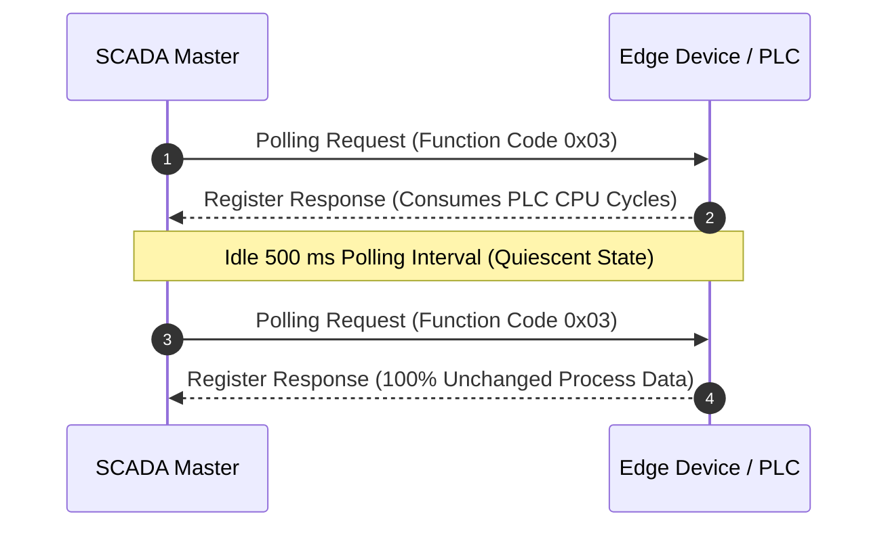
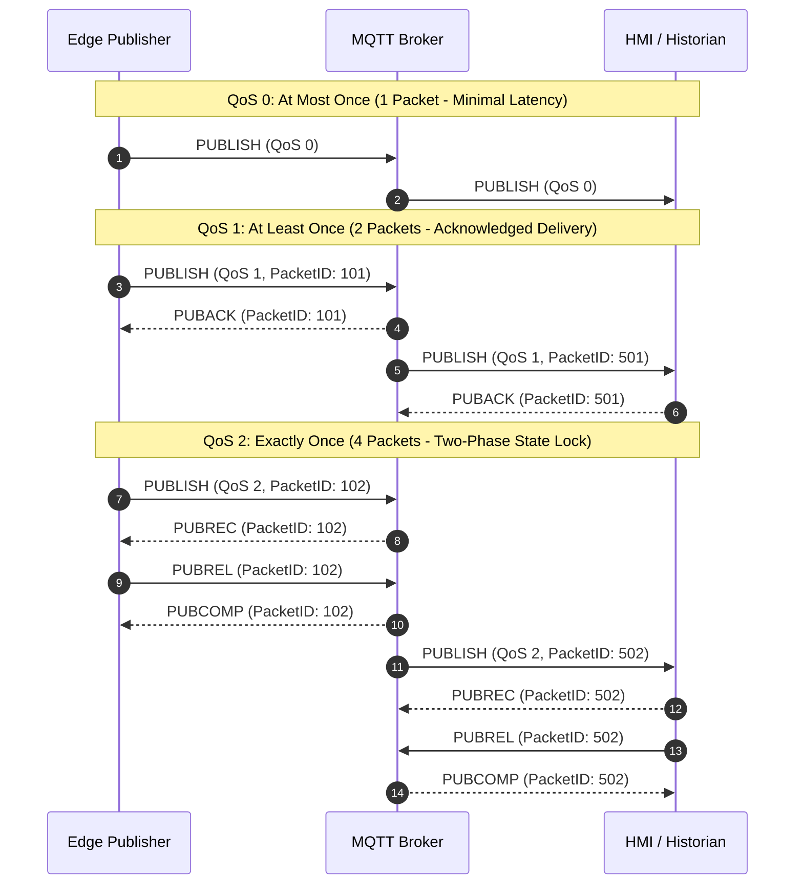
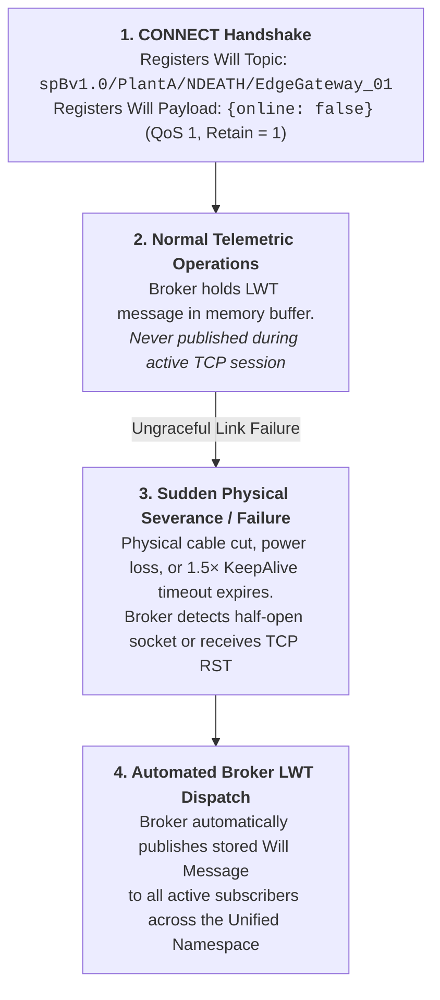

# Lesson 03: MQTT Protocol Internals & Telemetry Models

In high-throughput industrial automation environments, traditional client-server communication architectures buckle under the scale of modern edge computing. Legacy industrial protocols like Modbus TCP and classical OPC DA rely on synchronous request-response polling, forcing supervisory SCADA masters to continuously interrogate field devices over point-to-point connections. As device density expands across the plant floor, polling schedules consume network bandwidth, introduce variable latency, and saturate programmable logic controller (PLC) communication coprocessors. [[../Glossary#MQTT 5.0|Message Queuing Telemetry Transport (MQTT)]] resolves these fundamental physical constraints by replacing polling with an asynchronous, event-driven Publish/Subscribe (Pub/Sub) messaging model ([[Freitas_et_al_2025|Freitas et al., 2025]]; [[Jaloudi_2019|Jaloudi, 2019]]). By enforcing an ultra-compact 2-byte fixed header, dynamic variable-byte length encoding, granular [[../Glossary#Quality of Service (QoS)|Quality of Service (QoS)]] delivery contracts, and hardware-disconnect Last Will and Testament (LWT) routines, MQTT establishes the scalable transport layer for the Unified Namespace (UNS). This lesson dissects the packet-level physics, framing mathematics, socket state machines, and empirical latency characteristics of MQTT v3.1.1 and v5.0 implementations in industrial systems.

---

## 1. Operational Reality: Polling Bottlenecks to Asynchronous Edge Telemetry

On the plant floor, thousands of instrumentation points—including vibration transmitters, thermocouple banks, variable frequency drives (VFDs), and flowmeters—report dynamic physical states. Under legacy request-response polling architectures (such as Modbus TCP analyzed in [[02-Modbus-TCP-Mechanics|Lesson 02]]), a central SCADA server must execute a deterministic query-response loop for each device, reinforcing the rigid hierarchical coupling exposed in [[01-Purdue-vs-UNS|Lesson 01]] ([[Jaloudi_2019|Jaloudi, 2019]]):

This request-response paradigm introduces three severe operational vulnerabilities across the plant floor.

First, continuous polling produces extreme network bandwidth inefficiency. Telemetry frames traverse physical media constantly, even when process variables remain completely quiescent. In bandwidth-constrained industrial topologies—such as remote cellular uplinks, radio telemetry links, or legacy serial buses—this redundant polling saturates available spectrum with static data.

Second, cyclic polling degrades deterministic PLC scan times. Servicing frequent incoming polling queries forces the PLC operating system to context-switch between its high-priority deterministic ladder logic execution scan and its low-priority Ethernet communication coprocessor, compromising loop timing integrity and jitter budgets.

Finally, client-server polling expands the cyber-attack surface across network boundaries. Field devices must function as TCP servers listening on open inbound ports (e.g., TCP port 502 for Modbus or TCP port 4840 for OPC UA). Connecting to these devices from an upper supervisory tier requires punching inbound firewall conduits through Purdue Model cell perimeters, directly violating the outbound-only isolation requirements mandated by IEC 62443.

The physical hardware infrastructure required to support this telemetry shift is illustrated in **Figure 03.1**, contrasting DIN-rail edge publisher gateways (**Figure 03.1(a)**) with industrial managed network switches (**Figure 03.1(b)**) aggregating telemetry streams across plant subnets:

<!-- 
  PHOTO SEARCH GUIDANCE:
  Target Equipment: Industrial IoT Edge Publisher Gateway (DIN-Rail Mounted)
  Suggested Models: HMS Ewon Flexy 205 / Siemens SIMATIC IOT2050 / Advantech UNO-2271G
  Search Query: "HMS Ewon Flexy 205 gateway" OR "Siemens SIMATIC IOT2050 DIN rail"
  Google Images Link: https://www.google.com/search?tbm=isch&q=HMS+Ewon+Flexy+205+gateway
-->
<!-- 
  PHOTO SEARCH GUIDANCE:
  Target Equipment: Industrial Managed DIN-Rail Switch / Core Network Ingestion Gateway
  Suggested Models: Cisco Catalyst IE3400 Rugged Series / Moxa EDS-G512E Industrial Switch
  Search Query: "Cisco Catalyst IE3400 rugged switch" OR "Moxa EDS-G512E industrial switch"
  Google Images Link: https://www.google.com/search?tbm=isch&q=Cisco+Catalyst+IE3400+rugged+switch
-->
![[03-industrial-edge-publisher-gateway.png]]
*(a) Industrial DIN-Rail Edge Publisher Gateway (HMS Ewon Flexy 205)*

![[03-industrial-managed-switch.png]]
*(b) Industrial Managed Network Switch (Cisco Catalyst IE3400)*

*Figure 03.1: Industrial Telemetry Infrastructure: (a) DIN-rail edge gateway acting as a pure outbound MQTT publisher; (b) Rugged managed core switch aggregating edge broker traffic across plant subnets.*

### The Outbound-Only Publisher Invariant

MQTT resolves these physical limitations through a centralized, broker-mediated Publish/Subscribe architecture. In this paradigm, publishers (such as the HMS Ewon Flexy 205 edge gateway) establish a single persistent, outbound TCP socket (defaulting to TCP port 1883 or encrypted TLS port 8883) to a central message broker (such as EMQX, Mosquitto, or HiveMQ) ([[Freitas_et_al_2025|Freitas et al., 2025]]):

$$\text{Pure Publisher Constraint: } \quad \text{Direction}(\text{TCP SYN}) = \text{OT Cell} \longrightarrow \text{IDMZ / Enterprise UNS}$$

Because the connection originates strictly from inside the secure industrial control zone toward the demilitarized zone (IDMZ) or supervisory cloud, plant firewalls block all inbound connection attempts while stateful inspection engines permit established outbound socket traffic. Edge devices never listen on exposed TCP ports, neutralizing unauthorized ingress attacks at the network boundary ([[Freitas_et_al_2025|Freitas et al., 2025]]).

---

## 2. Protocol Anatomy: The 2-Byte Fixed Header & Variable-Byte Varint Physics

To minimize bandwidth consumption across resource-constrained edge media, the OASIS MQTT specification enforces an exceptionally lightweight wire framing protocol. Every MQTT control packet consists of up to three sequential layers:

1. **Fixed Header (Mandatory, 2–5 Bytes)**: Present in every MQTT control packet across all 14 protocol operations.
2. **Variable Header (Context-Dependent)**: Present in specific command and telemetry packets (e.g., `PUBLISH` carries the UTF-8 Topic Name and 16-bit Packet Identifier; `CONNECT` carries protocol level and session flags).
3. **Application Payload (Context-Dependent)**: The opaque application byte stream (e.g., Sparkplug B Protobuf binary structure, JSON string, or raw sensor bytes). The broker treats this payload as an uninspected binary blob, routing it without schema modification.

This layered encapsulation hierarchy is illustrated in **Figure 03.2**:

![[03-mqtt-packet-layout.svg]]

*Figure 03.2: Structural Anatomy of an MQTT Control Packet: Mandatory Fixed Header (2 to 5 bytes), context-dependent Variable Header, and uninspected Application Telemetry Payload.*

### The Fixed Header Bit Allocation

The Fixed Header contains a minimum of 2 octets (bytes). The first byte dictates packet semantics and delivery rules, while subsequent bytes encode remaining length:

#### Byte 1: Control Packet Type & Delivery Flags

Byte 1 is split into two discrete 4-bit nibbles:
- **Bits 7–4 (Control Packet Type / Opcode)**: A 4-bit unsigned integer ($0\text{x}1$ to $0\text{x}E$) defining the command:

| Opcode | Packet Type | Flow Direction | Operational SCADA / UNS Purpose |
| :---: | :--- | :---: | :--- |
| `0x1` | **`CONNECT`** | Client $\to$ Broker | Initiates TCP session; declares Client ID, Clean Session / Session Expiry, Keep-Alive timer, and credentials. |
| `0x2` | **`CONNACK`** | Broker $\to$ Client | Acknowledges connection; returns session state status (e.g., Session Present, Connection Accepted). |
| `0x3` | **`PUBLISH`** | Client $\rightleftharpoons$ Broker | Carries live process telemetry and topic string. Operates bidirectionally (Publisher $\to$ Broker and Broker $\to$ Subscriber). |
| `0x4` | **`PUBACK`** | Receiver $\to$ Sender | Acknowledges receipt of a **QoS 1** `PUBLISH`, releasing sender retransmission buffers. |
| `0x5` | **`PUBREC`** | Receiver $\to$ Sender | **QoS 2 Phase 1:** "Publish Received." Locks Packet Identifier to guarantee exactly-once processing. |
| `0x6` | **`PUBREL`** | Sender $\to$ Receiver | **QoS 2 Phase 2:** "Publish Release." Sender releases the packet for downstream consumption. |
| `0x7` | **`PUBCOMP`** | Receiver $\to$ Sender | **QoS 2 Final:** "Publish Complete." Finalizes transaction; both nodes purge state tracking. |
| `0x8` | **`SUBSCRIBE`** | Client $\to$ Broker | Registers client interest in topic filters with requested QoS ceilings. |
| `0x9` | **`SUBACK`** | Broker $\to$ Client | Confirms subscription registration and specifies granted QoS levels. |
| `0xA` | **`UNSUBSCRIBE`**| Client $\to$ Broker | Deregisters interest in specified topic paths. |
| `0xB` | **`UNSUBACK`** | Broker $\to$ Client | Confirms unsubscription completion. |
| `0xC` | **`PINGREQ`** | Client $\to$ Broker | Heartbeat ping sent when idle to verify TCP transport integrity. |
| `0xD` | **`PINGRESP`** | Broker $\to$ Client | Heartbeat response confirming broker responsiveness. |
| `0xE` | **`DISCONNECT`** | Client $\to$ Broker | Graceful disconnect. Suppresses execution of registered Last Will and Testament. |

- **Bits 3–0 (Delivery Flags)**:
  - **Bit 3 (`DUP` - Duplicate Delivery)**: Set to `1` when a QoS 1 or QoS 2 packet is retransmitted following an unacknowledged timeout.
  - **Bits 2–1 (`QoS Level`)**: 2-bit unsigned integer encoding delivery assurance: `00` (QoS 0), `01` (QoS 1), or `10` (QoS 2).
  - **Bit 0 (`RETAIN` - Retained Message)**: When set to `1`, the broker caches the message as the "Last Known Good Value" for that topic. Any new client that subsequently subscribes to this topic receives this cached packet immediately, establishing instant system state synchronization.

---

### Bytes 2 to 5: The Variable Byte Integer (Varint) Length Algorithm

Because TCP delivers an unbroken stream of bytes without application frame boundaries, the receiving parser must determine precisely how many bytes constitute the current packet before processing the next frame. 

Rather than wasting a fixed 4-byte (32-bit) integer on every single packet—which would double the framing overhead of small sensor heartbeats—MQTT utilizes a **Variable Byte Integer (Varint)** encoding algorithm:
- Each length byte dedicates **Bits 6–0** to encode numeric data ($0$ to $127$, base-128).
- **Bit 7 (the Most Significant Bit)** serves as a **Continuation Flag**:
  - `Bit 7 = 1`: Indicates that an additional length byte follows in the sequence.
  - `Bit 7 = 0`: Indicates that this byte is the terminal length byte.

#### Mathematical Reconstruction of Remaining Length

The total Remaining Length $L$ encoded across $n$ bytes (where $1 \le n \le 4$) is calculated by summing the 7-bit values shifted by powers of 128:

$$L = \sum_{i=0}^{n-1} (\text{Byte}_i \ \& \ 0\text{x}7\text{F}) \times 128^i$$

$$\begin{aligned}
\text{1 Length Byte:} &\quad 0 \le L \le 127 \text{ bytes} \quad &&(\text{Fixed Header = 2 bytes total}) \\
\text{2 Length Bytes:} &\quad 128 \le L \le 16{,}383 \text{ bytes} \quad &&(\text{Fixed Header = 3 bytes total}) \\
\text{3 Length Bytes:} &\quad 16{,}384 \le L \le 2{,}097{,}151 \text{ bytes} \quad &&(\text{Fixed Header = 4 bytes total}) \\
\text{4 Length Bytes:} &\quad 2{,}097{,}152 \le L \le 268{,}435{,}455 \text{ bytes} \quad &&(\text{Fixed Header = 5 bytes total; up to } \approx 256\text{ MB})
\end{aligned}$$

The exact bit-level octet allocation of this fixed header is mapped in **Figure 03.3**:

![[03-mqtt-fixed-header-bits.svg]]

*Figure 03.3: Bit-Level Octet Structure of the MQTT Fixed Header: Byte 1 splits into Opcode nibble (bits 7–4) and Delivery Flags (bits 3–0), followed by Byte 2+ Variable Byte Integer framing.*

*Engineering Implication:* A high-frequency temperature or pressure update transmitting an 8-byte IEEE-754 double precision float requires only **2 bytes of total header overhead**, enabling compact edge telemetry that maximizes transmission efficiency across constrained industrial backbones ([[Jaloudi_2019|Jaloudi, 2019]]).

---

## 3. Delivery Guarantees: Quality of Service (QoS 0, 1, 2) & Latency Trade-offs

MQTT provides three distinct application-layer delivery guarantees to balance message integrity against network latency:

### Mathematical & Latency Analysis of QoS Levels

1. **QoS 0 (At Most Once / "Fire and Forget")**:
   - Total Packets Exchanged: $1\text{ packet}$ per hop.
   - Round-Trip Time: $RTT = \text{One-way propagation delay } (t_{\text{prop}})$.
   - Memory State Footprint: $0\text{ bytes}$ buffer retention on the publisher. Once the frame is written into the kernel TCP socket buffer (`SO_SNDBUF`), the application frees heap memory immediately.
2. **QoS 1 (At Least Once / Acknowledged Delivery)**:
   - Total Packets Exchanged: $2\text{ packets}$ (`PUBLISH` + `PUBACK`).
   - Round-Trip Latency: $RTT = t_{\text{fwd}} + t_{\text{broker\_dispatch}} + t_{\text{ack}}$.
   - Delivery Assurance: Guaranteed delivery. However, duplicates can occur: if the receiver processes the `PUBLISH` but the returning `PUBACK` is dropped due to network jitter, the sender's retry timer fires, re-sending the message with flag `DUP = 1`.
3. **QoS 2 (Exactly Once / Two-Phase Commit Handshake)**:
   - Total Packets Exchanged: $4\text{ packets}$ (`PUBLISH` $\to$ `PUBREC` $\to$ `PUBREL` $\to$ `PUBCOMP`).
   - Protocol Overhead: Multiplies packet traffic by $4\times$. Both publisher and broker must allocate synchronized state tracking tables to lock and release the 16-bit Packet Identifier.

The comparative packet flows, handshakes, and state tracking overheads across all three QoS tiers are contrasted in **Figure 03.4**, with detailed sequence timing mapped below:

![[03-mqtt-qos-handshakes.svg]]

*Figure 03.4: Comparative Packet Flows and State Tracking Overheads for MQTT QoS 0 (Fire & Forget), QoS 1 (Acknowledged Retransmission), and QoS 2 (4-Step Two-Phase Commit).*

### Empirical Benchmarks & Industrial UNS Invariant

In their benchmark analysis of Unified Namespace protocols, Freitas et al. (2025) demonstrated that selecting QoS 2 in high-frequency industrial environments induces severe latency spikes and network degradation ([[Freitas_et_al_2025|Freitas et al., 2025]]):
- Under high-frequency cyclic telemetry ($10\text{--}100\text{ Hz}$), the 4-way lockstep handshake of QoS 2 creates exponential queue accumulation under transient network jitter.
- Adding downstream subscribers results in a pronounced $95\%$ increase in RTT under QoS 0 due to raw socket fan-out velocity, compared to $35\text{--}45\%$ under QoS 1 and QoS 2 where lockstep pacing artificially caps transmission rates ([[Freitas_et_al_2025|Freitas et al., 2025]], p. 13).

> [!IMPORTANT]
> **Illustrative Protocol Selection Candidate:**
> 1. **Continuous Analog Process Telemetry (Temperatures, Pressures, Speeds)**:
>    - **Candidate: QoS 0** paired with Report-by-Exception (RBE).
>    - *Operational Rationale*: Industrial process variables are ephemeral; fresh readings immediately supersede lost packets. Zero memory retention overhead on constrained field hardware.
> 2. **Discrete State Changes, Alarms, and Setpoint Commands**:
>    - **Candidate: QoS 1** paired with application-layer deduplication.
>    - *Operational Rationale*: Guarantees at-least-once delivery while eliminating the 4-way two-phase commit state locks and latency bottlenecks of QoS 2.
> 3. **QoS 2 Usage Policy**:
>    - **Candidate restriction:** avoid QoS 2 on plant-floor edge telemetry streams unless a later ADR justifies it.

---

## 4. Connection State Machine: Keep-Alives, TCP Heartbeats & LWT Failover Dynamics

Industrial field networks operating over Wi-Fi, private 5G, or legacy serial gateways frequently experience physical severance, power outages, and radio fading. Standard TCP socket termination detection relies on operating system TCP Keep-Alives, which require up to 7,200 seconds (2 hours) to detect broken half-open sockets under default Linux kernel settings.

### MQTT Keep-Alive Negotiation & The 1.5× Threshold

During the initial `CONNECT` sequence, the edge client declares an integer `KeepAlive` interval in seconds (e.g., $T_{\text{keepalive}} = 60\text{ s}$). If no telemetry messages are published during this quiescent window, the client emits an ultra-compact 2-byte `PINGREQ` ($0\text{x}C0, 0\text{x}00$), to which the broker responds with a 2-byte `PINGRESP` ($0\text{x}D0, 0\text{x}00$).

According to the OASIS specification, if the broker registers a total absence of incoming control packets exceeding $1.5\times$ the agreed `KeepAlive` duration:

$$T_{\text{timeout}} = 1.5 \times T_{\text{keepalive}}$$

For a $60\text{ s}$ Keep-Alive setting, if no packet arrives within $90\text{ s}$, the broker immediately declares the client socket dead, issues a TCP `RST` to reclaim OS socket buffers, and executes its configured LWT failover routine.

### Last Will and Testament (LWT) Mechanics

To achieve deterministic fault notification without polling, MQTT introduces the **Last Will and Testament (LWT)** state machine. The state machine progression from initial connection to unexpected fault dispatch is mapped in the following flowchart:

#### The LWT Graceful Disconnect Invariant

If an edge gateway undergoes planned maintenance, it transmits an explicit `DISCONNECT` packet ($0\text{x}E0, 0\text{x}00$) before closing its TCP socket:
- **Broker Rule**: Upon receiving an explicit `DISCONNECT`, the broker **erases the registered LWT message from memory** and closes the socket cleanly.
- **Failover Rule**: The LWT is triggered *strictly and exclusively* upon ungraceful, unexpected socket termination (e.g., physical drop, power loss, OOM crash, or Keep-Alive timeout), preventing false death alarms during scheduled reboots.

---

## 5. Architectural Defenses: Topic Filtering, Session State & Scalable UNS Ingestion

The central broker manages topic resolution and client delivery state across the enterprise Unified Namespace.

### Topic Namespace Architecture & Wildcard Routing

MQTT topic strings are forward-slash-delimited hierarchical namespaces that mirror the physical and operational hierarchy of the plant floor (derived from ANSI/ISA-95; see [[08-ISA-95-Object-Models-Taxonomy|Lesson 08]]; [[Freitas_et_al_2025|Freitas et al., 2025]], p. 8):
$$\texttt{Enterprise / Site / Area / Line / WorkCell / Metric}$$

Subscribers subscribe to specific data paths using two distinct wildcard operators:
1. **Single-Level Wildcard (`+`)**: Matches arbitrary characters within exactly one topic hierarchy level.
   - *Example*: `Enterprise/PlantA/+/Line1/Temperature` matches `Area1` or `Area2`, but does not match sub-branches like `Area1/SubCell`.
2. **Multi-Level Wildcard (`#`)**: Matches all remaining sub-levels in the topic hierarchy.
   - *Architectural Constraint*: The `#` operator must always be positioned as the **terminal character** in a topic filter string (e.g., `Enterprise/PlantA/Area1/#`). Placing `#` in the middle of a string (such as `Enterprise/#/Line1`) is a syntax violation rejected by the broker.

### Clean Sessions vs. Persistent Session Queues

During the `CONNECT` sequence, the client declares its session retention contract:
- **Clean Session (`CleanSession = true` in MQTT v3.1.1 / `SessionExpiryInterval = 0` in MQTT v5.0)**:
  - The broker establishes a purely transient session. If the client disconnects, all subscriptions and unconsumed in-flight queues are purged from broker RAM.
  - *Standard for Web SCADA & Transient HMIs*: Prevents heap accumulation when temporary browser sessions disconnect.
- **Persistent Session (`CleanSession = false` / `SessionExpiryInterval > 0`)**:
  - The broker preserves client subscriptions and buffers incoming QoS 1 messages in a dedicated session queue while the client is offline.
  - *Standard for Production Historians & Ingestion Engines*: Guarantees zero data loss across brief network outages, draining buffered frames upon reconnection.
  - *Caution*: Persistent sessions with disconnected or slow subscribers can trigger broker heap memory exhaustion if queue depth limits are unmanaged ([[Liu_et_al_2023|Liu & Al-Masri, 2023]]; analyzed in [[04-Broker-Failure-Modes-Backpressure|Lesson 04]]).

### Retained Messages & Instant State Reconstruction

When field sensors publish with `RETAIN = 1`, the broker caches the message payload in memory as the current system truth for that topic (formalized in Sparkplug B state lifecycles; see [[06-Sparkplug-B-Specification|Lesson 06]]):
- Whenever a newly launched HMI screen, operator tablet, or microservice connects and issues a subscription, the broker delivers the retained message **immediately**, without waiting for the field sensor to publish its next periodic cycle.
- **State Deletion Rule**: To delete a retained topic from broker memory, a publisher emits a zero-byte payload with `RETAIN = 1` to that topic, commanding the broker to purge the cached state.

---

## 6. Active-Recall Assessments

> [!FAQ]- Why does MQTT's outbound-only publisher architecture resolve industrial firewall traversal challenges that break Modbus TCP and OPC UA?
> In traditional protocols like Modbus TCP and OPC UA, field devices act as TCP servers listening on fixed inbound ports (e.g., TCP port 502 for Modbus or TCP port 4840 for OPC UA). To poll data from an external supervisory network, engineers must open inbound firewall ports into the OT cell, creating significant security vulnerabilities under IEC 62443. In MQTT, the edge gateway acts as a pure publisher, initiating a persistent outbound TCP connection (port 1883/8883) toward the central broker in the IDMZ (detailed in [[10-OT-Cybersecurity-IEC-62443|Lesson 10]]). Because industrial stateful firewalls permit outbound-established sessions while blocking unsolicited inbound ingress, field devices stream real-time telemetry across Purdue network boundaries without opening exposed inbound firewall ports ([[Freitas_et_al_2025|Freitas et al., 2025]], p. 18).

> [!FAQ]- How does the Variable Byte Integer (Varint) length encoding algorithm in the MQTT fixed header conserve bandwidth while supporting large payloads?
> The MQTT Varint encoding algorithm utilizes 1 to 4 bytes to represent the Remaining Length field. Each byte encodes 7 bits of length data (values 0–127) in Bits 6–0, reserving Bit 7 as a continuation flag (1 = more bytes follow, 0 = terminal byte). For small telemetry updates and sensor heartbeats ($\le 127\text{ bytes}$), length is encoded in a single byte, keeping the total fixed header overhead to just 2 bytes. When large payloads (such as firmware images or batch historical logs) are transmitted, the field automatically expands up to 4 bytes, supporting payloads up to $268{,}435{,}455\text{ bytes}$ ($\approx 256\text{ MB}$) without changing wire protocol structures ([[Jaloudi_2019|Jaloudi, 2019]]).

> [!FAQ]- Why is QoS 2 strictly avoided in high-frequency industrial telemetry streams according to empirical research?
> Empirical benchmarks by Freitas et al. (2025) demonstrate that QoS 2 requires a 4-step, two-phase commit handshake (`PUBLISH`, `PUBREC`, `PUBREL`, `PUBCOMP`) that quadruples packet traffic and forces both sender and broker to retain state tracking tables until the final acknowledgment clears. Under high-frequency cyclic telemetry ($10\text{--}100\text{ Hz}$) or transient wireless network jitter, this four-way lockstep exchange induces severe buffer bloat, retransmission cascades, and throughput collapse. Industrial UNS architectures mandate QoS 0 paired with Report-by-Exception (RBE) for continuous analog telemetry, and QoS 1 with client-side deduplication for discrete alarms and setpoints ([[Freitas_et_al_2025|Freitas et al., 2025]]).

> [!FAQ]- What is the operational distinction between an explicit client `DISCONNECT` (0x0E) and a TCP socket termination regarding the Last Will and Testament (LWT)?
> When an edge gateway undergoes a planned shutdown or maintenance reboot, it transmits an explicit `DISCONNECT` control packet (opcode `0x0E`). Upon receiving this packet, the broker discards the client's registered LWT message from RAM and closes the TCP socket cleanly. The Last Will and Testament is executed and published to the plant network *strictly and exclusively* when the connection terminates ungracefully (such as physical cable severance, power failure, or Keep-Alive timeout exceeding $1.5\times$ the agreed interval), preventing false equipment failure alarms during scheduled downtime.

> [!FAQ]- What syntactic rule governs the placement of the multi-level wildcard `#` in MQTT topic filters, and how does it differ from `+`?
> The single-level wildcard `+` matches arbitrary characters within exactly one topic hierarchy level and can be placed at any position within the topic string (e.g., `Enterprise/+/Area1/Line1/Temp`). The multi-level wildcard `#` matches all remaining hierarchical levels below its position; therefore, it must *always* be placed as the final character in the topic filter string (e.g., `Enterprise/Site1/#`). Placing `#` in any intermediate position (such as `Enterprise/#/Line1`) is a protocol syntax error that results in broker subscription rejection.
