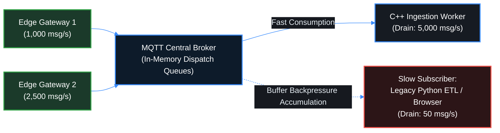

# Lesson 04: Broker Failure Modes, Backpressure & Slow Subscribers

In an event-driven industrial Unified Namespace (UNS), central message brokers ingest real-time process variables from hundreds of edge programmable logic controllers (PLCs), variable frequency drives (VFDs), and remote terminal units (RTUs) publishing at aggregate rates exceeding $10{,}000\text{ messages/sec}$. While standard MQTT brokers efficiently fan out telemetry under balanced loads, a critical architectural vulnerability emerges when downstream consumer applications process data at unequal rates. The presence of a single "Slow Subscriber"—such as a single-threaded legacy script, an overloaded relational database historian, or a mobile tablet traversing high-latency wireless links—triggers unbounded in-memory buffer accumulation. Left unmanaged, queue backpressure exhausts broker heap memory, invoking the operating system's Out-Of-Memory (OOM) killer and crashing plant-wide operations. This lesson examines the physics of asymmetric consumption velocity, TCP socket flow control, kernel OOM termination dynamics, queue eviction policies, and multi-process broker resilience patterns.

---

## 1. Operational Reality: The Asymmetric Velocity Dilemma on the Plant Floor

Industrial manufacturing environments generate heterogeneous data flows where high-performance field generators feed diverse enterprise consumers ([[Liu_et_al_2023|Liu & Al-Masri, 2023]]; [[Freitas_et_al_2025|Freitas et al., 2025]]):
- **Fast Generators (Edge Gateways & PLCs)**: Hardwired DIN-rail edge computers ([[05-EoN-Nodes-Brownfield-Gateways|Lesson 05]]) polling fieldbuses at $10\text{--}100\text{ Hz}$, generating thousands of telemetry packets per second per production line.
- **Fast Consumers (Time-Series Historians & Ingestion Engines)**: Multithreaded C++, Rust, or Go services running on dedicated server clusters equipped with non-volatile memory and zero-copy parsers, capable of draining $>50{,}000\text{ messages/sec}$.
- **Slow Consumers (Mobile HMIs, Web Browsers, Legacy ETL Scripts)**: Single-threaded Python analytic scripts, batch SQL insertion jobs, or operator tablet devices operating across plant-floor Wi-Fi where signal attenuation, multipath fading, and handoffs cause intermittent socket latency:

The physical hardware extremes creating this operational velocity gap are illustrated in **Figure 04.1**, contrasting multi-gigabit central broker server racks (**Figure 04.1(a)**) with mobile plant-floor operator tablets (**Figure 04.1(b)**) susceptible to wireless latency and socket stalling:

<!-- 
  PHOTO SEARCH GUIDANCE:
  Target Equipment: Enterprise Central Industrial Server Rack / On-Premises Broker Host
  Suggested Models: Dell PowerEdge R650 Server Rack / HPE ProLiant DL360 Gen10 / Advantech SKY-6200 Industrial Server
  Search Query: "Dell PowerEdge R650 server rack" OR "HPE ProLiant DL360 server rack"
  Google Images Link: https://www.google.com/search?tbm=isch&q=Dell+PowerEdge+R650+server+rack
-->
<!-- 
  PHOTO SEARCH GUIDANCE:
  Target Equipment: Rugged Industrial Mobile Tablet / Wireless HMI Client
  Suggested Models: Siemens SIMATIC Industrial Tablet MD-57A / Getac F110 Rugged Tablet / Panasonic Toughbook G2
  Search Query: "Siemens SIMATIC industrial tablet" OR "Getac F110 rugged tablet industrial"
  Google Images Link: https://www.google.com/search?tbm=isch&q=Siemens+SIMATIC+industrial+tablet
-->
![[04-central-broker-server.png]]
*(a) Central On-Premises Industrial Edge Server Rack (Dell PowerEdge R650 / HPE ProLiant)*

![[04-mobile-operator-tablet.png]]
*(b) Mobile Plant-Floor Operator Tablet / Wireless HMI Client (Siemens SIMATIC MD-57A)*

*Figure 04.1: Plant-Floor Infrastructure & Velocity Asymmetry: (a) Central broker server managing multi-gigabit ingress dispatch; (b) Wireless mobile operator tablet vulnerable to socket stalling, packet lag, and queue backpressure.*

### The Velocity Mismatch Invariant

The fundamental pub/sub vulnerability occurs when an individual subscriber's consumption rate falls below the ingress publish rate. This velocity mismatch is modeled in the architectural diagram below, contrasting fast ingestion against backpressure accumulation on slower consumers:

---

## 2. The Slow Subscriber Failure Mode: TCP Window Stalling & Queue Accumulation

When a client application subscribes to a high-frequency topic (or an enterprise wildcard `#`) and drains data slower than the incoming ingress stream, backpressure is generated:

$$\Delta v = v_{\text{in}} - v_{\text{out}} > 0$$

Under standard MQTT Quality of Service (QoS 1 or QoS 2; detailed in [[03-MQTT-Protocol-Internals|Lesson 03]]), the broker is contractually bound by protocol specification to buffer unacknowledged messages until the client returns `PUBACK` or `PUBREC`. However, even under **QoS 0** (where application-layer acknowledgments are absent), a slow subscriber (such as an unoptimized browser UI; see [[12-WebSocket-Streaming-Mechanics|Lesson 12]]) still forces catastrophic broker buffering due to operating system transport mechanics:

### TCP ZeroWindow Mechanics & Socket Stalling
Every active client connection corresponds to an operating system socket with a kernel send buffer (`SO_SNDBUF`). If the client fails to read from its network interface—whether due to garbage collection freezes, blocking disk I/O, or wireless interference—the client's operating system receive buffer (`SO_RCVBUF`) fills to capacity. At this point, the client's TCP stack transmits a TCP header frame with the window size set to zero ([[../Glossary#TCP ZeroWindow|TCP ZeroWindow]]), instructing the broker to halt transmission until buffer space clears.

On the broker host, the operating system's `SO_SNDBUF` quickly saturates, causing subsequent non-blocking `write()` system calls to return `EAGAIN` or `EWOULDBLOCK`. Because the broker cannot drop the socket without an explicit policy, it is forced to accumulate undelivered messages in user-space application heap memory.

### Mathematical Growth of Queue Backlog

The total memory consumed by a slow subscriber's session queue grows monotonically as a function of the velocity differential and average serialized message size $\overline{S}_{\text{msg}}$:

$$\text{Memory}_{\text{queue}}(t) = \int_0^t \left( v_{\text{in}}(\tau) - v_{\text{out}}(\tau) \right) \cdot \overline{S}_{\text{msg}} \, d\tau$$

For an ingress stream of $10{,}000\text{ msgs/sec}$ of JSON telemetry ($\overline{S}_{\text{msg}} \approx 1\text{ KB}$) and a stalled subscriber ($v_{\text{out}} \approx 0$):
$$\text{Memory Growth Rate} \approx 10{,}000 \times 1{,}024\text{ B/s} \approx 9.77\text{ MB / sec} \implies \mathbf{586\text{ MB / minute}}$$

Within minutes, a single stalled connection accumulates gigabytes of RAM in user-space queue buffers.

This compounding failure progression—from high-velocity ingress flow down to socket stalling and memory buffer growth—is illustrated in **Figure 04.2**:

![[04-broker-backpressure-queues.svg]]

*Figure 04.2: Broker Backpressure Architecture — High-Velocity Ingress Flow, Disparate Subscriber Draining Rates, TCP Socket Stalling, and Queue Eviction Rules.*

---

## 3. The Slow Subscriber Denial of Service & Linux Kernel OOM Killer

In their landmark empirical study on industrial MQTT vulnerability, [[Liu_et_al_2023|Liu & Al-Masri (2023)]] proved that a single low-privilege, authenticated client can execute an unrecoverable **Denial-of-Service (DoS) attack** on an industrial message broker without transmitting a single exploit payload:

### The Attack Execution Pattern
In their landmark empirical study on industrial MQTT vulnerability, [[Liu_et_al_2023|Liu & Al-Masri (2023)]] proved that a single low-privilege, authenticated client can execute an unrecoverable Denial-of-Service (DoS) attack on an industrial message broker without transmitting a single exploit payload.

The attack unfolds in four contiguous steps: first, the adversary establishes a valid MQTT session and subscribes to the root multi-level wildcard (`#` or `spBv1.0/#`). Second, the client deliberately halts socket reads, sets `SO_RCVBUF` to minimum, or sets its TCP receive window to zero. Third, because the attacker sends only a single initial subscription packet, plant-floor edge gateways publishing normal process telemetry inadvertently become the attack amplification engine. Finally, the broker exhausts its available physical memory allocating user-space heap buffers to queue every message across the entire facility for this stalled client.

### Linux Kernel OOM Killer Mechanics (`mm/oom_kill.c`)

When host physical RAM and swap space are completely exhausted, the Linux virtual memory manager triggers an Out-Of-Memory condition. Because the kernel cannot satisfy memory allocations for operating system tasks, it executes the **OOM Killer** routine:

1. **`oom_score` Computation**: The kernel inspects all running processes in `/proc/[pid]/oom_score`, calculating a heuristic penalty based on the percentage of physical RAM consumed:
   $$\text{points} = \frac{\text{process\_rss\_pages}}{\text{total\_ram\_pages}} \times 1000$$
2. **Target Selection**: The rogue slow subscriber script consumes minimal memory (a few megabytes for its idle socket). In contrast, the MQTT broker process holds gigabytes of buffered messages in its heap memory space.
3. **The Fatal Termination (`SIGKILL`)**: The kernel assigns the MQTT broker the highest `oom_score` and terminates the broker process with an uncatchable `SIGKILL` ($9$).

**Operational Catastrophe**: The centralized communication spine of the entire industrial facility collapses instantly. Supervisory HMI screens go blank, historical data ingestion halts, and safety interlocking alarms across all production lines are severed simultaneously—all caused by a single stalled client session.

---

## 4. Backpressure Governance: Queue Limits, Eviction Policies & Disconnection

To protect the message broker from memory exhaustion and OOM termination, industrial brokers must enforce rigorous backpressure and queue eviction policies ([[Liu_et_al_2023|Liu & Al-Masri, 2023]]):

### Queue Overflow Governance Policies

When a subscriber's session queue reaches its maximum provisioned message limit (e.g., $10{,}000\text{ messages}$) or memory watermark (e.g., $50\text{ MB}$), the broker executes one of three distinct queue policies:

| Queue Overflow Policy | Mechanical Behavior | Operational Assessment in SCADA / UNS |
| :--- | :--- | :--- |
| **1. [[../Glossary#Drop-Oldest (FIFO Head Eviction)|Drop-Oldest (FIFO Head Eviction)]]** | When the queue limit is reached, incoming fresh messages evict the oldest unconsumed packets at the head of the queue. | **Candidate policy.** Industrial telemetry is often ephemeral, but the broker policy must be selected for the deployment. |
| **2. Drop-Newest (Tail Eviction)** | When the queue limit is reached, new incoming messages are dropped at the broker ingress door. Old messages remain queued. | **Dangerous Anti-Pattern.** Locks the operator into viewing delayed historical data while new incoming emergency alarms and trip events are silently discarded. |
| **3. High-Watermark Forced Disconnect** | If a subscriber's buffer exceeds a hard memory threshold (e.g., $>50\text{ MB}$) or socket write timeout ($>10\text{ s}$), the broker forcibly terminates the TCP session. | **Safety Barrier.** Sacrifices the individual degraded subscriber with a TCP `RST`, releasing all buffered heap memory and preserving plant-wide availability. |

### Dead-Letter Queues (DLQ) & Diagnostic Tagging

In compliant architectures, dropped packets are not silently erased. Eviction counters are published to broker diagnostic metrics:
$$\texttt{\$SYS / broker / clients / [client\_id] / messages / dropped}$$

An implementation could monitor these diagnostic topics and generate supervisory warnings when a subscriber enters a continuous eviction state. This is a lesson pattern, not a universal requirement.

---

## 5. Architectural Defenses: Process Isolation & Multiprocessing Broker Resilience

Traditional open-source MQTT brokers (e.g., classic single-process Mosquitto or multithreaded daemon brokers) execute network I/O, topic routing, and client session queues within a **single operating system process space**. A single fatal memory allocation failure, an unhandled exception in an authentication plugin, or an OOM kill terminates the entire broker instance.

### The Multiprocessing Architecture ([[../Glossary#Remistry Multiprocessing Pattern|The Remistry Pattern]])

1. **Process-Level Memory Isolation**:
   - Rather than allocating client session queues inside a shared thread pool, client connections are partitioned across isolated operating system worker processes.
   - If an adversarial or broken slow subscriber exhausts memory, the Linux OOM killer terminates **only the specific worker process managing that client**, leaving the master daemon, the core topic tree, and all other production workers running undisturbed ([[Liu_et_al_2023|Liu & Al-Masri, 2023]]).
2. **Copy-on-Write (COW) Worker Prototype Pattern**:
   - Spawning isolated worker processes can incur memory overhead. The Remistry architecture utilizes a partially initialized **Worker Prototype** that preloads shared libraries.
   - Using Linux `fork()` with Copy-on-Write (COW), worker instances share identical read-only memory pages, reducing worker spawning latency to sub-millisecond timescales while maintaining complete memory fault isolation ([[Liu_et_al_2023|Liu & Al-Masri, 2023]]).
3. **Automated Self-Recovery**:
   - The master control daemon communicates with workers over bidirectional Inter-Process Communication (IPC) channels.
   - Upon detecting a closed IPC pipe (indicating worker crash or OOM termination), the control daemon immediately forks a replacement worker and migrates surviving client sockets without interrupting global plant telemetry.

This process-level memory partitioning, copy-on-write worker prototype, and automated fault recovery lifecycle are diagrammed in **Figure 04.3**:

![[04-remistry-multiprocess-isolation.svg]]

*Figure 04.3: Remistry Multi-Processing Broker Architecture — Process-Level Memory Isolation, Copy-on-Write (COW) Worker Spawning, and Targeted OOM Containment (Liu & Al-Masri, 2023).*

---

## 6. Active-Recall Assessments

> [!FAQ]- Why does a single slow subscriber consuming QoS 0 telemetry still pose a severe memory exhaustion risk to an MQTT broker?
> Even under QoS 0 where application-layer acknowledgments (`PUBACK`) do not exist, messages must still be transferred into the operating system kernel's TCP socket send buffer (`SO_SNDBUF`). If the client application stops reading, its local receive buffer fills, prompting its TCP stack to emit a `TCP ZeroWindow` advertisement. This blocks socket write system calls on the broker host. To avoid dropping messages without an explicit policy, the broker buffers outgoing frames in user-space heap RAM. If data flows into the broker at thousands of messages per second, this heap allocation expands exponentially until host physical memory is exhausted ([[Liu_et_al_2023|Liu & Al-Masri, 2023]]).

> [!FAQ]- How does the Linux kernel OOM Killer determine that the MQTT broker should be terminated rather than the slow subscriber script?
> The Linux Out-of-Memory killer (`mm/oom_kill.c`) evaluates the `oom_score` of all running tasks (`/proc/[pid]/oom_score`), penalizing processes proportional to the percentage of total physical RAM they currently consume. The slow subscriber client script is typically a lightweight process consuming a negligible few megabytes. The MQTT broker process, conversely, holds the massive multi-gigabyte accumulation of unconsumed queue buffers in its heap space. Because terminating the broker frees the largest volume of physical pages, the kernel selects the broker as the termination target, killing the plant's entire messaging spine ([[Liu_et_al_2023|Liu & Al-Masri, 2023]]).

> [!FAQ]- Why is the 'Drop-Oldest' queue overflow policy strictly mandated for SCADA operations over the 'Drop-Newest' policy?
> Industrial automation is concerned with real-time process truth. Telemetry data is ephemeral; an operator monitoring a cooling tower or chemical reactor requires the current pressure reading, not stale measurements from 45 seconds ago. Under 'Drop-Oldest' (FIFO head eviction), incoming fresh telemetry displaces stale buffered packets, guaranteeing that whenever a congested subscriber drains data, it receives the latest live plant state. Under 'Drop-Newest', fresh packets are discarded at the broker ingress door, locking the operator into viewing delayed historical data while silently dropping critical new alarms.

> [!FAQ]- How does the Multi-Processing (MP) isolation architecture in the Remistry pattern protect against broker collapse during a Slow Subscriber attack?
> In standard multithreaded brokers, all client queues share a unified process heap memory space; an OOM event or memory corruption terminates the entire broker daemon. The Remistry pattern partitions client connections across discrete operating system worker processes communicating over bidirectional IPC. If a slow subscriber triggers an OOM event, the kernel terminates *only* the specific worker child process servicing that client, while the master daemon, the core routing engine, and all other production workers continue operating uninterrupted ([[Liu_et_al_2023|Liu & Al-Masri, 2023]]).

> [!FAQ]- What operational metric indicates that an MQTT broker is experiencing backpressure before physical memory is exhausted?
> The primary early indicator of broker backpressure is a divergence between message ingress velocity and socket egress velocity ($\Delta v = v_{\text{in}} - v_{\text{out}} > 0$), accompanied by a sustained rise in client inflight queue counts (`$SYS/broker/clients/[id]/queue_length`) and TCP ZeroWindow advertisements captured in network packet analyzers.
