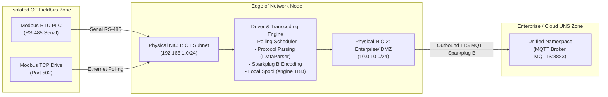

# Lesson 05: Edge of Network (EoN) Nodes & Brownfield Gateways

Over 80% of operating manufacturing and process facilities rely on legacy "brownfield" automation hardware—programmable logic controllers (PLCs), remote terminal units (RTUs), and variable frequency drives (VFDs) deployed decades ago that communicate exclusively over RS-485 serial fieldbuses (Modbus RTU, Siemens Profibus DP) or unencrypted, non-semantic Ethernet fieldbuses (such as Modbus TCP; analyzed in [[02-Modbus-TCP-Mechanics|Lesson 02]]; [[Huusom_et_al_2025|Huusom et al., 2025]]; [[Koprov_et_al_2022|Koprov et al., 2022]]). Ripping and replacing validated, revenue-generating industrial machinery is economically non-viable. The **Edge of Network (EoN) Node** resolves this structural dilemma by serving as an intelligent hardware appliance positioned at the physical boundary between isolated Operational Technology (OT) fieldbuses and enterprise Information Technology (IT) networks. This lesson examines the hardware dual-homing architecture, kernel-level anti-routing invariants, modular protocol termination patterns, edge store-and-forward buffering, and PLC scan-cycle shielding as candidate patterns for industrial gateway design.

---

## 1. Operational Reality: The Brownfield Constraint & Physical Boundary

Understanding edge integration requires distinguishing between the two fundamental operational paradigms encountered in industrial engineering:

> [!NOTE] Industrial Reality: Brownfield vs. Greenfield Facilities
> - **Brownfield Facility**: An operating industrial site utilizing machinery installed 10 to 30 years ago. These control loops are heavily calibrated, safety-certified, and tightly coupled to physical processes. Shutting them down for digital upgrades incurs prohibitive capital expenditure, downtime losses, and lengthy regulatory recertification.
> - **Greenfield Facility**: A newly constructed facility engineered from scratch with native Ethernet sensors, modern open protocols (OPC UA, MQTT Sparkplug B), and converged network backbones.

Because brownfield machinery cannot be replaced, automation architectures deploy the **Edge of Network (EoN) Node** as an edge gateway appliance. The EoN node bridges disparate physical media, terminates legacy serial and Ethernet protocols, contextualizes raw memory registers into typed semantic tags, and publishes data into an enterprise Unified Namespace (UNS; [[Senk_et_al_2026|Šenk et al., 2026]]; see [[01-Purdue-vs-UNS|Lesson 01]]) via MQTT ([[03-MQTT-Protocol-Internals|Lesson 03]]) and Sparkplug B ([[06-Sparkplug-B-Specification|Lesson 06]]).

The physical reality of this brownfield boundary is illustrated in **Figure 05.1**, showing a rugged dual-homed industrial edge computer (**Figure 05.1(a)**) deployed directly alongside a legacy brownfield PLC control enclosure (**Figure 05.1(b)**) containing multi-drop RS-485 serial fieldbuses:

<!-- 
  PHOTO SEARCH GUIDANCE:
  Target Equipment: Dual-Homed Industrial DIN-Rail Edge Gateway Computer
  Suggested Models: Advantech UNO-2271G / Moxa UC-8100A-ME-T / Siemens SIMATIC IOT2050 dual LAN
  Search Query: "Advantech UNO-2271G dual LAN" OR "Moxa UC-8100A dual ethernet"
  Google Images Link: https://www.google.com/search?tbm=isch&q=Advantech+UNO-2271G+dual+LAN
-->
<!-- 
  PHOTO SEARCH GUIDANCE:
  Target Equipment: Legacy Brownfield PLC Control Enclosure with RS-485 Serial Chaining and Terminal Racks
  Suggested Models: Modicon M340 PLC Cabinet / Allen-Bradley SLC 500 Rack Enclosure / Siemens S7-300 Cabinet
  Search Query: "Modicon PLC control panel RS485" OR "Allen Bradley SLC 500 rack cabinet"
  Google Images Link: https://www.google.com/search?tbm=isch&q=Modicon+PLC+control+panel+RS485
-->
![[05-dual-homed-edge-gateway.png]]
*(a) Industrial Dual-Homed DIN-Rail Edge Computer (Advantech UNO-2271G / Moxa UC-8100A)*

![[05-brownfield-plc-cabinet.png]]
*(b) Brownfield Industrial Control Enclosure with RS-485 Serial Chaining (Modicon M340 / SLC 500)*

*Figure 05.1: Physical Edge Integration Infrastructure: (a) Dual-homed industrial edge computer with physically separated Ethernet interfaces; (b) Brownfield control cabinet housing legacy serial and Ethernet PLCs requiring protocol termination.*

### Architectural Boundary Model

The EoN gateway physically separates the deterministic OT control loop from the non-deterministic enterprise IT backbone. This architectural boundary and protocol separation are mapped in the diagram below:



---

## 2. Hardware Dual-Homing & Physical Network Segmentation

A fundamental cybersecurity requirement enforced across modern automation standards (ANSI/ISA-95 and IEC 62443; detailed in [[10-OT-Cybersecurity-IEC-62443|Lesson 10]]) is **[[../Glossary#Dual-Homing|Hardware Dual-Homing]]** ([[Narayanan_et_al_2026|Narayanan et al., 2026]]).

### Physical Interface Invariants

Dual-homing dictates that the gateway appliance incorporates at least **two physically discrete Network Interface Cards (NICs)**, each cabled to an independent physical switch infrastructure:

1. **OT Network Interface (NIC 1)**:
   - **Physical Attachment**: Connected exclusively to the plant-floor machine switch on an isolated, air-gapped field subnet.
   - **Addressing**: Configured with a static, non-routable private IP address (e.g., `192.168.1.50/24`).
   - **Zero Default Gateway**: NIC 1 is intentionally configured without a default gateway route. It can communicate strictly with hosts sharing its local Layer 2 broadcast domain.
   - **Master Polling Role**: Acts as the sole authorized polling client querying local PLCs via Modbus TCP (port 502), EtherNet/IP, or serial RS-485.

2. **IT / Demilitarized Zone Network Interface (NIC 2)**:
   - **Physical Attachment**: Connected to the factory Enterprise network or [[../Glossary#Industrial Demilitarized Zone (IDMZ / Level 3.5)|Industrial Demilitarized Zone (IDMZ)]] (Level 3.5).
   - **Addressing**: Assigned an enterprise subnet IP (e.g., `10.0.10.50/24`) with an upstream default gateway pointing to the corporate firewall.
   - **Encrypted Outbound Telemetry (MQTTS)**: Emits telemetry exclusively over **TLS 1.3 on TCP port 8883** directed to the centralized MQTT broker.
   - **Zero Inbound Listening Ports ([[../Glossary#Drop-SYN Firewall Policy|Drop SYN Policy]])**: The host firewall (`iptables` / `nftables`) drops all incoming TCP `SYN` packets on NIC 2. The EoN node exposes zero listening sockets to the enterprise network; it operates strictly as an outbound client.

### The [[../Glossary#Anti-Routing Invariant (`ip_forward = 0`)|Anti-Routing Invariant]] (`ip_forward = 0`)

The defining security invariant of an EoN gateway is the total prohibition of network routing between interfaces:

$$\texttt{sysctl net.ipv4.ip\_forward = 0}$$

When `ip_forward` is set to `0` in the Linux kernel, the operating system's IP networking stack refuses to forward raw IP packets between NIC 1 and NIC 2. If a compromised corporate host on the IT subnet (`10.0.10.0/24`) attempts to route malicious packets toward a vulnerable PLC on the OT subnet (`192.168.1.10`), the gateway kernel drops the packets at the network layer. Data can cross between subnets **only through user-space application-layer termination**.

This dual-homed network isolation, drop-all incoming firewall policy, and application-layer translation barrier are illustrated in **Figure 05.2**:

![[05-eon-dual-homing-firewall.svg]]

*Figure 05.2: Dual-Homed Network Architecture — Two Physically Isolated NICs, Kernel IP Forwarding Prohibited, and Drop-All Inbound Firewall Rules on the IT Interface.*

The physical cabinet wiring layout separating the isolated OT fieldbus switch from the enterprise IDMZ infrastructure is mapped in **Figure 05.3**:

![[05-eon-dual-homing-physical-wiring.svg]]

*Figure 05.3: Physical Device Wiring — Field Controllers (PLCs, VFDs) connect to the OT switch; the Enterprise Broker connects to the IDMZ switch; the EoN gateway is the sole physical appliance bridging both zones.*

---

## 3. Protocol Termination, Transcoding & Modular Driver Design

An EoN gateway is not a dumb network bridge or packet forwarder; it functions as a **Protocol Terminator** and semantic data transcoder ([[Jiao_et_al_2018|Jiao & Sun, 2018]]; [[Koprov_et_al_2022|Koprov et al., 2022]]):

### [[../Glossary#Protocol Encapsulation vs. Protocol Termination|Encapsulation (Tunneling) vs. Protocol Termination]]

- **Protocol Encapsulation (Tunneling)**: Wraps raw legacy frames inside modern packets (e.g., placing raw Modbus RTU serial bytes inside an MQTT payload or WebSocket). This approach is brittle: upstream SCADA applications must still maintain legacy vendor driver stacks and parse cryptic memory registers (`40001`).
- **Protocol Termination**: The edge gateway completely unpacks and terminates the legacy protocol locally. It extracts raw binary values, applies calibration math and engineering units, formats the data into typed structures, and emits clean, standardized payloads (e.g., Sparkplug B Protobuf).

### Modular Software Architecture (`IMetaData` & `IDataParser`)

To integrate diverse industrial protocols (Modbus, Profibus, CAN bus, OPC DA) without destabilizing core gateway firmware, modern edge systems implement modular object-oriented driver patterns ([[Jiao_et_al_2018|Jiao & Sun, 2018]]):

```typescript
// Driver Interface Abstraction
interface IMetaData {
  tagId: string;           // Canonical UNS path: "Packaging/Line1/Filler/Temperature"
  registerAddress: number; // Legacy register offset: 40005
  dataType: "FLOAT32" | "INT16" | "BOOLEAN";
  scaleMultiplier: number; // e.g. 0.01 for raw integer to float conversion
  engineeringUnit: string; // e.g. "degC", "bar", "RPM"
}

interface IDataParser {
  // Parses raw binary byte buffer from PLC fieldbus into typed semantic metric
  parse(rawBytes: Uint8Array, metadata: IMetaData): MetricValue;
  // Encodes supervisory command from UNS into raw PLC register write frame
  formatCommand(command: CommandPayload, metadata: IMetaData): Uint8Array;
}
```

By decoupling protocol parsing (`IDataParser`) from tag metadata definitions (`IMetaData`), adding support for a new legacy device requires authoring an isolated driver module without modifying the underlying network or store-and-forward engines.

---

## 4. Edge Store-and-Forward Buffering & Network Blackout Recovery

Industrial edge networks frequently traverse lossy cellular backhauls, line-of-sight microwave links, or satellite uplinks. To prevent catastrophic telemetry loss during wide-area network (WAN) disconnects, the EoN gateway integrates a local **[[../Glossary#Store-and-Forward (SaF)|Store-and-Forward (SaF)]]** engine:

### The Store-and-Forward Operational Lifecycle

1. **Online State (Live Streaming)**:
   - When the outbound MQTT connection over NIC 2 is healthy, sensor telemetry polled from NIC 1 bypasses disk persistence and streams directly to the central broker with sub-5 millisecond latency.
2. **Offline Blackout State (Local Spooling)**:
   - When the MQTT connection to the central broker drops (detected via TCP Keep-Alive timeout or socket closure; see [[04-Broker-Failure-Modes-Backpressure|Lesson 04]]), the EoN gateway transitions immediately into **Spooling Mode**.
   - The gateway continues polling local PLCs deterministically over NIC 1 at scheduled rates.
   - A local persistent spool is one possible design; its storage engine (for example, SQLite or a memory-mapped circular ring buffer on non-volatile flash storage) must be selected for the deployment.
   - **[[../Glossary#Timestamp Preservation Invariant|Timestamp Preservation Invariant]]**: Every record is permanently stamped with its **exact local polling timestamp** rather than the eventual transmission timestamp, safeguarding time-series historian integrity (see [[09-Time-Series-Historians|Lesson 09]]).
3. **Reconnection Playback & Drain State**:
   - Upon WAN link restoration, the gateway establishes a fresh MQTT session, registers its birth certificates (`NBIRTH`/`DBIRTH`; see [[06-Sparkplug-B-Specification|Lesson 06]]), and initiates a controlled playback loop.
   - Historical records are drained from the local buffer and published to historical ingestion topics with their original timestamps intact, ensuring zero data loss during multi-day network blackouts.

This dual-path architecture—switching between sub-5 millisecond live streaming and local persistent spooling during blackouts—is diagrammed in **Figure 05.4**:

![[05-eon-hardware-store-forward.svg]]

*Figure 05.4: EoN Internal Architecture — Ingress Protocol Drivers, Security Firewall Barrier, Dual-Path Store-and-Forward Ring Buffer, and Egress Sparkplug B Protobuf Publisher.*

---

## 5. PLC Scan Cycle Protection & Communication Offloading

Legacy industrial controllers are real-time control engines designed for deterministic I/O execution, not high-volume web server operations:

### The PLC Hardware Scan Cycle

A programmable logic controller executes ladder logic inside a rigid four-stage cyclic loop:

$$\text{1. Read Physical Inputs} \implies \text{2. Execute Control Logic} \implies \text{3. Write Physical Outputs} \implies \text{4. Service Comm Requests}$$

In legacy PLCs (e.g., Modicon Micro, Allen-Bradley SLC 500, Siemens S7-300), the communications coprocessor is an underpowered 8-bit or 16-bit serial controller. Stage 4 ("Service Comm Requests") is allocated a strict time slice (often limited to $10\text{--}20\text{ ms}$).

### The Denial-of-Service Failure Mode

If multiple enterprise consumers—such as enterprise resource planning (ERP) databases, local SCADA terminals, historical historians, and engineering workstations—attempt to poll the same PLC simultaneously over Modbus TCP or Ethernet:
- The incoming query queue overflows the PLC's small internal network buffer.
- The PLC spends its entire communication time slice processing socket overhead, starving the CPU.
- If control loop execution is delayed, the PLC's internal [[../Glossary#Hardware Watchdog Timer (WDT)|hardware watchdog timer]] triggers an emergency fault, tripping the physical machinery into an emergency stop (**E-Stop**) and halting factory production.

### The EoN as a Single-Master Shield

The EoN gateway eliminates this failure mode by acting as a **Communication Shield**:
- The EoN gateway is configured as the **sole authorized master** communicating with the brownfield PLC.
- It polls the PLC's memory registers at a single, deterministic interval (e.g., exactly once every $100\text{ ms}$), creating a fixed, predictable CPU load on Stage 4 of the PLC scan cycle.
- Once read by the EoN gateway, the process state is published via MQTT Sparkplug B to the enterprise broker.
- Hundreds or thousands of enterprise subscribers (historians, analytics, Web SCADA clients) consume the telemetry simultaneously from the broker without generating a single network packet or CPU cycle on the physical PLC hardware.

---

## 6. Active-Recall Assessments

> [!FAQ]- Why must IP forwarding (net.ipv4.ip_forward) be permanently disabled in the operating system kernel of a dual-homed EoN gateway?
> Enabling IP forwarding converts the EoN gateway into a network router. If an attacker compromises an enterprise host on the corporate/IDMZ subnet (NIC 2), active IP forwarding allows them to route malicious IP packets directly into the isolated OT control subnet (NIC 1), bypassing perimeter firewalls and exposing vulnerable PLCs. Disabling IP forwarding ensures the kernel drops all inter-subnet packets at Layer 3; data can bridge between interfaces exclusively through user-space application logic ([[Narayanan_et_al_2026|Narayanan et al., 2026]]).

> [!FAQ]- How does an EoN node prevent accidental Denial of Service (DoS) conditions on legacy brownfield PLCs?
> Legacy PLCs execute control logic in a deterministic four-stage scan cycle (Read Inputs $\to$ Execute Logic $\to$ Write Outputs $\to$ Service Communications). Their communication processors have limited buffers and time slices. Multiple concurrent SCADA or database clients polling a PLC simultaneously can starve its communications processor, causing scan-cycle timeouts and triggering emergency machinery shutdowns. The EoN node shields the PLC by acting as the *single* authorized master polling at a controlled, deterministic rate (e.g., 100 ms), broadcasting that state via MQTT to unlimited enterprise consumers without additional PLC load.

> [!FAQ]- What is the operational distinction between Protocol Encapsulation and Protocol Termination on an edge gateway?
> **Protocol Encapsulation (Tunneling)** takes a raw legacy frame (such as Modbus RTU or TCP) and places it unmodified inside a transport wrapper (like raw MQTT or WebSocket). Upstream enterprise applications must still maintain proprietary vendor driver libraries and decode cryptic memory addresses (`40001`). **Protocol Termination** fully unpacks the legacy protocol at the edge gateway, maps raw binary registers to typed semantic variables with engineering units, and re-encodes the data into an open standardized schema (like Sparkplug B Protobuf).

> [!FAQ]- Why is preserving original capture timestamps inside the edge Store-and-Forward (SaF) buffer critical for industrial time-series historians?
> If an edge gateway buffers telemetry during a 24-hour cellular blackout and assigns transmission timestamps when the link recovers, all 24 hours of process readings will appear to have occurred simultaneously inside the historian. This corrupts derivative calculations, false alarm analyses, sequence-of-events root cause investigations, and machine learning models. The SaF buffer permanently stamps every record with its exact local polling acquisition timestamp at the moment of physical measurement.

> [!FAQ]- Why does the firewall on NIC 2 (the enterprise/IDMZ interface) enforce a drop-all policy on incoming TCP SYN packets?
> Dropping all incoming TCP `SYN` packets ensures the EoN gateway exposes zero listening network sockets to the enterprise network or WAN. Because the gateway never listens for incoming connections, it cannot be probed by automated network port scanners, cannot suffer from remote socket exploits, and requires no inbound holes through corporate firewalls. The gateway communicates strictly by initiating outbound, authenticated, TLS-encrypted client connections to the authorized MQTT broker.
