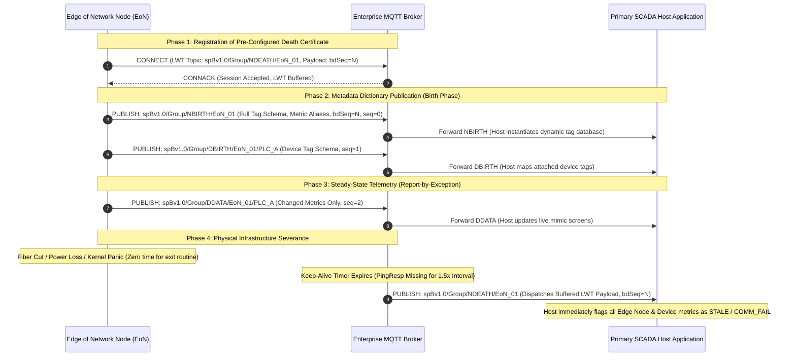

# Lesson 06: Eclipse Sparkplug B Specification & Industrial State Management

Standard Message Queuing Telemetry Transport (MQTT; analyzed in [[03-MQTT-Protocol-Internals|Lesson 03]]) has emerged as the de facto messaging backbone of modern Industrial Internet of Things (IIoT) platforms due to its lightweight publish/subscribe pattern and minimal transport overhead. However, when deployed in mission-critical Supervisory Control and Data Acquisition (SCADA) and factory automation architectures, generic MQTT reveals acute structural limitations: it lacks a standardized topic namespace, defines no payload data typing or schema contracts, and provides zero native awareness of physical edge device health. The **[[../Glossary#Sparkplug B|Eclipse Sparkplug B v3.0 Specification]]** formalizes an opinionated operational standard on top of MQTT, delivering deterministic device state management, self-describing topic taxonomies, Google Protocol Buffers (Protobuf) payload compression, and Report-by-Exception (RBE) telemetry optimization. This lesson examines the failure modes of raw MQTT on the plant floor, details the canonical topic namespace and session lifecycle, formalizes the dual sequence numbering contract, and explains Sparkplug B patterns that can be evaluated in industrial architectures.

---

## 1. Physical Edge Reality: The Plain MQTT Limitation in Industrial SCADA

In mission-critical industrial operational technology (OT), process engineers require absolute certainty regarding equipment connectivity, sensor measurement validity, and command responsiveness. While plain MQTT excels in consumer IoT, it introduces three fundamental architectural deficiencies when applied directly to industrial automation ([[Freitas_et_al_2025|Freitas et al., 2025]]; [[Senk_et_al_2026|Šenk et al., 2026]]).

First, standard MQTT permits arbitrary topic strings, leading to unstandardized topic taxonomies. In a multi-vendor plant, one contractor publishes tank levels to `tanks/tank1/level`, a second uses `Site_Chicago/Area_Processing/TK101_Level`, and a third emits `raw_telemetry/data/01`. Without an authoritative topic standard, enterprise SCADA and time-series historians require fragile, custom extract-transform-load (ETL) parsing layers for every machine.

Second, standard MQTT treats payloads as opaque, schema-free byte buffers. One edge gateway emits UTF-8 JSON dictionaries, another transmits raw ASCII text strings, and a third pushes packed binary floats. Subscribers cannot programmatically infer engineering units, numerical ranges, or data types without external, out-of-band documentation.

Finally, generic MQTT provides no deterministic device state modeling. MQTT clients connect to a central broker, but the broker has no intrinsic understanding of whether an attached PLC, sensor cluster, or field instrument is physically communicating with its gateway. If a field wire is severed or a subsea flowmeter suffers a power fault, subscribers continue to display stale historical values because no state-change event is broadcast.

The **Eclipse Sparkplug B v3.0 Specification** eliminates these blind spots by introducing strict topic structures, Protobuf payload schemas, and an end-to-end device lifecycle management protocol executed by industrial edge gateways (detailed in [[05-EoN-Nodes-Brownfield-Gateways|Lesson 05]]).

The physical hardware infrastructure implementing this protocol standard is illustrated in **Figure 06.1**, showing an industrial Edge of Network (EoN) gateway appliance (**Figure 06.1(a)**) managing sessions for subordinate field PLCs (**Figure 06.1(b)**):

<!-- 
  PHOTO SEARCH GUIDANCE:
  Target Equipment: Industrial Edge of Network (EoN) Gateway Appliance
  Suggested Models: Advantech WISE-710 / Moxa UC-8200 Industrial Embedded Computer / Kunbus RevPi Connect+
  Search Query: "Advantech WISE-710 DIN rail" OR "Moxa UC-8200 industrial gateway"
  Google Images Link: https://www.google.com/search?tbm=isch&q=Advantech+WISE-710+DIN+rail
-->
<!-- 
  PHOTO SEARCH GUIDANCE:
  Target Equipment: Subordinate Field Automation Controller / Modular PLC (Sparkplug Device)
  Suggested Models: Siemens S7-1200 Compact Controller / WAGO PFC200 (750-8212) Telecontrol Controller
  Search Query: "Siemens S7-1200 PLC" OR "WAGO PFC200 controller"
  Google Images Link: https://www.google.com/search?tbm=isch&q=Siemens+S7-1200+PLC
-->
![[06-sparkplug-eon-node.png]]
*(a) Edge of Network (EoN) Node / Industrial IoT Gateway Appliance (Moxa UC-8200)*

![[06-subordinate-field-plc.png]]
*(b) Subordinate Field PLC / Automation Controller connected as Sparkplug Device (Siemens S7-1200)*

*Figure 06.1: Physical Sparkplug B Topology: (a) Edge of Network (EoN) Gateway managing MQTT sessions and Last Will contracts; (b) Subordinate Field PLC whose I/O points are discovered dynamically via [[../Glossary#Birth and Death Certificates (Sparkplug B)|Device Birth (DBIRTH) certificates]].*

---

## 2. Canonical Topic Namespace & ISA-95 Mapping

Sparkplug B mandates a strict, non-negotiable 5-element topic structure across all publishers and subscribers:

$$\text{Topic} = \texttt{namespace / group\_id / message\_type / edge\_node\_id / [device\_id]}$$

### Topic Element Definitions

1. **`namespace`**: A fixed string defining the protocol version. For Sparkplug B, this is strictly `spBv1.0`. Any message published to an alternate namespace string is ignored by Sparkplug-compliant decoders.
2. **`group_id`**: An authoritative logical grouping representing physical plant topography, aligning directly with **ANSI/ISA-95 Enterprise, Site, or Area** levels (e.g., `Plant_Dallas` or `Refinery_Cracking_Area`).
3. **`message_type`**: The operational state or telemetry verb governing how the receiving host application must process the accompanying binary payload. Sparkplug B defines exactly nine core message verbs:
   - **`NBIRTH` (Node Birth Certificate)**: Broadcast when an Edge of Network (EoN) node establishes an active MQTT broker session. Contains the complete schema dictionary, metadata definitions, engineering units, and metric aliases for the gateway host.
   - **`NDEATH` (Node Death Certificate)**: Broadcast by the MQTT broker via the Last Will and Testament (LWT) mechanism upon ungraceful network severance, socket termination, or Keep-Alive expiration.
   - **`DBIRTH` (Device Birth Certificate)**: Broadcast when a subordinate instrument, motor drive, or PLC behind the EoN node is registered or comes online. Contains the device-level tag dictionary.
   - **`DDEATH` (Device Death Certificate)**: Broadcast by the EoN node when an attached field device loses communication (e.g., Modbus RS-485 cable cut or polling timeout) while the gateway itself remains online.
   - **`NDATA` (Node Telemetry Update)**: Transmits Report-by-Exception (RBE) process data originating from the EoN node hardware itself (e.g., gateway CPU temperature, cellular RSSI, memory utilization).
   - **`DDATA` (Device Telemetry Update)**: Transmits Report-by-Exception process data originating from subordinate field devices (e.g., tank pressure, motor RPM, flow rate).
   - **`NCMD` (Node Command)**: Downlink control command issued by the Primary SCADA Host to the EoN node (e.g., requesting a full configuration `Rebirth`).
   - **`DCMD` (Device Command)**: Downlink control command issued by the Primary SCADA Host to a subordinate field device (e.g., setting an analog valve position or tripping a digital circuit breaker).
   - **`STATE` (Host Session Status)**: Broadcast to topic `STATE/host_id` by the Primary SCADA Host Application to announce its operational readiness to the entire network.
4. **`edge_node_id`**: A unique string identifying the physical EoN gateway host within the specified `group_id` (e.g., `EoN_Gateway_Rack_04`).
5. **`device_id` (Optional)**: A unique string identifying a subordinate automation controller, remote I/O rack, or smart transmitter communicating through the EoN gateway (e.g., `PLC_Line_A` or `VFD_Mixer_02`). If an EoN gateway measures internal I/O directly without subordinate devices, the `device_id` element is omitted.

This structured topic namespace and its operational message verbs are illustrated in **Figure 06.2**:

![[06-sparkplug-topic-layout.svg]]

*Figure 06.2: Canonical Sparkplug B Topic Architecture — 5-Element Taxonomy Enforcing Protocol Revision, Enterprise Topology, Operational Message Verbs, Edge Gateways, and Subordinate Field Assets.*

### Enterprise UNS Alignment
The Sparkplug B topic taxonomy directly harmonizes with the **Unified Namespace (UNS)** equipment hierarchy established in [[08-ISA-95-Object-Models-Taxonomy|Lesson 08]]. In a raw MQTT architecture, every sensor reading typically requires a distinct topic path. To prevent broker connection exhaustion and eliminate redundant topic parsing overhead, Sparkplug B bundles all telemetry for a given machine into an asset-level payload (`DDATA`), while the UNS ingestion gateway strips the operational verb and transposes the payload metrics into the canonical ISA-95 directory tree.

As illustrated in **Figure 06.3**, the UNS ingestion layer strips the protocol verbs and transposes payload metrics directly into the canonical ISA-95 equipment hierarchy:

![[06-sparkplug-to-uns-mapping.svg]]

*Figure 06.3: Architectural Transposition — Mapping Sparkplug B Wire Topics and Protobuf Payload Metrics into the ANSI/ISA-95 Part 1 Equipment Hierarchy of the Unified Namespace (UNS).*

---

## 3. Session State Management & The Birth/Death Lifecycle

In traditional industrial polling protocols (Modbus, DF1), a central SCADA master interrogates edge slaves cyclically. In event-driven publish/subscribe architectures, state synchronization must be explicitly managed through deterministic protocol state machines. Sparkplug B guarantees continuous state awareness across edge hardware, intermediate brokers, and supervisory hosts.

### Sequence of Operations (The 5-Step Lifecycle)

The continuous state awareness, pre-registered Last Will contracts, and finite state transitions are diagrammed in **Figure 06.4**, with the multi-phase operational handshake detailed below:

![[06-sparkplug-state-machine.svg]]

*Figure 06.4: Sparkplug B Finite State Machine — Pre-Registration of LWT Death Certificates, Metadata Birth Dictionaries, Report-by-Exception Telemetry Loops, and Socket Severance Detection.*

The interaction among the Edge of Network (EoN) Node, the MQTT Broker, and the Primary SCADA Host Application follows a rigorous operational handshake:



### Dual Sequence Numbering Invariants (`seq` & `bdSeq`)

Standard TCP guarantees byte order over an established socket, but network packet drops, broker failovers, or temporary cellular reconnections can silently drop or scramble MQTT messages. Sparkplug B enforces data stream integrity through two independent sequence numbers:

#### Telemetry Sequence Counter (`seq`)
- An 8-bit unsigned integer ($0\text{--}255$) embedded in the header of every telemetry packet (`NBIRTH`, `DBIRTH`, `NDATA`, `DDATA`).
- **Initial Value**: Set to `0` on the `NBIRTH` packet.
- **Increment Rule**: Increments by $1$ for each subsequent packet emitted by that edge node. Wraps from $255$ back to $0$.
- **Gap Detection & Rebirth Trigger**: If a subscriber receives packet `seq = 14` followed immediately by `seq = 16`, an unrecoverable packet drop has occurred on the underlying transport. Because Sparkplug B transmits delta updates (Report-by-Exception), missing packet $15$ means the subscriber's in-memory state is now corrupt. The subscriber **MUST NOT** trust subsequent data and must immediately transmit an `NCMD` to the gateway with `Rebirth = true` to force a complete re-synchronization of all baseline variables.

#### [[../Glossary#Birth-Death Sequence Counter (`bdSeq`)|Birth-Death Sequence Counter (`bdSeq`)]]
- A 64-bit unsigned integer embedded inside `NBIRTH` and `NDEATH` certificates.
- **Increment Rule**: Increments by $1$ on the EoN gateway every time the device boots or initiates a fresh MQTT `CONNECT` handshake.
- **Correlation Invariant**: Prevents "zombie death" race conditions. If an edge gateway reboots rapidly, an out-of-order `NDEATH` from a prior socket closure might arrive at the SCADA host *after* a new `NBIRTH` has already been processed. The SCADA host compares the `bdSeq` in the `NDEATH` against the active `bdSeq` of the session; if the `bdSeq` is older than the current session, the death message is discarded as stale history.

---

## 4. The Primary SCADA Host Contract & Command Governance

In industrial SCADA environments, multi-master write conflicts create severe operational hazards (e.g., two distinct controllers commanding a pipeline valve simultaneously). Sparkplug B resolves this by formalizing the concept of a single **Primary SCADA Host Application** (acting as the supervisory core of the web SCADA tier; see [[11-Monolithic-vs-Web-SCADA|Lesson 11]]).

### The Primary Host Lifecycle (`STATE/host_id`)

The Primary SCADA Host Application acts as the authoritative supervisory consumer and command dispatcher:
1. **LWT Registration**: When the Primary Host connects to the MQTT broker, it registers its own LWT message on the topic:
   $$\texttt{STATE / host\_id}$$
   With a JSON payload: `{"online": false, "timestamp": 1774523400}`.
2. **Birth State Announcement**: Upon successful `CONNACK`, the Host publishes a retained message to `STATE/host_id` with:
   $$\texttt{\{"online": true, "timestamp": 1774523405\}}$$
3. **Edge Node Host Monitoring**: All EoN gateways subscribe to `STATE/+`. If an EoN gateway detects that the Primary SCADA Host has gone offline (`"online": false`), the gateway immediately transitions into a local buffering or safe-state mode, queuing telemetry until an active host re-establishes control.

### Downlink Command Execution (`NCMD` & `DCMD`)

Control operations are strictly separated from telemetry data streams:
- **Node Commands (`NCMD`)**: Target gateway configuration:
  ```protobuf
  // NCMD Payload Example
  metrics {
    name: "Node Control/Rebirth"
    type: Boolean
    boolean_value: true
  }
  ```
- **Device Commands (`DCMD`)**: Target field machinery setpoints:
  ```protobuf
  // DCMD Payload Example
  metrics {
    name: "Speed_Setpoint"
    type: Float
    float_value: 1750.0
  }
  ```

**Strict Security Boundary**: Under ISA/IEC 62443 standards (detailed in [[10-OT-Cybersecurity-IEC-62443|Lesson 10]]), edge gateways must enforce Access Control Lists (ACLs) on the MQTT broker, permitting write access to `*/*/*/NCMD/#` and `*/*/*/DCMD/#` exclusively to authenticated Primary SCADA Host credentials.

---

## 5. Report-by-Exception (RBE), Metric Aliasing & Bandwidth Economics

Legacy industrial protocols (Modbus RTU, Allen-Bradley DF1) rely on continuous cyclic polling: a master queries registers every $100\text{ ms}$, repeatedly receiving the same unchanged values across fieldbuses. Over distributed cellular or satellite links, continuous polling is economically non-viable.

### Report-by-Exception (RBE) Telemetry Mechanics

Sparkplug B enforces **Report-by-Exception (RBE)**:
1. During the `NBIRTH` and `DBIRTH` phase, the edge gateway transmits the complete baseline state of every tag on the machine.
2. In steady-state operation, the gateway samples field I/O at high internal frequencies ($10\text{--}50\text{ ms}$), but transmits an MQTT `NDATA` or `DDATA` packet **only when a variable changes beyond a configured deadband threshold** (or when a digital status bit toggles).
3. If an analog temperature fluctuates by $\pm 0.01^\circ\text{C}$ within a $\pm 0.5^\circ\text{C}$ deadband, zero network packets are emitted, completely silencing network traffic during steady-state process conditions.

### Metric Aliasing Optimization

In plain JSON architectures, every sensor update frame transmits the full descriptive string key (e.g., `"Enterprise/Plant_Dallas/Area_Packaging/Line_4/Filling_Machine/Cooling_Pump/Bearing_Temperature_DegC"`), consuming $90+$ bytes per reading solely in hierarchical strings.

Sparkplug B solves this through **Integer Metric Aliasing**:
- In the initial `NBIRTH` or `DBIRTH` dictionary, every descriptive string tag name is assigned a compact 64-bit integer `alias`:
  $$\texttt{"Cooling\_Pump/Bearing\_Temperature\_DegC"} \iff \mathbf{alias = 104}$$
- In all subsequent `NDATA` and `DDATA` telemetry frames, the gateway completely strips the descriptive string name, transmitting only the integer alias and the IEEE 754 value:
  ```protobuf
  // DDATA Wire Frame
  metrics {
    alias: 104
    value: 4.25
  }
  ```

Combining integer aliasing with Varint field tags (analyzed in depth in [[07-Protobuf-vs-Text-Serialization|Lesson 07]]) reduces telemetry packet overhead by **up to $90\%$**, allowing high-frequency telemetry transmission over low-bandwidth $2\text{G}/3\text{G}$, NB-IoT, and satellite connections.

---

## 6. Active-Recall Assessments

> [!FAQ]- What is the structural role of the NBIRTH certificate and what happens if a supervisory subscriber joins the network after it was published?
> The `NBIRTH` message acts as a self-describing metadata dictionary; it defines all metric names, data types, aliases, engineering units, and initial baseline values available on that edge gateway. If a supervisory application connects *after* the `NBIRTH` was published, it checks the node's cached birth state. If the birth state is absent or out of sync, the application issues an `NCMD` with `Node Control/Rebirth = true`, instructing the EoN gateway to immediately republish its complete `NBIRTH` and subordinate `DBIRTH` schema dictionaries ([[Senk_et_al_2026|Šenk et al., 2026]]).

> [!FAQ]- Why does Sparkplug B mandate that the NDEATH message be configured as an MQTT Last Will and Testament (LWT) rather than published during an edge gateway shutdown routine?
> Planned, graceful shutdowns can execute application exit routines to publish disconnect notifications. However, industrial field failure modes—such as backhoe fiber cuts, power outages, lightning strikes, or kernel panics—instantly terminate the edge processor before any exit code can run. By registering the `NDEATH` payload with the broker during the initial `CONNECT` handshake, the *broker* is responsible for detecting physical socket loss and broadcasting the death certificate when the Keep-Alive timer expires (typically $1.5\times$ the keep-alive interval) ([[Senk_et_al_2026|Šenk et al., 2026]]).

> [!FAQ]- How does the telemetry sequence number (`seq`) detect transport degradation and what exact action must the receiver take if a gap occurs?
> The `seq` number is an 8-bit integer ($0\text{--}255$) embedded in every telemetry packet that increments sequentially. Because Sparkplug B transmits delta updates (Report-by-Exception), missing even a single packet means the subscriber lacks an intermediate process change. If a subscriber receives packet $14$ followed by packet $16$ (a gap of 1), it detects packet loss, immediately flags subsequent telemetry as untrusted, and issues an `NCMD` with `Rebirth = true` to force the edge gateway to republish its complete baseline state.

> [!FAQ]- What operational hazard does the birth-death sequence number (`bdSeq`) eliminate in fast-rebooting edge gateways?
> The `bdSeq` counter is a 64-bit integer incremented on every gateway boot or reconnection that links `NBIRTH` and `NDEATH` pairs. If a gateway reboots rapidly after an ungraceful crash, network latency could cause an old `NDEATH` from the previous session to arrive at the SCADA host *after* the new session's `NBIRTH` has already been processed. The SCADA host compares the `bdSeq` of the incoming `NDEATH` against the active session's `bdSeq`; if the death message carries an older sequence number, it is discarded, preventing healthy live assets from being erroneously marked offline.

> [!FAQ]- How do Report-by-Exception (RBE) and integer Metric Aliasing cooperate to reduce cellular bandwidth expenses in remote wellhead RTUs?
> Traditional polling queries edge devices continuously, transmitting identical numbers over cellular data links regardless of whether values have changed. RBE suppresses transmission entirely unless process values exceed a deadband threshold or digital states change. When an update is emitted, Metric Aliasing replaces verbose hierarchical string paths ($50\text{--}100\text{ bytes}$) with a compact integer alias ($1\text{--}2\text{ bytes}$), delivering an aggregate payload reduction exceeding $90\%$ and safeguarding metered satellite and cellular telemetry tiers ([[Freitas_et_al_2025|Freitas et al., 2025]]).
