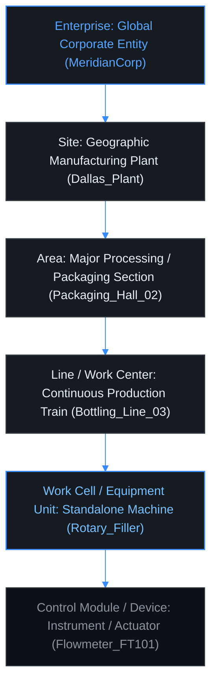

# Lesson 08: ISA-95 Object Models, Equipment Hierarchy & UNS Taxonomy

In legacy industrial automation, process data has historically been trapped in brownfield programmable logic controllers (PLCs) as raw memory offsets—a chaotic condition known across the industry as "Tag Soup". Transitioning from isolated control loops to an event-driven [[../Glossary#Unified Namespace (UNS)|Unified Namespace (UNS)]] requires adopting the **ANSI/ISA-95 Part 1 Role-Based Equipment Hierarchy (Clause 5.3)** as the authoritative semantic directory tree. This lesson examines the failure modes of unstructured PLC tag registries, formalizes the mapping of physical manufacturing facilities to deterministic MQTT topic trees, details enterprise wildcard harvesting patterns (`+` and `#`), and discusses object-oriented semantic profiles via CESMII standards as a possible integration pattern.

---

## 1. Physical Reality & The Brownfield 'Tag Soup' Dilemma (Prerequisites)

Understanding why modern IIoT architectures standardize on ANSI/ISA-95 requires analyzing the historical integration models and physical constraints of manufacturing control systems ([[Freitas_et_al_2025|Freitas et al., 2025]]; [[Senk_et_al_2026|Šenk et al., 2026]]):

### Historical Context: ANSI/ISA-95 (IEC 62264)
Developed in the late 1990s by the International Society of Automation, **ISA-95** established a formal standard for integrating enterprise resource planning (ERP like SAP) with manufacturing execution systems (MES) and plant-floor control infrastructure (SCADA, DCS, PLCs). 

Traditionally, ISA-95 integration relied on:
- **Hierarchical Point-to-Point Messaging:** Data traversed rigid [[../Glossary#Purdue Enterprise Reference Architecture (PERA / Purdue Model)|Purdue levels]] sequentially via scheduled batch ETL jobs.
- **B2MML (Business to Manufacturing Markup Language):** Monolithic XML schemas exchanged over SOAP endpoints and enterprise service buses (ESB).

**The Modern Architectural Shift:** In the proposed Meridian Grid and Unified Namespace (UNS) architecture (introduced in [[01-Purdue-vs-UNS|Lesson 01]]), ISA-95's Role-Based Equipment Hierarchy can provide the semantic basis for an event-driven publish/subscribe topic namespace over MQTT and Sparkplug B ([[03-MQTT-Protocol-Internals|Lesson 03]]; [[06-Sparkplug-B-Specification|Lesson 06]]). The exact topic governance and contract remain subject to Phase 2 specification.

### The Brownfield Baseline: The "Tag Soup" Problem
In brownfield manufacturing facilities, programmable logic controllers expose raw internal memory registers directly to industrial fieldbuses without contextual metadata:
- **Cryptic Memory Offsets:** A PLC engineer might assign a pump speed setpoint to Allen-Bradley register `N7:0`, line pressure to Siemens address `DB100.DBD12`, or motor run status to Modbus register `40001` (analyzed in [[02-Modbus-TCP-Mechanics|Lesson 02]] and terminated via edge gateways in [[05-EoN-Nodes-Brownfield-Gateways|Lesson 05]]).
- **Zero Inherent Context:** These registers lack engineering units (is `42.5` bar or PSI?), sensor measurement ranges, calibration timestamps, or physical machine ownership.
- **Brittle Coupling & Tribal Knowledge:** Upstream SCADA mimics and historical databases hardcode these memory offsets. If a PLC programmer modifies a data block, memory offsets shift, causing supervisory screens to display silently corrupted process values.

### Physical Equipment & Control Cabinet Infrastructure
On the physical plant floor, industrial instrumentation and programmable controllers are housed in rugged enclosures interfacing with analog transducers and fieldbuses, as illustrated in **Figure 08.1**, contrasting modular PLC control cabinets (**Figure 08.1(a)**) with smart digital field instruments (**Figure 08.1(b)**):

<!-- 
  PHOTO SEARCH GUIDANCE:
  Target Equipment: Industrial Automation Control Cabinet with PLCs & Terminal Blocks
  Suggested Models: Rittal VX25 Industrial Enclosure / Rockwell ControlLogix Cabinet / Siemens S7-1500 Rittal Rack
  Search Query: "Rittal industrial control panel PLC cabinet wiring" OR "Rockwell ControlLogix industrial control cabinet"
  Google Images Link: https://www.google.com/search?tbm=isch&q=Rittal+industrial+control+panel+PLC+cabinet+wiring
-->
<!-- 
  PHOTO SEARCH GUIDANCE:
  Target Equipment: Smart Industrial Field Instrument / Coriolis Mass Flowmeter
  Suggested Models: Endress+Hauser Promass F 300 / Emerson Micro Motion ELITE Coriolis Meter
  Search Query: "Endress+Hauser Promass Coriolis flowmeter" OR "Emerson Micro Motion Coriolis meter"
  Google Images Link: https://www.google.com/search?tbm=isch&q=Endress+Hauser+Promass+Coriolis+flowmeter
-->
![[08-industrial-automation-cabinet.png]]
*(a) Industrial Automation Control Cabinet with Modular PLCs and Terminal Wiring (Rittal VX25)*

![[08-smart-field-transmitter.png]]
*(b) Smart Industrial Coriolis Mass Flowmeter with Digital Fieldbus Transmitter (Endress+Hauser)*

*Figure 08.1: Plant-Floor Equipment Infrastructure: (a) Industrial Automation Control Enclosure housing modular PLCs; (b) Smart Field Instrument measuring mass flow rate and process temperature.*

This fundamental architectural transition—moving from unstructured brownfield memory offsets to structured, self-describing asset models—is illustrated in **Figure 08.2**:

![[08-tag-soup-vs-semantic-profile.svg]]

*Figure 08.2: Architectural Comparison — Cryptic Brownfield 'Tag Soup' Memory Offsets vs. Object-Oriented Semantic Asset Profiles with Self-Describing Types.*

---

## 2. The ANSI/ISA-95 Part 1 Role-Based Equipment Hierarchy (Clause 5.3)

Clause 5.3 of the ANSI/ISA-95.00.01 (IEC 62264-1) standard formalizes how industrial equipment and physical operations are organized into a strict role hierarchy:



### Physical Factory Floor Grounding
To understand this hierarchy in operational reality, consider a physical packaging facility:

1. **Enterprise (Corporate Cloud):** Global governance entity owning enterprise cloud and multi-site operations (`MeridianCorp`).
2. **Site (Physical Facility):** Distinct geographic manufacturing campus or facility (`Dallas_Plant`).
3. **Area (Process Section):** Dedicated production zone governed by common environmental, hygiene, or safety rules (`Packaging_Hall_02`).
4. **Line / Work Center (Continuous Train):** Integrated group of machines working synchronously on a continuous product flow (`Bottling_Line_03`).
5. **Work Cell / Equipment Unit (Individual Machine):** Distinct machine, robot, or vessel performing a specific unit operation (`Rotary_Filler`, `Crown_Capper`).
6. **Control Module / Field Device (Instrument):** Regulated field actuators, transducers, and transmitters directly monitoring physical state (`Flowmeter_FT101`, `Inlet_Temp_DegC`).

The mapping of this physical packaging train to hierarchical operational topic paths is illustrated in **Figure 08.3**:

![[08-physical-plant-to-uns-tree.svg]]

*Figure 08.3: Physical Equipment Grounding — Conveyor-Linked Packaging Train Mapped to Hierarchical Operational MQTT Topic Paths.*

---

## 3. Mapping ISA-95 Hierarchy to Unified Namespace (UNS) Topics

In a Unified Namespace, the ISA-95 equipment hierarchy is operationalized as the **authoritative topic namespace** within the MQTT event broker ([[Freitas_et_al_2025|Freitas et al., 2025]]):

$$\text{UNS Topic Path} = \texttt{Enterprise / Site / Area / Line / Work\_Cell / [Subsystem] / Metric\_Name}$$

### Concrete Industrial Example: Chemical Reactor Monitoring
Consider a cooling water jacket on an exothermic batch reactor located in Dallas:
```text
Enterprise: MeridianChemicals
Site:       Dallas_Plant
Area:       Polymer_Synthesis
Line:       Reactor_Train_02
Work_Cell:  Continuous_Stirred_Tank_Reactor_4
Subsystem:  Cooling_Jacket
Metric:     Inlet_Temperature_DegC
```

#### Corresponding Authoritative UNS Topic String
```text
MeridianChemicals/Dallas_Plant/Polymer_Synthesis/Reactor_Train_02/Continuous_Stirred_Tank_Reactor_4/Cooling_Jacket/Inlet_Temperature_DegC
```

### Topic Governance Invariants
1. **Strict Case-Sensitivity Enforcement:** MQTT brokers treat topics as raw byte strings (`AreaA` $\neq$ `areaa`). Platforms must strictly enforce uniform casing (`PascalCase` or `kebab-case`) across all gateway configurations to prevent silent routing failures.
2. **Deterministic Depth Invariant:** Every operational asset across every plant globally must adhere to the exact same hierarchy depth.
3. **No Dynamic Telemetry in Topic Keys:** Telemetry values must reside inside payload envelopes, never in topic names (e.g., publish `1200` to `.../Line1/Speed`, never publish to `.../Line1/Speed_1200RPM`).

This structural transformation, mapping traditional Purdue layers to semantic, event-driven MQTT topic paths, is illustrated in **Figure 08.4**:

![[08-isa95-to-uns-mapping.svg]]

*Figure 08.4: Structural Transformation — Transforming Rigid Purdue Physical Layers into Semantic Event-Driven MQTT Topic Hierarchies.*

---

## 4. Enterprise Wildcard Harvesting & Depth Determinism

MQTT provides two wildcard operators that enable enterprise applications to subscribe to targeted cross-sections of the factory hierarchy:
1. **Single-Level Wildcard (`+`):** Matches exactly one topic level between forward slashes (`/`).
2. **Multi-Level Wildcard (`#`):** Matches any number of remaining trailing topic levels. Must always be placed as the final character in a subscription string.

### Role-Based Subscription Patterns

| Enterprise Persona / System | MQTT Wildcard Subscription | Operational Function |
| :--- | :--- | :--- |
| **Global Predictive Maintenance (CBM)** | `Meridian/+/+/+/+/Vibration_RMS` | Ingests bearing vibration from every machine across all global plants in a single subscription without enumerating thousands of tag strings. |
| **Local Plant Safety Gateway** | `Meridian/Dallas_Plant/#` | Replicates all telemetry, alarms, and state changes originating from the Dallas site to the local HMI, completely ignoring other sites. |
| **Global Quality / Brewing Manager** | `Meridian/+/Brewing/+/+/Temperature` | Aggregates temperature curves across fermentation areas worldwide, filtering out unrelated packaging and logistics data. |

### The Fatal Hazard: Non-Deterministic Topic Depth
The power of single-level wildcards (`+`) depends entirely on **Deterministic Namespace Depth**:
- If Site A uses 6 levels: `Meridian / Dallas / Brew / L1 / Fermenter1 / Temp`
- If Site B skips the Line level (5 levels): `Meridian / Munich / Brew / Fermenter4 / Temp`

A global query structured as `Meridian/+/Brew/+/+/Temp` (expecting 6 levels) will successfully capture Site A, but will **silently ignore Site B**. No broker error or exception is ever raised. Strict enterprise governance must guarantee consistent hierarchy depth across all sites.

The interaction between single-level (`+`) and multi-level (`#`) wildcards and the critical role of namespace depth determinism are illustrated in **Figure 08.5**:

![[08-mqtt-wildcard-harvesting.svg]]

*Figure 08.5: Namespace Subscription Mechanics — Single-Level (+) and Multi-Level (#) Wildcard Subscriptions and the Deterministic Depth Invariant.*

---

## 5. Object-Oriented Semantic Profiles & Tag Soup Remediation

Beyond raw topic hierarchy strings, modern industrial systems enforce object-oriented data models called **Asset Profiles** ([[Koprov_et_al_2022|Koprov et al., 2022]]):

A Profile specifies the variables, engineering units, default setpoints, and behavioral methods associated with an asset class:

```typescript
// Semantic Profile: CentrifugalPump Class Contract
interface CentrifugalPump {
  suction_pressure: {
    type: "Float32";
    unit: "kPa";
    min: 0.0;
    max: 600.0;
    deadband: 0.5; // Report by Exception %
  };
  discharge_pressure: {
    type: "Float32";
    unit: "kPa";
    min: 0.0;
    max: 1200.0;
  };
  motor_current: {
    type: "Float32";
    unit: "Amperes";
    alarm_high: 145.0;
  };
  vibration_rms: {
    type: "Float32";
    unit: "mm/s";
    trip_limit: 4.5;
  };
  run_status: "STOPPED" | "STARTING" | "RUNNING" | "FAULT";
}
```

When a new pump is commissioned on the factory floor, the edge gateway instantiates this profile rather than manually creating disparate tags, guaranteeing semantic interoperability across the enterprise. Furthermore, this deterministic hierarchy generates the standardized compound identifiers utilized by the automated SVG synoptic synthesis engine (see [[13-Declarative-SVG-Synthesis|Lesson 13]]).

### Structural Comparison: Brownfield "Tag Soup" vs. ISA-95 Unified Namespace

| Architectural Dimension | Brownfield "Tag Soup" Architecture | ISA-95 Unified Namespace |
| :--- | :--- | :--- |
| **Data Organization** | Cryptic, flat PLC memory addresses (`N7:0`, `DB100.DBD12`) | Hierarchical functional topic path (`Enterprise/Site/Area/Line/Cell`) |
| **Semantic Metadata** | Zero inherent context; units and limits hardcoded in tribal docs | Self-describing typed profiles with engineering units, deadbands, and ranges |
| **System Coupling** | Tight point-to-point polling; client binds directly to memory offsets | Decoupled publish/subscribe via centralized broker; single source of truth |
| **Schema Evolution** | Shifting PLC registers breaks upstream SCADA and database mappings | Remapped at edge gateway without altering topic paths or consumer logic |
| **Analytics Ingestion** | Requires complex ETL and manual tag mapping per site | Instantaneous wildcard aggregation (`Meridian/+/+/+/+/Vibration_RMS`) |
| **Integration Overhead** | $\mathcal{O}(N^2)$ point-to-point connections across Purdue layers | $\mathcal{O}(N)$ connection model into common namespace hub |
| **Interoperability** | Vendor-locked proprietary protocols (Modbus, DF1, S7Comm) | Open standard contracts (MQTT Sparkplug B, CESMII Profiles, [[../Glossary#OPC Unified Architecture (OPC UA)|OPC UA]] NodeSets) |

---

## 6. Active-Recall Assessments

> [!FAQ]- Why is topic governance critical in a raw MQTT Unified Namespace, and how does Sparkplug B alter this dynamic?
> Raw MQTT does not enforce topic structure; without rigid governance, different engineering teams create inconsistent, non-standard hierarchies, creating data silos. Sparkplug B replaces arbitrary string conventions with a strictly enforced protocol namespace (`spBv1.0/Group_ID/Message_Type/Edge_Node_ID/Device_ID`), guaranteeing cross-vendor semantic consistency at the wire level ([[Freitas_et_al_2025|Freitas et al., 2025]]; [[Senk_et_al_2026|Šenk et al., 2026]]).

> [!FAQ]- How does the ISA-95 equipment hierarchy simplify enterprise-level telemetry subscription using wildcards?
> By structuring topic namespaces from most general (Enterprise) to most specific (Device), enterprise analytics applications can construct precise wildcard filters. For example, subscribing to `MeridianChemicals/+/Polymer_Synthesis/#` aggregates real-time data from every polymer synthesis area across all manufacturing sites globally in a single subscription without enumerating thousands of individual sensor tags.

> [!FAQ]- What is the difference between ISA-95 physical hierarchy and ISA-95 logical/functional hierarchy?
> The **physical hierarchy** models physical equipment locations and geographic enclosures (Site $\to$ Building $\to$ Room $\to$ Cabinet $\to$ Rack). The **functional role hierarchy** models operational responsibility in the production process (Enterprise $\to$ Site $\to$ Area $\to$ Line $\to$ Work Cell). Telemetry UNS namespaces model the *functional* hierarchy because data processing logic aligns with manufacturing execution, not physical building walls.

> [!FAQ]- What is the "Deterministic Depth Invariant" in UNS design, and what happens when it is violated?
> The Deterministic Depth Invariant dictates that every metric published to the broker must reside at the exact same depth level in the topic tree across all enterprise sites. When violated (e.g., one site omitting the Line level while another includes it), multi-tier single-level wildcard subscriptions (such as `Enterprise/+/Area/+/Cell/Metric`) fail to match the non-compliant topics, resulting in silent data omissions without generating error logs.
