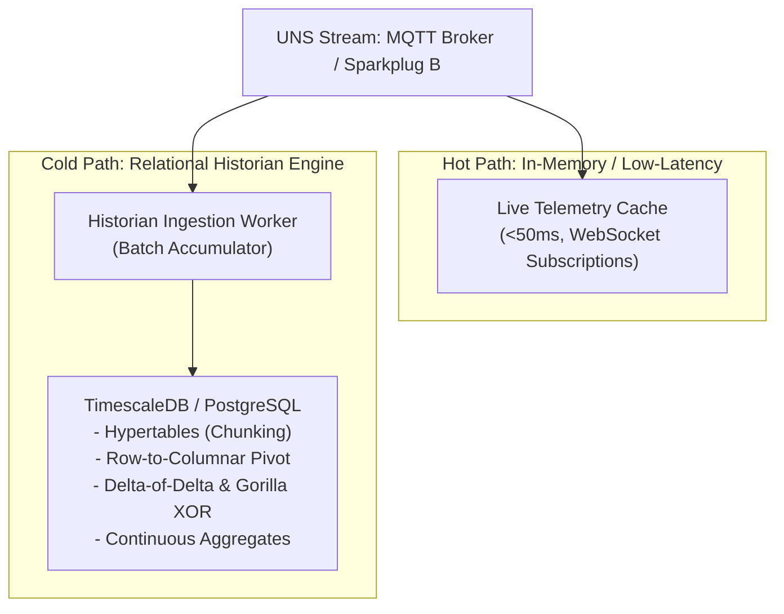

# Lesson 09: Time-Series Historians & Append-Only Relational Storage

In industrial supervisory control, process data is fundamentally distinct from enterprise transaction data. Sensor measurements, setpoint adjustments, and alarm events arrive at high sustained velocities ($>100{,}000\text{ samples/sec}$) and represent immutable physical facts ordered strictly by time. Attempting to ingest this firehose into standard unpartitioned relational databases triggers rapid index degradation and throughput collapse. This lesson analyzes the internal database mechanics of the **RAM Buffer Pool**, details the two-dimensional chunking of **Hypertables**, breaks down lossless bitwise compression algorithms (**Delta-of-Delta** and **Gorilla XOR**), and discusses **LTTB downsampling** as a possible technique for web SCADA trending charts. The historian engine, database extension, and downsampling policy are deployment decisions; `TimescaleDB` is one candidate among several.

---

## 1. Physical Storage Reality & Database Engine Foundations (Prerequisites)

Understanding why industrial telemetry requires specialized time-series storage requires examining how database management engines interface with physical memory and storage media ([[Huusom_et_al_2025|Huusom et al., 2025]]):

### OLTP vs. Industrial Time-Series Workloads
- **Online Transaction Processing (OLTP):** Traditional enterprise relational workloads (e.g., e-commerce, banking, ERP) execute unpredictable point reads, random updates, and deletions across normalized tables with foreign-key relationships. ACID guarantees prioritize row-level locking, rollback journals, and arbitrary record mutations.
- **Industrial Historian Telemetry:** Industrial telemetry streams are **append-only, immutable, and strictly ordered by time**. A thermocouple reading of $250.25^\circ\text{C}$ recorded at $14:02:00.125$ is an immutable physical event that can never be updated or deleted. Database queries are almost exclusively temporal interval scans ($\text{WHERE } t_1 \le \text{timestamp} \le t_2$) scoped to specific plant assets.

### The RAM Buffer Pool & The Working Set Barrier
Relational database engines manage physical disk I/O by caching storage blocks (typically 8 KB pages) in an in-memory memory region known as the **Buffer Pool**. The subset of data and index pages actively read or modified during execution constitutes the **Working Set**:
- **In-Memory Fit:** As long as the active working set fits entirely within host RAM, insert and read transactions execute at microsecond memory speeds.
- **Disk Page Swapping:** When the working set expands beyond available physical RAM, the database engine is forced to evict clean pages and flush dirty pages to disk, inducing non-deterministic NVMe/SSD read/write cycles.

### Industrial Persistence Hardware
Deploying a mission-critical historian requires distinct physical tiers: high-throughput server clusters in the enterprise data center or IDMZ, paired with ruggedized edge computing appliances on the plant floor for non-volatile local caching, as illustrated in **Figure 09.1**, contrasting rackmount enterprise database servers (**Figure 09.1(a)**) with DIN-rail edge historians (**Figure 09.1(b)**):

<!-- 
  PHOTO SEARCH GUIDANCE:
  Target Equipment: 2U High-Density Enterprise Historian Rackmount Server
  Suggested Models: Dell PowerEdge R750 / HPE ProLiant DL380 Gen10
  Search Query: "Dell PowerEdge R750 rack server front" OR "HPE ProLiant DL380 Gen10 2U server"
  Google Images Link: https://www.google.com/search?tbm=isch&q=Dell+PowerEdge+R750+rack+server+front
-->
<!-- 
  PHOTO SEARCH GUIDANCE:
  Target Equipment: DIN-Rail Industrial Edge Historian / Embedded IPC
  Suggested Models: Moxa MC-1200 Series / Advantech UNO-2000 Series / Siemens Microbox IPC
  Search Query: "Moxa MC-1200 DIN-rail computer" OR "Advantech UNO-2000 industrial PC"
  Google Images Link: https://www.google.com/search?tbm=isch&q=Moxa+MC-1200+DIN-rail+computer
-->
![[09-enterprise-historian-server.png]]
*(a) 2U Enterprise Historian Database Server with NVMe U.2 SSD Array (Dell PowerEdge R750)*

![[09-din-rail-edge-historian.png]]
*(b) DIN-Rail Rugged Industrial Edge Historian for Store-and-Forward Caching (Moxa MC-1200)*

*Figure 09.1: Industrial Time-Series Persistence Infrastructure: (a) 2U Enterprise Database Server with NVMe U.2 SSD Array hosting relational hypertables; (b) Rugged DIN-Rail Edge Computer providing local non-volatile store-and-forward telemetry caching.*

---

## 2. The B-Tree Index Collapse & Ingress Architecture

### The B-Tree Index Collapse Mechanism
Traditional relational databases index timestamp columns using balanced search trees (**B-Trees**). In an unpartitioned table:
1. Every newly ingested timestamp requires traversing and updating the table's B-Tree index.
2. As the table grows to tens of millions of rows, the physical B-Tree index expands from megabytes into tens of gigabytes, rapidly exceeding the host RAM buffer pool.
3. Because time moves continuously forward, newly inserted timestamps touch leaf pages distributed across the tree that are not cached in RAM.
4. The database engine enters **B-Tree Page Thrashing**: pausing write threads to swap 8 KB index pages from NVMe/SSD storage into memory for every single insert.
5. Ingestion throughput collapses exponentially—collapsing from $>100{,}000\text{ writes/sec}$ down to $<1{,}500\text{ writes/sec}$ once the index spills over RAM.

### Ingress Pipeline: Hot Path vs. Cold Path
To maintain wire-speed ingestion while isolating live supervisory visualization from disk serialization stalls, modern SCADA architectures split ingress into a dual-path pipeline ([[Huusom_et_al_2025|Huusom et al., 2025]]; analyzed in depth in [[19-Hot-Path-vs-Cold-Path-Pipelines|Lesson 19]]):

- **Hot Path (In-Memory Streaming):** Completely bypasses persistent disk storage. Live MQTT telemetry from the Unified Namespace ([[01-Purdue-vs-UNS|Lesson 01]]; [[03-MQTT-Protocol-Internals|Lesson 03]]; [[06-Sparkplug-B-Specification|Lesson 06]]) publishes directly into memory ring buffers and WebSocket gateways ([[12-WebSocket-Streaming-Mechanics|Lesson 12]]), updating browser SCADA mimics with sub-50 ms latency.
- **Cold Path (Batched Persistence):** Aggregates incoming metrics in high-speed memory buffers before issuing vectorized multi-row `COPY` or batch `INSERT` transactions into the time-series storage engine.

The architecture of this decoupled dual-path ingress pipeline is diagrammed below:

---

## 3. Hypertable Chunking & The Row-to-Columnar Storage Lifecycle

Modern time-series relational historians (such as PostgreSQL with **TimescaleDB**) resolve the B-Tree thrashing bottleneck through transparent, two-dimensional partitioning into **[[../Glossary#Hypertables & Chunks (TimescaleDB)|Hypertables]]**:

### Partitioning & Chunking Mechanics
1. **Logical Abstraction:** Applications read and write to a single logical entity (e.g., `telemetry_metrics`) using standard ANSI SQL.
2. **Physical Chunking:** Under the hood, the engine dynamically creates physical child tables ("chunks") based on timestamp intervals (e.g., 24 hours per chunk).
3. **Working-Set Guarantee:** Each chunk maintains its own independent B-Tree index. Because writes land *exclusively* in the newest active chunk, its index is small (e.g., 50–150 MB) and fits 100% inside host RAM. This guarantees flatline write throughput ($>100{,}000\text{ writes/sec}$) regardless of whether the database holds 1 million or 10 billion historical rows.
4. **Transparent Partition Pruning:** When an operator queries a 2-hour window, the query planner evaluates chunk metadata and scans *only* the matching physical chunk table, completely bypassing hundreds of gigabytes of historical data on disk.

This contrast between unpartitioned B-Tree index page thrashing and hypertable working-set guarantees is diagrammed in **Figure 09.2**:

![[09-btree-thrashing-vs-chunking.svg]]

*Figure 09.2: Storage Engine Dynamics — Unpartitioned B-Tree Index Page Thrashing vs. Hypertable Time-Chunking Working-Set Guarantees.*

### The Two-Phase Storage Lifecycle
Traditional row-oriented layouts store entire tuples together (`[timestamp, asset_id, value, quality]`). While row storage is optimal for transactional ACID inserts, it is catastrophically inefficient for analytical time-series queries and compression. Time-series engines resolve this through a **two-phase storage lifecycle**:

#### Phase 1: Active Ingestion (Row-Store in WAL & RAM)
While a chunk is open (e.g., during the current 24-hour window), incoming data is appended as row tuples. This minimizes write locks and CPU overhead, allowing the database to absorb wire-speed bursts from edge MQTT brokers.

#### Phase 2: Chunk Closure & Columnar Pivot
Once a chunk reaches its temporal boundary, it is closed against new writes. A background worker pivots the row tuples into homogeneous column vectors:
- `timestamps[]`: Array of 64-bit integer epochs.
- `asset_ids[]`: Array of foreign-key symbols or strings.
- `values[]`: Array of 64-bit IEEE 754 double-precision floats.
- `qualities[]`: Array of 8-bit OPC/Sparkplug quality flags.

Because each vector contains strictly homogeneous data types, specialized bitwise compression algorithms reduce disk consumption by **$90\%\text{–}95\%$**.

This transition from active row-tuple ingestion to dense columnar vector compression is illustrated in **Figure 09.3**:

![[09-row-vs-columnar-compression.svg]]

*Figure 09.3: Row-to-Columnar Storage Lifecycle — Ingesting Concurrent Row Tuples in Active Chunks vs. Pivoting to Homogeneous Column Vectors for Dense Lossless Compression.*

---

## 4. Lossless Bitwise Compression Algorithms (Delta-of-Delta & Gorilla XOR)

Industrial compliance standards require that raw historical telemetry be archived without losing floating-point precision. Relational historians apply two primary lossless bitwise compression codecs:

### [[../Glossary#Delta-of-Delta Compression|Delta-of-Delta]] Timestamp Encoding
Timestamps in industrial systems are generated by periodic scanning loops (e.g., polling every 1000 ms). Rather than storing absolute 64-bit Unix timestamps ($t_i$), the engine calculates the difference between successive intervals:

$$\Delta = t_i - t_{i-1}$$
$$D = (t_i - t_{i-1}) - (t_{i-1} - t_{i-2}) = \Delta_i - \Delta_{i-1}$$

#### Arithmetic Walkthrough:
Consider three periodic telemetry records sampled at $1000\text{ ms}$ intervals:
- $t_0 = 1774523400000\text{ ms}$
- $t_1 = 1774523401000\text{ ms} \implies \Delta_1 = 1000\text{ ms}$
- $t_2 = 1774523402000\text{ ms} \implies \Delta_2 = 1000\text{ ms}$
- **Delta-of-Delta ($D$):** $D = \Delta_2 - \Delta_1 = 1000 - 1000 = 0\text{ ms}$.

Because $D = 0$, the algorithm emits a **single bit: `0`**. A full 64-bit timestamp is compressed into a single bit. If network jitter causes a small variance (e.g., $D = +5\text{ ms}$), the engine uses a 2-bit prefix followed by a compact 7-bit integer, eliminating $>95\%$ of timestamp storage overhead.

### [[../Glossary#Gorilla XOR Compression|Gorilla XOR]] Floating-Point Encoding
Floating-point values (temperatures, pressures, flow rates) change smoothly over time. Successive IEEE 754 64-bit floats share identical sign bits, exponent bits, and high-order mantissa bits.

The Gorilla algorithm computes the bitwise XOR between the current reading ($V_i$) and the previous reading ($V_{i-1}$):

$$\text{XOR} = V_i \oplus V_{i-1}$$

- **Case 1 (Zero Delta):** If the value is unchanged ($V_i = V_{i-1}$), $\text{XOR} = 0$. The engine stores a **single bit `0`**. An 8-byte float is compressed to 1 bit.
- **Case 2 (Small Drift):** When a boiler temperature drifts slightly (e.g., from $250.25^\circ\text{C}$ to $250.26^\circ\text{C}$), the XOR product exhibits long runs of leading zeros (identical sign and exponent) and trailing zeros. The engine writes a prefix indicating the number of leading and trailing zeros, storing only the intermediate meaningful changed bits.

The bitwise mechanics of Gorilla floating-point XOR analysis and Delta-of-Delta timestamp compression are diagrammed in **Figure 09.4**:

![[09-gorilla-xor-compression.svg]]

*Figure 09.4: Lossless Bitwise Compression Mechanics — Gorilla Floating-Point XOR Register Analysis and Delta-of-Delta Timestamp Encoding.*

---

## 5. Client Visualization Bottlenecks: Continuous Aggregates & LTTB Decimation

### The Client-Side Rendering Bottleneck
A single high-speed sensor transmitting at $100\text{ Hz}$ generates $8{,}640{,}000$ points in 24 hours. Attempting to transmit this uncompressed dataset over WebSockets directly to a web browser introduces three catastrophic bottlenecks.

First, network payload bloat overwhelms the connection, as transferring $8.64\text{M}$ JSON records requires over $400\text{ MB}$ of wire transport for a single trend.

Second, the browser runtime suffers severe memory and layout collapse. Modern JavaScript engines and SVG/Canvas renderers degrade to single-digit framerates or crash entirely when managing more than $100{,}000$ active vector vertices in memory (analyzed in [[14-Browser-Rendering-Engines|Lesson 14]]).

Finally, sub-pixel aliasing destroys visual utility. On a standard $1920 \times 1080$ operator workstation, a trend widget is rarely wider than $800\text{ pixels}$. Directing millions of points into an 800-pixel viewport forces over $10{,}000$ points to compete for the exact same vertical pixel column, rendering the trend line illegible.

To solve this, industrial platforms employ a two-tier visualization architecture: **Continuous Aggregates** in the database, and **LTTB Decimation** on active streams.

### [[../Glossary#Continuous Aggregates|Continuous Aggregates]] (Materialized Views)
Rather than scanning billions of raw rows on every query, the database engine maintains pre-aggregated summary tables in the background (e.g., 1-minute, 1-hour rollups containing `min`, `max`, `avg`, `first`, `last`). Multi-month trend queries hit the aggregate tables in milliseconds without scanning raw tables.

### [[../Glossary#Largest Triangle Three Buckets (LTTB)|Largest Triangle Three Buckets (LTTB)]] Decimation
When high-resolution operational detail must be displayed without downsampling artifacts, an implementation may apply **LTTB (Largest Triangle Three Buckets)** downsampling:

Unlike naive boxcar averaging (which calculates the arithmetic mean of each time bucket and flattens out critical pressure spikes or safety valve trips), LTTB downsamples data while preserving the perceptual shape and transient extrema of the waveform:
1. The raw dataset of $N$ points is split into $K$ equal temporal buckets (where $K$ matches the target pixel width, e.g., 500).
2. For each bucket $B_i$, LTTB evaluates all candidate points and selects the point $B$ that forms the **maximum triangular area** with the point chosen in the previous bucket ($A$) and the average center point of the subsequent bucket ($C$):

$$\text{Area} = \frac{1}{2} \left| x_A(y_B - y_C) + x_B(y_C - y_A) + x_C(y_A - y_B) \right|$$

3. Selecting the vertex that maximizes triangle area mathematically guarantees that transient spikes, dips, and slope inflection points are preserved, ensuring operators never miss abnormal process conditions.

This geometric selection mechanism, contrasting LTTB peak retention against destructive boxcar averaging, is illustrated in **Figure 09.5**:

![[09-lttb-downsampling.svg]]

*Figure 09.5: High-Performance SCADA Decimation — LTTB Geometric Triangle Selection vs. Naive Boxcar Averaging for Transient Anomaly Retention.*

### Structural Comparison: Relational Row-Store vs. Time-Series Hypertable Historian

| Architectural Dimension | Traditional Relational Row-Store (PostgreSQL / MySQL) | Time-Series Hypertable Historian |
| :--- | :--- | :--- |
| **Ingestion Performance** | Collapses exponentially once B-tree exceeds RAM buffer pool ($<1.5\text{k ops/s}$) | Flatline wire-speed ($>100\text{k ops/s}$) via active chunk RAM working-set guarantee |
| **Storage Architecture** | Mixed-type row tuples in contiguous data pages | Two-phase: active row ingestion pivoted to homogeneous columnar arrays on chunk closure |
| **Data Compression** | Generic page-level LZ4/ZSTD ($40\%\text{–}60\%$ compression ratio) | Type-specific bitwise codecs (Gorilla XOR, Delta-of-Delta, RLE) achieving $90\%\text{–}95\%$ space reduction |
| **Historical Range Scans** | Full index scan across monolithic B-tree with high page fault probability | Transparent partition pruning: scans strictly the physical chunks covering the query interval |
| **Data Aging & Retention** | Slow, I/O-intensive row-by-row `DELETE` statements requiring heavy `VACUUM` | Instantaneous metadata-level `DROP CHUNK` with zero disk fragmentation |
| **Visualization Scalability** | Client queries raw points; crashes browser DOM on multi-day trend windows | Continuous aggregates and LTTB downsampling provide 60 FPS sub-50 KB chart payloads |
| **SQL Compatibility** | Full ANSI SQL standard support | 100% ANSI SQL compatibility with native PostgreSQL drivers, ORMs, and reporting tools |

---

## 6. Active-Recall Assessments

> [!FAQ]- Why does inserting high-throughput time-series data into an unpartitioned relational database inevitably degrade write performance over time?
> In an unpartitioned table with a B-tree index on `timestamp`, each new row requires updating the index tree. As table size expands into tens of millions of rows, the B-tree index outgrows the host RAM buffer pool. The database is forced to perform random disk read/write cycles to swap 8 KB index pages into memory for every insert, causing throughput to collapse from $>100{,}000$ rows per second to a few dozen ([[Huusom_et_al_2025|Huusom et al., 2025]]).

> [!FAQ]- Why must a time-series chunk be closed and pivoted to columnar storage before applying Gorilla XOR and Delta-of-Delta compression?
> Row-oriented storage interlaces different data types (`int64` timestamp, `string` asset_id, `float64` value) contiguously in memory, making bitwise differential compression impossible. Pivoting to columnar storage groups identical data types into contiguous arrays (`float64[]`). This type homogeneity allows Gorilla XOR and Delta-of-Delta algorithms to compare successive values directly, unlocking $90\%\text{–}95\%$ lossless compression ratios.

> [!FAQ]- Why is Naive Boxcar Averaging dangerous for SCADA trend visualization, and how does LTTB solve it?
> Naive boxcar averaging calculates the arithmetic mean of points within a time window, which mathematically cancels out rapid, transient process spikes (such as a 10 ms overpressure spike or a trip vibration surge). An operator viewing an averaged trend would see normal operating conditions while missing a catastrophic transient. LTTB divides the data into buckets and selects the point maximizing the triangular area against adjacent buckets, guaranteeing that extreme transient peaks and valleys are retained on screen.

> [!FAQ]- What is a Continuous Aggregate and how does it accelerate multi-day historical SCADA trending charts?
> Rather than scanning millions of raw 1-second telemetry rows every time an operator requests a 30-day overview trend, a **Continuous Aggregate** precomputes and incrementally maintains summary statistics (e.g., 1-hour `min`, `max`, `avg`) in the background. When the query executes, the database reads the pre-aggregated summary table in milliseconds rather than re-scanning gigabytes of raw measurements ([[Huusom_et_al_2025|Huusom et al., 2025]]).
