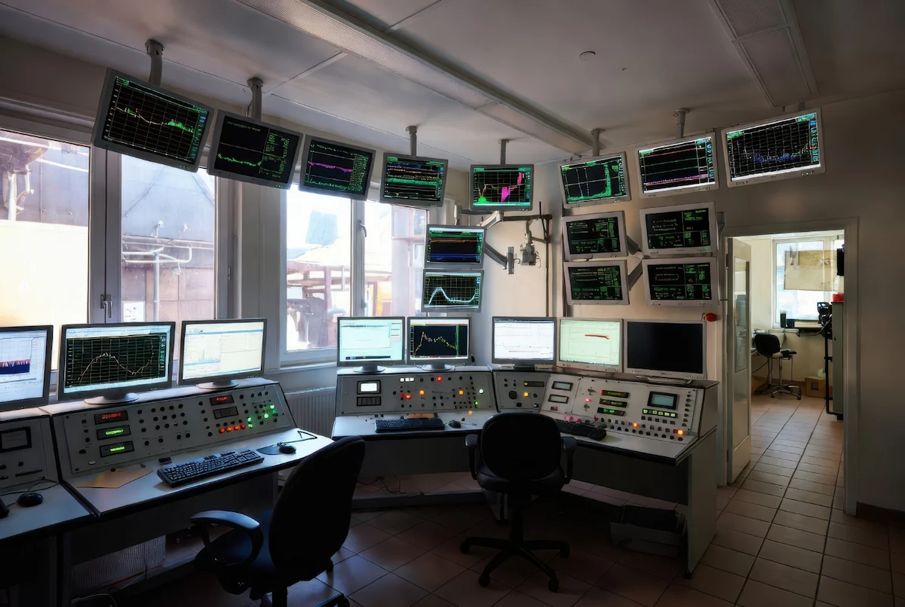
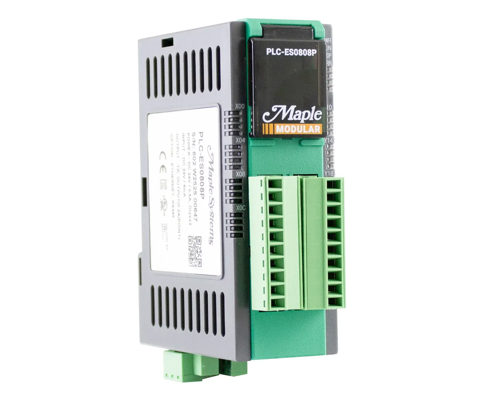
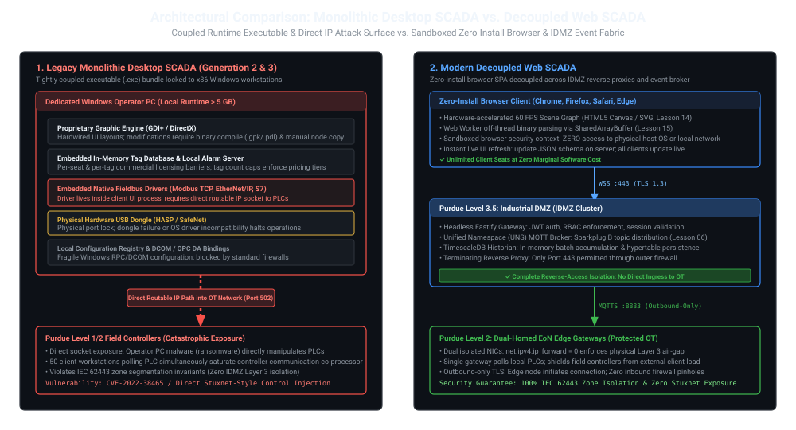
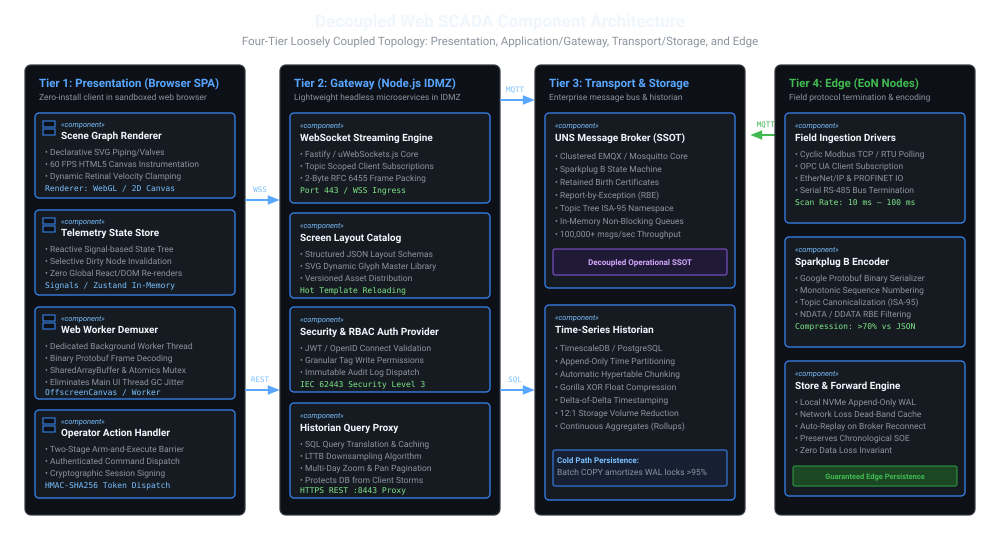
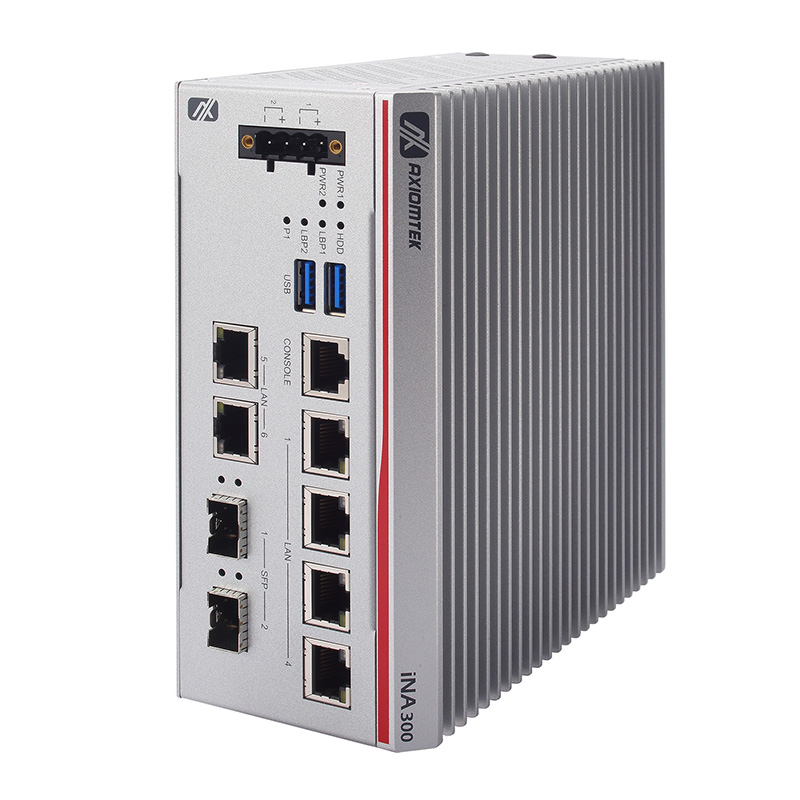
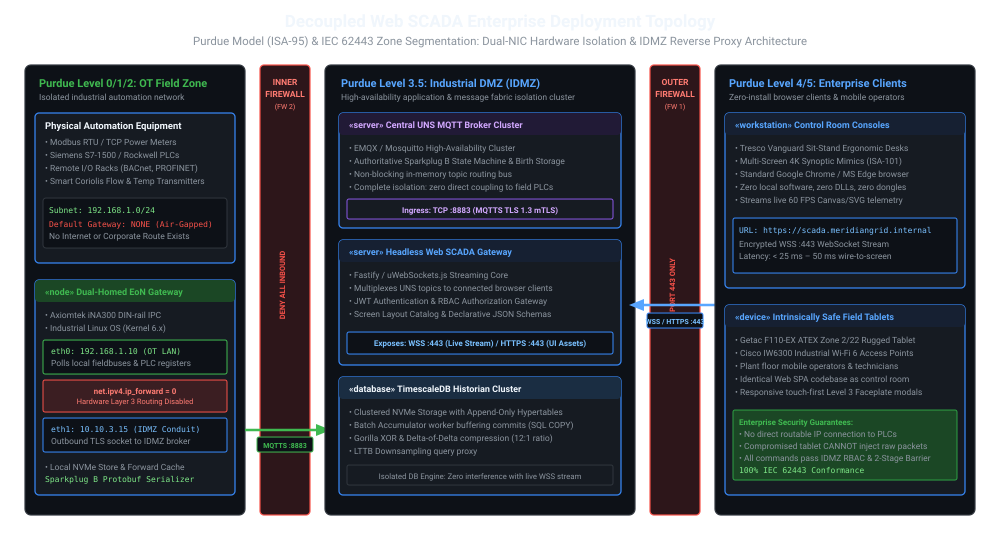
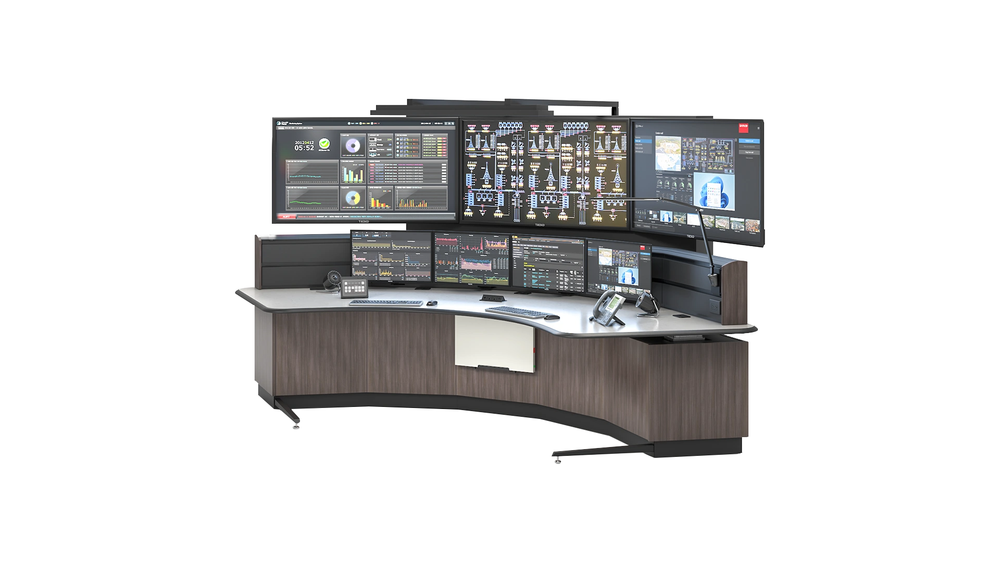
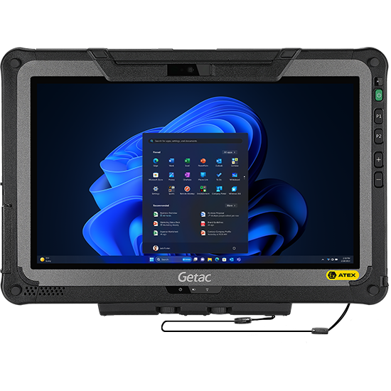

# Lesson 11: Monolithic Desktop SCADA vs. Decoupled Web Architectures

Traditional supervisory control and data acquisition (SCADA) systems were forged in an era of isolated local area networks, proprietary operating systems, and single-host desktop workstations. As industrial automation converges toward open IIoT paradigms, these monolithic architectures present catastrophic cybersecurity vectors, excessive lifecycle licensing costs, and operational downtime. This lesson examines the systemic failure modes of Generation 2 desktop SCADA and establishes a decoupled, web-native reference architecture.

---

## 1. Physical Reality & Field Equipment (Prerequisites)

To understand modern industrial supervisory architecture, we must analyze the technological constraints that shaped industrial software over the past four decades ([[Guo_et_al_2022|Guo et al., 2022]]; [[Villamar_et_al_2025|Villamar et al., 2025]]):

### The Four Generations of Supervisory Control
1. **Generation 1: Monolithic & Standalone (1970s–1980s):** Early minicomputers (e.g., PDP-11) connected directly to field hardware via dedicated, point-to-point proprietary serial lines. Redundancy was non-existent, and networking across systems was impossible.
2. **Generation 2: Distributed Desktop Client-Server (1990s–2010s):** Emergence of Windows-based industrial platforms (Wonderware InTouch, Siemens WinCC, Rockwell FactoryTalk View). Client PCs connected across local area networks (LANs) to centralized servers using Microsoft DCOM and OPC Data Access (OPC DA). While distributed, the software core remained **monolithic, host-bound, and tied to physical hardware dongles**.
3. **Generation 3: Networked / Web-Enabled (2010s):** Early attempts to extend desktop SCADA to web browsers via Java Applets, ActiveX controls, Microsoft Silverlight, or RDP/VNC screen-scraping tunnels. These suffered from catastrophic security vulnerabilities, browser plug-in deprecation, and high latency.
4. **Generation 4: Decoupled & Web-Native (2020s+):** Built on open web standards (HTML5 Canvas/SVG, WebSockets, TypeScript, MQTT Sparkplug B). The presentation layer is decoupled from driver ingestion and event routing, potentially executing as a zero-install browser Single Page Application (SPA).

The physical reality of legacy Generation 2 supervisory environments is shown in **Figure 11.1**, highlighting dedicated multi-monitor operator consoles tied to local Windows desktop runtimes:

<figure align="center">
  

    

      
      

        
Photo Unavailable

        
Search: "control room SCADA workstation multi monitor" OR "industrial control room console"

      

    

  

  <figcaption><em>Figure 11.1: Dedicated Windows SCADA Operator Workstations in a Control Room with Multi-Monitor LCD Mimics and Integrated Process Instrumentation Panels.</em></figcaption>
</figure>

### Physical Field Hardware: Level 1 & Level 2 Controllers
On the physical plant floor, industrial controllers operate in rugged, electrically noisy environments. These programmable logic controllers (PLCs), programmable automation controllers (PACs), and remote I/O chassis execute [[../Glossary#PLC Hardware Scan Cycle|deterministic scan cycles]] ($1\text{–}20\text{ ms}$) over proprietary backplanes and industrial fieldbuses (Modbus TCP, EtherNet/IP, PROFINET).

These physical field controllers and remote I/O terminal racks are shown in **Figure 11.2**, contrasting modular PLC CPUs (**Figure 11.2(a)**) with fieldbus I/O modules (**Figure 11.2(b)**):

<figure align="center">
  

    

      
      

        
Photo Unavailable

        
Search: "Maple Systems PLC-ES0808P" OR "modular industrial PLC CPU"

      

       
      <small><strong>(a)</strong> Modular PLC CPU Module with Built-In Digital I/O (Maple Systems PLC-ES0808P)</small>
    

    

      
      

        
Photo Unavailable

        
Search: "Metz Connect BMT-CI4" OR "DIN rail BACnet remote IO module"

      

       
      <small><strong>(b)</strong> DIN-Rail Remote I/O Terminal Module via BACnet Fieldbus Protocol (Metz Connect BMT-CI4)</small>
    

  

  <figcaption><em>Figure 11.2: Plant-Floor Level 1/2 Field Hardware: (a) Central Modular Processing Unit executing deterministic control loops; (b) DIN-Rail Remote I/O Terminal Racks interfacing field instrumentation.</em></figcaption>
</figure>

---

## 2. Architectural Pitfalls of Desktop Monoliths

In classical Generation 2 desktop architectures, a single executable process (`.exe`) or tightly coupled suite of Windows services bundles the entire operational stack together: graphics rendering (Windows GDI+ / DirectX), in-memory tag databases, alarming logic, and field communication drivers.

### Core Failure Modes of the Desktop Monolith

In classical Generation 2 desktop architectures, a single executable process (`.exe`) or tightly coupled suite of Windows services bundles the entire operational stack together: graphics rendering (Windows GDI+ / DirectX), in-memory tag databases, alarming logic, and field communication drivers. This monolithic coupling introduces four systemic failure modes.

First, host-bound installation overhead and operating system fragility create high maintenance friction. Every operator workstation requires installing gigabytes of proprietary runtimes, specific Windows operating system service packs, hardware USB license dongles, and local registry configurations. A routine OS patch or corrupted DLL can instantly halt supervisory visibility across an entire operating unit.

Second, proprietary vendors impose an artificial commercial bottleneck through "seat tax" and "tag tax" licensing models. Charging steep license fees per client seat and per monitored tag count (with pricing tiers escalating sharply between 5,000, 50,000, and 250,000 tags) actively penalizes enterprise-wide data access and prevents modern analytical platforms from consuming real-time telemetry.

Third, updating mimic screens causes severe maintenance downtime. Modifying a process graphic in a desktop monolith requires taking the local client runtime offline, compiling the graphic display into proprietary binary artifacts (e.g., `.gpk`, `.pdl`), and manually distributing or copying files across every physical workstation on the plant floor.

Finally, monolithic clients expose a catastrophic network attack surface. Because legacy desktop applications embed PLC communication drivers directly inside the client executable, the operator PC must maintain direct, uninhibited IP routes into the Level 1/2 control network. If an operator workstation in the control room is compromised by corporate malware or ransomware, the attacker gains direct socket-level access to manipulate field controllers.

This fundamental architectural difference—comparing tightly coupled monolithic runtimes with an open event-bus decoupled model—is illustrated in **Figure 11.3**:

<figure align="center">
  
  <figcaption><em>Figure 11.3: Architectural Comparison — Monolithic Desktop SCADA Runtime Coupling vs. Decoupled Web SCADA Event Bus Architecture.</em></figcaption>
</figure>

---

## 3. Decoupled Web SCADA Component Architecture

The following four-tier decomposition is a reference architecture for study; service boundaries, libraries, storage engines, and deployment details must be selected by the system's architecture decisions:

### Presentation Tier (Browser Client SPA)
The client runs entirely inside the sandboxed runtime of any standard modern web browser (Chrome, Firefox, Safari, Edge), requiring **zero software installation**:
- **Scene Graph Renderer:** Declarative vector mimic engine utilizing SVG for static piping/valves (synthesized via [[13-Declarative-SVG-Synthesis|Lesson 13]]) and HTML5 Canvas / WebGL for high-frequency dynamic instrumentation (60 FPS rendering; analyzed in [[14-Browser-Rendering-Engines|Lesson 14]]).
- **Telemetry State Store:** A high-performance reactive state-management option, with the library choice still undecided.
- **Web Worker Demuxer:** Executes off-main-thread binary decoding of incoming WebSocket frames, shielding the 60 FPS UI thread from garbage collection stutter (see [[15-Multithreaded-Web-Performance|Lesson 15]]).
- **Operator Action Handler:** Captures setpoint changes, manual valve overrides, and alarm acknowledgments, dispatching authenticated commands via REST/WSS.

### Application & Gateway Tier (Headless Node.js Services)
Hosted inside the Industrial DMZ (IDMZ; detailed in [[10-OT-Cybersecurity-IEC-62443|Lesson 10]]), these lightweight services bridge the web browser to the plant event infrastructure:
- **WebSocket Streaming Engine:** Maintains persistent WebSocket Secure (`WSS :443`) sessions with connected browsers, multiplexing filtered live telemetry from the UNS broker (analyzed in [[12-WebSocket-Streaming-Mechanics|Lesson 12]]).
- **Screen Layout Catalog:** Serves declarative UI layouts and graphics as structured JSON schemas and SVG templates ([[Bellini_et_al_2022|Bellini et al., 2022]]).
- **Security & RBAC Auth Provider:** A proposed boundary for authentication and role-based permissions; exact mechanisms and roles require ADRs.
- **Historian Query Proxy:** A possible boundary for translating historical requests and applying [[../Glossary#Largest Triangle Three Buckets (LTTB)|LTTB]] before browser delivery (see [[09-Time-Series-Historians|Lesson 09]]).

### Transport & Storage Tier
- **MQTT Event Broker (UNS SSOT):** Candidate enterprise message-broker boundary for Sparkplug B state management and [[../Glossary#Report-by-Exception (RBE)|report-by-exception]] routing ([[Freitas_et_al_2025|Freitas et al., 2025]]; see [[03-MQTT-Protocol-Internals|Lesson 03]] and [[06-Sparkplug-B-Specification|Lesson 06]]).
- **Time-Series Historian:** Candidate append-only relational storage; the database engine, hypertable strategy, and compression policy remain undecided ([[09-Time-Series-Historians|Lesson 09]]).

### Edge Tier (Edge of Network Nodes)
- **Field Ingestors:** Industrial polling engines communicating with brownfield controllers via native fieldbuses (Modbus TCP; see [[02-Modbus-TCP-Mechanics|Lesson 02]]; [[../Glossary#OPC Unified Architecture (OPC UA)|OPC UA]], EtherNet/IP).
- **Sparkplug B Encoder:** Compresses field data into strongly typed Protobuf payloads ([[07-Protobuf-vs-Text-Serialization|Lesson 07]]), appending contextual topic namespaces.
- **Store & Forward Engine:** A proposed local spool on dual-homed edge nodes ([[05-EoN-Nodes-Brownfield-Gateways|Lesson 05]]); durability guarantees and storage technology require contract and ADR decisions.

The component interaction between these four decoupled tiers is diagrammed in **Figure 11.4**:

<figure align="center">
  
  <figcaption><em>Figure 11.4: Decoupled Web SCADA UML Component Architecture — Modular Presentation, Gateway, Event Bus, and Edge Tiers.</em></figcaption>
</figure>

The physical edge hardware executing this protocol decoupling and store-and-forward caching is shown in **Figure 11.5**:

<figure align="center">
  

    

      
      

        
Photo Unavailable

        
Search: "Axiomtek iNA300 DIN-rail" OR "dual NIC industrial PC DIN-rail"

      

    

  

  <figcaption><em>Figure 11.5: Ruggedized DIN-Rail Industrial PC (EoN Gateway) Featuring Dual Isolated Gigabit Ethernet NICs for Application-Layer OT/IDMZ Bridging.</em></figcaption>
</figure>

---

## 4. Enterprise Deployment Topology across Purdue & IDMZ

Deploying a decoupled web SCADA platform requires strictly respecting ISA/IEC 62443 security zones and the Level 3.5 [[../Glossary#Industrial Demilitarized Zone (IDMZ / Level 3.5)|Industrial Demilitarized Zone (IDMZ)]]:

### Physical & Virtual Node Boundaries
1. **Level 0/1 Field Nodes (OT Network):** PLCs, RTUs, and smart sensors communicate over isolated industrial subnets (`192.168.1.0/24`). These devices have **no default gateway** pointing to the internet or corporate network.
2. **Level 3 Industrial PC (Dual-Homed EoN Gateway):** Rugged DIN-rail industrial IPC executing protocol termination. As detailed in [[05-EoN-Nodes-Brownfield-Gateways|Lesson 05 (Section 2)]], physical [[../Glossary#Dual-Homing|dual-homing]] separates NIC 1 (local PLC fieldbus LAN) from NIC 2 (IDMZ), while kernel [[../Glossary#Anti-Routing Invariant (`ip_forward = 0`)|anti-routing (`net.ipv4.ip_forward = 0`)]] enforces complete Layer 3 isolation between plant and enterprise networks.
3. **Inner Industrial Firewall (Firewall 2):** Governed by the two-tier IDMZ perimeter model ([[10-OT-Cybersecurity-IEC-62443|Lesson 10 (Section 4)]]), blocking all inbound ingress into the plant (`DENY ALL INBOUND`) while admitting strictly outbound MQTTS (TCP :8883) initiated by the EoN node.
4. **Level 3.5 IDMZ Server Cluster:** Proposed server boundary for the MQTT broker, API gateway, and historian; runtime framework, availability design, and database engine remain subject to Phase 2 ADRs.
5. **Outer Corporate Firewall (Firewall 1):** Channels client traffic into IDMZ reverse proxies exclusively on standard web port `443` (HTTPS for static UI assets, WSS for live telemetry; see [[12-WebSocket-Streaming-Mechanics|Lesson 12]]).
6. **Level 4/5 Client Workstations:** Zero-install browser clients (desktops, operator tablets) rendering synoptics at 60 FPS without local runtimes or VPN dependencies.

This enterprise deployment topology, enforcing strict zone isolation across [[../Glossary#Purdue Enterprise Reference Architecture (PERA / Purdue Model)|Purdue levels]] 0 through 5 via IDMZ reverse proxies, is diagrammed in **Figure 11.7**:

<figure align="center">
  
  <figcaption><em>Figure 11.7: UML Deployment Topology across Purdue Levels 0 through 5 — Dual-NIC Air-Gap and Reverse-Access Firewall Conduits.</em></figcaption>
</figure>

The physical client workstations and mobile tablets deployed across Level 4 and 5 enterprise spaces are shown in **Figure 11.6**, contrasting centralized control room consoles (**Figure 11.6(a)**) with intrinsically safe field tablets (**Figure 11.6(b)**):

<figure align="center">
  

    

      
      

        
Photo Unavailable

        
Search: "Tresco Vanguard control room console" OR "ergonomic SCADA operator console"

      

       
      <small><strong>(a)</strong> Control Room Multi-Monitor Operator Workstation (Tresco Vanguard)</small>
    

    

      
      

        
Photo Unavailable

        
Search: "Getac F110 rugged tablet" OR "hazardous area industrial tablet ATEX"

      

       
      <small><strong>(b)</strong> Hazardous-Area Industrial Mobile Field Tablet (Getac F110-EX ATEX)</small>
    

  

  <figcaption><em>Figure 11.6: Modern Level 4/5 Zero-Install Web SCADA Client Workstations: (a) Fixed Control Room Console running multi-screen vector mimics; (b) Mobile Field Tablet connected via encrypted WPA3-Enterprise Wi-Fi.</em></figcaption>
</figure>

---

## 5. Structural Comparison: Desktop Monolith vs. Web SCADA

| Architectural Dimension | Monolithic Desktop SCADA | Decoupled Web SCADA |
| :--------------------------- | :---------------------------------------------------------------- | :---------------------------------------------------------------------------------------------------------------------- |
| **Client Deployment**        | Heavy local installation ($>5\text{ GB}$, custom OS dependencies) | Zero-install: loads instantaneously via standard HTTPS URL                                                              |
| **Hardware Portability**     | Strictly locked to x86 Windows desktop workstations               | Universal: runs on PCs, tablets, smartphones, Linux panels                                                              |
| **Screen Updates**           | Manual binary compilation and file copying across all nodes       | Instantaneous: update server JSON template; all clients refresh live ([[Bellini_et_al_2022  \| Bellini et al., 2022]])  |
| **Driver Location**          | Embedded inside SCADA software core                               | Decoupled into edge EoN nodes; SCADA sees only normalized UNS topics                                                    |
| **Security Surface**         | Direct network route required between operator PC and field PLCs  | Client is fully isolated behind IDMZ reverse proxies (Port 443 only) ([[Villamar_et_al_2025 \| Villamar et al., 2025]]) |
| **System High Availability** | Complex active/passive Windows clustering                         | Standard horizontal web container scaling (Kubernetes/Docker)                                                           |
| **Rendering Technology**     | Proprietary OS APIs (GDI+, DirectX)                               | Open Web Standards (HTML5 Canvas, SVG, WebGL, Web Workers)                                                              |
| **Licensing Model**          | Restrictive per-seat and per-tag licensing structures             | Open protocol core: unlimited browser clients and tags at zero marginal software cost                                   |

---

## 6. Active-Recall Assessments

> [!FAQ]- Why does a decoupled web SCADA system provide superior operational cybersecurity compared to desktop client SCADA?
> Desktop SCADA installations require direct network route visibility from the operator PC to the field PLCs to poll tags via industrial protocols (Modbus, Ethernet/IP). If an operator workstation is infected with malware, the attacker has direct IP access to the PLCs. In a decoupled web SCADA architecture, the browser communicates exclusively with an intermediate HTTPS/WSS gateway in the IDMZ; fieldbus controllers are completely invisible, unrouted, and unreachable from the client network ([[Villamar_et_al_2025|Villamar et al., 2025]]).

> [!FAQ]- How does declarative UI composition eliminate downtime during SCADA screen modifications?
> In monolithic SCADA, modifying a graphic requires taking the runtime offline, recompiling the graphic project into binary files, and distributing them across all client nodes. In a declarative web SCADA system, screens are stored as structured JSON templates and SVG assets ([[Bellini_et_al_2022|Bellini et al., 2022]]). When an engineer saves a screen, the gateway broadcasts the updated layout schema over WebSockets, and connected clients re-render the DOM without dropping live process telemetry.

> [!FAQ]- What is the role of a Dual-Homed EoN Gateway in maintaining the physical network air-gap?
> A Dual-Homed EoN Gateway has two physically distinct network interface cards: NIC 1 on the isolated OT fieldbus LAN (`192.168.1.x`) and NIC 2 on the IDMZ ingress network (`10.10.35.x`). By disabling OS IP forwarding (`net.ipv4.ip_forward = 0`), no IP packets can ever route between the two interfaces. The gateway ingests raw register bytes on NIC 1, translates them into Sparkplug B Protobuf payloads in user space, and pushes them out NIC 2 via outbound-only TLS (Port 8883), maintaining an application-layer air-gap.

> [!FAQ]- What is the licensing impact of transitioning from tag-based desktop SCADA to a UNS web platform?
> Traditional vendors charge exponential licensing fees based on the number of monitored I/O tags (e.g., $1{,}000$ vs. $100{,}000$ tags) and concurrent operator seats. A decoupled UNS platform built on open protocols (MQTT Sparkplug B) eliminates per-tag and per-seat licensing: the broker routes unlimited data points, and web servers can serve hundreds of concurrent browser sessions at near-zero marginal software cost.
