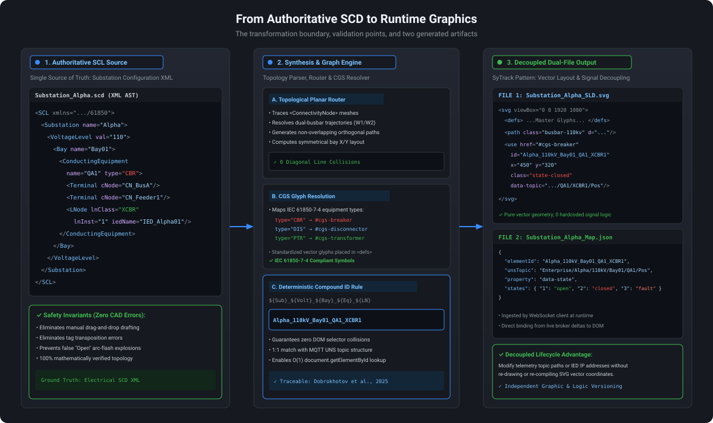
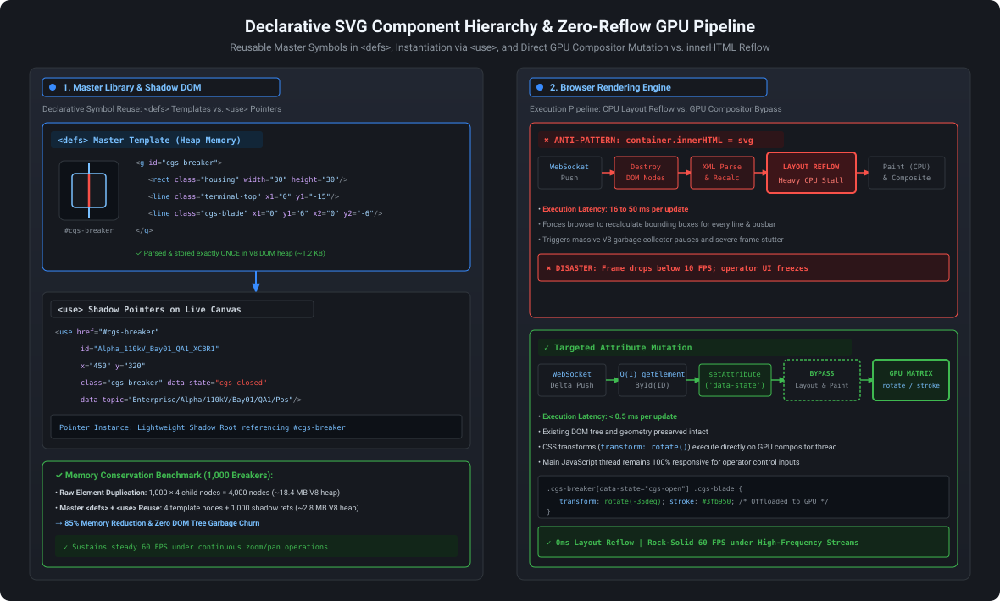

# Lesson 13: Declarative SVG Synthesis & Substation Automation (IEC 61850)

Substation automation and high-voltage electrical grid monitoring represent the pinnacle of mission-critical supervisory engineering. In this domain, human-machine interfaces (HMIs) must render complex, interconnected physical networks carrying hundreds of kilovolts with zero ambiguity and sub-millisecond event reflection. Traditional SCADA development relies on manual, error-prone graphic drafting in proprietary desktop software. This lesson examines the cyber-physical realities of electrical substation switchgear, exposes the catastrophic safety hazards of manual HMI drawing, and details programmatic synthesis of declarative **Scalable Vector Graphics (SVG)** from **IEC 61850 Substation Configuration Description (SCD)** files. SCD-to-SVG synthesis and any zero-reflow GPU pipeline are possible implementation patterns, not universal requirements.

---

## 1. Physical Reality & Field Equipment (Prerequisites)

Supervisory synoptics in electrical transmission and distribution are direct mathematical reflections of physical high-voltage apparatus operating in switchyards and control houses ([[Dobrokhotov_et_al_2025|Dobrokhotov et al., 2025]]):

### Physical Primary & Secondary Switchyard Equipment
As illustrated in **Figure 13.1**, substation automation bridges physical high-voltage primary apparatus located in the outdoor switchyard with microprocessor-based secondary instrumentation housed inside climate-controlled relay houses:

1. **High-Voltage Circuit Breakers (Primary Equipment, Figure 13.1(a)):** High-voltage circuit breakers ($110\text{–}145\text{ kV}$) are massive electromechanical interrupters capable of severing up to $40\text{ kA}$ of short-circuit fault current within 40 to 60 milliseconds. Breaking occurs inside sealed interrupter chambers filled with pressurized Sulfur Hexafluoride ($\text{SF}_6$) gas or vacuum bottles. A mechanical spring-drive mechanism actuates the heavy copper-tungsten contacts.
2. **Auxiliary Limit Switches ([[../Glossary#Auxiliary Contacts (52a / 52b)|$52a$ / $52b$]]):** The exact physical position of a breaker cannot be determined from control coil signals alone. Instead, heavy-duty gold-plated auxiliary limit switches are mechanically coupled directly to the main operating shaft:
   - Contact $52a$ (Normally Open): Closes only when the main contact is latched shut.
   - Contact $52b$ (Normally Closed): Closes only when the main contact is physically separated.
3. **Substation Bay Controllers & Protection Relays (Secondary IEDs, Figure 13.1(b)):** In the substation relay house, microprocessor-based **Intelligent Electronic Devices (IEDs)** sample analog voltages and currents from Instrument Transformers (CTs/VTs) at 80 samples per cycle. The IED monitors the $52a/52b$ contact voltages (110 VDC) and broadcasts digital status changes across the substation optical fiber bus via **IEC 61850 [[../Glossary#Generic Object Oriented Substation Events (GOOSE)|GOOSE]]** and **[[../Glossary#Manufacturing Message Specification (MMS)|MMS]]** network protocols.

<!-- 
  PHOTO SEARCH GUIDANCE:
  Target Equipment: High-Voltage Live Tank SF6 Circuit Breaker (110–145 kV)
  Suggested Models: Hitachi Energy LTB 145D1/B / Siemens 3AP1-DT 145 kV
  Search Query: "Hitachi Energy LTB 145 circuit breaker" OR "Siemens 3AP1-DT 145 kV live tank breaker"
  Google Images Link: https://www.google.com/search?tbm=isch&q=Hitachi+Energy+LTB+145+circuit+breaker
-->
<!-- 
  PHOTO SEARCH GUIDANCE:
  Target Equipment: Substation Bay Controller & Multi-Function Protection Relay IED
  Suggested Models: Siemens SIPROTEC 5 7UT85 / Schweitzer Engineering Laboratories SEL-487E
  Search Query: "Siemens SIPROTEC 5 protection relay" OR "Schweitzer SEL-487E transformer relay"
  Google Images Link: https://www.google.com/search?tbm=isch&q=Siemens+SIPROTEC+5+protection+relay
-->
<figure align="center">
  <div style="display: flex; justify-content: center; gap: 20px; flex-wrap: wrap;">
    <div style="flex: 1 1 340px; max-width: 48%; text-align: center; background: #16191F; border: 1px solid #30363D; border-radius: 8px; padding: 12px; box-sizing: border-box;">
      <!-- PHOTO SEARCH GUIDANCE: "Hitachi Energy LTB 145 circuit breaker" -->
      
      <div style="display: none; height: 260px; background: #0D1117; border: 1px dashed #30363D; border-radius: 6px; padding: 16px; text-align: center; color: #8B949E; box-sizing: border-box; flex-direction: column; justify-content: center; align-items: center;">
        <span style="font-weight: 700; color: #58A6FF;">[Photo 13.1A: 145 kV SF6 Circuit Breaker]</span><br />
        <span style="font-size: 0.82em; display: block; margin-top: 6px;">Live tank circuit breaker (Hitachi Energy LTB 145) with spring operating drive mechanism actuating mechanical auxiliary contacts.</span>
        <span style="font-size: 0.72em; color: #6E7681; display: block; margin-top: 6px;">Search: "Hitachi Energy LTB 145 circuit breaker"</span>
      </div>
      <br>
      <small><strong>(a)</strong> 145 kV SF6 Puffer Live Tank Circuit Breaker (Hitachi Energy LTB 145)</small>
    </div>
    <div style="flex: 1 1 340px; max-width: 48%; text-align: center; background: #16191F; border: 1px solid #30363D; border-radius: 8px; padding: 12px; box-sizing: border-box;">
      <!-- PHOTO SEARCH GUIDANCE: "Siemens SIPROTEC 5 protection relay" -->
      
      <div style="display: none; height: 260px; background: #0D1117; border: 1px dashed #30363D; border-radius: 6px; padding: 16px; text-align: center; color: #8B949E; box-sizing: border-box; flex-direction: column; justify-content: center; align-items: center;">
        <span style="font-weight: 700; color: #3FB950;">[Photo 13.1B: Substation Protection IED]</span><br />
        <span style="font-size: 0.82em; display: block; margin-top: 6px;">Microprocessor bay controller (Siemens SIPROTEC 5) reading auxiliary limit switches and broadcasting IEC 61850 GOOSE/MMS telemetry.</span>
        <span style="font-size: 0.72em; color: #6E7681; display: block; margin-top: 6px;">Search: "Siemens SIPROTEC 5 protection relay"</span>
      </div>
      <br>
      <small><strong>(b)</strong> Substation Bay Protection &amp; Control IED with Optical Ports (Siemens SIPROTEC 5)</small>
    </div>
  </div>
  <figcaption><em>Figure 13.1: Substation Primary &amp; Secondary Automation Hardware: (a) Physical 145 kV Circuit Breaker executing high-power grid isolation; (b) Microprocessor Protection IED monitoring auxiliary contacts and publishing IEC 61850 telemetry.</em></figcaption>
</figure>

### Electrical Single-Line Diagram (SLD) Anatomy & Double-Point Status (`Dbpos`)
An electrical Single-Line Diagram (SLD) abstracts a complex three-phase power network into a topological schema showing high-voltage busbars, feeder bays, circuit breakers (`QA1`), bus disconnectors (`QB1`, `QB2`), and safety earthing switches (`QC1`).

In high-voltage switchgear, breaker position cannot be reliably represented by a single binary bit because mechanical linkage wear, spring fatigue, or contact welding could leave contacts suspended between terminals. Consequently, IEC 61850-7-2 mandates **[[../Glossary#Double-Point Status (Dbpos)|Double-Point Status (`Dbpos`)]]**, reading both $52a$ and $52b$ auxiliary contacts into a deterministic 2-bit state vector:

| Bit Value | Decimal | IEC 61850 State | Physical Auxiliary Contacts | Operational Meaning | Visual Encoding (ANSI/ISA-101.01) |
| :--- | :--- | :--- | :--- | :--- | :--- |
| `00` | `0` | **Intermediate (`intermediate-state`)** | $52a = 0, \quad 52b = 0$ | Mechanism in transit ($40–120\text{ ms}$). Alarm if stuck $> 2\text{ s}$. | Cool Blue (`#58a6ff`) or Neutral Gray, blade tilted at $45^\circ$. |
| `01` | `1` | **Off / Open (`off`)** | $52a = 0, \quad 52b = 1$ | Main contacts physically separated; bay de-energized and safe. | Muted Green (`#3fb950`) or Slate, blade at $90^\circ$. |
| `10` | `2` | **On / Closed (`on`)** | $52a = 1, \quad 52b = 0$ | Main contacts closed and latched; conducting full load current. | Coral Red (`#f85149`), blade at $0^\circ$ bridging terminals. |
| `11` | `3` | **Bad State (`bad-state`)** | $52a = 1, \quad 52b = 1$ | Sensor discrepancy / broken linkage; both asserted simultaneously. | Flashing Coral Red (`#f85149`), crossed warning glyph. Urgent hardware alarm. |

As illustrated in **Figure 13.2**, this topological structure models a representative $110\text{ kV}$ double-busbar feeder bay (Bay 01), detailing the complete apparatus chain from Main Bus A (`W1`) and Transfer Bus B (`W2`) down to outgoing transmission line `L1`. The lower panel diagrams the electromechanical mechanics of the auxiliary contact sensing circuit: reading 110 VDC station battery signals through mechanically coupled $52a$ and $52b$ limit switches into IED optocoupler binary inputs to deterministically resolve the 2-bit `Dbpos` state vector.

<figure align="center">
  
  <figcaption><em>Figure 13.2: Substation Single-Line Diagram &amp; IEC 61850-7-2 Double-Point Position (Dbpos) States — Topological Feeder Bay Anatomy and 2-Bit Auxiliary Switch Telemetry.</em></figcaption>
</figure>

---

## 2. Architectural Pitfalls of Manual CAD Drafting & Fragile UI Frameworks

In conventional Generation 2 and 3 SCADA platforms, engineering an electrical single-line diagram requires a drafts-person to open a graphical editor, manually drag and drop circuit breaker and disconnector symbols onto a canvas, and copy-paste tag addresses into property dialogs ([[Dobrokhotov_et_al_2025|Dobrokhotov et al., 2025]]).

### Operational Hazards of Manual SCADA Drafting
In a substation switchyard containing dozens of bays and hundreds of disconnectors, manual drafting inevitably introduces tag transposition errors—such as inadvertently assigning the telemetry feedback of Disconnector A to the graphical symbol of adjacent Disconnector B. Such human errors introduce catastrophic operational hazards: during an emergency line clearance operation, an operator observing a false "Open" status may conclude that a feeder is electrically isolated and issue a remote command to close the line earthing switch. Closing an earthing switch onto an energized $110\text{ kV}$ circuit triggers an instantaneous multi-megawatt arc-flash explosion, destroying substation apparatus and creating lethal hazards for field crews. Furthermore, manual drawings suffer from continuous synchronization drift, decoupling operator graphics from authoritative protection engineering databases as field configurations evolve.

### Inadequacy of Canvas & Raster Bitmaps for Industrial Synoptics
Raster formats such as PNG and JPEG fail on high-resolution $4\text{K}/8\text{K}$ control room video walls because fixed pixel grids blur and pixelate under geometric zoom, while possessing zero internal DOM structure for individual element manipulation. Similarly, HTML5 Canvas (`<canvas>`), while efficient for procedural charts, operates as an immediate-mode procedural bitmap where individual lines, busbars, and breakers possess no distinct DOM identity. Updating a single breaker requires clearing the entire canvas or computing dirty bounding boxes before executing a JavaScript loop to redraw every vector line. Furthermore, Canvas forfeits native DOM event listeners (`onclick`, `onpointerover`) and accessibility integration.

### The Imperative for Authoritative SCL Models (IEC 61850-6)
To eliminate human transposition errors, modern substation engineering mandates that the digital configuration of the entire facility be formalized in **Substation Configuration Language (SCL)** XML documents:
- **SSD (System Specification Description):** Declares substation single-line topology and logical node requirements.
- **ICD (IED Capability Description):** Vendor-supplied XML defining IED functional capabilities.
- **SCD (Substation Configuration Description):** The single source of truth containing the complete substation specification: all primary switchgear, physical connections, communication subnetworks, and configured IED logical nodes.

---

## 3. Decoupled Web-Native Component Architecture: SCL-to-SVG Synthesis Pipeline

To guarantee absolute alignment between field engineering and operator displays, an automated **[[../Glossary#Substation Configuration Language (SCL)|SCL]]-to-SVG Synthesis Pipeline** can eliminate manual drawing ([[Dobrokhotov_et_al_2025|Dobrokhotov et al., 2025]]).

### The 3-Stage Synthesis Pipeline Architecture

#### Topological Electrical Graph Routing
The synthesis engine first traverses the XML hierarchy across `<Substation>`, `<VoltageLevel>`, and `<Bay>` boundaries. Next, it resolves conductivity nodes by extracting `<ConductingEquipment>` elements (circuit breakers, disconnectors, power transformers) and tracing their `<Terminal>` connections across `<ConnectivityNode>` tags. Finally, an orthogonal planar graph routing algorithm calculates non-overlapping vector busbar trajectories, positioning feeders, bus couplers, and switchgear symmetrically across a 2D coordinate space.

#### Conventional Graphical Symbol (CGS) Resolution & Deterministic Compound IDs
Conducting equipment types are matched against a standardized [[../Glossary#Conventional Graphical Symbols (CGS)|Conventional Graphical Symbols (CGS)]] vector library conforming to IEC 61850-7-4:
- Type `CBR` $\to$ Circuit Breaker Symbol (`#cgs-breaker`).
- Type `DIS` $\to$ Disconnector / Earth Switch Symbol (`#cgs-disconnector`).
- Type `PTR` $\to$ Step-Down Power Transformer Symbol (`#cgs-transformer`).

To eliminate DOM selector collisions across large utility grids, every instantiated SVG graphic element receives a globally unique compound identifier derived directly from the SCL hierarchy ([[Dobrokhotov_et_al_2025|Dobrokhotov et al., 2025]]; [[Jiao_et_al_2018|Jiao et al., 2018]]):
$$\text{Element ID} = \texttt{\$\{Substation\}\_\$\{VoltageLevel\}\_\$\{Bay\}\_\$\{ConductingEquipment\}\_\$\{LogicalNode\}}$$
*Example:* `Alpha_110kV_Bay01_QA1_XCBR1`

This compound ID aligns directly with the [[../Glossary#Unified Namespace (UNS)|Unified Namespace (UNS)]] MQTT topic structure (grounded in the ANSI/ISA-95 equipment hierarchy; see [[08-ISA-95-Object-Models-Taxonomy|Lesson 08]]) and enables $O(1)$ JavaScript pointer lookup in the browser runtime.

#### Dual-File Output Generation (SyTrack SCADA Pattern)
Following the architectural pattern formalized in the SyTrack SCADA platform ([[Dobrokhotov_et_al_2025|Dobrokhotov et al., 2025]]), the synthesis engine enforces strict decoupling between vector geometry and runtime telemetry logic by generating two distinct artifacts:
1. **Static SVG Mnemonic File (`.svg`):** Contains pure declarative vector geometry, busbar paths, and `<use>` symbol instances with embedded semantic attributes (`data-topic`, `data-ln`).
2. **Dynamization Mapping Specification (`.json` / `.xml`):** Declares exact property bindings linking real-time telemetry variables (e.g., `XCBR1$ST$Pos$stVal`) to visual graphic states (CSS class names, rotation transforms, stroke colors).

As diagrammed in **Figure 13.3**, this automated compilation pipeline takes authoritative IEC 61850 SCD XML and executes three deterministic transformations: parsing the electrical AST, routing planar orthogonal busbars, mapping standardized CGS glyphs with deterministic compound IDs, and emitting decoupled SVG vector mnemonics and JSON dynamization mapping specifications.

<figure align="center">
  
  <figcaption><em>Figure 13.3: Transformation boundary — authoritative SCD input is compiled into a visual artifact and a separate runtime binding map, making validation points explicit.</em></figcaption>
</figure>

### [[../Glossary#Master Definition (`<defs>`) & Shadow Instantiation (`<use>`)|Master Symbol Library (`<defs>`) & Shadow Instantiation (`<use>`)]]
Large refinery or substation synoptics contain thousands of repetitive glyphs (valves, pumps, disconnectors, indicators). Duplicating full XML coordinate geometry for each element inflates browser memory and exhausts DOM tree limits.

An architecture could leverage SVG's declarative template model (illustrated in Panel 1 of **Figure 13.4**):
1. **Master Definition in `<defs>`:** Complex visual geometry is defined once within the `<defs>` section of the SVG header:
   ```html
   <defs>
     <g id="cgs-breaker">
       <rect class="cgs-housing" x="-15" y="-15" width="30" height="30" rx="3" />
       <line class="cgs-terminal-top" x1="0" y1="-15" x2="0" y2="-6" />
       <line class="cgs-terminal-bot" x1="0" y1="6" x2="0" y2="15" />
       <line class="cgs-blade" x1="0" y1="6" x2="0" y2="-6" />
     </g>
   </defs>
   ```
2. **Lightweight Shadow Instantiation via `<use>`:** The canvas instantiates symbols by referencing the template ID:
   ```html
   <use href="#cgs-breaker" 
        id="Alpha_110kV_Bay01_QA1_XCBR1" 
        x="450" y="320" 
        class="state-closed" 
        data-topic="Enterprise/Alpha/110kV/Bay01/QA1/XCBR1/Pos" />
   ```
   **Memory Impact:** 1,000 circuit breakers share the identical 4 DOM vector nodes in memory, cutting V8 DOM heap allocation from $\sim 18.4\text{ MB}$ to $\sim 2.8\text{ MB}$ (an **85%** memory reduction, benchmarked in **Figure 13.4**) and ensuring steady $60\text{ FPS}$ panning and zooming.

---

## 4. Enterprise Deployment Topology across Purdue & IDMZ

Deploying synthesized vector synoptics across an industrial enterprise requires integrating real-time telemetry from Level 1/2 substation switchyards up to Level 4/5 browser rendering engines through the Level 3.5 [[../Glossary#Industrial Demilitarized Zone (IDMZ / Level 3.5)|Industrial Demilitarized Zone (IDMZ)]]:

### Substation-to-Cloud Telemetry Conduit Architecture
Bridging real-time switchgear events from substation bays to enterprise web clients requires crossing multiple ISA/IEC 62443 security zones without compromising deterministic protection networks:

1. **Level 1/2 Process & Station Bus:** Microprocessor IEDs publish high-speed trip interlocks over optical fiber via Layer 2 **IEC 61850 GOOSE** (sub-4 ms transfer time) and provide supervisory telemetry via client/server **MMS ([[../Glossary#Manufacturing Message Specification (MMS)|Manufacturing Message Specification]], ISO 9506)** over TCP port `102`.
2. **Level 2 Substation Dual-Homed EoN Gateway:** A ruggedized substation edge gateway (e.g., Moxa DIN-rail IPC) acts as an IEC 61850 MMS Client. The gateway features two physically isolated network interface cards:
   - **NIC 1 (`192.168.10.x`):** Physically linked to the local substation Station Bus LAN.
   - **NIC 2 (`10.10.35.x`):** Connected to the inner perimeter firewall.
   - **Kernel IP Forwarding Disabled:** By strictly [[../Glossary#Anti-Routing Invariant (`ip_forward = 0`)|setting `net.ipv4.ip_forward = 0`]], no IP-level packets route between the substation bus and the plant backbone. The gateway ingests raw `Dbpos` double-point variables in user space, maps them to normalized MQTT Sparkplug B topic payloads (`Enterprise/Alpha/110kV/Bay01/QA1/XCBR1/Pos`), and initiates outbound-only TLS sessions on TCP port `8883`.
3. **Level 3.5 IDMZ Broker & Gateway Cluster:** The industrial demilitarized zone hosts the centralized MQTT Broker and Fastify WebSocket streaming gateway. No external client can penetrate into the substation LAN; all connections terminate at the reverse proxy.
4. **Level 4/5 Zero-Install Web Clients:** Browser sessions connect via secure WebSockets (`wss://scada.enterprise.com:443/stream`). When a telemetry delta arrives, the browser runtime matches the topic directly against pre-synthesized SVG DOM elements using deterministic compound IDs.

### The Zero-Reflow GPU Execution Pipeline
In a SCADA system ingesting hundreds of telemetry updates per second over WebSockets, naive DOM manipulation causes catastrophic browser performance degradation.

#### The Anti-Pattern: String Concatenation & `innerHTML`
```typescript
// ❌ CRITICAL ANTI-PATTERN: DESTROYS PERFORMANCE
container.innerHTML = generateSvgString(newTelemetryState);
```
- **Consequences:** Forces the browser V8 engine to destroy existing DOM nodes, garbage-collect memory, re-parse the XML string, recalculate global CSS cascade rules, and trigger a complete **[[../Glossary#Layout Reflow Cliff|Layout Reflow]]** of the entire document. Frame rates drop to single digits, and the UI thread freezes.

#### The High-Performance Path: Targeted Attribute & Class Mutation
```typescript
/**
 * [[../Glossary#Zero-Reflow Attribute Mutation|Zero-Reflow Dynamization Handler]]
 * Executes in < 0.5 ms without triggering browser layout reflow.
 */
export function dynamizeBreakerNode(elementId: string, dbposState: number): void {
  const node = document.getElementById(elementId);
  if (!node) return;

  // Map IEC 61850 Dbpos state to CSS class
  const STATE_CLASSES: Record<number, string> = {
    0: 'cgs-intermediate',
    1: 'cgs-open',
    2: 'cgs-closed',
    3: 'cgs-fault'
  };

  const newClass = STATE_CLASSES[dbposState] ?? 'cgs-fault';

  // Direct class attribute mutation
  if (node.getAttribute('data-state') !== newClass) {
    node.setAttribute('data-state', newClass);
  }
}
```

```css
/* CSS transitions offloaded to GPU compositor thread */
.cgs-breaker[data-state="cgs-open"] .cgs-blade {
  transform: rotate(-35deg);
  transform-origin: 0px 6px;
  stroke: #3fb950;
  transition: transform 0.1s ease-out, stroke 0.1s ease-out;
}

.cgs-breaker[data-state="cgs-closed"] .cgs-blade {
  transform: rotate(0deg);
  stroke: #f85149;
}

.cgs-breaker[data-state="cgs-intermediate"] .cgs-blade {
  transform: rotate(-15deg);
  stroke: #58a6ff;
}

.cgs-breaker[data-state="cgs-fault"] {
  animation: pulse-alarm 1s infinite alternate;
}
```

- **Browser Performance Result:** Mutating `data-state` or CSS classes bypasses the Layout (Reflow) stage entirely. The browser skips geometric recalculations and proceeds directly to the **Paint** and **GPU Compositing** stages (analyzed in detail in [[14-Browser-Rendering-Engines|Lesson 14]]), sustaining a smooth $60\text{ FPS}$ ($16.6\text{ ms}$ render budget) under continuous WebSocket streaming deltas (see [[12-WebSocket-Streaming-Mechanics|Lesson 12]]).

As visualized in **Figure 13.4**, this rendering architecture contrasts the internal DOM memory footprint of master `<defs>` templates and `<use>` shadow instances (Panel 1) with the browser execution pipeline under high-frequency WebSocket streams (Panel 2). While the `container.innerHTML` anti-pattern forces expensive CPU layout reflows and complete DOM reconstruction (dropping frame rates below $10\text{ FPS}$), targeted `data-state` attribute mutations bypass the layout and paint stages entirely, enabling direct GPU compositor transformations in $<0.5\text{ ms}$ at rock-solid $60\text{ FPS}$.

<figure align="center">
  
  <figcaption><em>Figure 13.4: Declarative SVG Component Hierarchy &amp; Zero-Reflow GPU Pipeline — Master Symbol Templates in &lt;defs&gt; with 85% Memory Conservation (Left) vs. Browser Rendering Pipeline Contrasting CPU Layout Reflow Penalty with Direct GPU Compositor Mutation (Right).</em></figcaption>
</figure>

---

## 5. Structural Comparison: Substation Synoptic Rendering Technologies

| Architectural Dimension | Manual SCADA Drawing (Legacy) | Immediate-Mode Canvas (`<canvas>`) | SCL-Synthesized SVG DOM (candidate) |
| :--- | :--- | :--- | :--- |
| **Rendering Model** | Proprietary Desktop GDI+ / DirectX | Immediate-Mode 2D/WebGL Bitmap | **Retained-Mode Declarative XML DOM** |
| **DOM Addressability** | None (Locked in binary runtime) | None (Single flat canvas surface) | **Every breaker/line is a discrete DOM node** |
| **Event Handling** | Proprietary desktop mouse hooks | Complex manual pixel math in JS | **Native DOM events (`click`, `pointerenter`)** |
| **Resolution Scaling** | Often fixed pixel resolution | Requires manual devicePixelRatio scaling | **Infinite crisp vector scaling (`viewBox`)** |
| **Tag Binding Automation** | Manual copy-pasting (high error risk) | Manual procedural code linkage | **Possible automation from IEC 61850 SCD XML; deployment-dependent** |
| **DOM Memory Footprint** | Heavy OS desktop RAM (>500 MB) | Low RAM, high CPU redraw overhead | **Minimal RAM via `<defs>` and `<use>` reuse** |
| **Reflow & GPU Mechanics** | Full desktop screen invalidation | Full surface clear & redraw loop | **Zero-Reflow GPU attribute/CSS compositing** |
| **Engineering Rigor** | Prone to human transposition errors | High custom code maintenance burden | **Deterministic, mathematically verified layout** |

---

## 6. Active-Recall Assessments

> [!FAQ]- Why is programmatic SCD synthesis safety-critical compared to manual CAD drafting in high-voltage substations?
> Manual drafting in graphical SCADA editors relies on human engineers manually placing symbols and copy-pasting telemetry tag addresses. In substations with hundreds of switchgear units, human transposition errors frequently link the status of Disconnector A to the symbol for Disconnector B. During field maintenance, an operator viewing a false "Open" status could attempt to ground an energized $110\text{ kV}$ circuit, resulting in arc flash explosions and loss of life. Programmatic synthesis from authoritative IEC 61850 SCD files eliminates human transcription error entirely ([[Dobrokhotov_et_al_2025|Dobrokhotov et al., 2025]]).

> [!FAQ]- Why is retained-mode SVG vastly superior to immediate-mode HTML5 Canvas for SCADA synoptic diagrams?
> SVG is a **retained-mode XML DOM**: every circuit breaker, busbar line, and valve is a discrete, persistent DOM node with its own unique identifier and attributes. This enables native DOM event handling (`onclick`, `onpointerover`), direct CSS styling, and granular state mutations. In contrast, HTML5 Canvas is an **immediate-mode procedural bitmap**: updating a single breaker requires clearing the entire canvas (or calculating dirty bounding boxes) and re-drawing every line from scratch in JavaScript, while forfeiting built-in DOM accessibility and event handling.

> [!FAQ]- How does the SyTrack SCADA dual-file mnemonic representation decouple graphic layout from signal logic?
> SyTrack SCADA decouples HMI rendering into two independent artifacts:
> 1. An **SVG Vector File** that describes purely the geometric and topological layout of the substation (busbars, symbol `<use>` instances, coordinates).
> 2. An **XML/JSON Dynamization Map** that defines the bindings between graphic element IDs and real-time IED telemetry signals.
> This separation allows engineers to re-route signals or update topic addresses without re-opening or editing vector graphic coordinates, and vice-versa ([[Dobrokhotov_et_al_2025|Dobrokhotov et al., 2025]]).

> [!FAQ]- How do the four IEC 61850 Double-Point Position (Dbpos) states map to physical switchgear auxiliary contacts?
> IEC 61850 switchgear monitoring uses two physical auxiliary limit switches: $52a$ (normally open, tracks main contact closure) and $52b$ (normally closed, tracks main contact separation).
> - `00` (**Intermediate**): $52a=0, 52b=0$. Mechanism is in motion between positions (normal travel $40–120\text{ ms}$).
> - `01` (**Off / Open**): $52a=0, 52b=1$. Contacts separated; circuit is de-energized.
> - `10` (**On / Closed**): $52a=1, 52b=0$. Contacts closed and latched; circuit is energized.
> - `11` (**Bad State**): $52a=1, 52b=1$. Both switches assert simultaneously—a physical impossibility that indicates a broken auxiliary linkage or sensor discrepancy requiring immediate alarm annunciation.

> [!FAQ]- Why does targeted CSS attribute mutation prevent frame drops during real-time WebSocket streaming compared to innerHTML replacement?
> Assigning to `innerHTML` forces the browser engine to destroy all existing DOM nodes, re-parse the XML string, recalculate global style sheets, and execute a full **Layout (Reflow)** calculation across the entire document tree. In contrast, targeted attribute or class mutation (`node.setAttribute('data-state', 'closed')`) preserves existing DOM nodes and layout geometry. The browser skips the Layout stage entirely and advances straight to **Paint** and **GPU Compositing**, executing in under $0.5\text{ ms}$ and maintaining the $60\text{ FPS}$ ($16.6\text{ ms}$) rendering budget.
