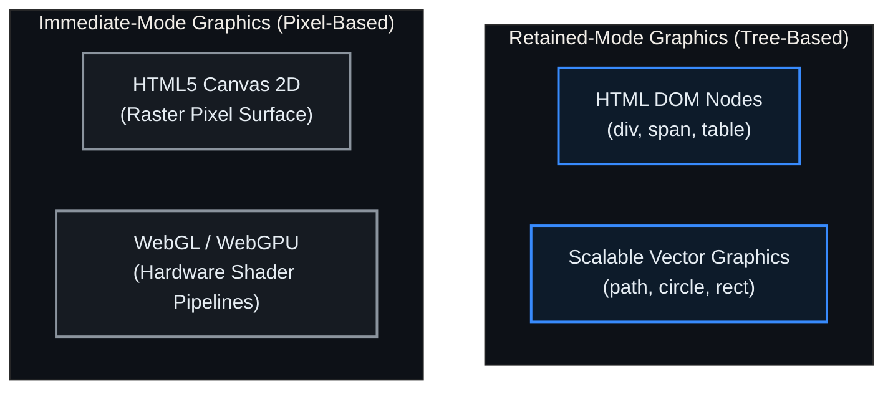

# Lesson 14: Browser Rendering Engines: DOM vs. SVG vs. Canvas 2D vs. WebGL

Supervisory Control and Data Acquisition (SCADA) platforms are among the most demanding visual computing applications in existence. A single industrial synoptic screen may combine thousands of static vector pipes, hundreds of fluctuating digital status indicators, floating high-priority alarm banners, and high-frequency analog trend curves streaming at 100 Hz. In a browser-native HMI, maintaining a steady, jitter-free **60 Frames Per Second (FPS)**—corresponding to a strict **[[../Glossary#16.6 ms Frame Budget (60 FPS Execution Floor)|16.6 ms per frame execution budget]]**—is a useful engineering target for operator situational awareness and safety. This lesson examines the physical hardware constraints of plant-floor displays, details the browser's [[../Glossary#Critical Rendering Path|critical rendering path]], analyzes the trade-offs across **HTML DOM**, **SVG**, **Canvas 2D**, and **WebGL**, and presents a hybrid layered rendering architecture as a candidate design.

---

## 1. Physical Reality & Field Equipment (Prerequisites)

Industrial graphics performance is constrained by the physical display hardware and client computing nodes deployed across the enterprise:

### Industrial Display Hardware & Graphic Controllers
1. **Multi-Monitor Control Room Consoles & Video Walls:** In central utility dispatch centers, operator workstations drive multi-monitor arrays ($4\text{–}8$ displays per seat) and massive $8\text{K}$ video walls through hardware graphic controllers. Rendering hundreds of thousands of vector lines across huge desktop viewports stresses GPU texture memory, fill-rate bandwidth, and browser window compositing.
2. **Plant-Floor Industrial Touch Panels (Level 2 Panel PCs):** On factory floors and in electrical switchgear rooms, operators interact with ruggedized, fanless panel PCs. These devices operate in harsh thermal environments ($-20^\circ\text{C}$ to $+60^\circ\text{C}$) and feature low-power, energy-efficient ARM or embedded x86 processors with integrated GPUs and limited RAM ($2\text{–}4\text{ GB}$). If an HMI architecture introduces memory bloat or triggers CPU-bound layout reflows, embedded panel PCs experience catastrophic tab crashes (Out-Of-Memory kills) and multi-second touch latency.

The physical client display and computing hardware deployed across industrial installations is shown in **Figure 14.1**, contrasting multi-monitor video wall controllers (**Figure 14.1(a)**) with plant-floor web panel PCs (**Figure 14.1(b)**):

<!-- 
  PHOTO SEARCH GUIDANCE:
  Target Equipment: Industrial Multi-Monitor Display Controller / Video Wall Processor
  Suggested Models: Matrox QuadHead2Go Series / Barco OverView Video Wall Controller
  Search Query: "Matrox QuadHead2Go multi-monitor controller" OR "Barco OverView video wall controller"
  Google Images Link: https://www.google.com/search?tbm=isch&q=Matrox+QuadHead2Go+multi-monitor+controller
-->
<!-- 
  PHOTO SEARCH GUIDANCE:
  Target Equipment: Rugged Industrial Touch Panel PC / Web HMI Panel
  Suggested Models: Siemens SIMATIC HMI Unified Comfort Panel / Advantech TPC-1551T Panel PC
  Search Query: "Siemens SIMATIC HMI Unified Comfort Panel" OR "Advantech TPC-1551T industrial panel PC"
  Google Images Link: https://www.google.com/search?tbm=isch&q=Siemens+SIMATIC+HMI+Unified+Comfort+Panel
-->
![[14-multi-monitor-operator-console.png]]
*(a) Hardware Multi-Monitor Video Wall Controller Driving 4K/8K Consoles (Matrox QuadHead2Go)*

![[14-industrial-web-panel-pc.png]]
*(b) Fanless Plant-Floor Web Panel PC Executing Chromium Kiosk (Siemens SIMATIC Unified)*

*Figure 14.1: Physical Client Display Hardware: (a) Multi-monitor graphic controller driving central control room video walls; (b) Low-power industrial touch panel PC running plant-floor web synoptics.*

---

## 2. Architectural Pitfalls of Retained-Mode DOM Trees (The Tension)

The foundational architectural divide in computer graphics lies between **[[../Glossary#Retained-Mode vs. Immediate-Mode Graphics|Retained-Mode]]** and **Immediate-Mode** graphics rendering, as categorized below:



### Retained Mode (HTML DOM & SVG): The Structural Tree Model
In retained-mode graphics, the browser maintains a persistent, in-memory hierarchical object tree of every visual element. Under this model, the browser engine automatically tracks element bounds, resolves CSS style hierarchies, calculates layer positions, handles hit-testing for mouse click and hover events, and manages the accessibility tree. However, this architectural convenience encounters a steep scaling limit: when the number of dynamic visual elements exceeds $3{,}000\text{–}5{,}000$ nodes, the computational cost of recalculating box models and CSS cascades saturates the CPU main thread, triggering the [[../Glossary#Layout Reflow Cliff|layout reflow cliff]].

This scalability divergence between retained-mode tree reflows and immediate-mode pixel rasterization is illustrated in **Figure 14.2**:

![[14-dom-vs-canvas-scaling-cliff.svg]]

*Figure 14.2: Browser Rendering Scalability — The DOM and SVG Layout Reflow Cliff vs. High-Throughput Immediate-Mode Canvas 2D and WebGL Pipelines.*

### The 16.6 ms Critical Rendering Path
To deliver $60\text{ FPS}$, the browser has exactly $16.6\text{ ms}$ to process data, update styles, and composite the screen:

$$\text{Frame Budget} = \frac{1{,}000\text{ ms}}{60\text{ frames}} \approx 16.67\text{ ms / frame}$$

If JavaScript execution, style calculation, and layout take longer than $16.6\text{ ms}$, the browser drops the frame. The operator perceives this as visual stuttering ("jank").

### Anatomy of the Browser Pipeline
1. **JavaScript:** Processing incoming WebSocket telemetry, updating application stores (Zustand/Signals).
2. **Style Recalculation:** Matching CSS selectors to DOM elements and computing active style rules.
3. **Layout (Reflow):** Calculating exact geometric coordinates, widths, and heights for every visual box. Modifying layout-triggering properties (`width`, `height`, `top`, `left`, `margin`, or `innerHTML`) forces the browser to recalculate the geometry of parent and sibling nodes across the entire document.
4. **Paint (Rasterize):** Converting computed visual vectors, fonts, and colors into bitmap pixels in memory tiles.
5. **GPU Composite:** The browser's **Compositor Thread** transfers pre-rasterized layer textures into GPU VRAM, applying transforms (`rotate`, `translate3d`) and opacity changes directly in hardware.

The browser's critical rendering path, contrasting the CPU-bound reflow path against the zero-reflow GPU compositing pipeline, is diagrammed in **Figure 14.3**:

![[14-browser-compositor-pipeline.svg]]

*Figure 14.3: Browser Critical Rendering Path — The CPU-Bound Layout Reflow Jank Path vs. The Hardware-Accelerated Zero-Reflow GPU Compositing Pipeline.*

### Cognitive Ergonomics: [[../Glossary#Dynamic Presentation Velocity Invariant|Visual Velocity Invariants]] (Tong et al., 2026)
High rendering performance is not merely an aesthetic concern; it directly impacts operator decision-making. Empirical cognitive research in SCADA interfaces demonstrates the profound impact of information presentation speed ([[Tong_et_al_2026|Tong et al., 2026]]). When dynamic visual symbols (such as animated fluid flows or rotating impellers) move across a display at velocities exceeding **$8^\circ/\text{s}$ of [[../Glossary#Visual Angle Velocity ($\omega$)|visual angle]]**, the probability of incorrect operational decisions increases significantly ($p < 0.001$). High speeds specifically impair cognitive decision-making logic rather than basic visual perception.

At presentation velocities of **$16^\circ/\text{s}$ and above**, overall operator situational awareness—evaluated via the [[../Glossary#Situation Awareness Rating Technique (SART)|Situation Awareness Rating Technique (SART)]]—collapses due to escalating attentional demand. Consequently, SCADA graphic engines must constrain dynamic visual symbol movement to an optimal ergonomic window of **$4\text{–}12^\circ/\text{s}$** (and strictly below $16^\circ/\text{s}$) to optimize task accuracy, prevent visual fatigue, and preserve cognitive attentional reserve ([[Tong_et_al_2026|Tong et al., 2026]]; formalized into High-Performance HMI design in [[16-ISA-101-High-Performance-HMI|Lesson 16]], [[17-Situational-Awareness-Cognitive-Mirroring|Lesson 17]], and [[18-Human-Visual-Fatigue-Limits|Lesson 18]]).

---

## 3. Decoupled Web-Native Component Architecture: The Hybrid Stacking Strategy

To overcome the limitations of individual rendering technologies, a browser architecture can implement a **[[../Glossary#Hybrid Viewport Stacking Strategy|Hybrid Layered Viewport Strategy]]** ([[Bellini_et_al_2022|Bellini et al., 2022]]; [[Jiao_et_al_2018|Jiao et al., 2018]]):

### The 3-Tier Layering Allocation Matrix

#### Base SVG Retained Synoptic Vector Layer (`z-index: 100`)
- **Technology:** Scalable Vector Graphics (SVG; synthesized via [[13-Declarative-SVG-Synthesis|Lesson 13]]).
- **Functional Role:** Structural plant infrastructure: P&ID piping grids, chemical reactor vessels, electrical busbars, transformer symbols, and discrete valves/breakers.
- **Key Advantage:** Resolution-independent vector clarity on $4\text{K}/8\text{K}$ video walls. Retained DOM nodes allow direct click event binding (`onclick="openBreakerModal('QA1')"`). Reusable symbol templates in `<defs>` instantiated via `<use>` reduce memory by $>85\%$ (detailed in [[13-Declarative-SVG-Synthesis|Lesson 13]]).

#### Middle Canvas 2D / WebGL Immediate Telemetry Layer (`z-index: 200`)
- **Technology:** HTML5 Canvas 2D / WebGL surface with `pointer-events: none`.
- **Functional Role:** High-frequency, high-density real-time data: oscilloscope-style analog curves (100 Hz), high-density historical trend plots ($100{,}000+$ points decimated via [[../Glossary#Largest Triangle Three Buckets (LTTB)|LTTB]]; see [[09-Time-Series-Historians|Lesson 09]]), animated fluid particles, and rotating impellers.
- **Key Advantage:** Immediate-mode rendering writes directly to a GPU-backed pixel buffer. Zero DOM nodes are created or destroyed, bypassing CPU style and layout reflow steps entirely. `pointer-events: none` allows operator mouse clicks to pass through seamlessly to the underlying SVG equipment layer.

#### Topmost HTML5 DOM HUD & Modals Layer (`z-index: 300`)
- **Technology:** Standard HTML5 DOM (`<div>`, `<input>`, `<button>`, `<table>`).
- **Functional Role:** High-priority operator interaction: tabular alarm annunciation banners, setpoint numerical entry dialogs, confirmation prompts, and system menus.
- **Key Advantage:** Native browser form controls, keyboard navigation, focus management, screen-reader accessibility, and standard CSS styling.

This hybrid viewport stacking architecture—combining resolution-independent SVG synoptics, high-speed Canvas telemetry, and accessible DOM HUDs—is illustrated in **Figure 14.4**:

![[14-hybrid-scada-rendering-layers.svg]]

*Figure 14.4: Hybrid viewport layering — each rendering surface owns a different interaction concern, while pointer and update paths remain separated across the stack.*

---

## 4. Enterprise Deployment Topology across Purdue & IDMZ

Deploying web SCADA interfaces across [[../Glossary#Purdue Enterprise Reference Architecture (PERA / Purdue Model)|Purdue]] Level 2 (plant-floor panel PCs) and Level 4/5 (control room video walls) requires offloading rendering workloads from the browser's main UI thread. Both client classes load the same SVG/Canvas bundle over `wss://...:443` terminating at the Level 3.5 [[../Glossary#Industrial Demilitarized Zone (IDMZ / Level 3.5)|IDMZ]] reverse proxy ([[11-Monolithic-vs-Web-SCADA|Lesson 11]]); no client ever routes to field controllers. Because the rendering cost is paid entirely client-side, a Level 2 panel PC with 2 GB RAM and no discrete GPU is the sizing constraint, not the IDMZ server tier.

### OffscreenCanvas & Web Worker Telemetry Rendering
In standard web applications, JavaScript telemetry ingestion and Canvas rendering share the main thread with user event listeners and DOM management. If an incoming WebSocket stream bursts with 5,000 samples (managed via [[../Glossary#Telemetry Conflation|telemetry conflation]]; see [[12-WebSocket-Streaming-Mechanics|Lesson 12]]), the main thread freezes, dropping touch response.

The reference architecture isolates Canvas rendering into background **Web Workers** via the **[[../Glossary#OffscreenCanvas API|OffscreenCanvas API]]** (analyzed in depth in [[15-Multithreaded-Web-Performance|Lesson 15]]):

```typescript
// Main Thread: Initializing and Transferring Canvas to Web Worker
export function initializeTrendViewport(canvasElement: HTMLCanvasElement): void {
  // Transfer rendering control off the main thread
  const offscreen = canvasElement.transferControlToOffscreen();
  
  // Spawn dedicated graphics worker
  const renderWorker = new Worker(new URL('./telemetryRenderWorker.ts', import.meta.url), {
    type: 'module'
  });

  // Hand off canvas ownership
  renderWorker.postMessage({ type: 'INIT_CANVAS', canvas: offscreen }, [offscreen]);
}
```

```typescript
// telemetryRenderWorker.ts: Dedicated Background Rendering Thread
let ctx: OffscreenCanvasRenderingContext2D | null = null;
const trendBuffer: Float32Array = new Float32Array(100_000);

self.onmessage = (event: MessageEvent) => {
  if (event.data.type === 'INIT_CANVAS') {
    const offscreen = event.data.canvas as OffscreenCanvas;
    ctx = offscreen.getContext('2d');
    startRenderLoop();
  } else if (event.data.type === 'TELEMETRY_BATCH') {
    // Ingest binary telemetry samples directly into typed array buffer
    trendBuffer.set(event.data.samples, event.data.offset);
  }
};

function startRenderLoop(): void {
  function renderFrame() {
    if (ctx) {
      // Immediate-mode off-screen rasterization: zero DOM overhead
      ctx.clearRect(0, 0, ctx.canvas.width, ctx.canvas.height);
      ctx.beginPath();
      ctx.lineWidth = 1.5;
      ctx.strokeStyle = '#58a6ff'; // ISA-101 cool-blue data trace (amber reserved for P2 alarms)
      
      for (let i = 0; i < 10_000; i += 2) {
        ctx.lineTo(trendBuffer[i], trendBuffer[i + 1]);
      }
      ctx.stroke();
    }
    requestAnimationFrame(renderFrame);
  }
  requestAnimationFrame(renderFrame);
}
```

### Zero-Reflow Compositor Rule
To guarantee that supervisory synoptics never drop below 60 FPS:
1. **Never Mutate Geometric Properties:** Script animations must never touch `width`, `height`, `top`, `left`, or `margin`.
2. **Use Composited CSS Properties Exclusively:** Animate position using `transform: translate3d(x, y, 0)`, rotate using `transform: rotate(deg)`, and adjust visibility using `opacity`.
3. **Hardware Layer Promotion:** Use `will-change: transform` or `contain: strict` to instruct the browser engine to isolate dynamic graphic components into independent GPU compositor layers, preventing child updates from invalidating parent raster tiles.

---

## 5. Structural Comparison: Industrial Web Rendering Technologies

| Architectural Dimension | HTML5 DOM | Scalable Vector Graphics (SVG) | HTML5 Canvas 2D | WebGL / WebGPU |
| :--- | :--- | :--- | :--- | :--- |
| **Rendering Model** | Retained-Mode (Box Tree) | Retained-Mode (Vector DOM) | **Immediate-Mode (Pixel Surface)** | **Immediate-Mode (Shader Pipeline)** |
| **Node Identity** | Every tag is a DOM node | Every shape is a DOM node | Zero DOM nodes (1 `<canvas>`) | Zero DOM nodes (1 `<canvas>`) |
| **DOM Memory Footprint** | Extremely High ($>1\text{ KB}$/node) | High ($>500\text{ B}$/vector node) | **Minimal (Fixed VRAM buffer)** | **Minimal (Fixed GPU buffer)** |
| **Element Scaling Limit** | $< 1{,}000$ active nodes | $< 5{,}000$ active nodes | **$50{,}000+$ data points** | **$1{,}000{,}000+$ vertices** |
| **Hit Testing & Events** | Native browser bubbling | Native per-node DOM events | Manual math coordinate checks | Manual raycasting / pick buffers |
| **Styling Flexibility** | Full CSS3 support | Full CSS3 & SVG attributes | None (Manual JavaScript) | None (GLSL / WGSL Shaders) |
| **Hardware Offloading** | CPU Layout + GPU Composite | CPU Layout + GPU Composite | **GPU-accelerated rasterization** | **Direct GPU Hardware Pipeline** |
| **Ideal SCADA Function** | Parameter tables, HUD, forms | **P&ID mimics, substation SLDs** | **100 Hz trend curves, waveforms** | **3D Digital Twins, point clouds** |

---

## 6. Active-Recall Assessments

> [!FAQ]- Why does appending 10,000 real-time trend data points into an SVG path cause browser freezing ("jank") while Canvas 2D handles it smoothly?
> SVG is a **retained-mode graphics format**: every point, path segment, or circle is an explicit object in the browser DOM tree. Appending or updating 10,000 SVG DOM elements forces the browser's main thread to execute computationally expensive style recalculation and **Layout Reflow** passes on every frame, exceeding the $16.6\text{ ms}$ frame budget and freezing the UI. In contrast, Canvas 2D operates in **immediate mode**: calling `ctx.lineTo()` writes pixels directly to a memory buffer without creating DOM objects, executing in under $1\text{ ms}$ with zero layout reflow.

> [!FAQ]- How does the browser Compositor Thread achieve 60 FPS animation without running Layout or Paint passes?
> When an element is isolated on a dedicated GPU layer (e.g., via `transform: translate3d()` or `will-change: transform`), the browser paints its texture once into GPU VRAM. Subsequent animations modifying `transform` or `opacity` are executed directly by the GPU's hardware compositor, bypassing the main thread's Style Recalculation, Layout (Reflow), and Paint passes entirely, achieving sub-millisecond frame execution.

> [!FAQ]- What is the purpose of pointer-events: none in a hybrid viewport layering model?
> The hybrid viewport places an immediate-mode Canvas 2D overlay (`z-index: 200`) directly on top of the retained-mode SVG synoptic mimic (`z-index: 100`). Setting `pointer-events: none` on the transparent Canvas allows mouse clicks and hover events to pass straight through to the underlying SVG elements. Operators can click on valves, pumps, and circuit breakers in the SVG diagram without interference from high-speed trend lines rendering on the canvas above.

> [!FAQ]- What empirical constraints does cognitive research establish for dynamic symbol velocities in SCADA HMIs?
> Research by [[Tong_et_al_2026|Tong et al., 2026]] demonstrates that dynamic visual symbol movement speeds exceeding **$8^\circ/\text{s}$ of visual angle** significantly escalate operator decision-making error rates, while speeds of **$16^\circ/\text{s}$ and above** trigger severe collapses in situational awareness (SART score drops) and induce visual fatigue. Consequently, industrial HMI graphic engines must constrain dynamic symbol velocities (e.g., rotating impellers or moving fluid particles) to an optimal window of **$4\text{–}12^\circ/\text{s}$**.

> [!FAQ]- How does the OffscreenCanvas API prevent high-frequency telemetry bursts from freezing the operator's touch interface?
> The `OffscreenCanvas` API transfers rendering control of a `<canvas>` element from the main browser thread to a background **Web Worker**. When high-frequency telemetry bursts arrive over WebSockets, the worker processes the byte buffers and executes drawing loops in background threads. The main UI thread remains completely unburdened, guaranteeing instantaneous responsiveness ($<16.6\text{ ms}$) for operator touch inputs, alarm acknowledgments, and emergency stop actions.
