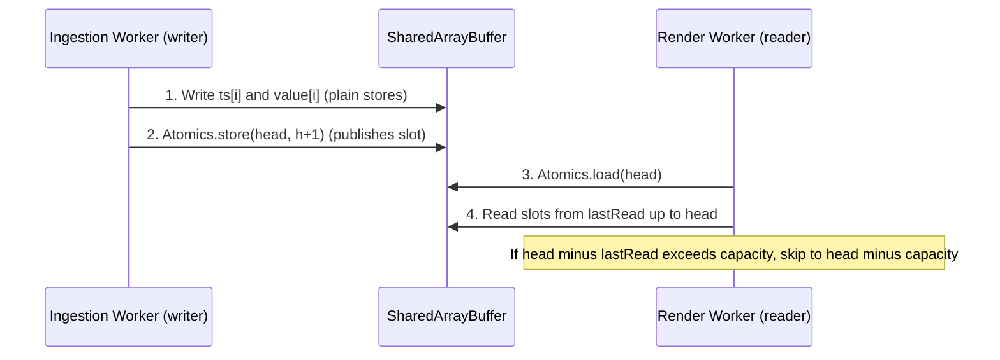

# Lesson 15: Multithreaded Web Performance: Web Workers, SharedArrayBuffer & Atomics

[[14-Browser-Rendering-Engines|Lesson 14]] established that the main thread owns a [[../Glossary#16.6 ms Frame Budget (60 FPS Execution Floor)|$16.6\text{ ms}$ frame budget]] and showed *how to move Canvas drawing* into a worker with `[[../Glossary#OffscreenCanvas API|OffscreenCanvas]]`. This lesson addresses the remaining load that still lands on the main thread: **ingesting, decoding, and handing off the telemetry itself**. It details the lock-free shared-memory ring buffer that connects the ingestion worker to the render worker, and the HTTP headers that must be deployed at the [[../Glossary#Industrial Demilitarized Zone (IDMZ / Level 3.5)|IDMZ]] edge for that memory model to exist at all.

---

## 1. Physical Reality & Field Equipment (Prerequisites)

A web thread is not an abstraction: each worker maps to an operating-system thread that the scheduler places on a **physical CPU core**. The Level 2 fanless panel PCs and Level 4/5 workstations described in [[14-Browser-Rendering-Engines|Lesson 14]] are multi-core machines, but a conventional web application leaves all but one core idle:

1. **Embedded Quad-Core Edge PCs:** Fanless DIN-rail and panel computers typically ship with 2–4 low-clock cores (e.g., Intel Atom / Celeron or ARM Cortex-A). Single-thread performance is modest, so work that a desktop absorbs unnoticed can saturate the one core that runs the UI.
2. **Thermal Throttling:** In sealed enclosures at $+50^\circ\text{C}$ ambient, sustained 100% load on one core triggers frequency throttling, shrinking the frame budget margin further. Spreading load across cores lowers per-core duty cycle and delays throttling.
3. **Shared Memory Bus:** All cores address the same DRAM. This is what makes true shared memory between threads physically possible, and why a *copy* between threads is pure waste on the same machine.

The physical edge computing hardware executing these multi-core workloads is shown in **Figure 15.1**, illustrating a fanless embedded PC deployed as a Level 2 client:

<!-- 
  PHOTO SEARCH GUIDANCE:
  Target Equipment: Fanless Multi-Core Industrial Embedded Box PC (Level 2 edge client)
  Suggested Models: Advantech UNO-2484G / Siemens SIMATIC IPC227E
  Search Query: "Advantech UNO-2484G fanless embedded PC" OR "Siemens SIMATIC IPC227E"
  Google Images Link: https://www.google.com/search?tbm=isch&q=Advantech+UNO-2484G+fanless+embedded+PC
-->
![[15-fanless-multicore-embedded-pc.png]]

*Figure 15.1: Fanless Multi-Core Industrial Embedded PC (Advantech UNO-2484G) — A sealed, passively cooled Level 2 client whose spare CPU cores are the resource Web Workers unlock.*

---

## 2. Architectural Pitfalls of Single-Threaded Telemetry Handling (The Tension)

The main thread already carries input handling, style, layout, and paint ([[14-Browser-Rendering-Engines|Lesson 14]]). A naive web SCADA client adds the entire telemetry path on top of it. Three failure mechanisms follow:

### Telemetry Decode Overhead on the UI Thread
[[12-WebSocket-Streaming-Mechanics|Lesson 12]] showed that binary Protobuf frames avoid UTF-8 validation, and [[07-Protobuf-vs-Text-Serialization|Lesson 07]] showed how varints and `float32` fields are unpacked. If that unpacking runs in the `onmessage` handler of the page, every burst of updates competes directly with rendering. A plant upset produces the largest bursts exactly when the operator most needs a responsive screen.

### Garbage-Collection Pauses from Per-Sample Allocations
Decoding each sample into a JavaScript object (`{ tag, ts, value }`) allocates on the V8 heap. At $10{,}000$ samples/s this produces millions of short-lived objects per minute. The collector must periodically pause the thread to reclaim them, producing irregular multi-millisecond stalls that no amount of rendering optimization can hide.

```typescript
// ❌ ANTI-PATTERN: per-sample heap allocation on the main thread
socket.onmessage = (ev: MessageEvent<ArrayBuffer>) => {
  const samples = decodeSparkplug(ev.data);            // allocates N objects
  for (const s of samples) store.setState(s.tag, s);   // triggers N reactive updates
};
```

### Thread Synchronization Bottlenecks in Structured Cloning
Moving work to a worker does not help if results return by `postMessage()` with **structured cloning**: the engine deep-copies the payload on one thread and reconstructs it on the other. Copying a $50\text{ MB}$ history buffer transiently needs $100\text{ MB}$ of heap and burns CPU on both sides, relocating the stall rather than removing it.

---

## 3. Decoupled Web-Native Component Architecture: Worker Pipeline & Shared-Memory Ring Buffers

The reference browser architecture splits the client into three single-responsibility execution contexts. Each owns its data exclusively except for one explicitly shared region.

| Context | Owns | Never does |
| :--- | :--- | :--- |
| **Ingestion Worker** | WebSocket socket, Protobuf decode, scaling, threshold logic | Touch DOM or canvas |
| **Render Worker** | `OffscreenCanvas` trend drawing ([[14-Browser-Rendering-Engines|Lesson 14]]) | Network I/O or decoding |
| **Main Thread** | SVG synoptic state, forms, alarm banners, input | Decode telemetry or draw trends |

This decoupled multi-threaded pipeline, separating ingestion, background rendering, and UI event handling across dedicated threads, is diagrammed in **Figure 15.2**:

![[15-sharedarraybuffer-worker-pipeline.svg]]

*Figure 15.2: Zero-Copy Worker Pipeline — Ingestion Worker Writing a SharedArrayBuffer Ring Read by the Render Worker While the Main Thread Stays Free for Operator Input.*

### Three Ways to Move Bytes Between Threads

| Mechanism | What happens to memory | Cost | Typical use |
| :--- | :--- | :--- | :--- |
| **Structured Clone** (`postMessage(obj)`) | Deep copy; both threads hold a copy | Scales with payload size | Small control messages only |
| **Transferable** (`postMessage(buf, [buf])`) | Ownership moves; sender's buffer is *detached* | Constant, near zero | Batched hand-off; **fallback** path |
| **`SharedArrayBuffer`** | One physical region visible to all threads | Zero copy, but needs synchronization | Continuous telemetry ring |

Transfer suits one-shot hand-offs (a history query result). A continuous stream needs the producer and consumer to *both* keep access, which a transfer forbids; that is the case for `SharedArrayBuffer` + `Atomics`.

### The [[../Glossary#Single-Producer / Single-Consumer (SPSC) Ring Buffer|Single-Producer / Single-Consumer (SPSC) Ring Buffer]]
The ingestion worker (sole writer) appends samples to a fixed-size circular region. The render worker (sole reader) tracks its own read position. Because exactly one thread writes the head counter, no mutex is required: an atomic store/load pair is sufficient. A pre-allocated region also eliminates the allocation churn from Pitfall 2.



The atomic store in step 2 is the **publication barrier**: all plain writes that precede it become visible to any thread that observes the new head value via `Atomics.load`.

```typescript
// shared-ring.ts — shared by both workers
export const CAPACITY = 1 << 17;       // 131,072 slots (power of two)
const MASK = CAPACITY - 1;

export function allocateRing(): SharedArrayBuffer {
  // [0..7]: Int32 control block (head counter) | then ts[] and value[] as Float64
  return new SharedArrayBuffer(8 + CAPACITY * 8 * 2);
}

function views(sab: SharedArrayBuffer) {
  return {
    ctl: new Int32Array(sab, 0, 2),
    ts: new Float64Array(sab, 8, CAPACITY),
    val: new Float64Array(sab, 8 + CAPACITY * 8, CAPACITY),
  };
}

// Ingestion Worker — the only writer
export function push(sab: SharedArrayBuffer, t: number, v: number): void {
  const { ctl, ts, val } = views(sab);
  const h = Atomics.load(ctl, 0);
  const i = h & MASK;
  ts[i] = t;
  val[i] = v;
  Atomics.store(ctl, 0, (h + 1) | 0);   // publish after data is written
}

// Render Worker — the only reader; `last` is private to this thread
export function drain(
  sab: SharedArrayBuffer,
  last: number,
  out: (t: number, v: number) => void
): number {
  const { ctl, ts, val } = views(sab);
  const head = Atomics.load(ctl, 0);
  let pending = (head - last) | 0;
  if (pending > CAPACITY) {             // reader fell behind: oldest samples overwritten
    last = (head - CAPACITY) | 0;
    pending = CAPACITY;
  }
  for (let k = 0; k < pending; k++) {
    const i = (last + k) & MASK;
    out(ts[i], val[i]);
  }
  return head;                          // caller stores as new `last`
}
```

Design notes:
- **Counters, not indices.** `head` is a free-running 32-bit counter; the slot is `head & MASK`. Subtracting counters with `| 0` stays correct across 32-bit wraparound because `CAPACITY` divides $2^{32}$.
- **Typed-array choice.** `Atomics` operates only on integer typed arrays, so the control block is `Int32Array` while payload uses `Float64Array`.
- **No blocking on the UI thread.** `Atomics.wait()` is forbidden on the main thread. The render loop instead calls `drain()` once per `requestAnimationFrame`.

### Overwrite Policy Must Match Data Class
Overwriting the oldest slot is acceptable for **continuous analog trends**, the same lossy last-value policy defined as Tier 1 in [[12-WebSocket-Streaming-Mechanics|Lesson 12]]. It is **not** acceptable for **discrete alarms and breaker trips** (Tier 2: lossless FIFO). Alarm events therefore travel on a separate, lossless `postMessage` channel to the main thread, never through the overwriting ring. The long-term, lossless record of both classes is the cold path ([[09-Time-Series-Historians|Lesson 09]]; [[19-Hot-Path-vs-Cold-Path-Pipelines|Lesson 19]]).

---

## 4. Enterprise Deployment Topology across [[../Glossary#Purdue Enterprise Reference Architecture (PERA / Purdue Model)|Purdue]] & [[../Glossary#Industrial Demilitarized Zone (IDMZ / Level 3.5)|IDMZ]]

`SharedArrayBuffer` is not available by default. Browsers expose it only in a **[[../Glossary#Cross-Origin Isolation (COOP / COEP)|cross-origin isolated]]** context, a defense introduced after speculative-execution side-channel attacks (Spectre) made shared high-resolution memory dangerous across origins. Isolation is granted by two response headers on the top-level document:

```http
Cross-Origin-Opener-Policy: same-origin
Cross-Origin-Embedder-Policy: require-corp
```

These headers are an **edge-tier deployment concern**: they are emitted by the Level 3.5 IDMZ reverse proxy that already terminates `wss://...:443` for every client ([[11-Monolithic-vs-Web-SCADA|Lesson 11]]). Operational consequences for plant engineering:

1. **Everything Embedded Must Opt In.** With `require-corp`, any cross-origin subresource (CDN fonts, map tiles, third-party iframes, vendor camera streams) is blocked unless it sends a compatible `Cross-Origin-Resource-Policy` header. The synoptic bundle must be served same-origin from the IDMZ, which also matches the zero-install, single-ingress model.
2. **Runtime Feature Detection with Graceful Fallback.** Some panel PCs run pinned, older kiosk browsers. The client must test `self.crossOriginIsolated` at startup and select the fallback if false:

```typescript
const useSharedRing =
  self.crossOriginIsolated && typeof SharedArrayBuffer !== 'undefined';

// true  -> SharedArrayBuffer ring (Section 3)
// false -> Ingestion Worker posts batched Float64Array chunks as Transferables
```

   The fallback preserves the architecture (decode and render still off the main thread) at the price of one cheap ownership transfer per batch.
3. **No New Network Surface.** Workers reuse the existing single WSS connection owned by the ingestion worker; no extra ports are opened through Firewall 1 or Firewall 2 ([[12-WebSocket-Streaming-Mechanics|Lesson 12]]).

---

## 5. Structural Comparison: Thread-Hand-Off Strategies

| Architectural Dimension | All on Main Thread | Worker + Structured Clone | Worker + Transferable | **Worker + SharedArrayBuffer Ring** |
| :--- | :--- | :--- | :--- | :--- |
| **CPU Cores Used** | 1 | 2+ | 2+ | **2+** |
| **Decode Location** | UI thread | Worker | Worker | **Worker** |
| **Copy per Hand-Off** | None | Full deep copy | None (ownership moves) | **None (shared region)** |
| **GC Pressure** | High | High (both sides) | Moderate | **Minimal (pre-allocated)** |
| **Producer Keeps Access After Send** | n/a | Yes | No (detached) | **Yes** |
| **Synchronization** | n/a | Implicit (message queue) | Implicit (message queue) | **Explicit (`Atomics`)** |
| **Deployment Requirement** | None | None | None | **COOP + COEP headers at IDMZ** |
| **Failure Mode** | Frame drops during bursts | Memory spikes, copy stalls | Detached-buffer bugs | **Torn reads if protocol violated** |

---

## 6. Active-Recall Assessments

> [!FAQ]- Why does moving decoding into a Web Worker still not guarantee a smooth UI if results come back through `postMessage` with structured cloning?
> Structured cloning deep-copies the payload on the sending thread and rebuilds it on the receiver, so large or frequent messages move the cost (and extra heap) rather than remove it. A 50 MB buffer briefly occupies 100 MB. Transferables or a `SharedArrayBuffer` avoid the copy entirely.

> [!FAQ]- Why is a mutex unnecessary in the SPSC ring buffer, and what breaks if two workers both write to it?
> With exactly one writer, only that writer modifies `head`, and the atomic store publishes completed slot data to the single reader. If two writers exist, both can read the same `head`, write the same slot, and overwrite each other, corrupting samples. Multi-producer rings need an atomic compare-exchange on `head` or one ring per producer.

> [!FAQ]- Why must alarms and breaker trips not travel through the overwriting ring buffer?
> Overwrite-oldest is a lossy policy that silently discards samples when the reader falls behind. That is acceptable for analog trends (only the latest value matters, as in Lesson 12's Tier 1), but an overwritten trip event would never reach the operator. Discrete events use a lossless `postMessage` queue instead.

> [!FAQ]- Why does `SharedArrayBuffer` require COOP and COEP headers, and who deploys them in a Purdue architecture?
> Shared high-resolution memory enables timing side channels such as Spectre, so browsers expose it only when the page is cross-origin isolated (`Cross-Origin-Opener-Policy: same-origin` plus `Cross-Origin-Embedder-Policy: require-corp`). The Level 3.5 IDMZ reverse proxy that serves the synoptic bundle emits them; any cross-origin embed must then send a compatible resource policy.

> [!FAQ]- Why can the main thread not call `Atomics.wait()`, and how does the render loop wait for new data instead?
> `Atomics.wait()` blocks the calling thread, which would freeze input and painting, so browsers forbid it on the main thread. The render loop instead polls with `Atomics.load(head)` once per `requestAnimationFrame`, drawing whatever samples have arrived since its last read.
