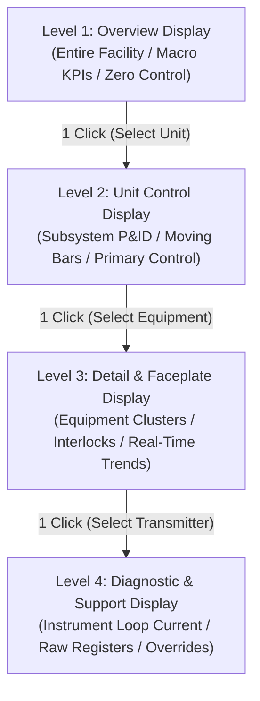

# Lesson 16: ANSI/ISA-101: High-Performance HMI & Visual Ergonomics

Previous lessons established the mechanical foundations of web-native SCADA: synthesizing declarative vector synoptics from authoritative models ([[13-Declarative-SVG-Synthesis|Lesson 13]]), managing browser rendering engines within a $16.6\text{ ms}$ compositor budget ([[14-Browser-Rendering-Engines|Lesson 14]]), and isolating telemetry ingestion from the main thread via Web Workers and shared-memory ring buffers ([[15-Multithreaded-Web-Performance|Lesson 15]]). 

However, achieving high graphics throughput is futile if the screen layout itself cripples the operator's mental model. This lesson transitions from computational performance to **cognitive ergonomics**. It examines the biological limits of the human visual system, details the operational failure modes of legacy [[../Glossary#"Christmas Tree" HMI Anti-Pattern|"Christmas Tree"]] graphics, formalizes the **ANSI/ISA-101.01-2015 (Human-Machine Interfaces for Process Automation Systems)** visual discipline, and presents the **[[../Glossary#Moving Analog Indicator (MAI)|Moving Analog Indicator (MAI)]]** and **[[../Glossary#4-Tier Supervisory Display Hierarchy|4-Tier Supervisory Display Hierarchy]]** as candidate design patterns.

---

## 1. Physical Reality & Field Equipment (Prerequisites)

Supervisory graphic ergonomics are bounded by the physical operational environments and hardware display terminals through which human operators oversee industrial facilities:

### Physical Control Environments & Display Hardware
1. **Central Control Room Consoles:** In continuous 24/7 process facilities (refineries, petrochemical complexes, transmission dispatch centers), console operators manage plants across arrays of $4\text{–}8$ high-resolution monitors per station, complemented by massive shared overhead video walls. Operators maintain continuous vigilance across 8- to 12-hour shifts under ambient lighting typically standardized to **$500\text{ lux}$** (Hollifield HPHMI standard). Under these conditions, high-luminance backgrounds and saturated colors induce acute ocular fatigue, headaches, and degraded visual acuity.
2. **Plant-Floor Operator Panels (Level 2 Web Panels):** As detailed in [[14-Browser-Rendering-Engines|Lesson 14]], field operators in dusty compressor shelters, boiler rooms, and electrical substations interact with fanless touchscreen panel PCs. These screens operate under variable ambient lighting—from direct sunlight to dim night conditions. Graphics must maintain high contrast without relying on subtle color hues.
3. **Biological Visual Constraints:** Human vision is non-uniform across the visual field:
   - **Foveal Vision ($1\text{–}2^\circ$ Visual Angle):** High-resolution detail and sharp color perception are concentrated strictly in the central fovea.
   - **Parafoveal Vision ($2\text{–}5^\circ$):** Visual resolution drops sharply; reading text becomes impossible.
   - **Peripheral Vision ($> 5^\circ$):** Accounts for over 95% of the visual field. It is completely blind to fine text and muted color differences, but hyper-sensitive to **luminance contrast, spatial motion, and geometric shape deformation** (Treisman's Feature Integration Theory).

The physical supervisory control environments and plant-floor display terminals deployed across industrial automation are shown in **Figure 16.1**, contrasting multi-display control room operator consoles (**Figure 16.1(a)**) with ruggedized plant-floor touch panel PCs (**Figure 16.1(b)**):

<!-- 
  PHOTO SEARCH GUIDANCE:
  Target Equipment: Modern Industrial SCADA Control Room Console with Multi-Display ISA-101 Setup
  Suggested Models: ABB Extended Operator Workplace (EOW) / Emerson DeltaV High-Performance Console
  Search Query: "ABB Extended Operator Workplace control room" OR "Emerson DeltaV high performance operator console"
  Google Images Link: https://www.google.com/search?tbm=isch&q=ABB+Extended+Operator+Workplace+control+room
-->
<!-- 
  PHOTO SEARCH GUIDANCE:
  Target Equipment: Rugged Plant-Floor Web Touch Panel PC with Grayscale HMI Display
  Suggested Models: Siemens SIMATIC HMI Unified Comfort Panel / Advantech IP66 Stainless Touch Panel
  Search Query: "Siemens SIMATIC HMI Unified Comfort Panel" OR "Advantech IP66 stainless touch panel PC"
  Google Images Link: https://www.google.com/search?tbm=isch&q=Siemens+SIMATIC+HMI+Unified+Comfort+Panel
-->
![[16-modern-scada-control-console.png]]
*(a) Central Dispatch Operator Console with Multi-Screen High-Performance Displays (ABB EOW Setup)*

![[16-isa101-operator-touch-panel.png]]
*(b) Plant-Floor Kiosk Touch Panel PC Executing Grayscale Synoptic Screens (Siemens SIMATIC Unified)*

*Figure 16.1: Industrial Supervisory Display Environments: (a) Multi-display ergonomic control room console managing enterprise facilities; (b) Rugged plant-floor touch panel running low-glare high-performance web synoptics.*

---

## 2. Architectural Pitfalls of the Legacy "Christmas Tree" HMI (The Tension)

For three decades, commercial SCADA software vendors encouraged graphics that mirrored physical equipment using realistic 3D shapes, saturated rainbow color palettes, and animated spinning widgets. This legacy design paradigm induces severe cognitive failure modes:

### The "Christmas Tree" Phenomenon
In legacy interfaces, saturated colors are assigned to normal, non-critical process states:
- **Running Motors & Pumps:** Colored bright neon green (`#00FF00`).
- **Stopped Equipment:** Colored bright red (`#FF0000`).
- **Piping & Conduits:** Colored by material type (cyan for cooling water, yellow for natural gas, magenta for steam, orange for hydrocarbons).
- **Vessels & Tanks:** Rendered with 3D gradients, beveled shadows, and animated sloshing liquid.

During steady-state nominal operations, the console screen is a glowing field of bright green circles, red squares, and rainbow pipes. When an actual hazardous upset occurs and a high-priority emergency alarm trips, another red indicator illuminates. Surrounded by dozens of pre-existing red and green elements, the alarm fails to produce sufficient luminance or salience contrast to trigger preattentive visual capture.

### Inattentional Blindness & [[../Glossary#Saccadic Search Time|Saccadic Search Time]]
Human cognitive processing operates under severe attentional bandwidth constraints, particularly under the stress of multi-alarm cascades ([[Verdejo_et_al_2026|Verdejo et al., 2026]]). In a cluttered "Christmas Tree" graphic, an operator hunting for an abnormal deviation must execute conscious serial saccadic eye fixations across every pump, valve, and vessel, resulting in visual search delays that frequently exceed $15\text{–}30\text{ seconds}$ per screen. Furthermore, decorative screen elements induce inattentional blindness: operators absorbed in diagnosing an initial pressure surge fail to notice adjacent high-temperature alarms because their central foveal channel is oversaturated by non-salient visual noise.

This cognitive strain is compounded by raw digital readouts. Displaying process metrics purely as numeric floating-point text (such as `42.8 bar` or `124.5 °C`) deprives the operator of instantaneous operational context. A raw number does not convey whether $42.8\text{ bar}$ represents a safe steady state or a critical trajectory approaching a relief-valve rupture, nor does it indicate the direction or rate of change. Determining process safety forces the operator to retrieve trip limits from memory and perform mental arithmetic—a cognitive friction step that reliably breaks down under crisis-induced fatigue.

This contrast between cognitive overload in legacy interfaces and the clarity of high-performance design is illustrated in **Figure 16.2**:

![[16-isa101-bad-vs-good-hmi.svg]]

*Figure 16.2: ANSI/ISA-101 Visual Ergonomics — (Left) Legacy "Christmas Tree" HMI drowning high-priority alarms in rainbow clutter and raw numbers; (Right) High-Performance HMI reserving saturated color exclusively for abnormal conditions and embedding spatial analog context.*

---

## 3. Decoupled Web-Native Component Architecture: ANSI/ISA-101.01 Visual Hierarchy & Symbology

To eliminate inattentional blindness and maximize operator situational awareness, **ANSI/ISA-101.01** establishes strict design rules for human-machine interfaces. These principles can be expressed through reusable declarative SVG templates ([[13-Declarative-SVG-Synthesis|Lesson 13]]) and layered viewports ([[14-Browser-Rendering-Engines|Lesson 14]]):

### Core Visual Ergonomic Principles of ISA-101.01

#### The [[../Glossary#Grayscale Canvas Baseline|Grayscale Canvas Baseline]] & Salient Color Reservation
Over **$85\text{–}90\%$** of all visual screen elements must reside in muted neutral slate or gray tones (`#16191f`, `#21262d`, `#484f58`, `#8b949e` in dark themes; `#d8dbe0`, `#e5e8ec`, `#9ca3af` in light themes). Structural infrastructure—pipes, vessels, headers, instrument lines, and equipment outlines—is drawn using thin, neutral strokes without 3D bevels, drop shadows, or gradient fills.

**Saturated, high-contrast color is strictly forbidden during normal operations:**
- When a plant operates safely at nominal setpoints, the entire screen appears calm, quiet, and grayscale.
- Saturated colors are reserved exclusively for abnormal process conditions, alarm annunciation, and safety interlock breaches.
- Running equipment is indicated by simple fill changes or directional arrow markers in neutral tones, **never by neon green**. An unpowered or stopped machine is rendered in outline, **never in red**.

#### [[../Glossary#Color Vision Deficiency (CVD) Dual-Encoding|Color Vision Deficiency (CVD) & Dual-Encoding]] (ANSI/ISA-18.2)
Approximately **$8\%$ of male process operators** suffer from congenital red-green color blindness (deuteranopia or protanopia). Interfaces that distinguish alarm states solely by red versus green hues violate life-safety engineering principles.

Under **ANSI/ISA-18.2 (Management of Alarm Systems)** and ISA-101.01, alarm indicators must implement **Redundant Dual-Encoding**:
$$\text{Alarm Indication} = \text{Color} + \text{Geometric Shape} + \text{Priority Number} + \text{Annunciation State}$$

| Alarm Priority | Color Token | Geometric Shape | Priority Digit | Required Response Time | Visual Annunciation State |
| :--- | :--- | :--- | :--- | :--- | :--- |
| **Priority 1 (Critical / Emergency)** | **Coral Red** (`#E63946`) | Square | `1` | $< 60\text{ seconds}$ | Flashing outer halo until operator acknowledgment |
| **Priority 2 (High Alarm)** | **Amber** (`#F4A261` dark / `#AC5E04` light) | Inverted Triangle | `2` | $< 5\text{ minutes}$ | Steady illuminated glyph with audible chime |
| **Priority 3 (Medium Warning)** | **Yellow / Gold** (`#E9C46A`) | Diamond | `3` | $< 30\text{ minutes}$ | Steady illuminated glyph without siren |
| **Priority 4 (Low / Diagnostic)** | **Purple** (`#A78BFA` dark / `#7C3AED` light) | Circle | `4` | Next maintenance cycle | Logged silently to historical alarm banner |
| **[[../Glossary#Alarm Shelving & Suppression (ISA-18.2)|Shelved / Suppressed]]** | **Muted Slate Outline** | Circle with Diagonal Slash | `—` | Operator-managed | Suppressed to prevent alarm flooding; audited under [[../Glossary#Management of Change (MOC)|MOC]] |

#### [[../Glossary#Method 3 Separate Alarm Indicator Placement|Method 3 Alarm Presentation]] vs. Anti-Patterns
Where should an alarm be rendered on an analog indicator? Industrial engineering identifies three historical approaches:
1. **Method 1 (Recolor the Pointer - Anti-Pattern):** Fusing the process variable readout with the alarm by turning the pointer red. Under deuteranopia, the red pointer becomes nearly indistinguishable from the dark track, creating a catastrophic safety blindspot.
2. **Method 2 (Paint Colored Bands on the Track - Anti-Pattern):** Painting bright red (HH/LL) and amber (H/L) bands across the track gauge. Even when the process is completely nominal, dozens of gauges display bright red and amber strips, re-introducing the "Christmas Tree" effect and degrading foveal vigilance.
3. **Method 3 (Separate Alarm Indicator - High-Performance Standard):** The track displays **only the normal operating zone**; alarm limits are represented as thin, neutral tick marks. When an alarm occurs, a **separate, distinct geometric badge** (color + shape + priority digit) appears immediately adjacent to the breached limit notch. The value pointer retains its invariant neutral color at all times.

The ANSI/ISA-18.2 alarm priority matrix, redundant CVD dual-encoding, and Method 3 badge placement are detailed in **Figure 16.3** gas-tight alignment:

![[16-alarm-method3-matrix.svg]]

*Figure 16.3: ANSI/ISA-18.2 Alarm Priority Matrix & Method 3 Placement — Normal vision vs. Grayscale vs. CVD simulation (Machado et al., 2009) showing survival of geometric shape and digit when hue collapses; Lower panel contrasts pointer recoloring and band painting against separate Method 3 badge placement.*

---

### Moving Analog Indicators & Spatial Process Encodings

#### Anatomy of the Moving Analog Indicator
Rather than printing raw numbers, ISA-101 mandates Moving Analog Indicators (MAIs). These widgets project current measurements onto a spatial axis that embeds operating limits directly into the visual layout:
1. **The [[../Glossary#Invariant Neutral Pointer|Invariant Neutral Pointer]]:** A high-contrast circular or bar pointer rendered in neutral white/black (`#FDFEFE` in dark theme; `#111827` in light theme). The pointer **never recolors**; its spatial position alone communicates process magnitude.
2. **The Normal Operating Zone:** The **only filled colored band** along the entire track (`#0369A1` in dark theme; `#BAE6FD` in light theme). It visualizes the desired nominal range ($40.0\text{–}120.0\text{ PSI}$).
3. **Setpoint Marker (SP):** A hollow chevron positioned on the opposite side of the track from the PV pointer, allowing immediate perception of regulatory loop deviation.
4. **Deviation Bracket:** A subtle spatial bracket indicating the signed deviation magnitude ($\Delta = \text{PV} - \text{SP}$).
5. **Safety Interlock (ESD) Cap:** A solid neutral block marking the automatic emergency shutdown threshold ($150.0\text{ PSI}$), distinguishing Safety Instrumented Systems (SIS) from regulatory alarms.
6. **Alarm-Limit Notches:** Thin transverse tick marks indicating Low-Low, Low, High, and High-High limits without painting colored background bands.
7. **Dual-Theme Support:** Light theme calibrated for $500\text{ lux}$ central control room ambient illumination (Hollifield standard), and dark theme calibrated for plant-floor night vision and mobile tablets.

The complete anatomy of the Moving Analog Indicator and its dual-theme presentation are illustrated in **Figure 16.4**, contrasting the control room light theme (**Figure 16.4(a)**) with the field panel dark theme (**Figure 16.4(b)**):

![[16-mai-anatomy-light.svg]]
*(a) Light Theme — Control Room / 500 Lux (Hollifield Anti-Glare Standard)*

![[16-mai-anatomy-dark.svg]]
*(b) Dark Theme — Field Panel & Night Vision (Contrast Preservation)*

*Figure 16.4: Moving Analog Indicator Anatomy & Theme Ergonomics: (a) Light theme optimized for 500 lux control room illumination; (b) Dark theme optimized for night-time and field touch panels. Both enforce an invariant neutral pointer, setpoint chevron, deviation bracket, and Method 3 alarm slots.*

#### Operational State Progression
When scanning an array of 50 MAIs across a unit, an operator's visual cortex perceives process health without performing arithmetic across five distinct operating conditions:

1. **Normal Steady-State:** Pointer rests calmly inside the blue normal band near SP. Visual salience is zero; silence is the signal.
2. **Deviation / In-Band:** Process variable shifts away from SP ($+42\text{ PSI}$), but remains within the normal zone. The spatial offset between the chevron and pointer alerts the operator to a drift before any alarm threshold is touched.
3. **Low Warning (P2):** Process breaches Low threshold ($30.0\text{ PSI}$). A steady amber triangle badge with digit `2` appears beside the notch; an audible chime sounds. The pointer remains neutral white.
4. **High Critical (P1):** Process breaches High-High threshold ($138.0\text{ PSI}$). A flashing red square badge with digit `1` illuminates beside the HH notch; repeating tone sounds. Instantaneous visual capture occurs.
5. **Bad Quality / Open Circuit:** Field transmitter loop current falls below $3.6\text{ mA}$ ([[../Glossary#NAMUR NE43|NAMUR NE43]] fault). The track fills with diagonal gray hatching, a purple Circle `4` badge indicates an I&C instrumentation fault, and the value displays `-----` with a frozen hollow pointer outline.

This 5-stage operational progression, demonstrating how the invariant pointer and external Method 3 alarm badges behave across nominal, warning, trip, and fault states, is illustrated in **Figure 16.5**:

![[16-mai-state-sequence.svg]]

*Figure 16.5: One Indicator, Five States — Operational progression demonstrating that the PV pointer remains visually identical in states 1–4. Abnormality is annunciated exclusively via external Method 3 alarm badges; Bad Quality isolates the loop with hatched fill and frozen outline.*

---

### Contextual Equipment Faceplates & Arm-and-Execute Barriers

When an operator clicks an active piece of equipment on a Level 2 screen, a web HMI can instantiate an interactive **Level 3 Equipment Faceplate Modal** directly over the synoptic canvas:

#### Operating Mode & Regulatory Control Bar
- **Mode Toggle:** Explicit `[AUTO]`, `[MANUAL]`, and `[CASCADE]` state buttons.
- **SP / PV / OP Alignment:** The Setpoint (SP), Process Variable (PV), and Controller Output (OP) are aligned using horizontal MAI tracks, highlighting regulatory loop deviation ($\Delta = \text{PV} - \text{SP}$) at a glance.
- **Micro-Trend:** A real-time 10-minute micro-trend waveform displays recent dynamic response and trip history.

#### Deterministic Interlock Permissive Chains
Before any control command can be dispatched, the faceplate renders the hardware interlock chain evaluated by the Level 1 controller:
- $I_1$: Suction Valve Open (`ZSO-101`) $\to$ `[✓ PASS]` (Muted Gray)
- $I_2$: Seal Water Flow Adequate (`FIT-101`) $\to$ `[✓ PASS]` (Muted Gray)
- $I_3$: Lube Oil Pressure Normal (`PSL-101`) $\to$ `[✓ PASS]` (Muted Gray)
- $I_4$: Motor Stator Winding Normal (`TE-101`) $\to$ `[✓ PASS]` (Muted Gray)
- Satisfied permissives remain quiet gray. If any permissive fails, it illuminates with an alarm badge and the command button is locked out.

#### [[../Glossary#Two-Stage "Arm-and-Execute" Confirmation Barrier|Two-Stage "Arm-and-Execute" Confirmation Barrier]]
Touchscreen panels on plant floors are susceptible to accidental activation from water droplets, operator sleeves, or erratic finger touches. To guarantee operational integrity, all command dispatches enforce a **Two-Stage Confirmation Barrier**:
1. **Select & Arm:** Operator enters the desired setpoint (`SP = 1800 RPM`) and taps `CHANGE SP`. The UI arms a 10-second countdown window highlighted in blue; the pending value is held strictly client-side.
2. **Confirm & Execute:** Operator must tap a spatially distant `CONFIRM` button placed in the opposite corner of the dialog. A single hand, droplet, or sleeve cannot trigger both touch targets.
3. **Authenticated Dispatch:** Upon confirmation, the browser client bundles the command with the operator's active cryptographic session token and dispatches an authenticated command frame over the secure WebSocket stream ([[12-WebSocket-Streaming-Mechanics|Lesson 12]]).

The structural layout of a Level 3 faceplate modal and its two-stage confirmation barrier are diagrammed in **Figure 16.6**:

![[16-faceplate-p101a.svg]]

*Figure 16.6: Level 3 Equipment Faceplate Modal & Arm-and-Execute Safety Barrier — (Left) P-101A faceplate composed of horizontal MAIs, 10-minute micro-trend, and hardware interlock permissives; (Right) 5-step deterministic arm-and-execute command dispatch sequence over secure WebSockets.*

---

### Multi-Variable [[../Glossary#Polar Radar Profile (Spider Chart)|Polar Radar Profiles (Spider Charts)]]

For complex coupled unit operations (e.g., distillation columns, steam cracking furnaces, fluidized bed reactors), individual scalar indicators fail to reveal multi-variable process skew. 

A **Polar Radar Profile** plots $6\text{–}12$ normalized process variables along radial axes:
- **Normalized Calibration:** Every variable is normalized so that its nominal operating setpoint intersects a concentric circular reference ring (radius $= 1.0$).
- **The Gestalt Symmetry Principle:** In steady state, the polygon forms a calm, symmetrical regular octagon or decagon. The human brain registers unit health in **$< 50\text{ ms}$**.
- **Preattentive Upset Detection:** If an operational upset begins—such as a reboiler heat surge coupled with column pressure drop—two vertices spike outward while another collapses inward. Under Treisman's Feature Integration Theory, the human visual cortex detects the breakdown of geometric symmetry in **$< 200\text{ ms}$**, long before individual scalar alarms breach their thresholds.

The geometric symmetry of normal operation and preattentive peripheral detection during process upsets are illustrated in **Figure 16.7**:

![[16-polar-radar-profile.svg]]

*Figure 16.7: Multi-Variable Polar Radar Profiles — (Left) Nominal steady-state forming a Gestalt regular octagon; (Right) Distorted process upset profile where reboiler surge and differential pressure breach immediately capture peripheral vision in < 200 ms.*

---

### The [[../Glossary#4-Tier Supervisory Display Hierarchy|4-Tier Supervisory Display Hierarchy]]

ANSI/ISA-101.01 organizes all operational graphics into a **4-Tier Display Hierarchy** based on progressive disclosure of operational context:

1. **Level 1 — Overview Display (Entire Facility):**
   - **Scope:** Broadest macro view of the entire plant or production train.
   - **Visual Elements:** High-level Key Performance Indicators (KPIs), overall mass and energy balance, and an enterprise unacknowledged alarm summary banner.
   - **The Zero Direct Control Rule:** Operators are **strictly prohibited** from executing setpoint adjustments or equipment start/stop toggles from Level 1. Because Level 1 lacks local process context, executing commands directly from this view invites catastrophic human error.
2. **Level 2 — Unit Control Display (Primary Operating Screen):**
   - **Scope:** Dedicated operational viewport for a specific physical process unit (e.g., Boiler 102, Crude Distillation Tower, Substation Feeder Bay).
   - **Visual Elements:** Full functional P&ID or SLD synoptics in disciplined grayscale, MAI moving-bar indicators, and polar radar profiles.
   - **Operational Role:** Console operators spend **over 90% of their operational shifts** on Level 2 screens. Primary regulatory control loop setpoint modifications are executed here.
3. **Level 3 — Detail / Trend Display (Equipment Clusters & Faceplates):**
   - **Scope:** Focused sub-element view (e.g., a specific feed pump train, compressor lube-oil skid, or three-phase transformer).
   - **Visual Elements:** Contextual equipment faceplate modals, safety interlock permissive status matrices, and 10-minute real-time micro-trend waveforms.
   - **Operational Role:** Root-cause troubleshooting when an alarm or interlock trip occurs on Level 2.
4. **Level 4 — Diagnostic / Support Display (Instruments & I/O):**
   - **Scope:** Individual field instrument or PLC execution block.
   - **Visual Elements:** 4–20 mA loop current health (e.g., [[../Glossary#HART Protocol (Highway Addressable Remote Transducer)|HART]] $3.82\text{ mA}$ underflow diagnostics), raw PLC register hex dumps, field terminal block wiring schedules, and cryptographic software bypass overrides.
   - **Operational Role:** Accessed strictly on-demand by instrument engineers and maintenance technicians during physical field repairs.

The progressive disclosure navigation structure between these four supervisory levels is mapped in the following state diagram:

This structured progressive disclosure navigation model and upward alarm annunciation rollup path are illustrated in **Figure 16.8**:

![[16-isa101-display-hierarchy.svg]]

*Figure 16.8: ANSI/ISA-101.01 4-Tier Supervisory Display Hierarchy — Progressive disclosure navigation paths (maximum 2 clicks to operational context) and upward alarm annunciation rollups.*

---

## 4. Enterprise Deployment Topology across [[../Glossary#Purdue Enterprise Reference Architecture (PERA / Purdue Model)|Purdue]] & [[../Glossary#Industrial Demilitarized Zone (IDMZ / Level 3.5)|IDMZ]]

Deploying an ANSI/ISA-101.01 display architecture across an industrial enterprise requires mapping the 4-tier display hierarchy across Purdue Model network zones while enforcing strict cybersecurity boundaries ([[10-OT-Cybersecurity-IEC-62443|Lesson 10]]; [[11-Monolithic-vs-Web-SCADA|Lesson 11]]):

### Zone-to-Tier Mapping & Network Conduits
1. **Purdue Level 4/5 (Enterprise & Remote Corporate Network):**
   - **Allowed Displays:** Level 1 Overview Displays and read-only Level 2 synoptic views.
   - **Security Invariant:** Corporate executive dashboards and remote tablets connect strictly over HTTPS/WSS (TCP Port 443) terminating at the Level 3.5 IDMZ reverse proxy. **Zero control commands can be dispatched from Level 4/5.** Reverse proxies enforce cryptographic role-based access control (RBAC), stripping any write commands before they reach the OT broker.
2. **Purdue Level 3 (Operations Control Room):**
   - **Allowed Displays:** Full Level 1, Level 2, Level 3, and Level 4 access.
   - **Security Invariant:** Control room consoles authenticate via mutual TLS (mTLS) or hardware-bound security keys. Command execution (Level 3 Faceplates) is permitted only for authenticated operators assigned to the specific plant zone.
3. **Purdue Level 2 (Plant-Floor Panel PCs & Kiosks):**
   - **Allowed Displays:** Dedicated Level 2 Unit Displays and Level 3 diagnostic faceplates for local machinery.
   - **Security Invariant:** Web panels execute Chromium in locked-down kiosk mode. Communication is constrained to the local Level 2/3 edge gateway; access to other plant units is blocked at the inner firewall.

### Bandwidth Compounding & Alarm Rollup Telemetry Flow
Rather than streaming raw Level 4 register data across the enterprise, a layered SCADA architecture can implement an **Upward Alarm Rollup Architecture**:
- Substation and field edge gateways ([[05-EoN-Nodes-Brownfield-Gateways|Lesson 05]]) process raw 100 Hz sensor feeds locally.
- When an alarm occurs, the edge gateway maps the event into an ISA-18.2 Sparkplug B metric payload (`Alarm/Unit102/P102B/Trip`) and publishes it to the Level 3.5 Unified Namespace broker ([[06-Sparkplug-B-Specification|Lesson 06]]).
- Level 1 displays subscribe only to top-level alarm rollup topics (`Enterprise/SiteA/Alarms/#`), keeping bandwidth under **$50\text{ KB/s}$** across the corporate WAN while delivering real-time incident awareness.

---

## 5. Structural Comparison: Legacy "Christmas Tree" HMI vs. ANSI/ISA-101.01 High-Performance HMI

| Architectural Dimension | Legacy "Christmas Tree" HMI (Anti-Pattern) | ANSI/ISA-101.01 High-Performance HMI |
| :--- | :--- | :--- |
| **Color Philosophy** | Saturated rainbow colors applied decoratively | **Disciplined neutral grayscale (85–90% of screen)** |
| **Normal Running State** | Bright neon green fills and spinning widgets | **Quiet, muted gray outline; normal is calm** |
| **Stopped Equipment** | Bright red fills (falsely mimics alarms) | **Neutral gray outline labeled 'OFF'** |
| **Alarm Annunciation** | Red text box lost in a sea of red/green shapes | **Method 3 separate badge; saturated color reserved for alarms** |
| **Color Blindness Safety** | Fails completely (relies strictly on red/green hue) | **ANSI/ISA-18.2 dual-encoding (Shape + Color + Number)** |
| **Data Representation** | Raw context-free floating-point numbers | **Moving Analog Indicators & polar radar profiles** |
| **Value Pointer** | Pointer recolors to red in alarm (Method 1) | **Invariant neutral pointer; shape/color never changes** |
| **Track Limit Bands** | Painted with colored bands (Method 2) | **Normal zone only; limits are thin unpainted notches** |
| **Preattentive Detection** | Slow serial saccadic search ($> 15\text{ seconds}$) | **Instantaneous peripheral pattern recognition ($< 2\text{ seconds}$)** |
| **Display Hierarchy** | Flat, disconnected screens (dozens of tabs) | **Structured 4-tier hierarchy with progressive disclosure** |
| **Command Execution** | Unprotected clicks directly on synoptic graphics | **Contextual Level 3 faceplates with 2-stage arm-and-execute** |
| **Human Error Reduction** | High operator fatigue and error rates in upsets | **Demonstrated 48% reduction in human operational error** |

---

## 6. Active-Recall Assessments

> [!FAQ]- Why does the High-Performance HMI philosophy mandate that normal running equipment must NOT be rendered in bright neon green?
> Bright neon green is a high-saturation, high-luminance color that strongly commands human foveal visual attention. If an interface displays 30 running pumps in bright green, the operator's visual cortex is saturated with stimuli for machinery operating nominally. Under ANSI/ISA-101.01, normal steady-state operation must be visually quiet (neutral gray), ensuring that when an abnormal warning (amber) or emergency trip (coral red) occurs, it immediately captures the operator's preattentive attention without competing background visual noise.

> [!FAQ]- How does an analog moving-bar indicator eliminate cognitive friction compared to a 4-digit floating-point readout?
> A raw floating-point number (`42.8 bar`) requires an operator to read the text, mentally retrieve the high and low alarm limits for that specific vessel, and perform mental subtraction to determine proximity to danger. An analog moving-bar indicator projects the measurement onto a spatial axis showing the normal target band, alarm thresholds, and emergency trip bounds. An operator perceives whether the process variable is nominal, drifting, or critical in a single visual glance without performing conscious arithmetic.

> [!FAQ]- Why must the value pointer on a Moving Analog Indicator (MAI) remain invariant in shape and color across all operating states?
> Fusing the value readout with the alarm indicator by turning the pointer red (Method 1) violates redundant encoding principles. Under red-green color vision deficiency (deuteranopia), a red pointer loses luminance contrast against dark tracks and normal zones. Keeping the pointer neutral white/black at all times preserves spatial legibility, while abnormal conditions are annunciated by an independent Method 3 glyph (shape + digit) placed beside the breached limit notch.

> [!FAQ]- Why is direct control command execution strictly prohibited from ISA-101 Level 1 Overview displays?
> Level 1 displays provide macro-level situational awareness across an entire operating facility. Permitting direct setpoint adjustments or valve toggles from Level 1 invites catastrophic operational errors, as operators cannot see the localized unit interlocks, fluid flows, and pressures associated with that equipment. To execute a command, operators must navigate down to the Level 2 Unit Control display or open a Level 3 Faceplate, where full contextual operational parameters are visible.

> [!FAQ]- What is the operational purpose of multi-variable polar radar profiling in complex chemical or thermal units?
> Polar radar charts normalize multiple interdependent process variables (temperatures, pressures, flows, reflux ratios) so that safe setpoints intersect a concentric regular polygon. Human visual processing is hardwired for preattentive geometric symmetry detection (Treisman's Feature Integration Theory). If a multi-variable process upset begins, the polygon deforms into an asymmetric shape, alerting peripheral vision in under $200\text{ ms}$ before any individual scalar variable crosses an alarm trip threshold.
