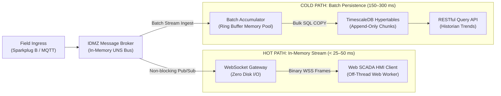
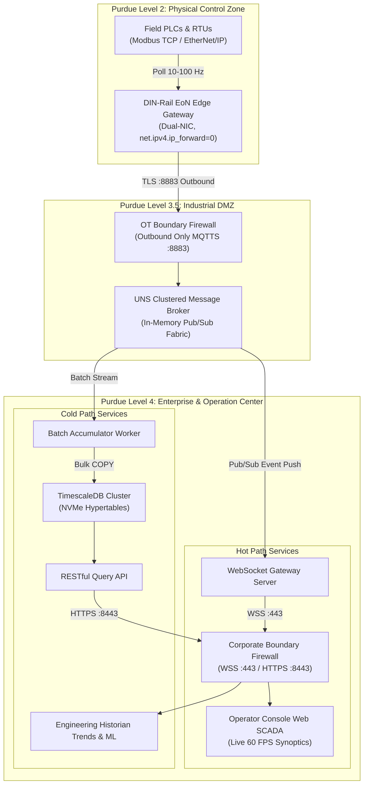

# Lesson 19: Dual-Path Processing: Hot Path vs. Cold Path Telemetry Pipelines

Industrial IoT and supervisory telemetry architectures operate under two diametrically opposed computational regimes: real-time, in-memory event dispatch that demands sub-50 ms response times, and massive, append-only time-series persistence required for historical trending, compliance audits, and machine learning ([[Grigat_et_al_2026|Grigat et al., 2026]]; [[Villamar_et_al_2025|Villamar et al., 2025]]). Attempting to unify these two distinct access patterns into a single monolithic database engine creates catastrophic operational failures. 

Understanding the [[../Glossary#Dual-Path Telemetry Bifurcation|mechanical bifurcation between the Hot Path and the Cold Path]] is essential for engineering resilient, web-native SCADA platforms that maintain sub-second operator responsiveness without sacrificing long-term analytical depth.

---

## 1. Physical Reality & Field Equipment (Prerequisites)

In modern automated production facilities, physical telemetry is generated across a wide spectrum of sampling frequencies and physical transport media:

1. **High-Frequency Dynamic Telemetry (100 Hz – 10 kHz):**
   - Transducers monitoring rotating turbomachinery (e.g., eddy-current proximity probes, piezoelectric accelerometers, strain gauges on turbine shafts) sample at kilohertz rates to detect acoustic cavitation, shaft misalignment, and bearing spalls.
   - High-speed I/O slices and protection relays (e.g., IEC 61850 sampled values) stream transient burst payloads that cannot tolerate network buffering or disk serialization delay.
2. **Standard Cyclic Supervisory Telemetry (0.1 Hz – 10 Hz):**
   - Regulatory process loops measure thermodynamic variables (temperature thermocouples, hydrostatic tank levels, Coriolis mass flow meters) where physical process inertia limits the rate of meaningful state change.
   - Edge-of-Network (EoN) gateways package these cyclic variables into [[06-Sparkplug-B-Specification|Sparkplug B]] protocol buffers or standard MQTT payloads using [[../Glossary#Report-by-Exception (RBE)|Report-by-Exception (RBE)]] semantics.

### Industrial Hardware Infrastructure

This telemetry spectrum connects to physical plant floor infrastructure spanning two distinct hardware classes:

- **Field Edge-of-Network (EoN) Gateways:** Industrial DIN-rail PCs (e.g., Moxa UC-8200 series or Advantech MIC-770 fanless computers) deployed inside Purdue Level 1/2 control cabinets. Equipped with dual isolated Gigabit Ethernet NICs, hardware watchdog timers, and wide-temperature solid-state storage, these gateways poll local PLCs over fieldbuses (RS-485 Modbus RTU, PROFINET, EtherNet/IP) and publish structured Sparkplug B frames to the factory [[../Glossary#Unified Namespace (UNS)|Unified Namespace (UNS)]].
- **Enterprise Historian Storage Servers:** High-performance rackmount servers deployed in the enterprise data center or IDMZ (e.g., Dell PowerEdge or HPE ProLiant clusters). These servers house enterprise NVMe flash storage arrays configured in RAID 10, multi-channel DDR5 ECC memory, and redundant 25 GbE network interfaces designed to sustain sustained write-heavy SQL workloads exceeding $100{,}000\text{ samples/sec}$.

The physical operational contrast between edge acquisition hardware and centralized historian storage infrastructure is illustrated in **Figure 19.1**:

![[19-dual-ethernet-eon-gateway.png]]
*(a) Dual-Ethernet DIN-Rail Edge-of-Network (EoN) Gateway*

![[19-nvme-historian-server-rack.png]]
*(b) High-Throughput NVMe Flash Enterprise Storage Server Rack*

*Figure 19.1: Physical Ingestion & Storage Infrastructure: (a) Dual-Ethernet DIN-rail edge gateway executing real-time field acquisition at Purdue Level 2; (b) Clustered enterprise NVMe flash storage rack executing cold-path time-series persistence in the corporate data center.*

---

## 2. Architectural Pitfalls of Single-Path Monoliths (The Bottleneck)

In naive SCADA systems, engineers frequently design a **Single-Path Monolithic Pipeline**: every incoming telemetry packet from the factory floor is directly written to a centralized relational database table, while client user interfaces continuously poll that same database via HTTP REST endpoints to refresh operator screens:

$$\text{Field Telemetry} \longrightarrow \text{Database INSERT} \longrightarrow \text{Disk Commit (WAL)} \longrightarrow \text{Client REST Poll} \longrightarrow \text{UI Render}$$

This single-path architecture collapses under industrial production loads due to three interrelated mechanical bottlenecks:

### [[../Glossary#Write-Ahead Log (WAL)|Write-Ahead Log (WAL)]] Contention & fsync Pauses
Relational database management systems (RDBMS) guarantee ACID transactions by appending every committed transaction to an on-disk **Write-Ahead Log (WAL)** before updating data pages in memory. If a plant produces $10{,}000\text{ tag updates/sec}$, executing $10{,}000$ individual single-row `INSERT` statements forces $10{,}000$ discrete synchronous kernel flushes (`fsync()`) per second. Even enterprise PCIe 4.0 NVMe drives experience queue depth exhaustion when subjected to continuous unbatched random `fsync` barriers: the storage controller locks, write latencies spike from microseconds to hundreds of milliseconds, and the database thread pool exhausts all available worker connections.

### Lock Contention Between Ingestion & Analytical Queries
In relational and document stores, concurrent write and read operations compete directly for internal shared resources. While the database engine is locking index B-trees to append incoming telemetry, operators or process engineers trigger multi-day historical trend queries (such as selecting 72 hours of boiler feed temperature averaged per minute). The analytical query scans millions of rows, acquiring shared read locks or saturating memory buffer pools while high-frequency write transactions stall behind read queries. In severe cases, database transaction queues overflow, causing incoming TCP buffers to back up across the network.

### The REST Polling Latency Floor
Polling an SQL database over HTTP REST introduces an immutable latency floor. The browser must establish an HTTP connection, dispatch a request, wait for SQL query parsing and execution, format the result set into JSON text, and transmit the payload over TCP. Empirical investigations by [[Villamar_et_al_2025|Villamar et al. (2025)]] document an average query latency of **$156\text{ ms}$ (frequently surging beyond $300\text{ ms}$)** across relational REST industrial architectures. A $300\text{ ms}$ refresh rate renders human supervisory screens incapable of displaying high-speed electrical transients or coordinating sub-second interlock safety barriers.

---

## 3. Decoupled Dual-Path Component Architecture (Hot vs. Cold)

To resolve this operational tension, modern industrial platforms enforce the **Dual-Path Architecture Bifurcation** ([[Grigat_et_al_2026|Grigat et al., 2026]]; [[Villamar_et_al_2025|Villamar et al., 2025]]):

### The Hot Path: In-Memory Low-Latency Streaming
The Hot Path services the immediate operational needs of console operators, safety interlocks, and real-time supervisory synoptics:
1. **Target Latency:** Sub-25 ms to 50 ms end-to-end latency from field transmitter to browser screen render ([[Bellini_et_al_2022|Bellini et al., 2022]]; [[Grigat_et_al_2026|Grigat et al., 2026]]).
2. **Zero Disk I/O Dependency:** Ingestion workers receive telemetry packets directly from the broker's TCP socket into memory buffers. The payload is parsed, verified, and immediately dispatched over active WebSocket connections ([[12-WebSocket-Streaming-Mechanics|Lesson 12]]) to connected clients. Disk writes are strictly prohibited on this path.
3. **Decoupled Failure Domain:** If the backend database crashes, locks, or undergoes maintenance, **the Hot Path continues streaming live telemetry to operator screens without a single dropped frame**.
4. **Client-Side Off-Thread Processing:** As established in [[15-Multithreaded-Web-Performance|Lesson 15]], incoming binary WebSocket frames are routed directly to dedicated Web Workers, parsed into `SharedArrayBuffer` memory, and rendered to Canvas/SVG elements at a rock-solid 60 FPS without touching the main UI JavaScript execution thread.

### The Cold Path: Batch Persistence & Historical Analytics
The Cold Path services historical trending, regulatory reporting, asset health prognosis, and machine learning training:
1. **Target Latency:** 150 ms to 300 ms analytical query response time ([[Villamar_et_al_2025|Villamar et al., 2025]]).
2. **[[../Glossary#Batch Accumulator Worker|Batch Accumulator Buffering]]:** Rather than executing individual `INSERT` statements, an in-memory batch accumulator pools incoming telemetry records into a bounded ring buffer. Once the buffer accumulates $1{,}000\text{ to }5{,}000\text{ rows}$ (or after a maximum flush timer of $500\text{ ms}$ expires), the worker issues a single bulk SQL `COPY` transaction. This amortizes transaction log overhead, reducing WAL writes and lock contention by over **$95\%$**.
3. **TimescaleDB Hypertable Chunking:** The Cold Path persists data into time-partitioned **[[../Glossary#Hypertables & Chunks (TimescaleDB)|Hypertables]]** ([[09-Time-Series-Historians|Lesson 09]]). Incoming records are partitioned into chronological chunks (e.g., 24-hour partitions). Because only the current chunk is active in RAM, B-tree indexes remain fully pinned in CPU cache, preventing disk thrashing.
4. **Columnar Lossless Compression:** Older chunks (e.g., data older than 7 days) are automatically transformed into columnar compressed format using [[../Glossary#Gorilla XOR Compression|Gorilla XOR compression]] for floating-point values and [[../Glossary#Delta-of-Delta Compression|Delta-of-Delta]] for timestamps, achieving a **12:1 storage footprint reduction**.

The complete architectural decoupling between the in-memory Hot Path and the batch-persisted Cold Path is detailed in **Figure 19.2**:

![[19-hot-path-cold-path-pipeline.svg]]

*Figure 19.2: Dual-Path Telemetry Architecture: Hot Path in-memory streaming gateway achieving sub-25–50 ms latency to browser clients, fully decoupled by the UNS broker from the batch accumulator worker, TimescaleDB hypertables, and REST historical query engines (150–300 ms).*

---

## 4. Enterprise Deployment Topology across [[../Glossary#Purdue Enterprise Reference Architecture (PERA / Purdue Model)|Purdue]] & [[../Glossary#Industrial Demilitarized Zone (IDMZ / Level 3.5)|IDMZ]]

Deploying a dual-path telemetry architecture across an industrial enterprise requires strict alignment with the **Purdue Model (ISA-95)** and **IEC 62443** cybersecurity zones ([[01-Purdue-vs-UNS|Lesson 01]]; [[10-OT-Cybersecurity-IEC-62443|Lesson 10]]):

### Zone-to-Path Mapping & Network Conduits

1. **Purdue Level 1/2 (Cell/Area Zone - OT Network):**
   - Field PLCs, I/O terminal racks, and instruments communicate over isolated industrial protocols (Modbus TCP, EtherNet/IP).
   - DIN-rail EoN gateways sit at the perimeter of Level 2, translating field registers into Sparkplug B Protobuf frames.
2. **Purdue Level 3 (Operations Zone) & Industrial DMZ (Purdue Level 3.5):**
   - The primary **Unified Namespace (UNS) Message Broker** is deployed within the secure Industrial DMZ (IDMZ).
   - In accordance with IEC 62443 conduits, field gateways establish **outbound-only TLS connections** (TCP port 8883) to the IDMZ broker. No inbound ports are opened from the IDMZ into the OT control network.
   - Dual-homed network isolation enforces `net.ipv4.ip_forward = 0` on all gateway nodes, eliminating routable IP bridges.
3. **Purdue Level 4 (Enterprise & Corporate IT Zone):**
   - The **WebSocket Streaming Gateway (Hot Path)** and **TimescaleDB Historian Cluster (Cold Path)** reside in dedicated server networks.
   - Hot Path operator consoles connect via encrypted WebSocket Secure (`wss://` port 443) to receive live streams.
   - Cold Path engineering workstations and ERP reporting systems query the historian via HTTPS REST (`https://` port 8443).
   - Heavy corporate historical queries are physically blocked from reaching the IDMZ message broker, ensuring that IT query spikes cannot starve OT control room operations.

The enterprise Purdue zone mapping and firewall conduit layout for dual-path telemetry are diagrammed below:

---

## 5. Structural Comparison

| Dimension | The Hot Path | The Cold Path |
| :--- | :--- | :--- |
| **Primary Target Latency** | **$< 25\text{ ms to } 50\text{ ms}$** ([[Bellini_et_al_2022|Bellini et al.]]; [[Grigat_et_al_2026|Grigat et al.]]) | **$156\text{ ms to } 300\text{ ms}$** ([[Villamar_et_al_2025|Villamar et al.]]) |
| **Transport Protocol** | WebSocket Secure (`wss://`) binary frames | HTTPS REST (`/api/v1/history/query`) / SQL |
| **Underlying Storage Model** | In-memory ring buffer (Zero Disk I/O) | Append-only partitioned relational hypertables |
| **Hardware Bottleneck** | Network socket throughput & CPU context switches | Disk write IOPS, WAL locks, and query memory cache |
| **Ingestion Mechanism** | Push-based single-message pub/sub event routing | In-memory batch accumulation + bulk SQL `COPY` |
| **Compression Strategy** | Transient Sparkplug B Protobuf serialization | Gorilla XOR + Delta-of-Delta columnar chunking |
| **Failure Domain** | Independent of database uptime or maintenance | Failure does NOT interrupt live operator synoptics |
| **Primary Consumer** | Control room operators & real-time safety interlocks | Historian trend viewers, ML models, ERP & audit |
| **Data Ownership** | Emitting field device (authoritative single truth) | Historical snapshot journal (immutable audit record) |

---

## 6. Active-Recall Assessments

> [!FAQ]- Question 1: Single-Path Monolithic Bottleneck & Disk Contention
> **Why does persisting every individual incoming telemetry packet directly to an SQL database table inevitably collapse live operator synoptics in a high-velocity industrial plant?**
>
> Writing individual incoming sensor frames directly to an SQL database table forces the database engine to open a transaction, acquire row and index locks, append the transaction to the on-disk Write-Ahead Log (WAL), and execute a kernel `fsync()` barrier. In a production facility streaming $10{,}000\text{ tags/sec}$, this generates $10{,}000$ discrete synchronous disk flushes per second. This saturates storage controller queue depths and exhausts the database connection pool. Furthermore, when an operator or engineer runs an analytical query over multi-day historical data, shared lock contention and memory cache eviction stall write transactions, freezing incoming TCP sockets and causing live supervisory operator screens to stall or drop connections ([[Villamar_et_al_2025|Villamar et al., 2025]]).

> [!FAQ]- Question 2: In-Memory Hot Path Invariant & Failure Domain Isolation
> **Explain the architectural principle that prevents a database crash or massive historical query lock in the Cold Path from interrupting live supervisory control in the Hot Path.**
>
> The Hot Path operates with a strict **Zero Disk I/O Dependency Invariant**. Ingestion workers receive telemetry packets directly from the in-memory message broker bus and immediately broadcast binary frames over established WebSocket connections to subscribed browser clients. The Hot Path does not read from or write to the historical database. Because the message broker fully decouples the two paths via non-blocking publish/subscribe queues, a catastrophic database failure, transaction lockup, or routine maintenance shutdown in the Cold Path has zero effect on the Hot Path. Live operator screens continue receiving real-time telemetry updates and alarm triggers with sub-50 ms latency ([[Grigat_et_al_2026|Grigat et al., 2026]]).

> [!FAQ]- Question 3: Batch Accumulator Amortization & Bulk SQL COPY
> **How does an in-memory batch accumulator worker reduce Write-Ahead Log (WAL) and disk I/O overhead by over 95% in the Cold Path?**
>
> Instead of executing an independent `INSERT` statement for every incoming telemetry frame, the batch accumulator worker pools incoming records into a bounded in-memory ring buffer. Records are committed in bulk transactions—flushing when the buffer reaches a threshold (e.g., $1{,}000\text{ to }5{,}000\text{ rows}$) or when a maximum flush interval (e.g., $500\text{ ms}$) expires. The worker dispatches the entire batch using a bulk SQL `COPY` or multi-value `INSERT` statement within a single transaction. This amortizes transaction setup, locks, and `fsync` barriers across thousands of rows simultaneously, reducing WAL write overhead and disk I/O operations by $>95\%$ while comfortably handling high-velocity industrial streams ([[Villamar_et_al_2025|Villamar et al., 2025]]).

> [!FAQ]- Question 4: Latency Divergence & Empirical Literature Benchmarks
> **Contrast the empirical latency characteristics of WebSocket streaming vs. RESTful database polling, citing relevant domain research.**
>
> Empirical benchmarks demonstrate that the two paths diverge by nearly an order of magnitude:
> 1. **Hot Path:** [[Bellini_et_al_2022|Bellini et al. (2022)]] demonstrated that WebSCADA architectures streaming binary telemetry over WebSockets sustain $20\text{ updates/sec}$ ($25\text{–}50\text{ ms}$ latency), while [[Grigat_et_al_2026|Grigat et al. (2026)]] achieved sub-$25\text{ ms}$ command dispatch using in-memory pub/sub message brokers.
> 2. **Cold Path:** [[Villamar_et_al_2025|Villamar et al. (2025)]] measured an average response latency of **$156\text{ ms}$ (surging to $300\text{ ms}$)** when querying historical process data across relational REST API stacks. Polling an SQL database is therefore fundamentally incompatible with real-time supervisory control loops.
