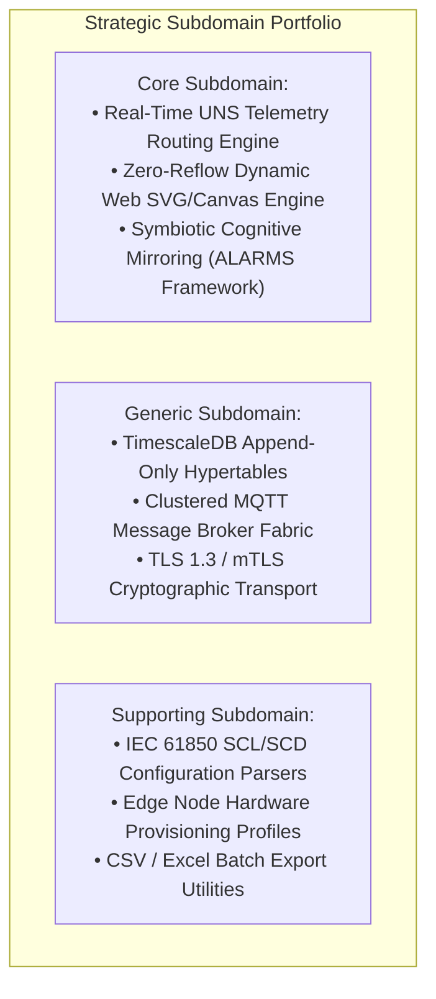

# Lesson 20: Strategic Domain-Driven Design in IIoT & Telemetry Architectures

Industrial control systems (ICS) and industrial IoT platforms encompass vast, heterogeneous problem domains. Within a single industrial manufacturing plant, software systems must simultaneously interface with hard real-time programmable logic controllers (PLCs), parse proprietary fieldbus registers, store petabyte-scale historical time series, execute regulatory alarm rationalization, and render responsive, high-performance web graphics for plant operators.

Traditional industrial software engineering frequently succumbs to the **Monolithic Canonical Model Trap**: attempting to construct a single universal database schema, object hierarchy, or software class model that represents every physical transducer, control loop, business metric, and user interface widget across the enterprise. 

As formalized by Vlad Khononov (2022) in *Learning Domain-Driven Design*, such universal models inevitably collapse into a fragile, unmaintainable "Big Ball of Mud". Applying **[[../Glossary#Strategic Domain-Driven Design (Strategic DDD)|Strategic Domain-Driven Design (Strategic DDD)]]** decomposes the sprawling industrial problem space into autonomous **Subdomains** and isolates software implementations within explicit **[[../Glossary#Bounded Context|Bounded Contexts]]** governed by rigorous integration contracts ([[Koltsova_et_al_2026|Koltsova et al., 2026]]).

---

## 1. Physical Reality & Field Equipment (Prerequisites)

On the physical plant floor, industrial operations are executed by multi-vendor automation hardware and managed by distinct operational disciplines with fundamentally incompatible mental models:

1. **The Operational Technology (OT) Field Reality:**
   - Automation technicians and control engineers program PLCs (e.g., Rockwell ControlLogix, Siemens S7-1500), Remote Terminal Units (RTUs), and Intelligent Electronic Devices (IEDs) using IEC 61131-3 languages (Ladder Logic, Structured Text).
   - In this physical layer, data is represented as raw hardware memory addresses: 16-bit unsigned integers, Modbus 40001 holding registers, 4–20 mA analog loop currents, or binary coil bits. Execution is governed by deterministic, millisecond-level cyclic scan routines ($10\text{–}50\text{ ms}$).
   - **OT Mental Model:** Deterministic safety, valve travel time, wiring loop integrity, and actuator interlock protection.
2. **The Supervisory & Control Room Reality:**
   - Console operators monitor unit operations through centralized supervisory control consoles, sit-stand workstations, and multi-monitor video walls.
   - Telemetry here is represented as high-level synoptic process flows, ISA-101 moving analog indicators (MAIs), multi-variable polar radar shapes, and prioritized alarm annunciation banners.
   - **Operator Mental Model:** Unit mass balance, furnace thermal stability, preattentive anomaly detection, and situational awareness.
3. **The Information Technology (IT) & Enterprise Data Reality:**
   - Data scientists, enterprise resource planning (ERP) systems, and maintenance reliability engineers query historical datasets housed in clustered database server racks.
   - Data is represented as relational tables, immutable append-only time-series hypertables, and RESTful JSON query payloads.
   - **IT Mental Model:** SQL schemas, ACID compliance, data warehouse replication, mean-time-between-failures (MTBF) analytics, and long-term asset depreciation.

The organizational and physical dichotomy between centralized supervisory operations and localized field diagnostic maintenance is illustrated in **Figure 20.1**:

![[20-industrial-operations-dispatch.png]]
*(a) Centralized Process Operations Dispatch Center*

![[20-field-engineering-workstation.png]]
*(b) Field Engineering Diagnostic & Calibration Station*

*Figure 20.1: Diverse Industrial Personas and Operating Realities: (a) Centralized supervisory control room focused on cognitive situational awareness and holistic unit management; (b) Field engineering calibration environment focused on low-level register addressing and physical loop integrity.*

---

## 2. The "Big Ball of Mud" Anti-Pattern in Industrial SCADA

When software architects attempt to merge these disparate physical realities into a single "universal" industrial object model, the architecture degrades into a **Big Ball of Mud** (Khononov, 2022).

### The Semantic Overlap Trap
In an industrial plant, different engineering domains use identical vocabulary to signify completely different concepts:

- **The Term "Tag":**
  - To a field PLC programmer, a `Tag` is an allocated 32-bit register offset (`DB102.DBD4`) residing in controller volatile RAM, polled at 20 Hz.
  - To a SCADA HMI developer, a `Tag` is a dynamic data-binding key mapped to an SVG DOM element's SVG transform matrix or fill attribute.
  - To a Historian database administrator, a `Tag` is an immutable UUID foreign key indexed in a relational metadata table pointing to millions of compressed time-series chunks.
- **The Term "State":**
  - In a motor starter circuit, `State` represents physical contactor feedback (auxiliary dry contact closed, coil energized).
  - In an ISA-18.2 alarm engine, `State` represents an unacknowledged alarm lifecycle condition (`UNACK`, `ACKED`, `RTN_UNACK`, `SHELVED`).
  - In a web frontend application store, `State` represents an in-memory reactive JavaScript state tree driving client DOM rendering.

### Why Canonical Enterprise Models Fail
Attempting to create a single `IndustrialTag` class that incorporates PLC register offsets, engineering unit conversions, historical compression flags, alarm rationalization deadbands, user permissions, and SVG rendering coordinates produces a bloated, highly coupled monstrosity. First, it introduces fragile coupling: modifying a field in the HMI rendering logic forces recompilation of the PLC communication driver and triggers migration scripts on the historical database. Second, it induces cognitive overload, as developers cannot understand or modify any single subsystem without grasping the totality of the entire enterprise system. Finally, it destroys team autonomy: engineering teams can no longer deploy features independently, because every minor software release requires cross-department coordination and facility-wide regression testing ([[Koltsova_et_al_2026|Koltsova et al., 2026]]).

---

## 3. Strategic Subdomain Portfolio & Bounded Context Decoupling

Strategic Domain-Driven Design resolves this friction by partitioning the problem space into **Subdomains** based on business capability, and structuring the solution space into autonomous **Bounded Contexts** (Khononov, 2022).

### The Three Subdomain Classifications
In accordance with Khononov's strategic taxonomy, the business capabilities of an industrial telemetry platform can be classified into three distinct categories:

1. **[[../Glossary#Core Subdomain|Core Subdomains]] (Proprietary Innovation & Competitive Advantage):**
   - High complexity and high volatility. These represent the unique engineering innovations that differentiate a platform from legacy commercial SCADA products. They require careful architectural treatment.
   - *Example Core Capabilities:*
     - **Real-Time UNS Telemetry Routing:** In-memory, non-blocking topic routing and Sparkplug B Protobuf decoding ([[06-Sparkplug-B-Specification|Lesson 06]]).
     - **Dynamic SVG/Canvas Scene Graph Engine:** High-performance, zero-reflow declarative graphic dynamization running in browser Web Workers ([[14-Browser-Rendering-Engines|Lesson 14]]; [[15-Multithreaded-Web-Performance|Lesson 15]]).
     - **Symbiotic Cognitive Mirroring (The ALARMS Paradigm):** Metacognitive Socratic advisory dialogue and Endsley Level 3 predictive digital twin simulation ([[17-Situational-Awareness-Cognitive-Mirroring|Lesson 17]]).
2. **[[../Glossary#Generic Subdomain|Generic Subdomains]] (Standardized Industry Commodity):**
   - High complexity but low volatility. These represent solved engineering problems common across all software industries that provide zero business differentiation. Must be adopted off-the-shelf using proven open-source or commercial software.
   - *Example Generic Capabilities:*
     - **Relational Time-Series Storage:** Clustered PostgreSQL / TimescaleDB hypertable engines ([[09-Time-Series-Historians|Lesson 09]]).
     - **MQTT Message Broker Fabric:** Clustered EMQX or Mosquitto brokers executing standard OASIS MQTT 5.0 pub/sub specifications.
     - **Cryptographic Security & TLS:** OpenSSL, WebCrypto API, and OAuth2 / OpenID Connect authentication providers.
3. **[[../Glossary#Supporting Subdomain|Supporting Subdomains]] (Auxiliary Business Functions):**
   - Low complexity and low volatility. Straightforward supporting capabilities required to complement system operations. Built simply in-house or outsourced.
   - *Example Supporting Capabilities:*
     - **Substation Configuration (SCD) XML Parsers:** IEC 61850 substation single-line diagram ingestion scripts ([[13-Declarative-SVG-Synthesis|Lesson 13]]).
     - **Edge Device Provisioning:** Configuration file distribution and firmware deployment profiles.

The portfolio hierarchy separating Core, Generic, and Supporting capabilities is structured in the following strategic diagram:

### Bounded Contexts & Integration Patterns
A **Bounded Context** establishes the strict boundary within which a specific **[[../Glossary#Ubiquitous Language|Ubiquitous Language]]** is unambiguously valid (Khononov, 2022). In an industrial telemetry platform, software boundaries are governed by formal DDD integration patterns:

1. **Upstream Context `[U]`: Data Transport & Semantics (Core):**
   - **Ubiquitous Language:** `MetricTag`, `EoNNode`, `DeviceBirth`, `SequenceNum`, `UNSPath`.
   - Acts as the authoritative distributor of real-time telemetry.
   - Implements the **[[../Glossary#Open-Host Service (OHS) & Published Language (PL)|Open-Host Service (OHS) & Published Language (PL)]]** pattern:
     - Rather than coupling internal transport schemas to downstream clients, the upstream context publishes an open, versioned integration contract.
     - **Hot Path Published Language:** Eclipse Sparkplug B Google Protobuf payloads over binary WebSockets (`wss://`).
     - **Cold Path Published Language:** Normalized JSON time-series query specifications over HTTPS REST (`https://`).
2. **Downstream Context `[D]`: Visualization & Low-Code HMI (Core):**
   - **Ubiquitous Language:** `SynopticCanvas`, `DynamicGlyph`, `BindAddress`, `ViewportTransform`, `MovingAnalogIndicator`.
   - Integrates with the upstream context via a **[[../Glossary#Customer-Supplier Relationship|Customer-Supplier]]** relationship, consuming the Published Language over WebSockets without requiring proprietary translation layers.
3. **Downstream Context `[D]`: Relational Time-Series Storage (Generic):**
   - **Ubiquitous Language:** `HypertableChunk`, `CompressionPolicy`, `WriteAheadLog`, `ContinuousAggregate`.
   - Adopts an off-the-shelf relational engine (TimescaleDB) fed by an in-memory batch accumulator worker.
4. **Brownfield Integration: Anti-Corruption Layer (ACL):**
   - When integrating legacy field equipment (e.g., Modbus RTU PLC networks or proprietary telemetry protocols), an **[[../Glossary#Anti-Corruption Layer (ACL)|ACL]]** can protect the domain model.
   - The ACL translates raw register addresses and arbitrary bitmasks into canonical Sparkplug B metric objects, protecting the core domain model from being corrupted by legacy vendor oddities.

The complete strategic [[../Glossary#Context Map|context map]], showing bounded context boundaries, integration relationships, and ubiquitous language definitions, is illustrated in **Figure 20.2**:

![[20-strategic-context-map.svg]]

*Figure 20.2: Strategic Domain-Driven Design Context Map: The visual emphasis is on ownership and translation boundaries—where legacy data is normalized, where the published language is exposed, and where downstream contexts remain independent ([[Koltsova_et_al_2026]]; Khononov, 2022).*

---

## 4. Fundamental Cross-Context Boundary Invariants

To guarantee architectural stability across distributed teams and prevent domain model contamination, all software components should adhere to three **Cross-Context Boundary Invariants**:

### The [[../Glossary#Data Ownership Preservation Invariant|Data Ownership Preservation Invariant]] ([[Koltsova_et_al_2026|Koltsova et al., 2026]])
> **Invariant Rule:** The Unified Namespace message broker, data exchange subsystems, and user interface renderers provide transport, routing, and visualization capabilities, but are **strictly prohibited from assuming data ownership**. 
>
> The physical emitting device (the field sensor, PLC, or RTU) remains the **sole authoritative source of truth** for process variable state.
> - The message broker acts purely as an event transit fabric. It must never fabricate, synthesize, extrapolate, or alter physical process measurements.
> - If an edge device disconnects, the broker must not invent a default value; it must publish an explicit Sparkplug B `NDEATH` or quality code `BAD_COMM_FAILURE` to preserve deterministic telemetry truth.

### The [[../Glossary#RESTful Client Isolation Invariant|RESTful Client Isolation Invariant]] ([[Villamar_et_al_2025|Villamar et al., 2025]])
> **Invariant Rule:** Remote HMI web clients, analytical viewers, and third-party enterprise applications are **strictly prohibited from issuing direct register queries to physical field controllers**.
>
> All client telemetry access must be decoupled through intermediate Open-Host Service gateways:
> - Directly polling PLCs over industrial networks (e.g., 50 web browsers issuing Modbus TCP read requests to a single PLC CPU) causes field controller communication buffer exhaustion, scan cycle jitter, and critical interlock latency spikes.
> - Enforcing the OHS gateway pattern shields OT controllers from external client load, preserves network segmentation boundaries under IEC 62443, and ensures that thousands of concurrent users can inspect process values without consuming a single microsecond of PLC CPU execution time.

### The [[../Glossary#Dynamic Presentation Velocity Invariant|Dynamic Presentation Velocity Invariant]] ([[Tong_et_al_2026|Tong et al., 2026]])
> **Invariant Rule:** Dynamic graphical elements rendered within the Visualization Bounded Context must constrain visual translation speeds to **$4^\circ/\text{s} \le \omega \le 12^\circ/\text{s}$ of visual angle**, and must **never exceed $16^\circ/\text{s}$**.
>
> As established in [[18-Human-Visual-Fatigue-Limits|Lesson 18]], exceeding this empirical boundary triggers oculomotor smooth pursuit breakdown, spontaneous blink reflex suppression, corneal desiccation, and a catastrophic surge in operator decision-making error ($p < 0.001$). Enforcing this invariant ensures that the presentation layer strictly serves human cognitive capabilities rather than uncritically mirroring raw physical velocities.

---

## 5. Structural Comparison

| Dimension | Monolithic "Canonical Model" SCADA | Strategic DDD Bounded Contexts |
| :--- | :--- | :--- |
| **Architectural Topology** | Single monolithic database & unified class model | Decoupled Bounded Contexts with explicit contracts |
| **Ubiquitous Language** | Contradictory definitions forced into one schema | Domain language strictly scoped per Bounded Context |
| **Core Subdomain Focus** | In-house developers reinvent generic commodities (DB, broker) | In-house focus strictly on Core innovation (UNS, Scene Graph) |
| **Legacy Integration** | Legacy registers bleed directly into UI code | Anti-Corruption Layer isolates brownfield protocols |
| **System Invariants** | Invariants scattered across stored procedures & scripts | Explicitly enforced across Bounded Context perimeters |
| **Failure Domain** | Single defect or schema migration crashes entire system | Failures isolated strictly within individual context boundaries |
| **Team Organization** | Large monolithic team bogged down by coordination friction | Stream-aligned teams with autonomous deployment pipelines |
| **Regulatory Compliance** | Audit trails mingled with transient real-time streams | Immutable audit journals separated from real-time streams |

---

## 6. Active-Recall Assessments

> [!FAQ]- Question 1: The Monolithic Canonical Model Trap & Domain Drift
> **Why does the pursuit of a single universal "Canonical Industrial Data Model" inevitably fail in large-scale supervisory control platforms?**
>
> Pursuing a single universal data model fails because different industrial engineering disciplines operate under irreconcilable mental models and operational constraints. To a PLC programmer, a "Tag" is a volatile 16-bit register address polled at 20 Hz for deterministic machine protection. To an HMI designer, a "Tag" is a dynamic binding driving an SVG animation matrix. To an enterprise data architect, a "Tag" is an immutable foreign key in an append-only relational table. Forcing these conflicting concepts into a single universal class creates a bloated "Big Ball of Mud" with immense coupling: any modification to an HMI widget forces database migrations and breaks PLC drivers. Strategic DDD resolves this by creating explicit Bounded Contexts where each domain maintains its own cleanly scoped Ubiquitous Language (Khononov, 2022).

> [!FAQ]- Question 2: Subdomain Classification & Resource Allocation
> **How does classifying industrial software capabilities into Core, Generic, and Supporting subdomains prevent engineering resource waste in IIoT development?**
>
> Subdomain classification dictates where a software engineering organization must invest proprietary development resources. The current context map classifies telemetry routing and the dynamic dashboard engine as candidate **Core Subdomains**; their eventual implementation boundaries remain subject to Phase 2 ADRs. In contrast, **Generic Subdomains** (e.g., time-series storage, MQTT brokers, cryptographic TLS) are complex but non-differentiating commodities; attempting to build a custom in-house time-series database or MQTT broker squanders millions in engineering capital on solved problems. Generic subdomains should be evaluated for off-the-shelf adoption. **Supporting Subdomains** (e.g., SCD XML parsers) are low-complexity auxiliary utilities that can be implemented simply or outsourced ([[Koltsova_et_al_2026|Koltsova et al., 2026]]).

> [!FAQ]- Question 3: Open-Host Service (OHS) vs. Anti-Corruption Layer (ACL)
> **Contrast the architectural purpose of an Open-Host Service (OHS) with that of an Anti-Corruption Layer (ACL), and identify where each is deployed in a telemetry architecture.**
>
> An **Open-Host Service (OHS)** is an integration pattern implemented by an *upstream provider* to serve multiple downstream consumers. The upstream context defines a stable, versioned public contract—the **Published Language (PL)**—allowing downstream systems to integrate without writing custom translation wrappers. For example, a `Data Transport & Semantics` context could act as an OHS, publishing telemetry contracts for HMI clients and historians. In contrast, an **Anti-Corruption Layer (ACL)** is implemented by a *downstream consumer* to shield its clean domain model from being corrupted by an uncooperative or legacy upstream interface. At a brownfield edge, the ACL can translate raw Modbus RTU/TCP memory registers into normalized metric objects.

> [!FAQ]- Question 4: The Data Ownership Preservation Invariant
> **What physical catastrophe does the Data Ownership Preservation Invariant ([[Koltsova_et_al_2026|Koltsova et al., 2026]]) prevent in industrial control systems?**
>
> The Data Ownership Preservation Invariant dictates that the message broker, exchange fabric, and visualization interfaces are purely transit and rendering pipelines; they never own, fabricate, or extrapolate operational process data. The physical emitting device (PLC or field sensor) remains the sole authoritative source of truth. If this invariant were violated, a message broker or intermediate gateway might attempt to "fill in" missing data during an edge network disconnection with an extrapolated nominal value. An operator looking at an HMI would see a calm, nominal tank pressure reading, unaware that the real physical vessel was experiencing an unmonitored thermal runaway. Preserving strict data ownership ensures that telemetry truth and quality codes remain fully deterministic.
