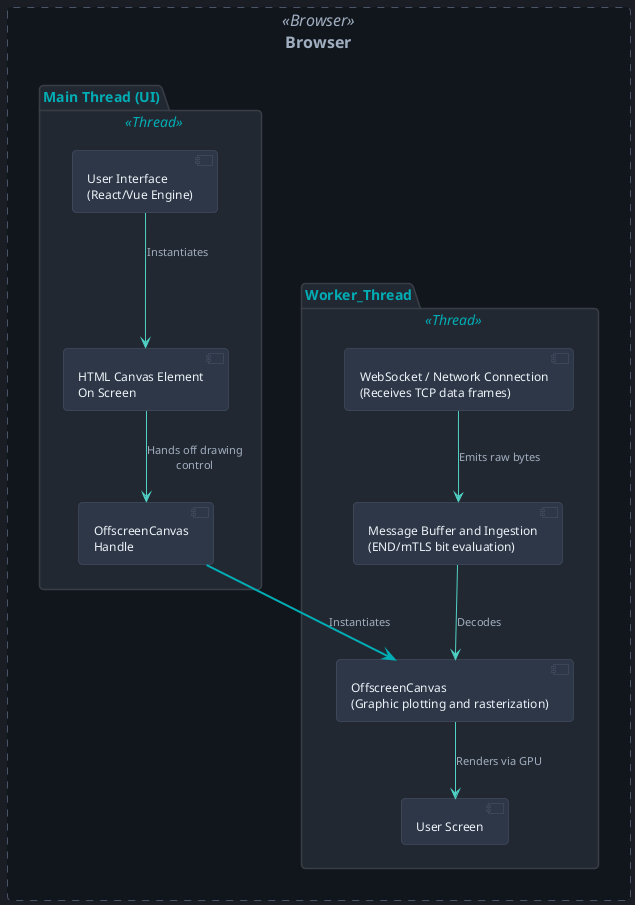
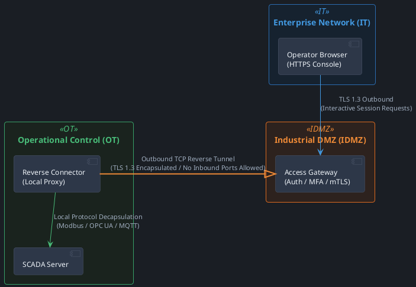

#NotebookLM #Exploratory-Mapping-Study
# Conceptual Architecture of Modern SCADA Systems: Low-Code IoT Connectivity, Dynamic Visualization, and High-Performance Data Processing

## Introduction and Evolution of Industrial Data Architecture

The paradigm of industrial automation, historically represented by the Automation Pyramid and governed by the ISA-95 standard, is undergoing a structural reorganization toward decoupled, event-driven data ecosystems [^1][^2]. The rigidity of direct, hierarchical point-to-point integrations (where information ascends linearly from physical sensors to Enterprise Resource Planning [ERP] systems through coupled intermediate layers) introduces a high degree of technical complexity known as the "integration tax" [^1][^3]. This traditional model generates isolated silos, restricts access to real-time telemetry, and exponentially raises maintenance costs as the plant-floor device ecosystem expands [^4][^5].

To overcome these limitations, the design of modern supervisory control and data acquisition (SCADA) systems adopts the Unified Namespace (UNS) pattern [^4][^6]. The UNS acts as a central, event-driven communication layer, structured under a common semantic hierarchy that logically represents the operational state of the entire corporation [^1][^6][^7]. Rather than maintaining rigid dependencies, every node in the infrastructure (field devices, gateways, databases, and visualization tools) integrates into the UNS as either a producer or consumer of information [^4][^7].

Implementing the UNS on top of messaging technologies such as MQTT brokers enables a publish/subscribe (Pub/Sub) data distribution pattern [^1][^4][^6]. By organizing communication channels to mirror the physical layout of the business (following standards such as ISA-95 Part 2: Enterprise, Site, Area, Line, Cell), the onboarding of new analytics tools is simplified without altering the plant-floor hardware configuration [^1][^6][^7].

However, centralizing communications in a single message broker introduces availability vulnerabilities. In response, industrial software architecture is evolving from a centralized, monolithic model toward a Fractal UNS pattern [^8]. The Fractal UNS architecture replaces the single centralized broker with a topology of self-similar namespaces distributed across each operational level (cell, line, area, site) [^8]. Each level operates its own broker autonomously, which guarantees fault isolation, contains the blast radius in the event of security compromises or network outages, defines clear boundaries of data sovereignty, and delivers predictable performance by resolving critical telemetry locally before selectively replicating aggregates to higher levels [^8].

## Analysis of Architectural Components

### Low-Code Connectivity and Ingestion Layer

The design of the data ingestion layer in a modern SCADA system must process payloads of a heterogeneous nature — from JSON-encoded text to compact binary frames — and efficiently route them to time-series databases (TSDB) without requiring the constant deployment of custom code [^9][^10]. To this end, abstraction layers are structured to assimilate multiple industrial and Internet of Things (IoT) communication protocols, primarily MQTT, OPC UA PubSub, and HTTP WebSockets [^11][^12][^13]. WebSockets provide a persistent, low-latency, bidirectional TCP communication channel that is indispensable both for the rapid ingestion of events from edge gateways and for the continuous delivery of updates to the visualization client [^12][^14].

To achieve a genuinely low-code approach, the ingestion layer implements a rules execution engine that exposes a visual interface rather than requiring dedicated development work [^10][^15]. This engine processes incoming data through declarative data query and transformation languages, such as regular expression (Regex) mapping expressions, JSONPath, and `jq`-based JSON filtering [^16][^17]. The ingestion pipeline sequentially executes decoding, noise filtering, aggregation, and normalization of telemetry [^16][^18].

To ensure semantic consistency in the analytical database, the transformation engine requires that assimilated signals comply with a minimum data contract [^6]. This contract defines a canonical structure that prevents degradation in the quality of the collected information [^6].

| Data Contract Parameter | Data Type | Technical Purpose |
| ------------------------------- | ---------------------------- | ------------------------------------------------------------------------------------------------------------------- |
| **Timestamp (`ts`)** | String (ISO 8601 / RFC 3339) | Records the precise moment of measurement, prioritizing the clock of the originating device [^6][^9]. |
| **Value (`value`)** | Float / Int / String / Bool | Represents the measured magnitude or logical state reported by the sensor [^6][^11]. |
| **Unit (`unit`)** | String (Metadata) | Specifies the engineering unit (e.g., Celsius, Bar, RPM) to prevent interpretation errors [^6][^11]. |
| **Quality (`quality`)** | String / Enum | Determines the validity and reliability of the sensor reading (e.g., good, bad, uncertain) [^6][^19]. |
| **Source (`source`)** | String | Unambiguously identifies the PLC, gateway, or controller that generated the reading [^6][^9]. |

Once normalized under this contract, the data is mapped to the destination TSDB [^9][^16]. The database schema design must prevent resource exhaustion by optimizing cardinality [^9][^20]. Static or slowly changing variables (such as device identifier, geographic location, and model) are strictly stored as indexed tags, while high-frequency dynamic variables (such as direct numeric measurements and error codes) are defined as non-indexed fields [^9]. This prevents the database from suffering bottlenecks caused by index reorganization during massive write bursts [^20][^21].

Likewise, to mitigate the overhead of constant individual inserts, the ingestion system implements an in-memory buffer that performs bulk writes based on time or volume windows [^21]. When the input rate exceeds the TSDB's write capacity, a backpressure protocol is triggered that dynamically pauses or reduces the reading of new messages from the transport broker, forcing the communication protocol's queues (such as the broker's internal buffer or the edge device's storage) to temporarily retain the information without causing memory overflows on the ingestion server [^9].

### Transport Mechanisms and Semantic Models

The choice of communication protocols and data model representation determines transmission efficiency and applications' ability to understand information without requiring prior configuration [^22][^23]. Below is a comparative analysis of the technical structure of the three leading technologies in this space [^13][^19][^24].

|Architectural Attribute|OPC UA Client/Server [^13][^19]|OPC UA PubSub (Part 14) [^13][^19][^25]|Sparkplug B over MQTT [^11][^13][^19]|
|---|---|---|---|
|**Connectivity Model**|Direct, interactive point-to-point session over TCP [^13][^19][^22]|Decoupled via message broker or UDP multicast [^13][^19][^25]|Decoupled via intermediate message broker [^13][^22]|
|**Firewall Directionality**|Requires opening inbound ports on the plant floor [^13][^26][^27]|Native outbound-only toward the transport broker [^25][^27]|Native outbound-only from the plant-floor node to the broker [^1][^13][^27]|
|**Payload Encoding**|Proprietary structured binary format native to the OPC architecture [^13][^23]|JSON (analytics/IT) or optimized binary UADP for the plant floor [^25]|Highly compressed binary via Google Protobuf [^1][^11][^22]|
|**State Synchronization**|The server maintains and exposes the model's current state [^13]|Defined locally in the publisher's configuration [^25]|Actively managed by the broker via Birth/Death messages [^11][^13][^22]|
|**Bandwidth Consumption**|High, due to session maintenance and polling [^13][^19][^22]|Low to medium (highly efficient when UADP encoding is used) [^25]|Extremely low; reports only by exception (RBE) [^13][^22]|
|**Auto-discovery**|Native, via active node-tree browsing [^19]|Requires static preconfiguration or external directory services [^25]|Dynamic and immediate via subscription to standardized topics [^11]|

The **OPC UA PubSub (Part 14)** standard dispenses with the formal establishment of heavy application-level interactive sessions (`CreateSession` / `ActivateSession`), enabling the unidirectional, asynchronous transmission of typed information [^25]. Its design is built on four logical abstractions configured locally on the emitting device [^25]:

1. **PublishedDataSet:** Defines the specific selection of variables from the industrial controller's address space (tags) intended to be shared externally [^25].
2. **DataSetWriter:** Translates the content of a specific `PublishedDataSet` into a specific serialized format, structuring the corresponding metadata [^25].
3. **WriterGroup:** Groups multiple data writers (`DataSetWriter`) that share identical network parameters, such as the sampling interval (e.g., 50 ms) and the physical transport configuration [^25].
4. **PubSubConnection:** Defines the communication parameters toward the destination broker (e.g., a secure TLS connection directed to a centralized broker) [^25].

For environments with severe bandwidth constraints, Part 14 implements **UADP** (Universal Architecture Data Packet) binary encoding [^25]. By dispensing with the repetitive descriptive strings present in text formats such as JSON, a typed data frame in UADP requires approximately 35 bytes compared to the 220 bytes of its plain-text equivalent [^25].

To maintain the security and confidentiality of information in this asynchronous, decoupled model, the **Security Key Service (SKS)** is introduced [^25]. Due to the absence of a direct point-to-point channel between sender and receiver for negotiating encryption keys, the SKS acts as a centralized external authority (securely accessible via HTTPS) responsible for distributing rotating symmetric security keys and their corresponding validity windows to authorized publishers and subscribers [^25]. The publisher signs and encrypts the industrial payload at the application level with the current period's symmetric key before handing it off to the transport layer [^25]. In this way, the message travels encrypted through the message broker (even if the broker is untrusted or lacks TLS), and legitimate subscribers autonomously decrypt the content using the current key previously provided by the SKS [^25].

For its part, **Sparkplug B** adds semantic structure on top of the MQTT transport protocol (which, by design, is agnostic to content format) [^11][^22]. Sparkplug B prescribes a strict topic hierarchy based on five structured elements [^11]:

$spBv1.0/ \{\text{Group ID}\}/\{\text{Message Type\}}/\{\text{Edge Node ID\}}/[\text{\{Device ID\}}]$

Here, the `Message Type` field directly and semantically categorizes the message within the topic header (for example, `NBIRTH` to announce the power-up and variable definitions of an edge node, `DDATA` for exclusively updating changed device values, or `NDEATH` to notify the abrupt disconnection of an endpoint) [^11][^22].

The Sparkplug B payload is encoded using compact binary protocol buffers (Google Protobuf) [^11][^22]. Each transmitted metric includes its unique semantic identifier, explicit data type (Float32, Int32, Boolean, String), standardized units of measurement, and millisecond-precision timestamps [^11]. When coupled with MQTT's Last Will and Testament (LWT) feature, all subscribers are guaranteed to faithfully and mathematically reconstruct the plant's current state in real time, reacting to physical disconnections through deterministic damping mechanisms [^11][^13][^22].

### No-Code/Low-Code Dynamic Dashboard Engine

Building operational graphical interfaces under a low-code architecture relies on fully decoupling the definition of visual elements from the compiled source code on the client [^28][^29]. The backend takes on the role of a schema governance and validation service, while the frontend functions as a reactive execution engine driven by structured JSON metadata [^28][^29].

To instantiate a dynamic dashboard's interface without programming, complementary JSON specifications are used [^28]:

- **JSON Schema (Validation and Contract):** Defines the supported data types and the allowed ranges of variables [^28]. Through client-side validation libraries (such as AJV), the JSON Schema acts as the integrity contract that validates user interaction before dispatching directives to the backend [^28]. The engine automatically maps data types to specific interactive visual components (for example, a variable defined as `boolean` generates a toggle switch; a numeric type associated with the `minimum` and `maximum` properties generates a bounded slider or gauge) [^28].
- **UI Layout Schema (Spatial Composition):** Defines the hierarchy and layout of containers and visual controls on the screen [^28]. It uses nested structures based on UI composition standards (for example, hierarchies of the type `Categorization > Category > Control`), specifying spatial distribution, responsive grid widths, and component ordering directives [^28].
- **List Configuration Schema:** Specifies the layout and properties of dynamic data tables and grids [^28]. Since JSON Schema lacks specific business-semantic typing (for example, it does not distinguish a generic number from a monetary value or a date), the list schema introduces the descriptive `kind` property (with values such as `currency`, `date`, `boolean`, or `text`) so that the client's formatting components can correctly interpret and present the information [^28].

To give the dashboard advanced interactivity, custom extension properties are introduced into the JSON schemas, conceptually prefixed under the `x-` namespace [^28]:

- `x-condition`: Encodes reactive conditional logic for visibility or the enabling of controls directly in the JSON (for example: "show the emergency stop button only if pressure exceeds a threshold value or if the logged-in user's role corresponds to Supervisor") [^28].
- `x-hidden`: Hides properties or data in the form that must persist in the data model but should not be exposed to the operator in the user interface [^28].
- `x-options`: Declares the control's binding to dynamic server-side queries [^28].

Processing of these schemas is preferably performed on the backend server before dispatching them to the client [^28]. The server intercepts the dashboard schema, resolves `x-options` directives by querying live operational databases to populate selection lists, evaluates and filters properties marked with `x-hidden` or that do not meet `x-condition` privilege rules, and delivers a ready-to-render data package [^28]. This offloads processing burden from the browser and prevents leaks of sensitive information by avoiding the transmission of unauthorized metadata or variables to the end client [^28].

### Real-Time Visualization Strategies and Frontend Optimization

Frontend performance in SCADA systems faces the challenge of processing massive real-time data streams while maintaining smooth navigation at 60 FPS [^30][^31]. Runtime update propagation avoids the use of heavy, immutable global state architectures (such as conventional Redux), since the recursive reconciliation process of the virtual DOM and the cost of re-evaluating the component tree degrade main-thread performance under high update frequencies [^30][^31].

Instead, modern SCADA engines implement granular reactive state architectures based on **Signals** or libraries optimized for direct atomic updates (such as Zustand or MobX) [^29][^30]. Signals encapsulate operational variable values in isolation and create direct subscription bindings to the DOM nodes that display that data [^29]. When data arrives via WebSockets or MQTT, the signal immediately and exclusively updates the specific browser node, bypassing change detection and re-rendering of the rest of the user interface [^29][^30].

To process fast data streams in the browser without blocking physical user interaction, the system offloads network processing and rendering flow using the architecture described below:

1. **Low-Level Network Management:** The high-performance WebSocket channel processes incoming TCP packets in the browser engine [^12][^14]. At the native network infrastructure level (such as the browser engine's C++ layer), the `WebSocketChannelImpl` component receives physical byte frames, manages their arrival order, and evaluates the end-of-message indicator bit (END bit = 1) to consolidate network fragments into a unified payload [^14].
2. **Data Transfer to V8:** Once the message is consolidated, the `DOMWebSocket` component bridges the native network code and the V8 JavaScript execution engine [^14]. During this process, the bytes are mapped directly into memory in a fast-typed data buffer (`ArrayBuffer`) on the JavaScript heap, immediately dispatching a `MessageEvent` with the decoded payload to the active message listener [^14].
3. **Asynchronous Processing in Web Workers:** To prevent the conversion of bytes into operational data structures and subsequent formatting from saturating the interface's execution thread, the system moves WebSocket listening and full decoding to the background using the **Web Workers** API [^30][^31][^32]. The use of messaging abstraction libraries (such as Comlink) simplifies bidirectional interaction between the Worker thread and the main thread through transparent RPC calls based on JavaScript proxies, reducing code-maintenance overhead [^32].
4. **Asynchronous Rendering with OffscreenCanvas:** The Worker not only processes the data but also carries out the graphical drawing instructions directly [^30][^31][^33][^34]. Using `transferControlToOffscreen()`, the main thread transfers drawing control of a canvas element to the Worker, generating an `OffscreenCanvas` instance [^31][^33][^34]. In this way, curve construction and painting are executed in isolation on the secondary thread using the terminal's GPU acceleration [^30][^33][^34].
5. **Canvas Layering Optimization:** The frontend organizes the screen by stacking independent canvas layers with absolute CSS positioning [^31][^35]. The background layer represents immutable elements such as grids, analog scales, and static instrumentation text [^31][^35]. Above it, the intermediate dynamic layer draws continuous operational trend lines or moving variable states [^31][^35]. In this way, the static layer is drawn once into memory and cached, while the graphics engine updates only the pixels of the moving layer [^35][^36].
6. **Batching and Synchronization in Curve Plotting:** The graphics refresh loop dispenses with standard timers such as `setInterval` to avoid visual jumps or jank [^35]. The engine synchronizes redraw phases using calls to `requestAnimationFrame()` [^31][^35]. In addition, to minimize rendering operations, the `Path2D` class is used to consolidate and retain the vector geometry of time-series data in the GPU cache [^36]. The engine groups coordinates into complex continuous polylines and executes them via a single drawing directive, reducing the number of drawing state changes in the canvas context [^35][^36].
7. **Garbage Collector Control via Object Pooling:** The massive flow of dynamically instantiated analytical objects can strain resources due to pauses imposed by JavaScript's garbage collector [^30][^31]. To avoid this, an Object Pooling pattern is established [^31]. During dashboard initialization, an array of JSON objects with a predetermined static size is reserved in memory [^31]. Incoming new data cyclically overwrites the attributes of existing objects in the pool instead of instantiating new dynamic memory blocks, ensuring stability in computing resource consumption [^30][^31].

### Data Stream Processing: Hot Path and Cold Path

To support analytical and audit needs without compromising real-time visualization and alerting requirements, modern industrial data systems rely on **Lambda Architecture** [^37][^38][^39]. This pattern splits incoming data processing into two parallel execution paths [^18][^37][^38][^40]:

- **Hot Path (Speed Layer):** Designed to deliver minimal latency (seconds or milliseconds) [^18][^37][^38][^40]. It continuously ingests real-time telemetry through distributed stream processing engines (such as Apache Flink) to evaluate short sliding time windows, process alerts, and update operational dashboard widgets [^18][^31][^37][^38]. This path prioritizes speed over absolute precision, accepting slightly misaligned or approximate data when the process's calculation speed demands it [^18][^38][^40].
- **Cold Path (Batch Layer):** Focused on storing and processing large volumes of immutable historical data at low cost (using data lakes or distributed file systems such as S3 or HDFS) [^18][^37][^38][^40]. Periodically (hours or days), high-compute batch processing algorithms are run to perform predictive maintenance analytics, audits, and AI model training [^18][^37][^38][^40]. This path prioritizes consistency and full mathematical accuracy of the historical series [^18][^37][^38][^40].

Both paths converge in the **Serving Layer** [^38][^39][^40]. When a client application or analytical dashboard requests a trend, the serving layer transparently unifies the consolidated data queries from the cold path with the most recent telemetry streams from the hot path, providing a continuous view [^38][^40].

In simplified architectures, the **Kappa** pattern is chosen, which eliminates the batch path [^18][^38][^40]. In Kappa, all information is treated uniformly as a continuous stream of event data stored in a high-retention append-only log (such as Apache Kafka) [^18][^38][^40]. Reprocessing historical data or re-evaluating algorithms is done by re-feeding the historical stream through the same execution engine, simplifying maintainability by operating a single code processing model [^18][^38][^40].

In real industrial deployments with sensors distributed across geographically dispersed networks, it is common to face the phenomenon of **out-of-order ingestion**, caused by the temporary disconnection of edge gateways that store and forward accumulated telemetry [^41][^42][^43]. To manage this flow without disrupting the consistency of data already processed on the hot path, industrial time-series systems apply three logical strategies [^41]:

1. **Watermarking:** Establishes a logical time boundary that defines the tolerable network delay expectation [^41][^42]. The watermark value $W(t)$ is calculated dynamically by subtracting an allowed delay $\Delta t_{permitted}$ from the most recent event timestamp received by the processor:
	$$W(t)=\max(T_{event}​)−\Delta t_{permitted}​$$
	Any delayed data arriving with a timestamp greater than $W(t)$ is processed and integrated into the calculations of active real-time windows, while extremely lagged information ($t≤W(t)$) is discarded or routed to offline correction routines to avoid recomputing streams on the hot path [^42]. 
2. **Reorder Buffer (Buffer Windows):** Reserves intermediate memory areas where incoming metrics are held and chronologically sorted before being permanently persisted to disk storage blocks [^41]. 
3. **Merge-on-Read:** Eases disk write overhead by storing late, out-of-order records in adjacent append-only sequential files [^41]. During query operations, the database engine dynamically merges the temporary out-of-order records with the already consolidated main blocks [^41]. This shifts the computational cost of physically reorganizing information to background processes (_compaction_), keeping the fast data ingestion path clear [^41].

## Common Software Engineering Challenges in This Domain

### Temporal Consistency and Clock Synchronization

One of the most complex technical challenges in implementing event-driven distributed SCADA architectures is mitigating clock skew among distributed sensors, edge gateways, and central servers [^20][^41]. Deviations in local timestamps prevent the correlation of concurrent events generated by different physical plant-floor devices [^43]. Furthermore, when historical data accumulated due to connectivity loss is transmitted to the TSDB with distorted timestamps, the database engine experiences write amplification, significantly degrading hot-data insertion speed due to the need to recurrently rewrite consolidated disk blocks in order to insert misaligned records [^20][^44].

To counter this, the mandatory implementation of high-precision, hardware-level time synchronization protocols is required (such as the IEEE 1588 Precision Time Protocol [PTP] standard on the local operations network, or Network Time Protocol [NTP] for geographically distributed edge gateways), coordinated with discard and sanitization mechanisms for misaligned timestamps during data contract validation at the ingestion layer [^9][^20].

### Cardinality Explosion in TSDBs

As a Unified Namespace (UNS) is consolidated, ongoing topic reorganizations (renaming operational areas, replacing or adding new sensors on the plant floor) generate variations in metadata structures [^21][^44]. In time-series databases, this triggers a phenomenon known as **cardinality explosion** [^20][^44]. Each new unique combination of descriptive tags generates a distinct time series in the database's indexes [^9][^20].

If UNS metadata is carelessly mapped directly onto TSDB storage tags without strict cardinality control, the database experiences excessive RAM consumption to hold variable search indexes [^20]. Once available memory is exceeded, historical lookups and analytical queries collapse the storage system's performance [^20].

Mitigating this technical risk requires designing stable metadata abstraction layers where logical UNS reorganizations are resolved at the application level, keeping the underlying database's unique physical storage identifiers unchanged [^21][^45].

### Cybersecurity, Isolation, and Zero Trust

Bidirectional integration between corporate and operational networks expands the perimeter attack surface of plant-floor systems [^26][^46][^47]. The engineering challenge is to enable interactive control and real-time data replication under **Zero Trust** schemes and in direct compliance with the **ISA/IEC 62443** standard, without introducing latencies that jeopardize the availability and physical integrity of plant operations [^26][^46][^48][^49].

The traditional security model based on perimeter Virtual Private Networks (VPNs) and shared jump servers with static access broadens the risk of lateral intrusion spread [^2][^46][^50]. By compromising the credentials or endpoint of an external contractor connected to the corporate VPN, an attacker gains broad IP-level network reach over the entire industrial zone [^2][^51]. The modern cybersecurity approach discards this pattern in favor of strict control-zone isolation via IDMZ asymmetric communication conduits and the application of **Reverse Access** mechanisms [^26][^47][^50][^51].

To secure an operational-level automation zone, a dedicated software connector is deployed within the protected local OT network [^51]. This connector permanently establishes and maintains an outbound TCP data tunnel encrypted with TLS 1.3 and robust mutual authentication (mTLS) toward a central Access Gateway located in the corporate IDMZ or in a managed security environment [^27][^51]. The perimeter physical firewall absolutely blocks any inbound connection attempt from outside (`DENY ALL INBOUND`) [^51]. Internal industrial traffic (such as commands sent to the SCADA system) is not exposed to the internet; instead, it is encapsulated and securely transported through the preestablished asymmetric reverse tunnel [^51].

Operator authentication is resolved centrally at the perimeter access gateway through least-privilege policies and multi-factor authentication (MFA) before granting command redirection [^50][^51]. This neutralizes automated vulnerability-scanning attacks, denial-of-service attacks against PLCs, and illegitimate lateral movement, so that plant-floor components remain invisible and protected against unauthorized access [^27][^51].

## Conclusions

The transformation of traditional SCADA systems into modern, interconnected, service-oriented architectures requires the rigorous adoption of software decoupling principles and semantic data modeling [^1][^4]. By replacing direct, hierarchical point-to-point integrations with a Unified Namespace (UNS) pattern, ideally under a Fractal UNS topology, industrial organizations drastically reduce integration complexity and eliminate operational information silos [^1][^3][^8]. The adoption of descriptive data standards, such as Sparkplug B and OPC UA Part 14 Pub/Sub with UADP binary encoding, guarantees semantic interoperability without overloading infrastructure bandwidth [^11][^22][^25].

At the interface and user-experience level, low-code design strategies enable the instantiation of dynamic, reactive dashboards through JSON metadata schemas processed securely on the server [^28][^29]. Optimizing visual performance on the frontend requires separating state management from the main paint thread, offloading the heavy work of decoding JSON or Protobuf messages and drawing to Web Workers and independent OffscreenCanvas drawing surfaces based on the native GPU cycle [^30][^31][^32][^33].

Finally, to ensure analytical consistency in the face of massive real-time and historical data ingestion in remote environments vulnerable to disconnections, the industrial storage backend architecture must structure a parallel flow based on Lambda or Kappa patterns [^37][^38][^40]. This processing is coordinated with strict backpressure control mechanisms, temporal watermarking, and deferred merge-on-read write strategies to efficiently assimilate late telemetry without corrupting the integrity of system indexes [^9][^41]. These software engineering practices, aligned with the application of segmentation under the ISA/IEC 62443 standard and the implementation of zero-trust reverse access, ensure the viability, scalability, and resilience of next-generation SCADA systems [^26][^48][^51].

## References

[^1]: The Architect's Guide to Unified Namespace (UNS): Implementation Roadmap | Proxus Blog, [https://proxus.io/blog/unified-namespace-architecture-guide/](https://www.google.com/url?sa=E&q=https%3A%2F%2Fproxus.io%2Fblog%2Funified-namespace-architecture-guide%2F)
[^2]: Purdue model & Zero Trust: modernising OT segmentation - Brixio, [https://brixio.io/blog/purdue-model-zero-trust-ot/](https://www.google.com/url?sa=E&q=https%3A%2F%2Fbrixio.io%2Fblog%2Fpurdue-model-zero-trust-ot%2F)
[^3]: Unified Namespace Smart Factory White Paper - NNIT, [https://www.nnit.com/insights/white-papers/unlock-the-power-of-unified-namespace-in-your-smart-factory](https://www.google.com/url?sa=E&q=https%3A%2F%2Fwww.nnit.com%2Finsights%2Fwhite-papers%2Funlock-the-power-of-unified-namespace-in-your-smart-factory)
[^4]: Unified Namespace inModern Industrial Architecture - Solace, [https://solace.com/wp/unified-namespace/](https://www.google.com/url?sa=E&q=https%3A%2F%2Fsolace.com%2Fwp%2Funified-namespace%2F)
[^5]: Understanding UNS: What is Unified Namespace (UNS) - AVEVA, [https://www.aveva.com/en/solutions/digital-transformation/what-is-unified-namespace/](https://www.google.com/url?sa=E&q=https%3A%2F%2Fwww.aveva.com%2Fen%2Fsolutions%2Fdigital-transformation%2Fwhat-is-unified-namespace%2F)
[^6]: Unified Namespace MQTT at a Glance | TT PSC, [https://ttpsc.com/en/blog/unified-namespace-mqtt-best-practices/](https://www.google.com/url?sa=E&q=https%3A%2F%2Fttpsc.com%2Fen%2Fblog%2Funified-namespace-mqtt-best-practices%2F)
[^7]: What is the Unified Namespace (UNS)? - IIoT University, [https://www.iiot.university/blog/what-is-uns%3F](https://www.google.com/url?sa=E&q=https%3A%2F%2Fwww.iiot.university%2Fblog%2Fwhat-is-uns%253F)
[^8]: Stop Unifying Everything - Cogent DataHub, [https://cogentdatahub.com/stop-unifying-everything/](https://www.google.com/url?sa=E&q=https%3A%2F%2Fcogentdatahub.com%2Fstop-unifying-everything%2F)
[^9]: What Is MQTT to Time-Series DB Ingestion? - Merobix, [https://www.merobix.com/blog/what-is-mqtt-to-time-series-database-ingestion](https://www.google.com/url?sa=E&q=https%3A%2F%2Fwww.merobix.com%2Fblog%2Fwhat-is-mqtt-to-time-series-database-ingestion)
[^10]: MQTT Integration with Low-Code IoT: A Practical Guide - DEV Community, [https://dev.to/iotellectplatform/mqtt-integration-with-low-code-iot-a-practical-guide-1n8a](https://www.google.com/url?sa=E&q=https%3A%2F%2Fdev.to%2Fiotellectplatform%2Fmqtt-integration-with-low-code-iot-a-practical-guide-1n8a)
[^11]: What is Sparkplug B? | Software Toolbox, [https://softwaretoolbox.com/resources/what-is-sparkplug-b](https://www.google.com/url?sa=E&q=https%3A%2F%2Fsoftwaretoolbox.com%2Fresources%2Fwhat-is-sparkplug-b)
[^12]: Building Real-Time Dashboards with WebSockets and Frontend Frameworks - Sencha.com, [https://www.sencha.com/blog/building-real-time-dashboards-with-websockets-and-frontend-frameworks/](https://www.google.com/url?sa=E&q=https%3A%2F%2Fwww.sencha.com%2Fblog%2Fbuilding-real-time-dashboards-with-websockets-and-frontend-frameworks%2F)
[^13]: MQTT Sparkplug vs OPC UA 2026 | IIoT Protocol Compared - PLC Programming IO, [https://plcprogramming.io/blog/mqtt-sparkplug-vs-opc-ua](https://www.google.com/url?sa=E&q=https%3A%2F%2Fplcprogramming.io%2Fblog%2Fmqtt-sparkplug-vs-opc-ua)
[^14]: How I squeezed out 80% UI speed gains using Web Workers in my Electron app, [https://javascript.plainenglish.io/how-i-squeezed-out-80-ui-speed-gains-using-web-workers-in-my-electron-app-9fe4e7731e7d](https://www.google.com/url?sa=E&q=https%3A%2F%2Fjavascript.plainenglish.io%2Fhow-i-squeezed-out-80-ui-speed-gains-using-web-workers-in-my-electron-app-9fe4e7731e7d)
[^15]: Low-Code Data Pipelines for Agility and Scale - Integrate.io, [https://www.integrate.io/blog/low-code-data-pipelines/](https://www.google.com/url?sa=E&q=https%3A%2F%2Fwww.integrate.io%2Fblog%2Flow-code-data-pipelines%2F)
[^16]: MQTT in TDengine, [https://tdengine.com/mqtt/](https://www.google.com/url?sa=E&q=https%3A%2F%2Ftdengine.com%2Fmqtt%2F)
[^17]: Sparkplug B | EMQX Enterprise Docs, [https://docs.emqx.com/en/emqx/latest/data-integration/sparkplug.html](https://www.google.com/url?sa=E&q=https%3A%2F%2Fdocs.emqx.com%2Fen%2Femqx%2Flatest%2Fdata-integration%2Fsparkplug.html)
[^18]: What is Big Data Architecture? Everything You Need To Know - K21 Academy, [https://k21academy.com/azure-data/big-data-architectures/](https://www.google.com/url?sa=E&q=https%3A%2F%2Fk21academy.com%2Fazure-data%2Fbig-data-architectures%2F)
[^19]: OPC UA vs MQTT: Which Protocol Is Better for Industrial IoT? - Blog, [https://blog.iotellect.com/opc-ua-vs-mqtt-which-protocol-is-better-for-industrial-iot/](https://www.google.com/url?sa=E&q=https%3A%2F%2Fblog.iotellect.com%2Fopc-ua-vs-mqtt-which-protocol-is-better-for-industrial-iot%2F)
[^20]: What is time series database? Meaning, Architecture, Examples, Use Cases, and How to Measure It (2026 Guide) - AIOps School, [https://aiopsschool.com/blog/time-series-database](https://www.google.com/url?sa=E&q=https%3A%2F%2Faiopsschool.com%2Fblog%2Ftime-series-database)
[^21]: From MQTT to SQL: A Practical Guide to Sensor Data Ingestion, [https://www.tigerdata.com/blog/mqtt-sql-practical-guide-sensor-data-ingestion](https://www.google.com/url?sa=E&q=https%3A%2F%2Fwww.tigerdata.com%2Fblog%2Fmqtt-sql-practical-guide-sensor-data-ingestion)
[^22]: MQTT Sparkplug B: The Protocol That Will Retire Your OPC Server - iGromi, [https://igromi.com/en/blog/mqtt-sparkplug-b-vs-opc-ua](https://www.google.com/url?sa=E&q=https%3A%2F%2Figromi.com%2Fen%2Fblog%2Fmqtt-sparkplug-b-vs-opc-ua)
[^23]: OPC UA vs MQTT: Industrial Protocol Comparison - InTechHouse, [https://intechhouse.com/blog/opc-ua-vs-mqtt-industrial-protocol-comparison](https://www.google.com/url?sa=E&q=https%3A%2F%2Fintechhouse.com%2Fblog%2Fopc-ua-vs-mqtt-industrial-protocol-comparison)
[^24]: MQTT vs OPC UA: Why This Question Never Has a Straight Answer - FlowFuse, [https://flowfuse.com/blog/2026/01/opcua-vs-mqtt/](https://www.google.com/url?sa=E&q=https%3A%2F%2Fflowfuse.com%2Fblog%2F2026%2F01%2Fopcua-vs-mqtt%2F)
[^25]: Configuring OPC UA Pub/Sub Transport Over MQTT Brokers - Industrial Monitor Direct, [https://industrialmonitordirect.com/blogs/knowledgebase/configuring-opc-ua-pubsub-transport-over-mqtt-brokers](https://www.google.com/url?sa=E&q=https%3A%2F%2Findustrialmonitordirect.com%2Fblogs%2Fknowledgebase%2Fconfiguring-opc-ua-pubsub-transport-over-mqtt-brokers)
[^26]: Secure IIoT Integration: OPC UA and ISA/IEC 62443 Standards | Intecracy Group, [https://intecracy.com/en/internet-of-things/secure-iiot-integration-standards/](https://www.google.com/url?sa=E&q=https%3A%2F%2Fintecracy.com%2Fen%2Finternet-of-things%2Fsecure-iiot-integration-standards%2F)
[^27]: Secure IIoT Integration: OPC UA and ISA/IEC 62443 Standards - Software Ukraine, [https://ua.software/en/internet-of-things/secure-iiot-integration-standards/](https://www.google.com/url?sa=E&q=https%3A%2F%2Fua.software%2Fen%2Finternet-of-things%2Fsecure-iiot-integration-standards%2F)
[^28]: Schema-Driven Platforms: Why JSON Schema Is the Most Underrated Tool in Your Stack - Peter Hrynkow, [https://peterhrynkow.com/ai/architecture/2025/02/01/schema-driven-platforms.html](https://www.google.com/url?sa=E&q=https%3A%2F%2Fpeterhrynkow.com%2Fai%2Farchitecture%2F2025%2F02%2F01%2Fschema-driven-platforms.html)
[^29]: Building Dynamic Forms in Angular Using JSON Schema and Signals, [https://angular.love/building-dynamic-forms-in-angular-using-json-schema-and-signals](https://www.google.com/url?sa=E&q=https%3A%2F%2Fangular.love%2Fbuilding-dynamic-forms-in-angular-using-json-schema-and-signals)
[^30]: Best Practices for Optimizing Frontend Performance in Data-Intensive Data Visualization Web Applications - Zigpoll, [https://www.zigpoll.com/content/what-are-the-best-practices-for-optimizing-frontend-performance-in-web-applications-designed-for-extensive-data-visualization](https://www.google.com/url?sa=E&q=https%3A%2F%2Fwww.zigpoll.com%2Fcontent%2Fwhat-are-the-best-practices-for-optimizing-frontend-performance-in-web-applications-designed-for-extensive-data-visualization)
[^31]: Real-Time Data Visualization: Lessons from 1M Events/Second, [https://chartgen.ai/resources/blog/real-time-data-visualization-lessons-from-scale](https://www.google.com/url?sa=E&q=https%3A%2F%2Fchartgen.ai%2Fresources%2Fblog%2Freal-time-data-visualization-lessons-from-scale)
[^32]: The Power of Web Workers for Frontend Performance - DEV Community, [https://dev.to/hasunnilupul/the-power-of-web-workers-for-frontend-performance-1h6i](https://www.google.com/url?sa=E&q=https%3A%2F%2Fdev.to%2Fhasunnilupul%2Fthe-power-of-web-workers-for-frontend-performance-1h6i)
[^33]: Using Web Workers and OffscreenCanvas for Smooth Rendering in JavaScript - Medium, [https://medium.com/@lightxdesign55/using-web-workers-and-offscreencanvas-for-smooth-rendering-in-javascript-1c9df43fdb52](https://www.google.com/url?sa=E&q=https%3A%2F%2Fmedium.com%2F%40lightxdesign55%2Fusing-web-workers-and-offscreencanvas-for-smooth-rendering-in-javascript-1c9df43fdb52)
[^34]: OffscreenCanvas—speed up your canvas operations with a web worker | Articles, [https://web.dev/articles/offscreen-canvas](https://www.google.com/url?sa=E&q=https%3A%2F%2Fweb.dev%2Farticles%2Foffscreen-canvas)
[^35]: Optimizing canvas - Web APIs | MDN, [https://developer.mozilla.org/en-US/docs/Web/API/Canvas_API/Tutorial/Optimizing_canvas](https://www.google.com/url?sa=E&q=https%3A%2F%2Fdeveloper.mozilla.org%2Fen-US%2Fdocs%2FWeb%2FAPI%2FCanvas_API%2FTutorial%2FOptimizing_canvas)
[^36]: Optimizing Canvas Performance for Large Scale Applications - Reintech, [https://reintech.io/blog/optimizing-canvas-performance-large-scale-apps](https://www.google.com/url?sa=E&q=https%3A%2F%2Freintech.io%2Fblog%2Foptimizing-canvas-performance-large-scale-apps)
[^37]: Hot Path vs Cold Path Real-Time Architecture Patterns - dev3lop, [https://dev3lop.com/blog/hot-path-vs-cold-path-real-time-architecture-patterns/](https://www.google.com/url?sa=E&q=https%3A%2F%2Fdev3lop.com%2Fblog%2Fhot-path-vs-cold-path-real-time-architecture-patterns%2F)
[^38]: Understanding Lambda Architecture: A Scalable Solution for Big Data Processing - Medium, [https://medium.com/@devendra631995/understanding-lambda-architecture-a-scalable-solution-for-big-data-processing-ad06577fe839](https://www.google.com/url?sa=E&q=https%3A%2F%2Fmedium.com%2F%40devendra631995%2Funderstanding-lambda-architecture-a-scalable-solution-for-big-data-processing-ad06577fe839)
[^39]: Lambda Architecture in Azure - 3Cloud, [https://3cloudsolutions.com/resources/lambda-architecture-in-azure/](https://www.google.com/url?sa=E&q=https%3A%2F%2F3cloudsolutions.com%2Fresources%2Flambda-architecture-in-azure%2F)
[^40]: Big Data Architectures - Azure - Microsoft Learn, [https://learn.microsoft.com/en-us/azure/architecture/databases/guide/big-data-architectures](https://www.google.com/url?sa=E&q=https%3A%2F%2Flearn.microsoft.com%2Fen-us%2Fazure%2Farchitecture%2Fdatabases%2Fguide%2Fbig-data-architectures)
[^41]: Out-of-order Ingestion - QuestDB, [https://questdb.com/glossary/out-of-order-ingestion/](https://www.google.com/url?sa=E&q=https%3A%2F%2Fquestdb.com%2Fglossary%2Fout-of-order-ingestion%2F)
[^42]: IoT Sensor Data Processing with Apache Flink - Streamkap, [https://streamkap.com/resources-and-guides/flink-iot-sensor-processing](https://www.google.com/url?sa=E&q=https%3A%2F%2Fstreamkap.com%2Fresources-and-guides%2Fflink-iot-sensor-processing)
[^43]: Time-Series and IoT Data for AI Training: Infrastructure for Sensor Data - Introl, [https://introl.com/blog/time-series-iot-data-ai-training-influxdb-2025](https://www.google.com/url?sa=E&q=https%3A%2F%2Fintrol.com%2Fblog%2Ftime-series-iot-data-ai-training-influxdb-2025)
[^44]: What Developers Get Wrong About Storing Sensor Data - Tiger Data, [https://www.tigerdata.com/blog/what-developers-get-wrong-about-storing-sensor-data](https://www.google.com/url?sa=E&q=https%3A%2F%2Fwww.tigerdata.com%2Fblog%2Fwhat-developers-get-wrong-about-storing-sensor-data)
[^45]: Industrial Data Historian: Time-Series DBs & Compression - Symestic, [https://www.symestic.com/en-us/what-is/industrial-data-historian](https://www.google.com/url?sa=E&q=https%3A%2F%2Fwww.symestic.com%2Fen-us%2Fwhat-is%2Findustrial-data-historian)
[^46]: OT & Cyber-Physical Security Architecture | IEC 62443, NIST 800-82 | TBDCyber, [https://www.tbdcyber.com/ot-security-architecture](https://www.google.com/url?sa=E&q=https%3A%2F%2Fwww.tbdcyber.com%2Fot-security-architecture)
[^47]: Secure IT/OT Network Architecture for Manufacturing (IDMZ Guide) - Cybele Software Blogs, [https://blog.cybelesoft.com/secure-it-ot-network-architecture-manufacturing/](https://www.google.com/url?sa=E&q=https%3A%2F%2Fblog.cybelesoft.com%2Fsecure-it-ot-network-architecture-manufacturing%2F)
[^48]: Building an OT Cybersecurity Program with IEC 62443 and NIST SP 800-82 - Shieldworkz, [https://shieldworkz.com/blogs/building-an-ot-cybersecurity-program-with-iec-62443-and-nist-sp-800-82](https://www.google.com/url?sa=E&q=https%3A%2F%2Fshieldworkz.com%2Fblogs%2Fbuilding-an-ot-cybersecurity-program-with-iec-62443-and-nist-sp-800-82)
[^49]: Secure connectivity principles for Operational Technology (OT) | Cyber.gov.au, [https://www.cyber.gov.au/business-government/secure-design/operational-technology-environments/secure-connectivity-principles-for-operational-technology](https://www.google.com/url?sa=E&q=https%3A%2F%2Fwww.cyber.gov.au%2Fbusiness-government%2Fsecure-design%2Foperational-technology-environments%2Fsecure-connectivity-principles-for-operational-technology)
[^50]: Securing Third-Party Vendor Access to Manufacturing OT Networks: A Zero Trust Architecture Guide - Cybele Software Blogs, [https://blog.cybelesoft.com/securing-third-party-vendor-access-manufacturing-ot-networks/](https://www.google.com/url?sa=E&q=https%3A%2F%2Fblog.cybelesoft.com%2Fsecuring-third-party-vendor-access-manufacturing-ot-networks%2F)
[^51]: What Is Reverse Access Technology and How Does It Protect OT Networks? - TerraZone, [https://terrazone.io/reverse-access-technology-ot-security-firewall-compliance/](https://www.google.com/url?sa=E&q=https%3A%2F%2Fterrazone.io%2Freverse-access-technology-ot-security-firewall-compliance%2F)
