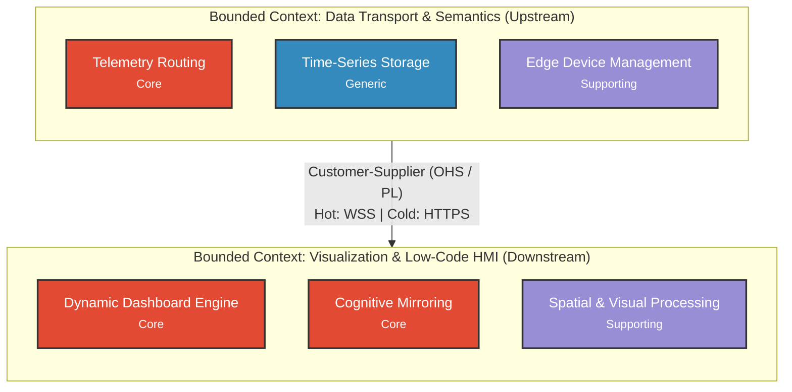

# Architectural Context Map Specification

## 1. Visual Context Map Diagram

## 2. Bounded Context Registry

### Context: Data Transport & Semantics (Sub-RQ 1)
*   **Strategic Purpose**: Manages the ingestion, standardization, event-driven distribution, and archival of industrial telemetry across the physical-to-digital boundary.
*   **Encompassed Subdomains**:
    *   **Telemetry Routing**: Core. High complexity handling high-frequency asynchronous events, ensuring the Unified Namespace (UNS) operates as a Single Source of Truth (SSOT).
    *   **Time-Series Storage**: Generic. Standardized storage of metrics using off-the-shelf Relational Historians (PostgreSQL/TimescaleDB).
    *   **Edge Device Management**: Supporting. State synchronization and lifecycle tracking via Device Twins (Desired/Reported properties) and EoN node certificates.
*   **Team Ownership**: Backend & Infrastructure Engineering
*   **Ubiquitous Language Scope**: Unified Namespace (UNS), Sparkplug B, MQTT Protocol, Device Twins, Edge of Network Node (EoN), Relational Historian, RTT.

### Context: Visualization & Low-Code HMI (Sub-RQ 2)
*   **Strategic Purpose**: Provides real-time, low-latency dynamic graphical interfaces and AI-symbiotic decision support to operators without requiring continuous manual recoding or monolithic desktop runtimes.
*   **Encompassed Subdomains**:
    *   **Dynamic Dashboard Engine**: Core. Generates and renders SVG/Canvas-based Custom Widget Templates, WYSIWYG composition, and ISA-101 high-performance displays.
    *   **Cognitive Mirroring**: Core. Symbiotic multi-agent interaction (ALARMS) that surfaces uncertainty and restates situations to prevent operator deskilling and automation bias.
    *   **Spatial & Visual Processing**: Supporting. Handles rendering geometry, protocol-coupling map symbols, and declarative IF-THEN visual mapping logic.
*   **Team Ownership**: Frontend & UI/UX Engineering
*   **Ubiquitous Language Scope**: Custom Widget Template, Conventional Graphical Symbols (CGS), Mnemonic Diagram, Information Presentation Speed, ALARMS, Locutor Agent, Local/Remote HMI.

## 3. Integration & Relationship Matrix

| Source Context (Upstream) | Target Context (Downstream) | Relationship Pattern | Contract / Published Language (PL) | Communication Protocol |
| :--- | :--- | :--- | :--- | :--- |
| Data Transport & Semantics [U] | Visualization & Low-Code HMI [D] | Customer-Supplier via Open-Host Service (OHS) | **Hot Path:** Sparkplug B Payload / Standard JSON Telemetry Events | Asynchronous (WebSocket Secure - WSS) |
| Data Transport & Semantics [U] | Visualization & Low-Code HMI [D] | Customer-Supplier via Open-Host Service (OHS) | **Cold Path:** RESTful Query Contract (JSON Time-Series Schema) | Synchronous (HTTPS / REST) |

## 4. Cross-Context Boundary Invariants

*   **Data Ownership Preservation Invariant ([[Koltsova_et_al_2026|Koltsova et al., 2026]])**: The unified data exchange subsystem and visualization interfaces provide delivery, presentation, and access interfaces but are strictly prohibited from assuming data ownership. The generating physical component or edge node remains the sole authoritative source of truth.
*   **RESTful Client Isolation Pattern ([[Villamar_et_al_2025|Villamar et al., 2025]])**: Remote HMI clients are restricted from accessing PLC fieldbus registers directly. They must query data exclusively through Node.js REST APIs or WebSocket proxies to decouple field controllers from external client load and preserve operational security boundaries.
*   **Dynamic Presentation Velocity Invariant ([[Tong_et_al_2026|Tong et al., 2026]])**: Dynamic visual element translation speeds across the HMI must be constrained to **4–12°/s visual angle** (and strictly below 16°/s) to prevent operator decision-making error, attentional demand saturation, and visual fatigue under ISA-101.
*   **Latency & Performance Bounds**: 
    *   **Hot Path (Direct WebSocket / In-Memory Broker)**: Sub-25 ms to 50 ms latency bounds for critical event-driven monitoring and command execution ([[Grigat_et_al_2026|Grigat et al., 2026]]; [[Bellini_et_al_2022|Bellini et al., 2022]]).
    *   **Cold Path (REST/Relational Web SCADA)**: 156 ms to 300 ms latency bounds for historical telemetry querying and batch visualization ([[Villamar_et_al_2025|Villamar et al., 2025]]).
